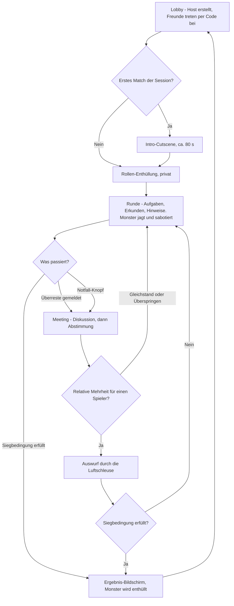
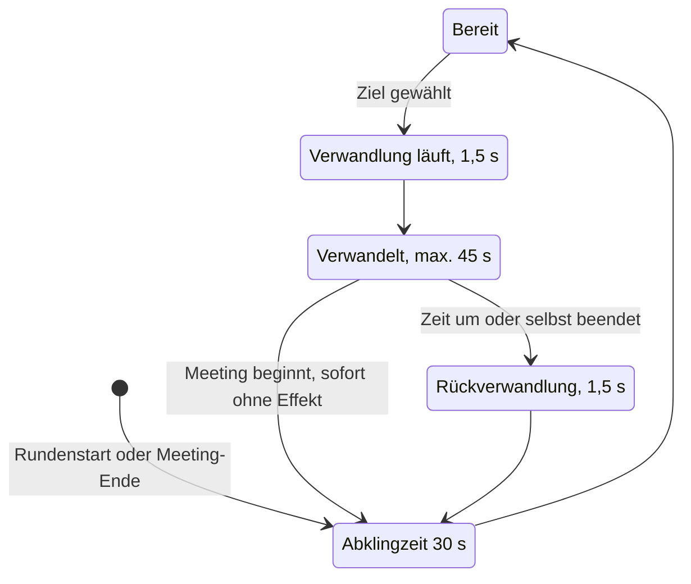
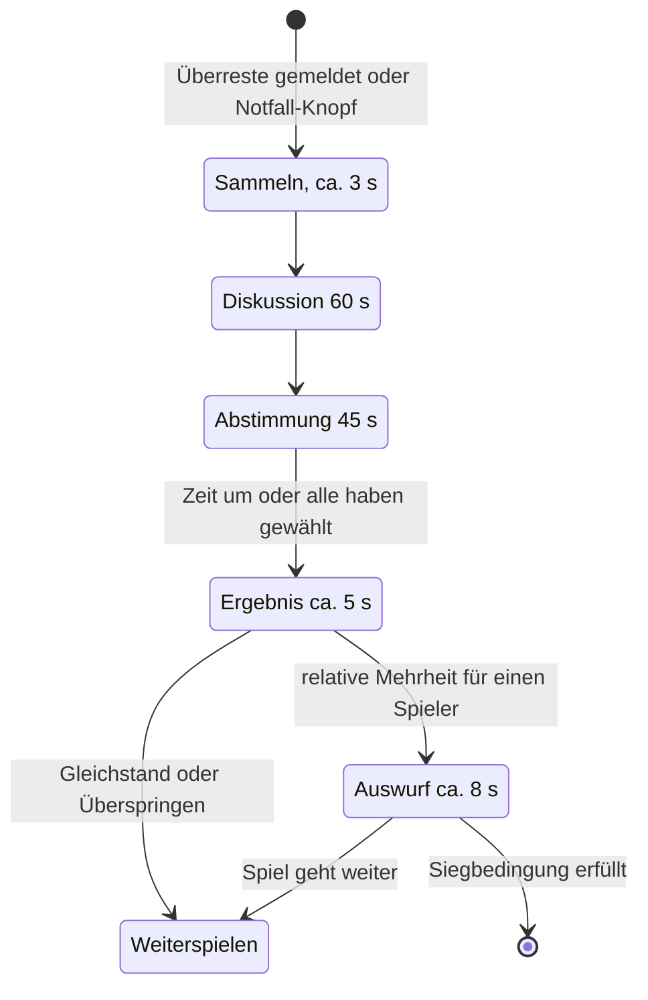

# 01 – Game Design Document

Stand: November 2026 · Teil der Planung für *How Could It Be You*

**Worum geht's:** Dieses Dokument beschreibt, *was* gespielt wird: Story, Rollen, Aufgaben, Hinweise, Sabotage, Meetings, Spielmodi, Horror-Regeln und die drei Maps, jeweils mit konkreten Startwerten. *Wie* das technisch gebaut wird, steht in [02 – Technische Architektur](02-technische-architektur-ue5.md). Maße, Checks und Testpläne stehen in [04 – Qualität & Tests](04-qualitaet-und-tests.md). Alle Zahlen sind Startwerte für den ersten Playtest (= Testrunde mit echten Mitspielern). Sie stehen später in einer Text-Config (= Einstellungsdatei, hier `Game/Config/DefaultGame.ini`), damit Claude sie schnell anpassen kann. Die Markierungen **🤖 Claude (Code)** und **🧑 Du (Editor/Test)** zeigen, wer was macht.

**Inhalt**
0. [Auf einen Blick](#auf-einen-blick)
1. [Pitch und Vision](#1-pitch-und-vision)
2. [Story und Setting](#2-story-und-setting)
3. [Kern-Loop und Rundenablauf](#3-kern-loop-und-rundenablauf)
4. [Rollen](#4-rollen)
5. [Aufgaben](#5-aufgaben)
6. [Hinweis-Systeme](#6-hinweis-systeme)
7. [Sabotage](#7-sabotage)
8. [Meetings und Abstimmung](#8-meetings-und-abstimmung)
9. [Siegbedingungen und Spielmodi](#9-siegbedingungen-und-spielmodi)
10. [Horror-Design](#10-horror-design)
11. [Maps](#11-maps)
12. [Lobby-Einstellungen](#12-lobby-einstellungen)
13. [HUD und Bedienung](#13-hud-und-bedienung)
14. [Balancing-Startwerte und Playtest](#14-balancing-startwerte-und-playtest)

---

## Auf einen Blick

Das kompakte GDD auf einer Seite. Alles Weitere sind Details zu genau diesen Punkten.

| Punkt | Kurzfassung | Details |
|---|---|---|
| **Spiel** | First-Person-Horror im Genre Social Deduction für 4–8 Spieler, inspiriert von Among Us, aber realistisch und dunkel. Eine Runde dauert 10–15 min | §1 |
| **Story** | Eine Forscher-Crew der Hesperus-Initiative untersucht auf der Station Kepler-7 eine Probe vom Jupitermond Europa. Im Intro bricht der Organismus aus, kopiert einen Forscher, frisst den Kommandanten, die Crew flieht. „Es ist einer von euch.“ | §2 |
| **Kern-Loop** | Lobby → Intro (nur 1. Match) → private Rollen-Enthüllung → Runde (Aufgaben, Hinweise sammeln, Monster tötet und sabotiert) → Überreste melden oder Notfall-Knopf → Meeting (Diskussion, Abstimmung) → Auswurf oder weiter → Ergebnis → Lobby | §3 |
| **Rollen** | **Crew:** Aufgaben, Hinweise, Reparaturen, Abstimmung. **Der Wandler** (genau 1, zufällig): sieht aus wie ein Forscher, tötet, verwandelt sich in jeden lebenden Mitspieler (nur die Stimme bleibt echt), sabotiert Licht und Türen, hat Fake-Aufgaben. **Geister:** Tote erledigen Geister-Aufgaben und sprechen nur untereinander | §4–§8 |
| **Spielmodi** | **Infiltration** (Start-Modus, klassisch, ohne Timer) und **Evakuierung** (2. Modus, Überleben bis zum Rettungsschiff, 12 min). Später: Quarantäne/Blackout, Hardcore | §9 |
| **Siegbedingungen** | **Crew:** in Infiltration alle Aufgaben erledigt oder Wandler ausgeworfen, in Evakuierung Timer überlebt (≥ 2 Crew) oder Wandler ausgeworfen. **Wandler:** lebende Monster ≥ lebende Crew, in allen Modi | §9 |
| **Horror** | Dunkelheit und Taschenlampen-Akku, Stromausfälle mit rotem Notlicht, Geräusche als echte Information, Proximity-Voice, Misstrauen durch Formwandel. Cinematischer Jumpscare nur für das Opfer. Nichts verrät die Rolle nebenbei | §10 |
| **Maps** | **Kepler-7** (Ring-Station im Orbit, Prototyp-Map), **Europa-Bohrstation** (3 Ebenen unter dem Eis), **Ikarus** (Frachter, später). Jede mit Grundriss, Aufgaben-Orten, Verstecken, Sabotage-Punkten und Kameras | §11 |
| **Start-Empfehlung** | Prototyp mit Kepler-7 und Infiltration, danach Evakuierung und Europa ([06](06-roadmap.md)) | §9 |

---

## 1. Pitch und Vision

*How Could It Be You* ist ein First-Person-Horrorspiel im Genre **Social Deduction** (= Spiele, in denen man im Gespräch herausfinden muss, wer lügt) für 4–8 Spieler. Eine Forscher-Crew sitzt auf einer dunklen Raumstation fest, und einer von ihnen ist **der Wandler**: ein Organismus, der jede lebende Person perfekt kopieren kann, nur nicht ihre Stimme. Die Crew repariert die Station, sammelt Hinweise aus Kameras, Türprotokollen und Spuren und stimmt in Meetings ab, wen sie durch die Luftschleuse wirft. Der Wandler tötet, sabotiert das Licht und schlüpft in fremde Gestalten. Das Spiel lebt von dem Moment, in dem man im roten Notlicht einen Kollegen sieht und nicht sicher ist, ob er es wirklich ist.

### Design-Säulen

| Säule | Was das heißt | Konsequenz im Design |
|---|---|---|
| **Misstrauen statt Muskeln** | Die Crew kämpft nicht. Ihre Waffen sind Beobachtung, Gespräch und Abstimmung. | Keine Waffen, kein Kampfsystem. Jede Monster-Fähigkeit hinterlässt einen Hinweis. |
| **Atmosphäre durch Licht & Klang** | Dunkelheit, Notbeleuchtung, Geräusche und Stille erzeugen die Angst, nicht Splatter. | Licht ist eine Spielmechanik (Akku, Stromausfall). Sound trägt echte Informationen (Schritte, Verwandlungsgeräusch). |
| **Fair & lesbar** | Nichts blockiert den Weg, und kein Effekt verrät heimlich die Rolle. | Harte Level-Regeln (siehe [04](04-qualitaet-und-tests.md)), Regel „keine Informations-Lecks“ (Abschnitt 10), alle Sabotagen werden für alle angesagt. |
| **Kurz & intensiv** | Eine Runde dauert 10–15 Minuten, danach sofort die nächste. | Wenige, klare Regeln pro Modus. Intro nur beim ersten Match. Schneller Weg zurück in die Lobby. |

### Eckdaten

| Punkt | Festlegung |
|---|---|
| Plattform | Windows-PC, Maus + Tastatur, Headset empfohlen |
| Engine | Unreal Engine 5.8 (UE = Unreal Engine) |
| Spielerzahl | 4–8, empfohlen 6–8. Genau **1 Monster** (2 Monster bei 7–8 Spielern → Offene Frage Q-A4, siehe [07](07-offene-fragen.md), Default: immer 1) |
| Rundendauer | Infiltration 10–15 min. Evakuierung 12 min Timer (plus Meetings) |
| Zielgruppe | Freundesgruppen und Discord-Communities, die Among Us oder Koop-Horror kennen. Altersempfehlung ab 16 (Schreckmomente, angedeutete Gewalt) |
| Netzwerk | Listen-Server (= ein Spieler ist gleichzeitig Host/Server), Lobbys und Verbindung über Epic Online Services. Details: [03 – Multiplayer & Backend](03-multiplayer-und-backend.md) |
| Sprache im Spiel | Proximity-Voice (= Sprachchat, bei dem du nur Spieler in deiner Nähe hörst) während der Runde, alle hören alle im Meeting. Geister sprechen nur untereinander, Lebende hören sie nie (Geister hören Lebende in der Nähe und im Meeting mit, Abschnitt 4.3) |
| Vertrieb | Nur über den eigenen Launcher, siehe [05 – Launcher & Updates](05-launcher-und-updates.md) |

---

## 2. Story und Setting

### Mission und Station

Im Jahr 2148 schickt die Forschungsagentur **Hesperus-Initiative** eine kleine Crew auf die Orbital-Forschungsstation **Kepler-7**. Dort soll eine Probe analysiert werden, die auf der **Europa-Bohrstation** unter dem Eis des Jupitermonds gefunden und mit dem Frachter **Ikarus** gebracht wurde. Die drei Maps erzählen so dieselbe Geschichte: Fundort (Europa), Transport (Ikarus), Labor (Kepler-7).

### Der Organismus – „Der Wandler“

- Eine zellartige Lebensform, die Biomasse aufnimmt und dabei Haut, Kleidung und Ausweis ihres Opfers äußerlich nachbildet.
- **Sie kann jede Gestalt kopieren, aber nur eine Stimme sprechen: die ihres ersten Wirts.** Das erklärt in der Spielwelt, warum der Monster-Spieler immer mit seiner echten Stimme spricht.
- Beim Meeting-Alarm (Notfall-Knopf oder gemeldete Überreste) flutet die Station die Gänge mit Dekontaminations-Licht. Das zwingt den Wandler zurück in die Gestalt seines ersten Wirts, also in die eigene Forscher-Identität des Monster-Spielers. In der Spielwelt erklärt das, warum jede Verwandlung beim Meeting endet.
- Seine wahre Gestalt sieht man nur in der Intro-Cutscene und in Jumpscares (= Schreckmomente beim eigenen Tod). Im Spiel sieht der Wandler immer wie ein Forscher aus.

### Intro-Cutscene (Beat-Sheet)

Die Intro-Cutscene ist eine **Level Sequence** (= ein Film, gebaut im **Sequencer**, dem Film-Werkzeug von Unreal), ca. 80 s lang, Schauplatz Kepler-7.

**Warum NPC-Crew statt echter Spieler:** Die Cutscene zeigt vier feste NPCs (= computergesteuerte Figuren) in neutral grauen Anzügen ohne Spieler-Farben oder -Symbole. Würden die echten Spielerfiguren auftreten, könnte schon die Auswahl (wer wird kopiert, wer gefressen, wer steht im Bild) etwas über den echten Monster-Spieler verraten. Sie könnte auch falschen Verdacht säen („In der Cutscene war Blau das Monster!“). Außerdem bleibt die Sequenz so unabhängig von der Spielerzahl (4–8) und muss nur einmal gebaut werden.

NPCs: Kommandant **Viktor Hale** (wird gefressen), Biologin **Dr. Mara Lindqvist**, Ingenieur **Jonas Brandt** (wird kopiert), Technikerin **Aiko Sato**.

| Nr. | Dauer | Kamera | Handlung | Ton |
|---|---|---|---|---|
| 1 | 6 s | Totale außen, langsamer Flug auf die Station | Kepler-7 im Orbit, Positionslichter blinken | Tiefes Brummen, Funkspruch „Kepler-7, Tag 41. Probe stabil.“ |
| 2 | 8 s | Schwenk in Schulterhöhe durchs Bio-Labor | Die vier NPCs arbeiten, die Probe pulsiert in einem Glaszylinder | Lüftung, Piepen, gedämpfte Gespräche |
| 3 | 6 s | Nahaufnahme Zylinder | Ein Riss läuft durchs Glas | Glas knackt, danach Stille |
| 4 | 5 s | Halbtotale von der Decke | Licht flackert, Stromausfall, rote Notbeleuchtung (zeigt den Look der Sabotage) | Strom bricht weg, Alarmton |
| 5 | 7 s | Handkamera, nur Taschenlampenkegel | Der Zylinder birst, die wahre Gestalt entfaltet sich, nie ganz scharf zu sehen | Stinger (= kurzer, lauter Schreck-Ton), nasses Knacken |
| 6 | 8 s | Halbnah auf Brandt, dann Gegenschuss | Das Wesen fixiert Brandt und verwandelt sich: Plötzlich stehen **zwei Brandts** da. Am Boden bleibt Schleim zurück. | **Exakt das Verwandlungsgeräusch aus dem Spiel**, damit alle es lernen |
| 7 | 4 s | Zwei-Personen-Einstellung | Hale hebt die Taschenlampe: „Keine Bewegung. Beide.“ | Atmen, Stille |
| 8 | 7 s | Schatten an der Wand | Einer der Brandts springt Hale an. Schnitt weg, die Taschenlampe rollt über den Boden. | Schrei, abrupt abgeschnitten |
| 9 | 4 s | Bodenhöhe im Lichtkegel | Blutlache und ID-Marke „HALE“ (zeigt, wie Überreste aussehen) | Tropfen |
| 10 | 10 s | Handkamera, Flucht | Die Crew rennt durch rote Gänge, ein Schott knallt hinter ihnen zu. Im Chaos verliert die Kamera einen der beiden Brandts aus dem Bild | Schritte, Keuchen, Alarm, Schott-Knall, dann Stille |
| 11 | 8 s | Langsame Fahrt über Gesichter | Kommandozentrale: Lindqvist, Sato und *ein* Brandt keuchen. Welcher Brandt? Die Kamera bleibt kurz auf ihm hängen. | Lüftung, Herzschlag verklingt |
| 12 | 5 s | Schwarzbild | Text: **„Es ist einer von euch.“** | Tiefer Bass-Impuls |
| 13 | 2 s | Abblende | Übergang zur Rollen-Enthüllung | Stille |

**Übergang ins Match:** Nach dem Schwarzbild folgt die private Rollen-Enthüllung (Abschnitt 13). Danach stehen alle Spieler an ihren Startpunkten in der Kommandozentrale, also dort, wo die Cutscene endet. Ab dem zweiten Match einer Session (= ein Spielabend in derselben Lobby) wird die Cutscene automatisch übersprungen. Davor kann die Lobby sie per Mehrheit überspringen. Für Europa und Ikarus reicht in v1 eine kurze Kamerafahrt mit Text, später eigene Intros (→ Offene Frage Q-B4, siehe [07](07-offene-fragen.md)).

- **🧑 Du (Editor/Test):** Du baust die Level Sequence nach diesem Beat-Sheet im Sequencer: Kameras, NPC-Animationen, Licht und Ton-Spuren. Die NPCs sind normale Skeletal Meshes (= animierbare 3D-Figuren) in grauen Anzügen. Die Klick-für-Klick-Anleitung (Sequence anlegen, Kamera-Spur, Animationen, Ton) steht in [02](02-technische-architektur-ue5.md), Abschnitt „Schritt für Schritt im Sequencer“.
- **🤖 Claude (Code):** Claude schreibt die Intro-Phase, den synchronen Start, das Überspringen per Abstimmung, den Failsafe (= Notfall-Timer, falls etwas hängt) und die Untertitel-Einblendung. Wie die Sequenz abgespielt wird, steht in [02](02-technische-architektur-ue5.md).

---

## 3. Kern-Loop und Rundenablauf



| Phase | Typische Dauer | Was passiert |
|---|---|---|
| Lobby | beliebig | Der Host erstellt die Lobby, Freunde treten mit einem Join-Code (6 Zeichen) bei, der Host stellt Modus, Map und Werte ein |
| Intro | ca. 80 s, nur beim 1. Match | Cutscene, per Mehrheit überspringbar |
| Rollen-Enthüllung | 5 s | Jeder sieht nur seine eigene Rolle, für alle gleich lang |
| Erste Spielphase | 2–4 min | Start in der Kommandozentrale. Erster Kill frühestens nach 20 s, erste Sabotage frühestens nach 30 s |
| Meeting | ca. 2 min | 3 s Sammeln + 60 s Diskussion + 45 s Abstimmung + 5 s Ergebnis + ggf. 8 s Auswurf |
| Weitere Spielphasen | je 1,5–3 min | Typisch sind 2–4 Meetings pro Match |
| Ergebnis | 15–20 s | Sieger, Identität des Monsters, kurze Statistik, dann zurück in die Lobby |

Technisch heißen diese Phasen `Lobby, Intro, RoleReveal, Playing, Meeting, Ejection, GameOver` (Enum `EHCMatchPhase` = feste Liste von Zuständen im Code, siehe [02](02-technische-architektur-ue5.md)).

**Spieler verlassen das Spiel:** Ein Crew-Spieler, der geht, zählt als tot (ohne Überreste). Geht das Monster, gewinnt die Crew. Ein Verbindungsabbruch wird für alle gleich angesagt („Tom hat die Verbindung verloren“), egal ob Tom noch lebte oder schon Geist war. So verrät die Meldung keinen heimlichen Kill. Geht der Host, endet die Runde für alle mit einer Meldung, weil Unreal keine Host-Übergabe kann (Details in [03](03-multiplayer-und-backend.md)).

---

## 4. Rollen

Alle Spieler haben eine eigene Forscher-Identität: Spielername, Anzug-Farbe und Symbol (Abschnitt 13). Crew und Monster haben **identische** Kollision, Laufwerte, Schritte, Animationen und Ausrüstung. Die Werte sind: Kapsel (= unsichtbarer Kollisionskörper) Radius 40 cm, Höhe 180 cm, Gehen 300 cm/s, Sprinten 500 cm/s mit Ausdauer, kein Ducken in v1.

### 4.1 Crew (Forscher)

| Fähigkeit | Reichweite | Abklingzeit / Dauer | Einschränkungen |
|---|---|---|---|
| Aufgabe erledigen | 180 cm (Blick auf Station) | je Aufgabe 3–20 s (Abschnitt 5) | Jederzeit abbrechbar, sperrt nie die Bewegung |
| Überreste melden | 250 cm | – | Startet sofort ein Meeting, auch im Dunkeln |
| Notfall-Knopf | 180 cm, nur in der Kommandozentrale | 1× pro Spieler und Match, nach jedem Meeting 20 s für alle gesperrt | Gesperrt während kritischer Sabotage (später) |
| Reparieren | 180 cm am Sicherungskasten/Türpanel | 3–4 s | Ein Spieler reicht (Ausnahme später: Reaktor) |
| Taschenlampe | Lichtkegel ca. 15 m | Akku 120 s, lädt ausgeschaltet in 90 s voll, an Ladestationen in 10 s | Das Helmlicht (schwach, ca. 3 m, immer an) sorgt dafür, dass niemand ganz blind ist |
| Sprinten | – | 6 s Ausdauer, volle Erholung in 10 s | Lauter als Gehen (Schritte ca. 20 m statt 12 m hörbar) |
| Verstecken im Spind | 180 cm | max. 20 s drin, danach 30 s Sperre für diesen Spieler | Ein- und Aussteigen knarrt hörbar (ca. 10 m). Wer einen besetzten Spind öffnet, deckt den Versteckten auf. Nach Ablauf steigst du automatisch auf einem geprüften Ausstiegspunkt aus |
| Kameras / Türprotokoll ansehen | im Sicherheitsraum | beliebig lang | Siehe Abschnitt 6 |
| Abstimmen | Meeting | 45 s | 1 Stimme oder „Überspringen“ |

**Ausrüstung** (für alle gleich, auch für das Monster): Taschenlampe mit Akku, Helmlicht und Funkgerät. Über den Funk sprechen im Meeting automatisch alle miteinander. Während der Runde gibt es keinen globalen Funk, nur Proximity-Voice.

### 4.2 Monster – „Der Wandler“ (intern: Mimic)

| Fähigkeit | Reichweite | Abklingzeit / Dauer | Einschränkungen |
|---|---|---|---|
| **Formwandel** | beliebige Entfernung | Dauer 45 s, Abklingzeit 30 s, Verwandlung dauert 1,5 s | Nur in **lebende** Mitspieler. Verwandlungsgeräusch 3D ca. 8 m, kurzer sichtbarer Effekt, Schleimspur 60 s |
| **Töten / Fressen** | ≤ 200 cm, freie Sichtlinie (= nichts dazwischen) | Abklingzeit 30 s, erster Kill frühestens 20 s nach Rundenstart | Weder Monster noch Opfer dürfen in der Kommandozentrale (Meeting-Raum) stehen. Nicht während Meetings, nicht während einer Verwandlung, nicht aus dem Spind heraus. Opfer und Monster sind ca. 2,5 s gesperrt. Ohne gültiges Ziel passiert beim Drücken nichts Sichtbares oder Hörbares |
| **Sabotage: Stromausfall** | über den Stationsplan, von überall | Abklingzeit 45 s ab Ende des Ausfalls | Ein Sektor gleichzeitig, nie die Kommandozentrale (Abschnitt 7) |
| **Sabotage: Tür verriegeln** | über den Stationsplan, von überall | Tür max. 10 s zu, Abklingzeit 30 s | Nie den letzten Weg, nie den Meeting-Raum (Abschnitt 7) |
| **Fake-Aufgaben** | wie Crew | wie Crew | Laufen sichtbar gleich ab, zählen aber nicht (Abschnitt 5) |
| Alle Crew-Aktionen: Melden, Notfall-Knopf, Reparieren, Spind, Kameras/Protokoll, Taschenlampe, Sprinten, Abstimmen | wie Crew | wie Crew | Sonst wäre jede dieser Handlungen ein Crew-Beweis. Das Monster darf selbst Überreste melden („Self-Report“). Im Spind ist kein Formwandel möglich (Spinde für alle Lebenden → Offene Frage Q-A10, siehe [07](07-offene-fragen.md), Default: ja) |
| Wartungsschächte | – | – | Nicht in v1. Später nur für das Monster, mit hörbarem Geräusch. Platz ist in den Maps reserviert (→ Offene Frage Q-A11, siehe [07](07-offene-fragen.md), Default: nicht in v1, frühestens nach dem Release) |

Beim Töten spielt das Monster eine kurze Attacke in seiner **aktuellen Gestalt** ab. Zeugen in der Nähe sehen sie und hören einen 3D-Schrei (ca. 20 m, durch Wände gedämpft). Das Opfer wird „gefressen“. Zurück bleiben **Überreste**: eine Blutlache (Decal, = aufgeklebtes Bild auf dem Boden) plus die ID-Marke des Opfers. Überreste haben **keine Kollision** und blockieren nie einen Weg. Es gibt bewusst keine liegenden Körper, also auch keine Physik-Probleme.

Töten in fremder Gestalt ist erlaubt: Zeugen sehen dann „Lena“ töten, obwohl Lena woanders ist. → Offene Frage Q-A16, siehe [07](07-offene-fragen.md). Default: erlaubt, weil es die Kernfrage „Warst du das wirklich?“ verstärkt und das Türprotokoll Lena entlasten kann.

#### Formwandel-Regeln

1. **Ziel:** Das Monster hält Q gedrückt. Ein Radialmenü (= kreisförmige Auswahl in der Bildmitte, du wählst per Mausbewegung) zeigt alle **lebenden** Mitspieler mit Name, Farbe und Symbol. Loslassen wählt aus. Tote, Geister und Ausgeworfene stehen nicht zur Wahl.
2. **Kopiert wird:** Anzug-Farbe und Markierung, Namensschild und Körper. Auch die Türscanner lesen die kopierte Identität (Abschnitt 6).
3. **Nicht kopiert wird:** die **Stimme**. Sie bleibt immer die echte Stimme des Monster-Spielers. Das ist bewusst ein Hinweis für die Crew. Es gibt keine Sprecher-Anzeige mit Namen. Ob ein Funk-Filter Stimmen teilweise maskieren soll, ist offen (→ Offene Frage Q-A2, siehe [07](07-offene-fragen.md), Default: kein Maskieren. In der Runde hörst du die natürliche Stimme, im Meeting liegt nur ein leichter Funk-Filter als Stilmittel darüber. Laut Recherche verdeckt ein reiner Funk-Filter die Klangfarbe einer Stimme ohnehin nicht).
4. **Ablauf:** Die Verwandlung dauert 1,5 s. Das Monster bleibt dabei stehen und kann sich nur umsehen. Ein ekliges, nasses Knack-Geräusch ist in 3D ca. 8 m weit hörbar, dazu kommt ein kurzer Haut- und Partikel-Effekt. Am Ort bleibt 60 s lang eine Schleimspur (Decal).
5. **Ende:** Nach 45 s verwandelt sich das Monster automatisch zurück, oder vorher per kurzem Tipp auf Q. Die Rückverwandlung läuft genauso ab (1,5 s, Geräusch, Spur). **Beim Meeting-Start endet jede Verwandlung sofort und ohne Effekt.** Im Meeting erscheinen alle als sie selbst. Stirbt die kopierte Person, während das Monster sie darstellt, bleibt die Verkleidung bis zum Ende der Dauer. Ein „Toter, der herumläuft“ ist ein starker Hinweis (→ Offene Frage Q-A3, siehe [07](07-offene-fragen.md), Default: Verkleidung bleibt). Stirbt das Ziel während der 1,5-s-Verwandlung, bricht sie ohne Abklingzeit ab.
6. **Abklingzeit:** 30 s ab Ende der Verwandlung. Bei Rundenstart und nach jedem Meeting startet sie neu.
7. **„Jederzeit verwandeln“:** Deine Vorgabe setzen wir als „jederzeit, sobald die Abklingzeit vorbei ist“ um. Mit Dauer = 0 und Abklingzeit = 0 in der Lobby bekommst du genau dein Original-Verhalten (unbegrenzt). → Offene Frage Q-A1, siehe [07](07-offene-fragen.md), Default: 45 s Dauer / 30 s Abklingzeit.



Beginnt ein Meeting, springt jeder Zustand ohne Effekt auf „Abklingzeit“, und die Abklingzeit startet nach dem Meeting neu bei vollen 30 s.

### 4.3 Geister

| Eigenschaft | Regel |
|---|---|
| Wer / Sichtbarkeit | Getötete und Ausgeworfene. Für Lebende unsichtbar und unhörbar |
| Bewegung | Freies Fliegen (450 cm/s), durch Wände möglich, aber nur innerhalb der Map-Grenzen |
| Sprache | Sprechen nur mit Geistern. Hören Lebende in der Nähe und im Meeting (Default, Technik in [03](03-multiplayer-und-backend.md)) |
| Geister-Aufgaben | Erledigen ihre restlichen eigenen Aufgaben. Sie zählen zum Aufgabenfortschritt (→ Offene Frage Q-A8, siehe [07](07-offene-fragen.md), Default: ja) |
| Darf nicht | Melden, Knopf drücken, abstimmen, Türen/Spinde/Licht benutzen. Die Station reagiert bei Geister-Aufgaben **nicht sichtbar oder hörbar** für Lebende, damit Geister nichts verraten können |
| Rollen sehen | Geister sehen, wer der Wandler ist (rote Markierung mit eigenem Symbol, nur für Geister). Die Information schickt der Server erst nach dem Tod und nur an den neuen Geist, lebende Spieler bekommen sie nie (Technik in [02](02-technische-architektur-ue5.md)). Absprachen über Discord kann das Spiel nicht verhindern, hier gilt Ehrensache |

### 4.4 Steuerung (Standardbelegung)

| Aktion | Taste | Wer |
|---|---|---|
| Bewegen / Umsehen | W A S D / Maus | alle |
| Sprinten | Shift halten | Lebende |
| Interagieren: Aufgabe, Melden, Reparieren, Spind, Knopf | E (bei Halten-Aufgaben gedrückt halten) | Lebende (Geister nur Geister-Aufgaben) |
| Taschenlampe an/aus | F | Lebende |
| Aufgabenliste ein-/ausklappen | Tab | alle |
| Stationsplan | M | alle (Monster: dort auch Sabotage) |
| Am Kamera-Monitor: Kamera wechseln / Monitor verlassen | A und D (wie Bewegen) / E oder Esc | Lebende im Sicherheitsraum |
| Push-to-Talk (optional, Standard ist Sprachaktivierung) | V | alle |
| Töten | Linke Maustaste (Ziel im Fadenkreuz, ≤ 2 m) | Monster |
| Formwandel wählen / beenden | Q halten / Q tippen | Monster |
| Geist hoch / runter | Leertaste / Strg | Geister |
| Abstimmen | Maus: Porträt anklicken, Bestätigen | Lebende im Meeting |
| Für „Intro überspringen“ stimmen | Leertaste halten | alle |
| Menü, Einstellungen, „Feststecken? Befreien“ | Esc | alle |

Alle Tasten sollen später frei belegbar sein. „Befreien“ setzt dich auf den letzten gültigen Laufpunkt zurück, mit Abklingzeit und Log-Eintrag (Details in [04](04-qualitaet-und-tests.md)).

---

## 5. Aufgaben

Es gibt vier Aufgaben-Typen. **Halten** = E gedrückt halten. **Abfolge** = Tasten oder Punkte in vorgegebener Reihenfolge drücken. **Minispiel** = kleines Geschicklichkeits-Rätsel als Overlay (= halbtransparentes Fenster über dem Spielbild). **Mehrstufig** = mehrere Schritte an verschiedenen Orten.

| # | Aufgabe | Raum Kepler-7 / Europa | Typ | Dauer | Kategorie | Besonderheit |
|---|---|---|---|---|---|---|
| 1 | Ausweis registrieren | Sicherheit / Funk & Überwachung | Halten | 3 s | Gemeinsam | Schreibt einen Eintrag ins Türprotokoll (aktuelle Gestalt) |
| 2 | Bio-Scan | Medbay / Medstation | Halten (auf Plattform stehen) | 10 s | Kurz | **Sichtbar, aber kein Beweis:** Lichtring und Ton sehen bei allen gleich aus. Beim Monster zählt der Scan nicht (Abschnitt 6) |
| 3 | Kühlmittel-Ventile | Reaktor / Pumpenraum | Minispiel (3 Drehregler) | ca. 8 s | Kurz | Lauter Raum, übertönt Schritte |
| 4 | Kern kalibrieren | Reaktor / Generatorraum | Halten | 12 s | Lang | Evakuierung: Der nächste periodische Stromausfall fällt aus (Sabotage des Monsters bleibt möglich) |
| 5 | Probe analysieren | Lager → Bio-Labor → Medbay / Probenkammern → Kryo-Labor → Medstation | Mehrstufig | 2 s + 20 s Wartezeit + 3 s | Lang | Während der Zentrifuge darfst du weggehen |
| 6 | Antenne ausrichten | Kommunikation / Funk & Überwachung | Minispiel (Signalkurven) | ca. 6 s | Kurz | – |
| 7 | Funkdaten übertragen | Kommunikation → Hangar / Funk & Überwachung → Bohrsteuerung | Mehrstufig | 8 s + 8 s | Lang | Evakuierung: verkürzt den Timer um 60 s |
| 8 | Kamera justieren | Wandnische im Gang an K1 oder K3 / Nische in der Galerie an K2 | Abfolge (4 Tasten) | ca. 5 s | Kurz | Die Kamera ist während der Aufgabe kurz aus, auch bei der Fake-Aufgabe des Monsters (sonst wäre das Bild ein Beweis) |
| 9 | Fracht scannen | Lager / Ausrüstung | Abfolge (3 Kisten an der Wand) | 3 × 2 s | Kurz | Kisten stehen an der Wand, nie im Weg |
| 10 | Shuttle betanken / Bohrkopf kühlen | Lager → Hangar / Bohrsteuerung → Wartungsebene (Bohrkopf) | Mehrstufig | 5 s + 8 s | Lang | **Sichtbar mit Beweiskraft:** Tankanzeige bzw. Dampfstoß nur bei echter Crew |
| 11 | Luftfilter wechseln | Quartiere / Wasseraufbereitung | Halten | 5 s | Kurz (auch als Gemeinsam möglich) | – |
| 12 | Proben-Kühlung prüfen | Bio-Labor / Kryo-Labor | Minispiel (Temperatur halten) | ca. 6 s | Kurz | – |

**Verteilung pro Spieler (Default):** 1 gemeinsame (alle haben dieselbe), 2 lange und 3 kurze, also 6 Aufgaben. Claude verteilt sie per Code (`FHCTaskAssigner`) nach diesen Regeln: höchstens 1 sichtbare Aufgabe (#2 oder #10) pro Spieler, die Aufgaben über mindestens 3 Bereiche der Map gestreut, und niemand bekommt nur Aufgaben in einem Raum. Grob gerechnet sind das 3–4 Minuten reine Lauf- und Arbeitszeit pro Spieler. Mit Vorsicht, Dunkelheit und Meetings ergibt das die 10–15 Minuten Rundendauer.

**Regeln, damit Aufgaben nie blockieren:**
- Bewegung oder Esc bricht jede Aufgabe sofort ab. Halten-Fortschritt geht dabei verloren, erledigte Teilschritte bleiben.
- Minispiele sind halbtransparente Overlays in der Bildmitte. Den Rand und den 3D-Ton nimmst du weiter wahr, denn ein Schreck von der Seite gehört zum Spiel.
- Vor jeder Station sind ≥ 120 cm frei, und sie ist über das NavMesh erreichbar (= unsichtbares Laufnetz, mit dem Unreal berechnet, wohin man gehen kann). Mehrere Spieler können dieselbe Station gleichzeitig benutzen. Details in [04](04-qualitaet-und-tests.md).

**Fake-Aufgaben des Monsters:** Das Monster bekommt eine Schein-Liste mit derselben Zusammensetzung (inkl. der gemeinsamen Aufgabe) im gleichen Look. An Stationen laufen dieselben Animationen, Overlays und Welt-Effekte ab (Lichtring beim Bio-Scan, Türprotokoll-Eintrag, Kamera aus), aber der Aufgabenbalken steigt nicht. Einzige Ausnahme ist #10: Beim Monster fehlen Tankanzeige bzw. Dampfstoß, es sollte diese Aufgabe also nie vor Zeugen „machen“.

**Geister-Aufgaben:** Geister erledigen ihre restlichen Aufgaben an denselben Stationen, ohne jede sichtbare oder hörbare Reaktion für Lebende. Ist „Geister-Aufgaben zählen“ in der Lobby aus, fallen die Aufgaben Toter aus der Gesamtsumme heraus, aber erst beim nächsten Meeting. Sonst würde der Balken sofort springen und einen noch unentdeckten Kill verraten. In der Evakuierung haben Geister keine Aufgaben, weil es dort keinen Balken gibt und Werkzeug-Effekte (Timer, Licht) für Lebende sichtbar wären.

- **🤖 Claude (Code):** Claude schreibt die vier Aufgaben-Typen als Varianten von `AHCTaskStation`, die Verteilung und den Fortschritt.
- **🧑 Du (Editor/Test):** Du legst pro Aufgabe eine BP-Kindklasse an (= Blueprint, der von Claudes C++-Klasse erbt und nur Mesh und Sound zuweist): Content Browser → Rechtsklick → *Blueprint Class* → unten *All Classes* aufklappen → `HCTaskStation` suchen → *Select* → Name `BP_TaskStation_<Name>`. Dann ziehst du sie laut Raumtabelle aus dem Content Browser in den Viewport und trägst im *Details*-Panel die *Task Id* aus Claudes Liste ein. Die genaue Anleitung steht in [02](02-technische-architektur-ue5.md) und [06](06-roadmap.md).

---

## 6. Hinweis-Systeme

Jede Monster-Aktion hinterlässt mindestens einen Hinweis, und für jeden Hinweis gibt es ein Gegenspiel. So bleibt das Spiel fair für beide Seiten.

| System | Wie die Crew es nutzt | Wie das Monster es umgehen kann |
|---|---|---|
| **Sicherheitskameras** (live im Sicherheitsraum, mit Bildrauschen, zeigen die *aktuelle* Gestalt) | Gänge beobachten: Wer war wann wo? Wer ging allein Richtung Reaktor? | Kameras hängen nur in Gängen und offenen Knotenpunkten (Atrium, Eisfenster-Galerie), nie in Aufgaben-Räumen, also in Räumen töten. Eine rote Lampe an jeder Kamera zeigt, dass gerade jemand zuschaut. Stromausfall im Sektor des Sicherheitsraums (Kepler-7: Ost) schaltet die Monitore ab. Verwandelt an Kameras vorbeigehen |
| **Türprotokoll** (Ausweis-Scanner an Schotts loggen „Name + Zeit“, Kepler-7: an den 4 Speichen-Schotts rund ums Atrium, Europa: an den Treppenhaus-Ausgängen. Das Terminal im Sicherheitsraum zeigt die letzten 3 min) | Widersprüche finden: dieselbe Person an zwei Orten gleichzeitig, oder ein Eintrag, der nicht zur Aussage passt | Mit fremder Identität nicht durch Scanner-Schotts gehen. Personen kopieren, die gerade in der Nähe sind (plausibel). Im dunklen Sektor sind die Scanner aus, das erzeugt Lücken |
| **Verwandlungsspuren** (1,5 s Geräusch 3D ca. 8 m, kurzer Effekt, Schleimspur 60 s) | Geräusch hören oder Schleim finden heißt: Hier hat sich in der letzten Minute jemand verwandelt. Abgleich mit Protokoll und Aussagen | An abgelegenen, dunklen Orten verwandeln, wo die Spur nicht innerhalb von 60 s gefunden wird. Verwandlung nicht in Hörweite anderer |
| **Bio-Scanner** (sichtbare Aufgabe in der Medbay) | Zuschauen und auf den Aufgabenbalken achten: Steigt er nach dem Scan nicht, ist das verdächtig | Scan meiden, oder scannen, wenn gleichzeitig andere Aufgaben fertig werden (Balken nicht zuzuordnen). Mit „Aufgabenbalken: nur im Meeting“ verliert der Hinweis an Kraft |
| **Stimme** (bleibt echt, kommt aus der Figur, keine Namensanzeige) | „Lena, sag mal was!“: Passt die Stimme zum Anzug? | Verwandelt schweigen oder flüstern. Laute Räume (Reaktor) nutzen. Später: Kommunikation stören (Rauschen) |
| **Überreste** (Blutlache + ID-Marke) | Wer ist tot, wo, und wer war zuletzt in der Nähe? | Abseits töten. Selbst melden, um unschuldig zu wirken |
| **Sichtbare Aufgaben** (Shuttle/Bohrkopf) | Wer die Aufgabe vor Zeugen erledigt, ist sicher Crew | Diese Aufgaben nie vor Zeugen „machen“ |
| Vitalmonitor (später) | Zeigt, wer lebt, auch bevor Überreste gefunden werden | – |

**Beispiel Türprotokoll – „Person an zwei Orten“:**

```text
TÜRPROTOKOLL · Atrium-Schotts                    Stand 06:42
06:31  Speiche W   LENA   Gelb / Quadrat
06:33  Speiche O   TOM    Blau / Kreis
06:34  Speiche N   LENA   Gelb / Quadrat
06:34  Speiche S   LENA   Gelb / Quadrat   <- zwei Schotts in derselben Sekunde: eine „Lena“ lügt
```

Die Zeiten sind Stationszeit in Minuten:Sekunden seit Rundenstart (06:34 = 6 min 34 s). Quer durchs Atrium von Speiche N nach Speiche S brauchst du mehrere Sekunden, zwei Einträge in derselben Sekunde sind also unmöglich. Das Terminal markiert Widersprüche **nicht** automatisch. Die Crew soll selbst kombinieren, aber die Liste ist klar lesbar (Zeit, Ort, Name, Farbe und Symbol).

**Bio-Scanner-Detail:** Für Zuschauer sieht der Scan bei allen gleich aus. Er liefert also keinen eindeutigen Beweis, aber beim Monster zählt er nicht zum Fortschritt. → Offene Frage Q-B11, siehe [07](07-offene-fragen.md). Default: so. Alternative: kleine Chance auf eine sichtbare „Anomalie“-Meldung.

- **🤖 Claude (Code):** Kameras mit Rauschen und Zuschau-Lampe, Türprotokoll (nur der Server schreibt Einträge), Schleimspur, Bio-Scanner-Logik und die Abschaltung im dunklen Sektor.
- **🧑 Du (Editor/Test):** Du platzierst Kameras, Türscanner, Monitore und das Protokoll-Terminal laut Raumtabelle in Abschnitt 11 (BP-Kindklassen von `AHCSecurityCamera` und `AHCDoorLogTerminal`) und prüfst im Test, ob Bild und Liste gut lesbar sind.

---

## 7. Sabotage

Das Monster sabotiert über den **Stationsplan (M)**, den auch die Crew ständig öffnet. Von außen sieht Sabotieren also nicht anders aus als Kartenlesen. Reparieren darf jeder Lebende, auch das Monster. Sonst wäre jede Reparatur ein Crew-Beweis.

| Sabotage | Wirkung | Dauer | Abklingzeit | Reparatur | Version |
|---|---|---|---|---|---|
| **Stromausfall** (ein Sektor) | Licht aus, rote Notbeleuchtung (Wege und Silhouetten bleiben erkennbar), Kameras und Türscanner im Sektor aus | bis zur Reparatur, nach max. 90 s kommt der Notstrom automatisch zurück | 45 s ab Ende | Sicherungskasten des Sektors: 3 Schalter in Reihenfolge (ca. 4 s), ein Spieler reicht | v1 |
| **Tür verriegeln** (eine markierte Tür) | Die Tür schließt und leuchtet rot | max. 10 s | 30 s | Keine nötig, öffnet von selbst. Notentriegelung am Türpanel: 3 s halten | v1 |
| Kommunikation stören | Proximity-Voice-Reichweite sinkt auf 40 %, Rauschen. Kamera- und Protokoll-Bild gestört | bis zur Reparatur | 60 s | Antenne in der Kommunikation neu ausrichten (5 s) | später |
| Reaktor-Kernschmelze (kritisch) | 45-s-Countdown für alle, Notfall-Knopf gesperrt | 45 s | 90 s | 2 Spieler halten gleichzeitig 3 s an zwei Panels im Reaktor. Sonst gewinnt das Monster | später |

**Fairness-Regeln (hart, per Code und Map-Check abgesichert):**
1. Eine Sabotage schneidet **nie den letzten Weg** ab. Nur vorab markierte Türen sind sabotierbar. Sie sind so gewählt, dass selbst bei **allen gleichzeitig** verriegelten markierten Türen jeder Raum, jeder Sicherungskasten und jede Aufgabe erreichbar bleibt (diesen Map-Check beschreibt [04](04-qualitaet-und-tests.md)). Faustregel für Kepler-7: pro Ring-Abschnitt zwischen zwei Speichen höchstens eine sabotierbare Tür, und nie die Türen an den Enden einer Speiche (Atrium, Hangar, Medbay). Zusätzlich prüft der Server vor dem Schließen, ob von jedem Raum noch ein Weg zur Kommandozentrale offen ist.
2. **Nie die Kommandozentrale:** Ihre Türen sind nicht sabotierbar, und sie hat eigenen Notstrom.
3. Türen schließen **nie auf Spielern**. Steht jemand im Türrahmen, wartet die Tür (max. 2 s). Ist der Rahmen dann noch belegt, schlägt die Sabotage fehl, und die Abklingzeit wird nicht verbraucht.
4. Pro Typ ist höchstens **eine** Sabotage gleichzeitig aktiv (1 Sektor dunkel + 1 Tür zu ist erlaubt).
5. Keine Sabotage während Intro, Rollen-Enthüllung, Meeting und Auswurf, und frühestens 30 s nach Rundenstart bzw. Meeting-Ende. Ein Meeting hebt jede Tür-Sperre sofort auf. Ein laufender Stromausfall bleibt bestehen (die Kommandozentrale hat eigenen Strom, das Meeting ist also nicht betroffen).
6. Jede Sabotage wird **für alle** angesagt (Text oben + Alarmton, z. B. „STROMAUSFALL – SEKTOR NORD“), damit sie lesbar bleibt.
7. Sicherungskästen hängen in Gängen und sind aus zwei Richtungen erreichbar, nie in Sackgassen. Sie sitzen in einer Wandnische, damit ihre Freifläche den Gang nicht verengt ([04](04-qualitaet-und-tests.md) §4).

- **🤖 Claude (Code):** Sabotage-Logik auf dem Server (`AHCPowerSector`, `AHCFuseBox`, `AHCDoor`), Weg-Prüfung vor dem Schließen, Ansagen und Abklingzeiten.
- **🧑 Du (Editor/Test):** Du platzierst Sicherungskästen und Türen, ordnest Lichter und Räume ihrem Sektor zu und markierst die sabotierbaren Türen laut Raumtabelle (Abschnitt 11). Wie das im *Details*-Panel geht, beschreibt [02](02-technische-architektur-ue5.md).

---

## 8. Meetings und Abstimmung

**Auslöser:**
- **Überreste melden:** E innerhalb von 250 cm. Das geht auch im Dunkeln und auch für das Monster.
- **Notfall-Knopf:** nur in der Kommandozentrale, 1× pro Spieler und Match. Nach jedem Meeting ist er 20 s für alle gesperrt, während kritischer Sabotage (später) ebenfalls.



**Ablauf:**
1. **Sammeln (`Gathering`):** Alarm, kurze Abblende. Alle Lebenden werden auf ihren **festen** Sitzplatz in der Kommandozentrale teleportiert. Der Platz richtet sich nach der Lobby-Reihenfolge, nicht nach dem Standort, damit die Sitzordnung nichts verrät. Alle Verwandlungen enden, alle Überreste verschwinden, Spieler in Spinden werden herausgeholt. Eingeblendet wird, wer einberufen hat und was gefunden wurde („Lena meldet: Überreste von TOM, Reaktor“). Angezeigt wird immer die echte Identität des Melders, auch wenn er gerade verwandelt war.
2. **Diskussion (`Discussion`, 60 s):** Alle Lebenden hören sich gegenseitig ohne Entfernungsdämpfung. Geister hören zu, werden aber nicht gehört.
3. **Abstimmung (`Voting`, 45 s):** Jeder Lebende wählt einen lebenden Spieler oder „Überspringen“. Die Stimmen bleiben verdeckt, sichtbar ist nur, *wer schon* gewählt hat. Wählen alle früher, endet die Phase sofort. Wer nicht abstimmt, zählt als „Überspringen“.
4. **Ergebnis (`Results`, ca. 5 s):** Die Stimmen pro Kandidat werden aufgedeckt, mit Symbolen der Wähler (Lobby-Option „Anonyme Stimmen“ Default aus).
5. **Auswurf (`Ejection`, ca. 8 s)** oder „Niemand wurde ausgeworfen“.

**Auswertung (relative Mehrheit):**

| Stimmen (Beispiel, 7 Lebende) | Ergebnis |
|---|---|
| Lena 3, Tom 2, Überspringen 2 | Lena wird ausgeworfen |
| Lena 3, Tom 3, Überspringen 1 | Gleichstand → niemand |
| Lena 2, Überspringen 3, Rest verteilt | Mehrheit Überspringen → niemand |
| Lena 3, Überspringen 3 (inkl. Nicht-Wähler), Tom 1 | Gleichstand → niemand |

**Auswurf-Sequenz:** Die Kamera zeigt die Luftschleuse. Der Ausgeworfene steht in seiner echten Identität an der Innentür, Warnlicht, die Außentür öffnet sich, die Figur treibt ins All (Europa: ins schwarze Eiswasser). Er selbst sieht es aus der Ego-Perspektive und wird danach zum Geist. Die wahre Gestalt des Wandlers erscheint hier bewusst nicht, sie bleibt dem Intro und den Jumpscares vorbehalten.

**Rollen-Anzeige:** Lobby-Option „Rolle beim Auswurf zeigen“, Default **an** (in Infiltration und Evakuierung). Text: „Lena war der Wandler.“ bzw. „Lena war nicht der Wandler.“ Ist die Option aus, steht dort nur „Lena wurde ausgeworfen.“ Mit nur 1 Monster ist das ohnehin implizit, weil das Spiel beim Auswurf des Monsters sofort endet.

**Danach:** Alle starten auf ihren Sitzen in der Kommandozentrale. Die Kill-Abklingzeit des Monsters startet neu mit ihrem vollen Wert (30 s, Evakuierung 20 s), die Verwandlungs-Abklingzeit (30 s) ebenso. Sabotage ist frühestens nach 30 s wieder möglich, der Notfall-Knopf nach 20 s.

- **🤖 Claude (Code):** Meeting-Ablauf (`AHCMeetingManager`), Auszählung (`FHCVoteTally`), Sitzvergabe mit Kapsel-Check, Meeting-Bildschirm.
- **🧑 Du (Editor/Test):** Du stellst 8 Sitzpunkte (`AHCMeetingSeat`), den Notfall-Knopf und die Luftschleusen-Kulisse in die Map und baust die kurze Auswurf-Sequenz im Sequencer (Anleitung in [02](02-technische-architektur-ue5.md)).

---

## 9. Siegbedingungen und Spielmodi

| | **Infiltration** (Start-Modus) | **Evakuierung** (2. Modus) |
|---|---|---|
| **Crew gewinnt** | Alle Aufgaben erledigt **oder** Monster ausgeworfen | Timer abgelaufen und ≥ 2 Crew leben **oder** Monster ausgeworfen |
| **Monster gewinnt** | Lebende Monster ≥ lebende Crew (mit 1 Monster: nur noch 1 Crew lebt) | gleich |
| **Timer** | keiner | 12 min bis das Rettungsschiff andockt, pausiert während Meetings und Auswurf. Jede erledigte Aufgabe „Funkdaten übertragen“ (#7): −60 s (max. −3 min) |
| **Aufgaben** | Siegweg, Aufgabenbalken sichtbar | Werkzeuge: „Funkdaten übertragen“ verkürzt den Timer, „Kern kalibrieren“ lässt den nächsten periodischen Stromausfall ausfallen. Kein Balken, keine Geister-Aufgaben. Ladestationen (keine Aufgabe) halten Taschenlampen am Leben |
| **Monster** | Kill-Abklingzeit 30 s | aggressiver: Kill-Abklingzeit 20 s |
| **Station** | normal | Alle 150 s fällt zusätzlich ein zufälliger Sektor 60 s lang aus (nie die Kommandozentrale, nie ein schon dunkler Sektor). Er zählt nicht als Sabotage des Monsters und lässt sich am Sicherungskasten früher beheben |
| **Rolle beim Auswurf** | an | an |
| **Rundendauer** | 10–15 min | ca. 12–18 min inkl. Meetings |
| **Hauptfrage** | „Schaffen wir die Arbeit, bevor er uns frisst?“ | „Überleben wir, bis Hilfe kommt?“ |

Die Parität (= Gleichstand der Lebenden) prüft der Server nach jedem Kill, Auswurf und Disconnect. Mit 1 Monster gewinnt die Crew sofort, wenn es ausgeworfen wird. In der Evakuierung ist „≥ 2 Crew leben“ bei Ablauf automatisch erfüllt, wenn das Spiel noch läuft, denn bei nur 1 Crew hätte das Monster schon vorher gewonnen.

### Warum die drei Crew-Siegwege auf Modi verteilt werden

Du wolltest drei Crew-Siege: Aufgaben, Abstimmung und Timer-Überleben. Alle drei in **einem** Modus würden sich gegenseitig entwerten:
- **Timer + Aufgaben gleichzeitig:** Wenn Aussitzen reicht, lohnt sich kein riskanter Gang zur Aufgabe. Das Verstecken wird zur besten Strategie und die Spannung fällt weg. Umgekehrt macht ein schneller Aufgaben-Sieg den Timer bedeutungslos.
- **Das Monster müsste an drei Fronten verteidigen:** Es hat nur einen Siegweg (Parität). Drei Crew-Wege sind kaum zu balancieren und verwässern die Frage, was gerade wichtig ist.
- **Lesbarkeit:** Jeder Modus soll *eine* klare Hauptfrage haben, damit neue Spieler sofort wissen, was sie tun sollen.

Deshalb: **Abstimmung** ist das Herz des Genres und gilt in jedem Modus. **Aufgaben** sind der Siegweg in Infiltration. **Timer-Überleben** ist der Siegweg in Evakuierung, dort werden Aufgaben zu Werkzeugen und bleiben so sinnvoll.

### Empfehlung

1. **Start nur mit Infiltration.** Das Prinzip ist von Among Us bekannt und für Freunde sofort verständlich. Der Modus nutzt alle Kernsysteme und lässt sich gut messen (Aufgabenfortschritt, Meetings, Kills).
2. **Evakuierung als zweiter Modus.** Er braucht fast nur andere Regelwerte, einen Timer und die periodischen Stromausfälle, also wenig neuen Code. Modi sind Datensätze (`UHCMatchRules`) für denselben GameMode, keine eigenen Codebasen.

**Risiko Evakuierung:** Die kill-freie Kommandozentrale lädt im Timer-Modus zum Aussitzen ein. → Offene Frage Q-B1, siehe [07](07-offene-fragen.md). Default: Die Kill-Sperre gilt wie festgelegt in allen Modi, im Playtest beobachten wir das gezielt. Mögliche Alternative: In der Evakuierung gilt die Sperre nur während Meetings und 10 s danach.

**Dasselbe Risiko im Infiltration-Endspiel:** Bleiben z. B. 2 Crew gegen 1 Monster übrig, könnten beide in der Kommandozentrale sitzen bleiben. Dann kann niemand mehr gewinnen, und die Runde hängt. In v1 gibt es noch keine Reaktor-Sabotage, die sie herauszwingt. Deshalb messen wir im Playtest, ob das passiert (Abschnitt 14). Tritt es auf, greift dieselbe Alternative (Kill-Sperre nur während Meetings und 10 s danach), oder die Kernschmelze-Sabotage wird vorgezogen. Diese Frage (→ Offene Frage Q-A20, siehe [07](07-offene-fragen.md)) wird zusammen mit dem Evakuierungs-Risiko (Q-B1) entschieden.

### Spätere Modus-Ideen

- **Quarantäne / Blackout:** dauerhaft dunkel, nur Taschenlampen, keine Notfall-Knöpfe (nur Meldungen). Braucht eine gut getestete Licht-Balance.
- **Hardcore:** keine Auswurf-Bestätigung, kein Aufgabenbalken. Erst sinnvoll, wenn die Gruppe das Grundspiel beherrscht.
- **Zwei Wandler** (7–8 Spieler), die sich kennen. → Offene Frage Q-A4, siehe [07](07-offene-fragen.md), ändert das Balancing stark.
- **Kritische Sabotage als Monster-Siegweg:** Kernschmelze nicht rechtzeitig repariert, dann gewinnt das Monster. Kommt mit der Reaktor-Sabotage.

---

## 10. Horror-Design

### Spannungskurve einer Runde

| Phase | Wann | Spannung | Mittel |
|---|---|---|---|
| Orientierung | 0–1 min | niedrig, unruhig | Licht an, alle verteilen sich, Lüftung brummt, noch kein Kill möglich (20 s) |
| Erster Schock | 1–4 min | steil ansteigend | Erster Stromausfall, ein Schrei in der Ferne, die ersten Überreste |
| Entladung | Meeting | Ventil | Warmes Licht, alle reden, Anschuldigungen. Hier dürfen Spieler lachen |
| Misstrauen | danach | hoch | Gruppen bilden sich, niemand will allein gehen, aber Aufgaben warten |
| Endspiel | 2–4 Lebende | maximal | Die Station wird dunkler und stiller. Die Intensität der Hintergrund-Klänge (Ambient) hängt an der Zahl der Lebenden beim letzten Meeting (ändert sich also nie direkt nach einem Kill, das wäre eine Kill-Meldung), **nicht** an der Position des Monsters |

### Dunkelheit und Licht

- **Taschenlampe mit Akku** (120 s): Licht macht dich sicherer, aber auch sichtbar. Ladestationen (2–3 pro Map) stehen nie in der Kommandozentrale.
- **Helmlicht:** schwach, ca. 3 m, immer an. Niemand ist komplett blind, und jede Figur bleibt als Silhouette erkennbar. Im Dunkeln reicht das Helmlicht aber nur für das Namensschild aus nächster Nähe (ca. 2 m). Erst im Taschenlampenkegel liest du es wie bei Raumlicht aus ca. 5 m (Abschnitt 13), und genau daraus entsteht die Frage „Wer ist das da hinten?“.
- **Notbeleuchtung rot** bei Stromausfall, mit fester Mindesthelligkeit für Wege.
- **Fairness der Grafikstufen:** Dunkelheit entsteht über die Lichtmenge und eine feste Belichtung (keine Auto-Belichtung, die dunkle Räume aufhellt; im Post Process Volume, also dem Bereich im Level, der Bildfilter und Belichtung festlegt, z. B. *Exposure → Metering Mode = Manual*, beim Umsetzen gegen UE 5.8 prüfen), nicht über die Schattenqualität. Der Helligkeitsregler hat einen engen Bereich. Niedrige Grafikstufen dürfen keinen Sichtvorteil geben. Die Rendering-Stufen (Lumen = Echtzeit-Beleuchtung mit indirektem Licht, MegaLights = Technik für viele schattenwerfende Lichter) stehen in [02](02-technische-architektur-ue5.md).
- Flackernde Lampen, Lichtsäulen und wandernde Schatten der Taschenlampen sind Stimmung, aber **zufällig oder für alle gleich**, nie an das Monster gekoppelt.

### Sounddesign-Prinzipien

1. **Schichten pro Raum:** Grundbrummen, Lüftung, Raum-Hall über Audio Gameplay Volumes (= Volumen, die Filter und Hall abhängig vom Raum anwenden; Reifegrad in 5.8 prüfen: Menü *Edit → Plugins*, nach „Audio Gameplay Volume“ suchen und auf den Hinweis *Beta*/*Experimental* achten). Sounds werden mit **MetaSounds** gebaut (= Unreals System für programmierbare Sounds).
2. **Ton ist Information:** Schritte (gehen ca. 12 m, sprinten ca. 20 m hörbar, je nach Boden), Verwandlung (8 m), Kill-Schrei (20 m), Spind-Knarren (10 m). Alles ist durch Wände gedämpft (Occlusion = Verdeckung) und für alle gleich.
3. **Zufällige Stations-Geräusche** (fernes Metall-Ächzen, Klopfen, Eis-Knacken) sind nie an das Monster gekoppelt. Sie sollen verunsichern, nicht informieren.
4. **Stille als Stilmittel:** In manchen Gängen fällt die Lüftung bewusst aus, sodass Schritte und Atmen plötzlich laut wirken.
5. **Proximity-Voice als Horror:** Eine Stimme hinter der Wand, ein Flüstern im Dunkeln. Die Stimme kommt aus der Figur und wird mit ihr gedämpft (Technik in [03](03-multiplayer-und-backend.md)).
6. **Stinger nur bei echten Ereignissen:** Jumpscare (hört nur das Opfer), Meeting-Alarm, Sabotage-Alarm (beide für alle). Bei einem Kill hören alle anderen nur den 3D-Schrei in Reichweite, nie einen globalen Ton, denn der wäre eine Kill-Meldung. Keine Fake-Stinger ohne Ursache, das hält die Spannung glaubwürdig.

### Jumpscare-Design

Nur das **Opfer** erlebt den Jumpscare, lokal aus der Ego-Perspektive. Zeugen sehen die Attacke von außen und hören den Schrei.

| Zeit | Ablauf |
|---|---|
| 0,0–0,3 s | Die Kamera wird übernommen (herumgerissen oder hochgezogen) |
| 0,3–1,8 s | Nahaufnahme der wahren Gestalt, Sound-Stinger, kurzer Weißblitz, Post-Process (= Bildfilter über dem fertigen Bild): Verzerrung, Rot-Stich |
| 1,8–2,5 s | Kamera-Wackeln, Schnitt auf Schwarz |
| 2,5–4 s | Schwarz, Herzschlag verklingt, Text „Du bist tot.“, dann Geist-Modus |
| Failsafe | Der Server macht dich nach ca. 3 s zum Geist, dein PC beendet den Jumpscare spätestens nach 5 s, egal was hängt |

**Drei Varianten** (Datensätze `UHCJumpscareData`, zufällig gewählt):
1. **„Umdrehen“:** Die Kamera wird nach hinten gerissen, das Gesicht des Wandlers füllt das Bild, das Maul öffnet sich.
2. **„Von oben“:** Die Kamera wird nach oben gezogen, der Wandler hängt kopfüber von der Decke.
3. **„Aus dem Lichtkegel“:** Eine Sekunde Stille und Atmen, das Gesicht schält sich langsam im Taschenlampenkegel (bei ausgeschalteter Lampe im Helmlicht) aus der Dunkelheit, dann der plötzliche Angriff. Damit sie trotz der Stille nicht länger dauert als die anderen (bis Schwarz ca. 2,3 s, passend zur Kill-Sperre, [02](02-technische-architektur-ue5.md) §7.5), ist der Angriff danach kürzer und härter.

Wie die Kamera in jeder Variante gerissen wird (Richtung, Tempo, Stille vorab), steht als Zahlen im Datensatz, nicht in einer eigenen Kamera-Animation ([02](02-technische-architektur-ue5.md) §7.5). „Umdrehen“ wählt der Server nur, wenn der Wandler hinter dem Opfer steht.

**Intensitätsstufen** (persönliche Einstellung, keine Lobby-Option): **Voll** (Default, alles wie oben), **Reduziert** (kein Weißblitz, Stinger ca. 12 dB leiser, weniger Wackeln), **Minimal** (keine Nahaufnahme, sanfte Abblende mit dumpfem Ton). Beim ersten Spielstart erscheint eine **Epilepsie-/Schreck-Warnung** mit direktem Link zu dieser Einstellung.

### Misstrauens-Mechaniken

Jeder kann jeder sein (Formwandel). Ohne Namen über den Köpfen musst du hinschauen und brauchst dafür Licht. Wer verwandelt ist, schweigt verdächtig oft (echte Stimme). Proximity-Voice erlaubt private Absprachen zu zweit, und damit auch Lügen. „Ich war bei den Ventilen“ lässt sich kaum prüfen (Fake-Aufgaben). Türprotokoll und Kameras liefern Fakten, die einander widersprechen können. Die offene Abstimmung zeigt, wer wen gewählt und wer vielleicht das Monster geschützt hat.

### Regel: Keine Informations-Lecks

Nichts im Spiel darf die Rolle eines Spielers *nebenbei* verraten:
1. **Kein Herzschlag, keine Musik, kein Effekt** nur in der Nähe des echten Monsters. Das Unbehagens-System (Vignette = abgedunkelter Bildrand, Herzschlag, Tinnitus) reagiert nur auf Dunkelheit und **Alleinsein**. Alleinsein heißt: Du hast seit 20 s keinen anderen Spieler im Blickfeld gehabt. Es zählt nur, was du selbst siehst, nicht, wer unsichtbar in der Nähe ist.
2. Gleiche Kollision, Laufwerte, Schritte, Atmen, Taschenlampe und Animationen für Crew und Monster.
3. Die Rollen-Enthüllung dauert für alle gleich lang und hat denselben Ton (wichtig bei LAN-Partys im selben Raum).
4. Keine „Wer spricht“-Anzeige, keine Spielerliste mit Lebenden während der Runde, keine Kill-Meldungen. Verbindungsabbrüche werden für Lebende und Geister gleich angesagt, und der Aufgabenbalken springt bei einem Tod nicht (Abschnitt 5).
5. Das Monster-HUD hat dieselbe Aufteilung wie das Crew-HUD (Fake-Liste am selben Platz). Abklingzeiten machen keine Geräusche. Alles, was die Crew tun kann (Spind, Reparieren, Kameras), kann auch das Monster.
6. Geister lösen nichts Sichtbares oder Hörbares aus.
7. Technisch bekommt jeder lebende Client nur seine eigene Rolle. Erst ein Geist erfährt, wer der Wandler ist (Details in [02](02-technische-architektur-ue5.md)). Ehrlicher Hinweis: Der Host eines Listen-Servers hat alle Daten, deshalb spielen wir zunächst nur unter Freunden.

- **🤖 Claude (Code):** Unbehagens-System, Lichtsteuerung bei Stromausfall, Taschenlampen-Akku, Jumpscare-Ablauf mit Failsafe (`AHCJumpscareDirector`, Datensätze `UHCJumpscareData`), Untertitel-Auslöser.
- **🧑 Du (Editor/Test):** Du setzt Lichter und Notlichter, importierst Sounds und baust daraus MetaSounds, legst die drei Jumpscare-Datensätze an (nur Animation, Sound und Bildfilter zuweisen) und prüfst im Test, ob Dunkelheit auf allen Grafikstufen gleich wirkt. Die Klick-für-Klick-Anleitung für realistisches Licht mit Lumen und Nanite und für den ersten MetaSound steht in [02](02-technische-architektur-ue5.md) §15.6.

---

## 11. Maps

**Gemeinsame Regeln für alle Maps** (Maße und automatische Checks in [04](04-qualitaet-und-tests.md)): Gänge ≥ 200 cm breit, Türen ≥ 140 × 230 cm. Jeder Raum hat ≥ 2 Ausgänge (Ausnahme: kleine, bewusst gebaute Sackgassen mit Fluchtweg). Es gibt Rundwege, keine kleinen Props mit Kollision auf Laufwegen (Deko flach als Decal) und keine Physik-Objekte auf Wegen. Verstecke liegen abseits der Hauptwege in Nischen und blockieren nie Durchgänge. Sitz- und Startpunkte sind vorab platziert und geprüft. Spielfiguren blockieren sich nicht hart gegenseitig, sondern weichen sanft aus. So kann niemand mit seinem Körper eine Tür, einen Spind-Ausstieg oder einen Sitz versperren (→ Offene Frage Q-A17, siehe [07](07-offene-fragen.md), Default: weiches Ausweichen). Jede Map braucht außerdem eine **Luftschleusen-Kulisse** für die Auswurf-Sequenz: ein kleiner, nicht begehbarer Raum mit Kamera-Punkt, kein Laufweg.

Die ASCII-Grundrisse sind schematisch, nicht maßstabsgetreu. Verbindlich sind die Verbindungen, die Raumtabellen und die Laufzeiten.

- **🧑 Du (Editor/Test):** Du baust zuerst eine **Greybox** (= grober Rohbau aus einfachen Klötzen, z. B. Würfel aus *Place Actors → Shapes*, mit R auf Raumgröße skaliert) nach dem Grundriss. Dann platzierst du die Spiel-Actors (= Objekte, die im Level stehen: Aufgaben, Sitze, Knopf, Sicherungskästen, Kameras, Scanner, Spinde, Türen, Ladestationen), indem du ihre BP-Kindklassen aus dem Content Browser in den Viewport ziehst, und läufst die Laufzeiten mit der Stoppuhr ab. Erst danach kommt die Optik. Schritt-für-Schritt-Hilfe für die Greybox steht in [06](06-roadmap.md), die Maße in [04](04-qualitaet-und-tests.md).
- **🤖 Claude (Code):** Claude schreibt die Actor-Klassen (`AHCTaskStation`, `AHCMeetingSeat`, `AHCEmergencyButton`, `AHCFuseBox`, `AHCPowerSector`, `AHCDoor`, `AHCSecurityCamera`, `AHCDoorLogTerminal`, `AHCHidingLocker`, `AHCChargingStation` für die Ladestationen), eine Platzier-Checkliste pro Map und die automatischen Erreichbarkeits-Checks.

### 11.1 Forschungsstation „Kepler-7“ (Orbit) – Priorität 1, Prototyp

**Konzept und Stimmung:** Eine kompakte Ring-Station mit Atrium in der Mitte. Enge Gänge aus gebürstetem Metall, kaltes Neonlicht, das bei Stromausfall in tiefes Rot kippt. Durch kleine Fenster wandert alle ca. 90 s das Sonnenlicht durch die rotierende Station (optional, für alle gleich). Die Map ist der Prototyp: Hier wird jedes System zuerst gebaut und getestet.

```text
                          +---------------------------+
                          |     KOMMANDOZENTRALE      |
                          |   Meeting-Raum + Knopf    |
                          |  8 Sitze, eigener Strom   |
                          +-----D---------------D-----+
                                |               |
+---------------+               |               |                +-----------------+
|   QUARTIERE   D=====(K1)======#==GANG NORD====#=====(K2)=======D  KOMMUNIKATION  |
| Spinde S1 S2  |                       #  SK-N                  |  Antenne        |
|  Lader L1     |                       #                        |                 |
+-------D-------+                  SPEICHE N [T]                 +---------D-------+
        #                               #                                  #
        #                        +------D------+                           #
    GANG WEST                    |   ATRIUM    |   +------------+     GANG OST
        #                        |  Zentral-   D===D SICHERHEIT |     SK-O #
+-------D-------+  SPEICHE W     |  schacht    |   | Monitore + |   +------D---------+
|    HANGAR     D======[T]=======D    (K5)     |   | Protokoll  |   |    MEDBAY      |
|  Shuttle      |                |             |   +-----D------+   |  Bio-Scanner   |
|  Schrank S3   |                |             D=========#====[T]===D  Lader L3      |
+-------D-------+                +------D------+     SPEICHE O      +------D---------+
        #   (K3)                        #                                  #
    GANG WEST                      SPEICHE S [T]                       GANG OST
        #                               #                                  #
+-------D-------+                       #                           +------D---------+
|     LAGER     D=================#=====#=GANG SÜD====#======(K4)===D   BIO-LABOR    |
|  Spind S4     |                 #   SK-SW           #             |  Zentrifuge    |
|  Lader L2     |                 #                   #             |  Spind S5      |
+---------------+              +--D-------------------D--+          +----------------+
                               |         REAKTOR         |
                               |  Kern, Kühlung, laut    |
                               +-------------------------+

D = Tür   = und # = Gang   [T] = Türprotokoll-Scanner   (K1)-(K5) = Kamera
SK = Sicherungskasten   S1-S5 = Spind   L1-L3 = Ladestation   Außenmaß ca. 90 x 75 m
SPEICHE = Verbindungsgang vom Atrium zum Ring   Luftschleuse (nur Kulisse) an der Hangar-Westwand
Stromsektoren: NORD (Quartiere, Kommunikation, Gang Nord, Speiche N) · OST (Medbay,
Bio-Labor, Sicherheit, Atrium, Gang Ost, Speiche O) · SÜD-WEST (Reaktor, Lager, Hangar,
Gang Süd, Gang West, Speichen S/W) · Kommandozentrale: eigener Strom, nie sabotierbar
```

| Raum | Funktion | Aufgaben | Verstecke | Sabotage / Reparatur | Kameras / Protokoll |
|---|---|---|---|---|---|
| Kommandozentrale | Meeting-Raum, Notfall-Knopf, 8 Sitz- und Startpunkte, kill-frei | keine (Anti-Camping) | keine | nie sabotierbar, eigener Strom | Monitor zeigt nur Sabotage-Status |
| Quartiere | Kojen, Ladestation L1 | Luftfilter wechseln | Spinde S1, S2 in einer Nische hinter den Kojen | Sektor Nord, Südtür sabotierbar | K1 vor der Tür |
| Kommunikation | Funk, Antenne | Antenne ausrichten, Funkdaten (Schritt 1) | dunkle Nische hinter dem Server-Schrank | Sektor Nord, Südtür sabotierbar. Später: Reparatur „Kommunikation stören“ | K2 vor der Tür |
| Sicherheit | 5 Kamera-Monitore, Türprotokoll-Terminal | Ausweis registrieren (gemeinsam) | – | Sektor Ost: Strom aus, Monitore aus. Südtür (zur Speiche O) sabotierbar | – |
| Medbay | Bio-Scanner, Ladestation L3 | Bio-Scan, Probe analysieren (Schritt 3) | – (bewusst gut einsehbar) | Sektor Ost, keine sabotierbare Tür (Knoten zwischen Gang Ost und Speiche O) | [T] Speiche O |
| Bio-Labor | Proben, Zentrifuge, Ort der Intro | Probe analysieren (Schritt 2), Proben-Kühlung | Spind S5 | Sektor Ost, Nordtür sabotierbar | K4 vor der Westtür |
| Reaktor | Kern, Kühlung, sehr laut | Kühlmittel-Ventile, Kern kalibrieren | dunkle Nische hinter dem Kühlturm (mit Durchgang) | Sektor Süd-West, die westliche der beiden Türen sabotierbar. Später: Kernschmelze | – |
| Lager | Regale an den Wänden, Ladestation L2 | Fracht scannen, Probe (Schritt 1), Kanister füllen | Spind S4 hinter dem Rolltor | Sektor Süd-West, Osttür sabotierbar | K3 im Gang davor |
| Hangar | Shuttle, groß und dunkel. An der Westwand die Luftschleusen-Kulisse für den Auswurf (nicht begehbar) | Shuttle betanken (sichtbar), Funkdaten (Schritt 2) | Werkzeugschrank S3 | Sektor Süd-West, keine sabotierbare Tür (Knoten an Speiche W) | [T] Speiche W |
| Atrium | Knotenpunkt, Zentralschacht mit Lichtsäule (zählt als Gang, nicht als Aufgaben-Raum) | – | – | Sektor Ost | K5, [T] an Speiche N und S |
| Gänge / Speichen | Wege | Kamera justieren (K1, K3) | – | SK-N (Gang Nord), SK-O (Gang Ost), SK-SW (Gang Süd) | K1–K4 |

**Laufzeiten (Zielwerte für die Greybox, Gehen mit 300 cm/s):**

| Strecke | Weg | Ziel |
|---|---|---|
| Kommandozentrale → Reaktor | Speiche N, Atrium, Speiche S | ca. 20 s |
| Kommandozentrale → Reaktor | außen über den Ring | ca. 35 s |
| Hangar → Medbay | über das Atrium | ca. 22 s |
| Quartiere → Bio-Labor (diagonal) | Ring / Atrium | ca. 45 s / ca. 32 s |
| **Ende-zu-Ende** (Hangar-Rückwand → Bio-Labor-Rückwand) | längster sinnvoller Weg | **45–60 s** |
| Jeder Raum → Sicherungskasten des eigenen Sektors / nächste Ladestation | – | ≤ 15 s / ≤ 20 s |

**Schleifen und Ausgänge:** Der große Außenring läuft durch sechs Räume. Die vier Speichen bilden mit dem Ring vier kleine Schleifen. Kommandozentrale und Reaktor hängen mit je zwei Türen am Ring, Sicherheit hat zwei Türen (Atrium + Speiche O). Kein Raum hat nur einen Ausgang. Sabotierbar sind genau 6 Türen (Quartiere Süd, Kommunikation Süd, Bio-Labor Nord, Lager Ost, Reaktor West, Sicherheit Süd): höchstens eine pro Ring-Abschnitt und keine an den Enden einer Speiche. So bleibt alles erreichbar, auch wenn alle 6 gleichzeitig zu wären. Die kill-freie Kommandozentrale liegt *neben* dem Ring, nicht darauf, und taugt so nicht als sichere Abkürzung. Wartungsschächte (später): Öffnungen reserviert in Reaktor ↔ Medbay und Quartiere ↔ Hangar.

**Verstecke:** 5 Spinde und 2 dunkle Nischen, alle in Raumecken abseits der Laufwege. Vor jedem Spind sind ≥ 120 cm frei. Der Ausstiegspunkt ist geprüft, und ist er belegt, gibt es einen Ersatzpunkt.

**Gefahrenstellen für Hängenbleiben und wie wir sie vermeiden:**
- *Hangar:* Shuttle-Fahrwerk und Rampe bekommen eine einfache Block-Kollision, keine Lücke unter dem Rumpf (entweder ≥ 230 cm hoch oder geschlossen). Kisten stehen nur an Wänden.
- *Lager:* Regale stehen bündig an der Wand oder mit ≥ 200 cm Abstand, nie schmale Spalten.
- *Reaktor:* Rohre verlaufen an Decke und Wand, nicht am Boden. Bodenleitungen sind nur Decal.
- *Türrahmen und Schotts:* Schwellen sind flach (≤ 5 cm, unter der Stufenhöhe von 45 cm).
- *Kommandozentrale:* Tisch und Stühle haben einfache Kollision, die Sitze sind feste, geprüfte Teleport-Punkte mit Kapsel-Check.

**Horror-Besonderheiten:** Das Atrium als dunkler Knoten, an dem vier Wege zusammenlaufen und man nie weiß, aus welchem Gang jemand kommt. Der laute Reaktor übertönt Schritte und Stimmen. Der riesige, dunkle Hangar verschluckt den Taschenlampenkegel. Das wandernde Sonnenlicht und die rote Notbeleuchtung lassen bekannte Gänge plötzlich fremd aussehen.

### 11.2 Tiefenlabor „Europa-Bohrstation“ (unter dem Eis) – Priorität 2

**Konzept und Stimmung:** Eine vertikale Station auf drei Ebenen unter der Eisdecke des Jupitermonds. Kälter, enger, feuchter: Atemwolken (bei allen gleich), Nebel, knackendes Eis, ein riesiges Eisfenster in die schwarze Tiefe. Hier wurde die Probe gefunden. Drei senkrechte Verbindungen sorgen für Schleifen über die Ebenen hinweg.

```text
EBENE 1 – WOHNDECK (direkt unter der Eisdecke)
                     +----------------------------+
                     |  MESSE  Meeting + Knopf    |
                     |  8 Sitze, eigener Strom    |
                     +-----D------------------D---+
                           #                  #
 [TW]==D[QUARTIERE]D=======#=====GANG 1=======#=======D[FUNK & ÜBERWACHUNG]D==[TO]
  #     Spind S1  L1                (K1)                Monitore, Protokoll      #
  #                                 SK-1                                         #
  #=====D[AUSRÜSTUNG]D=============[BR]=============D[WASSERAUFBEREITUNG]D=======#

EBENE 2 – LABORDECK
 [TW]==D[PROBENKAMMERN]D==DS1==D[MEDSTATION]D==DS2==D[KRYO-LABOR]D==[TO]
  #     Spind S2                 Bio-Scanner  L2      Spind S3         #
  #                                                                    #
  #=====D[ EISFENSTER-GALERIE  (K2) SK-2 [BR]=== (K3) ]D===============#

EBENE 3 – BOHRDECK
 [TW]==D[GENERATORRAUM]D==SK-3===D[BOHRSTEUERUNG]D==(K4)===D[PUMPENRAUM]D==[TO]
  #                                                         Nische N1        #
  #                                                                          #
  #~~~~~D[ ÜBERFLUTETE WARTUNGSEBENE ~~~ [BR] BOHRKOPF ~~~ ]D~~~~~~~~~~~~~~~~#

[TW]/[TO] = Treppenhaus West/Ost (E1-E3)   [BR] = Wendelrampe im Bohrturm-Schacht (E1-E3)
DS = Druckschleuse   ~ = knöcheltiefes Wasser   SK = Sicherungskasten (je Ebene ein Sektor)
[T]-Scanner: an beiden Treppenhaus-Ausgängen jeder Ebene   L = Ladestation
(K1)-(K4) = Kamera   Luftschleuse (nur Kulisse für den Auswurf ins Eiswasser) an der Messe
```

| Raum | Funktion | Aufgaben | Verstecke | Sabotage / Reparatur | Kameras / Protokoll |
|---|---|---|---|---|---|
| Messe (E1) | Meeting-Raum, Knopf, 8 Sitze, kill-frei | keine | keine | nie sabotierbar, eigener Strom | – |
| Quartiere (E1) | Kojen, Ladestation L1 | – (Ruhezone) | Spind S1 | Sektor E1 | [T] TW |
| Funk & Überwachung (E1) | Kamera-Monitore, Protokoll, Funk | Ausweis registrieren, Antenne, Funkdaten (Schritt 1) | – | Sektor E1, Osttür (zum TO) sabotierbar | [T] TO |
| Ausrüstung / Wasseraufbereitung (E1) | Lager bzw. Technik | Fracht scannen / Luftfilter wechseln | dunkle Nische zwischen den Tanks (mit Durchgang) | Sektor E1, SK-1 in Gang 1 | – |
| Probenkammern (E2) | Eisproben, Fundstück | Probe analysieren (Schritt 1) | Spind S2 | Sektor E2, Tür zu DS1 nie sabotierbar | – |
| Medstation (E2) | Bio-Scanner, Ladestation L2 | Bio-Scan, Probe (Schritt 3) | – | Sektor E2 | – |
| Kryo-Labor (E2) | Kühlkammern | Proben-Kühlung, Probe (Schritt 2) | Spind S3 | Sektor E2, Osttür (zum TO) sabotierbar | – |
| Eisfenster-Galerie (E2) | langer, offener Rückweg, Blick in die Tiefe (zählt als Gang) | Kamera justieren (K2) | – | Sektor E2, SK-2 in der Galerie | K2, K3 |
| Generatorraum / Pumpenraum (E3) | Strom bzw. Pumpen, beide laut | Kern kalibrieren / Kühlmittel-Ventile | Nische N1 im Pumpenraum | Sektor E3, SK-3 im Gang vor dem Generatorraum. Osttür des Pumpenraums sabotierbar | – |
| Bohrsteuerung (E3) | Kontrollpult | Funkdaten (Schritt 2), Bohrkopf kühlen (Schritt 1) | – | Sektor E3 | K4 im Gang davor |
| Überflutete Wartungsebene (E3) | knöcheltiefes Wasser, Bohrkopf | Bohrkopf kühlen (Schritt 2, sichtbar: Dampfstoß) | – | Sektor E3 | – |

**Laufzeiten:** Eine Ebene von West nach Ost dauert ca. 30 s (ca. 90 m), ein Treppenhaus pro Ebene ca. 6–8 s. Ende-zu-Ende (Quartiere E1 → Treppenhaus West → zwei Ebenen hinab → quer über E3 → Pumpenraum) ca. 45–55 s. Die Wendelrampe ist kürzer im Grundriss, aber langsamer pro Höhenmeter: Sie lohnt sich nur für die Mitte.

**Schleifen und Ausgänge:** Jede Ebene ist ein eigener Rundweg (Nordreihe der Räume + Rückweg im Süden). Senkrecht gibt es drei Verbindungen (TW, BR, TO). Jeder Raum hat ≥ 2 Türen. Druckschleusen (DS1, DS2) sind langsame Alternativen (2 s Durchschleusen), die Galerie ist der schnelle, aber überwachte Weg. Sabotierbar ist pro Ebene genau eine Tür an der Ostseite (siehe Tabelle), so bleibt jeder Rundweg auch mit allen verriegelten Türen offen. Auf v1 verzichten wir bewusst auf Aufzüge und Leitern (Hängen- und Warte-Risiko).

**Verstecke:** 3 Spinde und 2 Nischen, jeweils in Raumecken, nie im Treppenhaus oder auf der Rampe.

**Gefahrenstellen für Hängenbleiben:**
- *Treppen:* Unsichtbare Rampen-Kollision unter den Stufen (man gleitet hoch statt an Kanten hängenzubleiben), Geländer als durchgehende Blocking-Kollision (= Kollision, die Spieler aufhält, ohne Lücken).
- *Wendelrampe:* ≥ 250 cm breit, Steigung deutlich unter dem Grenzwinkel von 44°, Geländer innen und außen geschlossen.
- *Druckschleusen:* Kammer ≥ 300 × 300 cm, Türen mit Überlappungs-Check. Eine Schleuse kann **nicht** per Sabotage verriegelt werden, damit niemand eingesperrt wird. Sie hat keinen Knopf: Wer hineingeht, wird automatisch in 2 s durchgeschleust. Die Tür hinter dir schließt nur bei freiem Rahmen, und bei Stromausfall bleiben beide Türen offen.
- *Wasser:* rein optisch plus Plätscher-Ton (für alle lauter, also fair), kein Schwimmen, keine Verlangsamung.
- *Eis:* Eiszapfen und -brocken nur an Wänden und Decke oder mit großer, einfacher Kollision, nie kleine Teile am Boden.
- *Nebel:* Er nimmt Sicht, aber nie unter ca. 8 m, damit Wege lesbar bleiben.

**Horror-Besonderheiten:** Durch den offenen Bohrturm-Schacht siehst du Lichtkegel auf anderen Ebenen und hörst Schritte über dir. Das Eis knackt zufällig. Im Eisfenster bewegt sich selten ein riesiger Schatten in der Tiefe (rein kosmetisch, für alle gleichzeitig). Alle 90 s schlägt der Bohrer 5 s lang laut an: Das überdeckt Stimmen und Schritte, ist aber vorhersehbar und für alle gleich.

### 11.3 Frachter „Ikarus“ (Trägerschiff) – Priorität 3, später

**Konzept und Stimmung:** Ein langes Schiff mit zwei parallelen Hauptgängen (Backbord/Steuerbord). Groß, leer und hallend. Der riesige Hangar und der Frachtraum voller Container erzeugen Weite *und* Enge. Der Maschinenraum ist so laut, dass man Stimmen erst spät hört.

```text
 BUG                                                                        HECK
             +---- BACKBORD-GANG ---(K1)------SK-1----------(K2)-------+
             |          |                  |                  |        |
 [BRÜCKE]D===+     [QUARTIERE]    [ GROSSER HANGAR  ]   [ FRACHTRAUM ] +===D[MASCHINENRAUM]
  Meeting    |     [SICHERHEIT]    2 Shuttles, hoch     Container-     |     laut
  + Knopf D==+     [  MEDBAY  ]    [T] an den Toren     Gassen, S2     +===D
             |          |                  |                  |        |
             +-SK-3--STEUERBORD-GANG-(K3)-------------------(K4)-SK-2--+

Jeder Mittelblock hat eine Tür zu jedem Hauptgang. Quartiere, Sicherheit und Medbay bilden
einen Block mit Innentüren (Quartiere zum Backbord-, Medbay zum Steuerbord-Gang). Brücke und
Maschinenraum hängen mit je zwei Türen an beiden Gängen. [T] = Scanner an den Hangar-Toren.
SK-1 Sektor Mitte, SK-2 Heck, SK-3 Bug. Luftschleuse (Kulisse) an der Brücke.
Ende-zu-Ende ca. 55-60 s.
```

| Raum | Funktion | Aufgaben (Varianten) | Verstecke | Sabotage | Kameras |
|---|---|---|---|---|---|
| Brücke | Meeting-Raum, Knopf, kill-frei, eigener Strom | keine | – | nie | – |
| Quartiere / Medbay | Wohnen, Bio-Scanner | Luftfilter, Bio-Scan | Spind S1 (Quartiere) | Sektor Bug (SK-3 im Steuerbord-Gang) | K1, K3 in den Gängen davor |
| Sicherheit (Mitte des Blocks) | Kamera-Monitore, Türprotokoll | Ausweis registrieren | – | Sektor Bug | – |
| Großer Hangar | 2 Shuttles, hohe Decke | Shuttle betanken, Funkdaten | Werkzeugschrank | Sektor Mitte (SK-1 im Backbord-Gang) | [T] an den Toren |
| Frachtraum | Container-Gassen | Fracht scannen, Probe (Schritt 1) | Spind S2 in einer Container-Nische | Sektor Mitte | K2, K4 in den Gängen davor |
| Maschinenraum | Antrieb, sehr laut | Kern kalibrieren, Kühlmittel-Ventile | dunkle Nische | Sektor Heck (SK-2 im Steuerbord-Gang davor) | – |

**Alle Aufgaben-Orte** (Vorschlag, Feinschliff beim Greybox-Bau):

| # | Aufgabe | Ort auf der Ikarus |
|---|---|---|
| 1 | Ausweis registrieren | Sicherheit |
| 2 | Bio-Scan (sichtbar, kein Beweis) | Medbay |
| 3 / 4 | Kühlmittel-Ventile / Kern kalibrieren | Maschinenraum |
| 5 | Probe analysieren | Frachtraum (Kühlcontainer) → Medbay (Zentrifuge) → Sicherheit (Ergebnis funken) |
| 6 | Antenne ausrichten | Großer Hangar, Pult neben dem Backbord-Tor |
| 7 | Funkdaten übertragen | Sicherheit → Großer Hangar |
| 8 | Kamera justieren | Wandnische im Backbord-Gang an K1 oder im Steuerbord-Gang an K4 |
| 9 | Fracht scannen | Frachtraum, Kisten an der Wand, nie in den Gassen |
| 10 | Shuttle betanken (sichtbar mit Beweiskraft) | Frachtraum (Kanister füllen) → Großer Hangar |
| 11 | Luftfilter wechseln | Quartiere |
| 12 | Proben-Kühlung prüfen | Medbay |

Damit verteilen sich die Aufgaben auf fünf Bereiche (Wohnblock, Hangar, Frachtraum, Maschinenraum, Gänge), die Regel „über mindestens 3 Bereiche gestreut“ aus Abschnitt 5 greift also. Die Brücke bleibt wie jeder Meeting-Raum aufgabenfrei.

**Sabotage und Ladestationen:** Sabotierbar sind genau 4 Türen: Quartiere zum Backbord-Gang, Hangar-Tor zum Steuerbord-Gang, Frachtraum zum Backbord-Gang und Maschinenraum zum Backbord-Gang. Jeder dieser Räume behält eine zweite, nie sabotierbare Tür (die Quartiere über Sicherheit und Medbay), und Bug- und Heck-Ende verbinden die beiden Gänge immer. Nie sabotierbar sind die Brücke und die Innentüren des Wohnblocks. Ladestationen: L1 Quartiere, L2 Großer Hangar, L3 Maschinenraum.

**Schleifen:** Die zwei parallelen Gänge sind an fünf Stellen verbunden (Bug-Ende, drei Mittelblöcke, Heck-Ende). So entstehen vier kurze Rundwege, und kein Raum ist eine Sackgasse. **Verstecke:** 2 Spinde, 1 Werkzeugschrank, 1 Nische, alle abseits der Gänge.

**Gefahrenstellen:** Container-Labyrinthe sind die größte Hänge-Gefahr des Projekts. Deshalb: Gassen ≥ 250 cm breit, Container nur als **eine** einfache Box-Kollision, Abstand zur Wand entweder ≥ 200 cm oder 0 (mit Blocking-Kollision geschlossen), keine Sackgasse ohne zweiten Ausgang, keine besteigbaren Stapel, höchstens 2 Container hoch mit geschlossener Oberkante. Laufstege im Hangar kommen erst später, mit durchgehendem Geländer. Der Bot-Läufer aus [04](04-qualitaet-und-tests.md) (= computergesteuerte Testfiguren, die alle Aufgabenpunkte ablaufen und Hänger melden) läuft diese Map besonders oft ab.

**Horror-Besonderheiten:** Hall und Leere im Hangar, eingeschränkte Sicht in den Container-Gassen, der Lärm im Maschinenraum (man hört niemanden kommen). Lichtstreifen fallen durch Ladeluken.

---

## 12. Lobby-Einstellungen

Der Host stellt diese Werte vor dem Match ein. Die Defaults kommen aus der Config.

| Einstellung | Default | Bereich |
|---|---|---|
| Spielmodus | Infiltration | Infiltration / Evakuierung |
| Map | Kepler-7 | Kepler-7 (später Europa, Ikarus) |
| Anzahl Monster | 1 | 1 (2 = offene Frage) |
| Kill-Abklingzeit | 30 s (Evakuierung 20 s) | 10–60 s |
| Erster Kill frühestens nach | 20 s | 10–60 s |
| Verwandlungsdauer | 45 s | 0 = unbegrenzt, 15–120 s |
| Verwandlungs-Abklingzeit | 30 s | 0 = keine, bis 120 s |
| Diskussionszeit | 60 s | 15–180 s |
| Abstimmungszeit | 45 s | 15–120 s |
| Notfall-Meetings pro Spieler | 1 | 0–3 |
| Notfall-Knopf-Sperre nach Meeting | 20 s | 0–60 s |
| Aufgaben: gemeinsam / lang / kurz | 1 / 2 / 3 | 0–2 / 0–3 / 1–5 |
| Geister-Aufgaben zählen | an | an / aus |
| Rolle beim Auswurf zeigen | an (in beiden Modi) | an / aus |
| Anonyme Stimmen | aus | an / aus |
| Aufgabenbalken-Sichtbarkeit (nur Infiltration) | immer | immer / nur im Meeting / nie |
| Proximity-Voice-Reichweite | 20 m | 10–30 m |
| Modus-Timer (Evakuierung) | 12 min | 8–20 min |
| Taschenlampen-Akku | 120 s | 60–300 s |
| Intro-Cutscene | beim 1. Match der Session | an / aus |

---

## 13. HUD und Bedienung

Das **HUD** (= Anzeigen über dem Spielbild) ist minimal. Die Welt soll sprechen, nicht die Oberfläche. Den Prototyp baut Claude per C++, schönere Designs kommen später.

| Element | Position | Sichtbar | Hinweis |
|---|---|---|---|
| Fadenkreuz-Punkt | Mitte | immer | – |
| Interaktions-Hinweis | unter der Mitte | in Reichweite (180 cm, Überreste 250 cm) | z. B. „[E] halten: Luftfilter wechseln“ |
| Aufgabenliste | oben links | immer, mit Tab einklappbar | Aufgabe + Raum + Häkchen. Beim Monster die Fake-Liste im gleichen Look |
| Aufgabenbalken | oben Mitte | laut Lobby-Einstellung | Nur in Infiltration |
| Evakuierungs-Timer | oben Mitte (statt Balken) | nur in Evakuierung, für alle | Restzeit bis zum Andocken. Zeigt kurz „−60 s“, wenn Funkdaten übertragen wurden (ohne Namen) |
| Sabotage-Meldung | oben Mitte, unter Balken bzw. Timer | bei Sabotage, für alle | Text + Ton + ggf. Countdown |
| Akku / Ausdauer | unten rechts | Akku dezent immer, Ausdauer nur beim Sprinten | Segmente statt Zahlen |
| Monster-Fähigkeiten | unten rechts, neben dem Akku | nur beim Monster | Kill, Formwandel, Sabotage mit Abklingzeit, kein Ton |
| Stationsplan | Vollbild (M) | auf Tastendruck | Grundriss, eigene Aufgabenorte. Nie Positionen anderer Spieler |
| Meeting-Ansicht | Vollbild im Meeting | Diskussion bis Ergebnis | Porträts der Lebenden (Farbe + Symbol + Name), Marker „hat gewählt“, Phase und Restzeit. Keine Sprecher-Anzeige |
| Untertitel | unten | bei wichtigen Sounds | siehe Barrierefreiheit |

**Bewusst nicht vorhanden:** keine Namen über Köpfen, keine Sprecher-Anzeige, keine Minimap mit Spielern, kein Kill-Feed (= Liste der Tode am Bildschirmrand), keine Liste der Lebenden. Den Namen liest du vom **Namensschild auf dem Anzug** (Brust und Rücken). Im Licht ist es ca. 5 m weit lesbar, Farbe und Symbol erkennst du schon aus ca. 15 m. Alle tragen Helme mit getöntem Visier, Gesichter sieht man also nicht (→ Offene Frage Q-A12, siehe [07](07-offene-fragen.md), Default: so).

**Identitäten (farbenblind-sicher: Farbe + Symbol + Name):**

| Slot | 1 | 2 | 3 | 4 | 5 | 6 | 7 | 8 |
|---|---|---|---|---|---|---|---|---|
| Farbe | Rot | Blau | Gelb | Grün | Orange | Violett | Weiß | Türkis |
| Symbol | Dreieck | Kreis | Quadrat | Kreuz | Stern | Raute | Balken | Welle |

**Rollen-Enthüllung (5 s, privat, für alle gleich lang und gleich laut):** Crew: „CREW – Erledige deine Aufgaben. Finde den Wandler.“ Monster: „DER WANDLER – Töte. Täusche. Werde einer von ihnen.“ Dazu siehst du die eigene Identität (Farbe, Symbol, Name).

**Ergebnis-Bildschirm (15–20 s):** Siegerseite und Grund („Alle Aufgaben erledigt“, „Wandler ausgeworfen“, „Rettungsschiff angedockt“, „Der Wandler hat das Spiel verlassen“, „Die Crew wurde gefressen“), die Forscher-Identität des Wandlers (Porträt mit Farbe, Symbol und Name), eine Mini-Statistik (Kills, Verwandlungen, erledigte Aufgaben, wer wen gewählt hat) und der Button „Zurück in die Lobby“.

**Barrierefreiheit:**
- **Jumpscare-Intensität:** Voll / Reduziert / Minimal, dazu die Epilepsie-Warnung beim Start (Abschnitt 10).
- **Untertitel für wichtige Sounds**, mit Richtung und Nähe, z. B. „[Nasses Knacken – nah, links]“, „[Schrei – fern]“, „[Spind knarrt]“, „[Alarm: Stromausfall Sektor Nord]“. Sie geben genau die Information, die Hörende auch bekommen, nicht mehr.
- **Farbenblind-sicher:** Farbe, Symbol und Name überall gemeinsam (Anzug, Abstimmung, Protokoll, Ergebnis).
- Kamera-Wackeln reduzieren, FOV-Regler (Blickwinkel), Mausempfindlichkeit, getrennte Lautstärken (Stimmen, Effekte, Musik), Halten-Aufgaben wahlweise als Umschalten (antippen statt halten), Push-to-Talk oder Sprachaktivierung.

- **🤖 Claude (Code):** Das komplette Prototyp-HUD, die Menüs und die Einstellungen baut Claude in C++, inklusive Untertitel-System.
- **🧑 Du (Editor/Test):** Du prüfst im Test Lesbarkeit und Größe auf deinem Bildschirm und meldest, was stört. Schönere Designs als Widget-Blueprints (WBP = im Editor gestaltete Oberflächen) kommen später.

---

## 14. Balancing-Startwerte und Playtest

Alle in der Lobby einstellbaren Werte stehen in Abschnitt 12. Dazu kommen diese festen Startwerte:

| Bereich | Startwert |
|---|---|
| Kill / Formwandel | Kill-Reichweite 200 cm, Sperre ca. 2,5 s · Verwandlung 1,5 s, Geräusch 8 m, Spur 60 s |
| Sabotage | Stromausfall: Abklingzeit 45 s, max. 90 s, Reparatur ca. 4 s · Tür: max. 10 s, Abklingzeit 30 s, Notentriegelung 3 s |
| Bewegung / Licht | Gehen 300 cm/s, Sprinten 500 cm/s, Ausdauer 6 s, Erholung 10 s · Taschenlampe lädt in 90 s bzw. 10 s an der Station, Helmlicht ca. 3 m |
| Verstecke | Spind max. 20 s, danach 30 s Sperre |
| Evakuierung | „Funkdaten übertragen“ −60 s (max. −3 min), Stations-Stromausfall alle 150 s für 60 s, Kill-Abklingzeit 20 s |
| Jumpscare | ca. 2,5 s + Schwarzblende, Failsafe Server 3 s / Client 5 s |

**Was im Playtest zuerst gemessen wird** (das Spiel schreibt mit Claudes Code am Ende jedes Matches eine Zusammenfassung ins Log `LogHCMatch`, die du mit `Tools/CollectLogs.bat` einsammelst und Claude schickst. Testablauf in [04](04-qualitaet-und-tests.md)):

| Messgröße | Zielwert | Wenn daneben |
|---|---|---|
| Rundendauer Infiltration | 10–15 min | Aufgabenanzahl oder Kill-Abklingzeit anpassen |
| Monster-Siegquote | 40–55 % | Kill-Abklingzeit, Verwandlungsdauer, Aufgabenanzahl |
| Zeit bis zum ersten Kill | 1–3 min | „Erster Kill frühestens“, Kartengröße |
| Meetings pro Match | 2–4 | Notfall-Meetings, Knopf-Sperre |
| Anteil richtiger Auswürfe | 30–50 % | Stärke der Hinweise (Spurdauer, Geräusch-Reichweite) |
| Wie oft wurde das Monster an der Stimme erkannt? (Fragebogen) | „manchmal“, nicht „immer“ | Funk-Filter-Frage neu bewerten |
| Verwandlungen pro Match | 3–8 | Dauer/Abklingzeit, Lautstärke des Geräuschs |
| Stromausfall bis zur Reparatur | 20–45 s | Lage der Sicherungskästen, Reparaturdauer |
| Hänger / „Befreien“-Nutzung | **0** | Sofort Map-Stelle fixen (Positionen stehen im Log) |
| Aussitzen in der Kommandozentrale (Crew bleibt > 60 s drin, ohne Meeting) | **0** Patt-Runden | Kill-Sperre-Alternative aus Abschnitt 9 testen |
| Laufzeit Ende-zu-Ende | 45–60 s | Greybox anpassen, bevor Art investiert wird |

- **🧑 Du (Editor/Test):** Du spielst mit Freunden 3–5 Runden pro Testabend, notierst Eindrücke (Was war unfair? Wann war es gruselig?) und schickst Logs und Notizen an Claude.
- **🤖 Claude (Code):** Claude wertet die Logs aus, schlägt neue Werte vor und ändert sie in der Config. Für Wert-Änderungen braucht es keinen neuen C++-Code.

Die Reihenfolge der Umsetzung (was zuerst spielbar wird) steht in [06 – Roadmap](06-roadmap.md). Alle offenen Entscheidungen mit ihren Defaults sind in [07 – Offene Fragen](07-offene-fragen.md) gesammelt.
