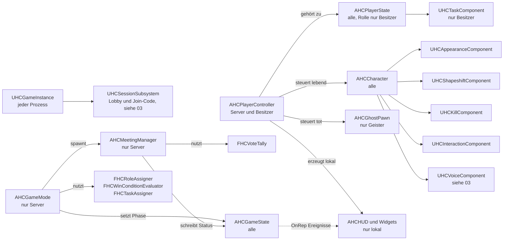
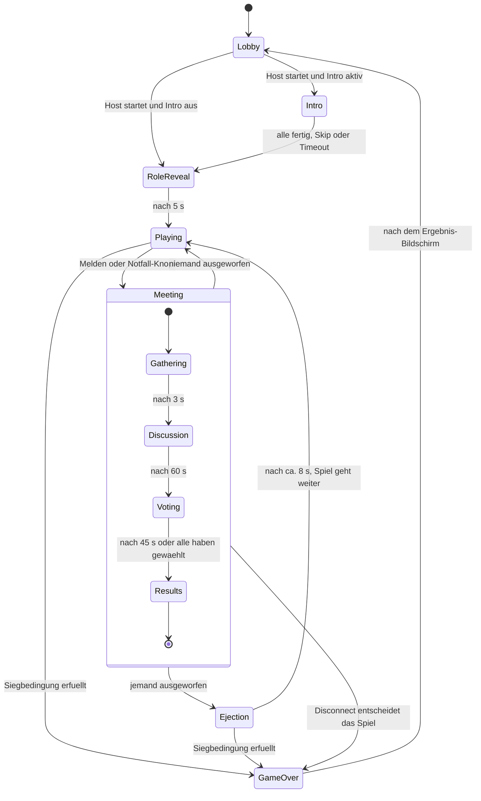
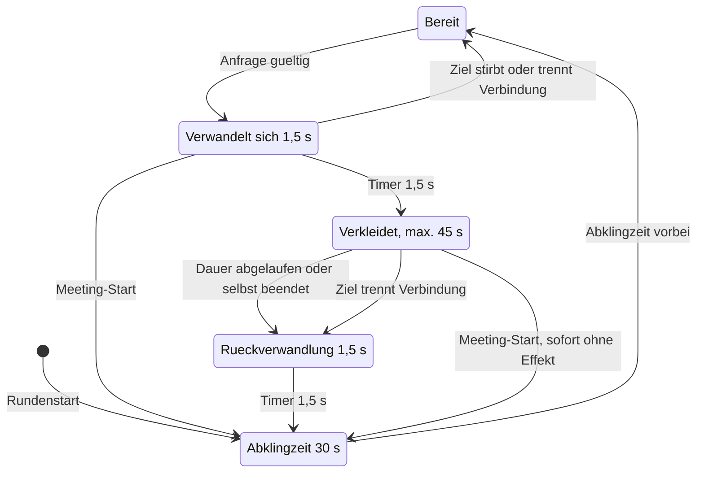
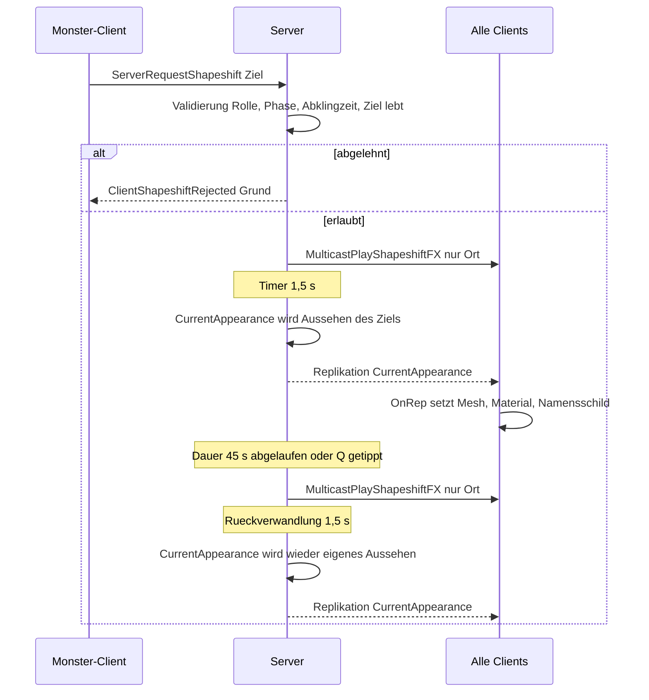
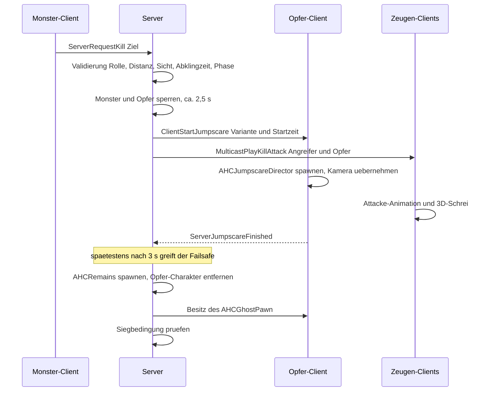
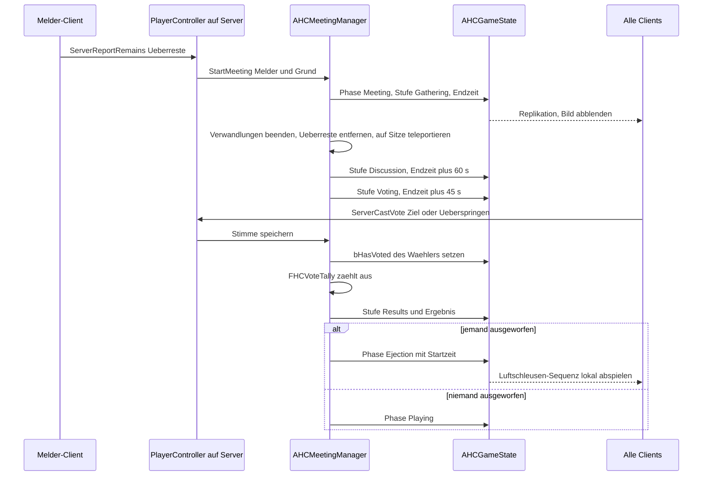
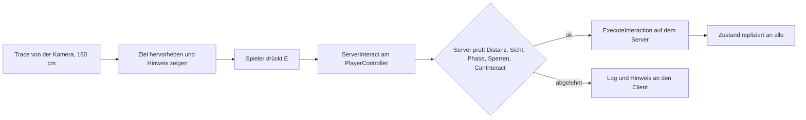
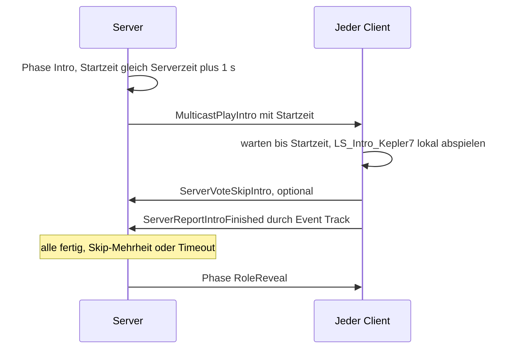

# 02 – Technische Architektur (UE 5.8)

Stand: November 2026 · Teil der Planung für *How Could It Be You*

## Worum geht's

Dieses Dokument beschreibt, wie *How Could It Be You* technisch in Unreal Engine 5.8 aufgebaut wird: welche C++-Klassen es gibt, wie Informationen zwischen Host und Mitspielern fließen (Replikation) und wie die Kernsysteme funktionieren. Dazu gehören Formwandel, Kill und Jumpscare, Meeting und Abstimmung, Aufgaben, Sabotage, Hinweise, Intro-Cutscene, Licht und Audio, UI, Konfiguration und Debug-Werkzeuge.
Bei jedem System steht, was **Claude** programmiert und was **du** im Editor machst. Netzwerk-Dienste (EOS, Voice, Cloudflare) beschreibt [03 – Multiplayer & Backend](03-multiplayer-und-backend.md), Level-Maße, Checks und Testpläne stehen in [04 – Qualität & Tests](04-qualitaet-und-tests.md).

## Inhalt

1. [Überblick und Grundprinzipien](#1-überblick-und-grundprinzipien)
2. [Replikation für Einsteiger](#2-replikation-für-einsteiger)
3. [Projektstruktur](#3-projektstruktur)
4. [Framework-Klassen](#4-framework-klassen)
5. [Match-Phasen, Rollen und Siegbedingungen](#5-match-phasen-rollen-und-siegbedingungen)
6. [Formwandel-System](#6-formwandel-system)
7. [Kill- und Jumpscare-System](#7-kill--und-jumpscare-system)
8. [Meeting- und Voting-System](#8-meeting--und-voting-system)
9. [Aufgaben-System](#9-aufgaben-system)
10. [Interaktion](#10-interaktion)
11. [Sabotage, Licht und Türen](#11-sabotage-licht-und-türen)
12. [Hinweis-Systeme](#12-hinweis-systeme)
13. [Voice und Online](#13-voice-und-online)
14. [Intro-Cutscene mit Sequencer](#14-intro-cutscene-mit-sequencer)
15. [Licht- und Audio-Technik](#15-licht--und-audio-technik)
16. [UI-Architektur](#16-ui-architektur)
17. [Konfiguration](#17-konfiguration)
18. [Debug-Werkzeuge](#18-debug-werkzeuge)
19. [Erweiterbarkeit](#19-erweiterbarkeit)
20. [Code-Konventionen](#20-code-konventionen)

---

## 1. Überblick und Grundprinzipien

Die Architektur folgt vier Grundsätzen:

1. **C++-first, Editor-minimal.** Spiellogik, Regeln und Zahlenwerte stehen in C++ und in Text-Configs. Claude kann sie lesen und ändern, aber keine `.uasset`-Dateien erzeugen, weil das Binärdateien sind. Blueprints (= visuelle Skripte im Editor, gespeichert als `.uasset`) sind nur dünne **Asset-Hüllen**: Eine Blueprint-Kindklasse (= ein Blueprint, der von einer C++-Klasse erbt und deren Logik übernimmt) bekommt von dir nur Meshes, Sounds und Materialien zugewiesen.
2. **Server-autoritativ auf einem Listen-Server.** Listen-Server bedeutet: Ein Spieler hostet die Runde, und sein PC ist gleichzeitig Server und Spieler. Server-autoritativ bedeutet: Nur der Server entscheidet über Regeln (Kills, Stimmen, Aufgaben). Clients (= die PCs der anderen Spieler) schicken nur Anfragen und bekommen Ergebnisse zurück.
3. **Datengetrieben.** Alle einstellbaren Werte (Abklingzeiten, Reichweiten, Meeting-Zeiten) stehen in `UDeveloperSettings`-Klassen. Das sind C++-Klassen, deren Werte in einer `.ini`-Datei stehen und im Editor unter *Projekteinstellungen* erscheinen. Spielmodi sind Datensätze (`UHCMatchRules`), keine eigenen Codebasen.
4. **Klein und testbar.** Reine Regel-Logik (Abstimmung, Siegbedingung, Rollen- und Aufgabenverteilung) steckt in kleinen C++-Structs ohne Spielwelt. Claude kann sie mit automatischen Tests absichern, ohne dass Unreal eine Map laden muss (Details in [04](04-qualitaet-und-tests.md)).

### Wer macht was?

| System | 🤖 C++ (Claude) | 🧑 Blueprint-Kindklasse (du weist Assets zu) | 🧑 Reine Editor-Arbeit (du) |
|---|---|---|---|
| Regeln, Phasen, Siegbedingungen | `AHCGameMode`, `AHCGameState`, `FHCWinConditionEvaluator` | `BP_HCGameMode` (nur Klassen-Verweise) | – |
| Spielfigur | `AHCCharacter` + Komponenten, Bewegung, Taschenlampe | `BP_HCCharacter`: Körper-Meshes, Anzug-Materialien, Symbole, Sounds | Animation Blueprint `ABP_` aus der Vorlage übernehmen |
| Monster-Fähigkeiten | `UHCShapeshiftComponent`, `UHCKillComponent`, Sabotage-Logik | Effekt-Sounds/-VFX im `BP_HCCharacter` | Niagara-Effekt, Spuren-Decal-Material |
| Jumpscare | `AHCJumpscareDirector`, `UHCJumpscareData` (Klasse) | `DA_Jumpscare_*` (Monster-Mesh, Montage, Stinger) | Montage, Camera Shake (`BP_CS_*`) |
| Meeting | `AHCMeetingManager`, `FHCVoteTally`, `AHCMeetingSeat` | `BP_HCEmergencyButton` (Mesh, Sound) | Sitzpunkte und Meeting-Raum in der Map platzieren |
| Aufgaben | `AHCTaskStation`, `UHCTaskComponent`, `FHCTaskAssigner`, Prototyp-Minispiele | `BP_TaskStation_*` (Mesh, Sounds) | Stationen platzieren, `TaskId` eintragen |
| Sabotage, Türen | `AHCPowerSector`, `AHCFuseBox`, `AHCDoor` | `BP_HCDoor` (Tür-Meshes, Sounds) | Lichter einem Sektor zuordnen, Türen platzieren |
| Hinweise | `AHCSecurityCamera`, `AHCDoorLogTerminal`, Bio-Scanner | Monitor-/Terminal-Meshes | Kameras platzieren und ausrichten |
| Intro | Abspiel-Logik, Synchronisierung, Überspringen | – | Level Sequence (= Sequencer-Datei einer Zwischensequenz) `LS_Intro_Kepler7` komplett |
| Licht und Audio | Strom/Flackern, Unbehagen-System, Grafik-Stufen | – | Lichter, Post-Process (= Bildeffekte über dem fertigen Bild), MetaSounds `MS_`, Attenuation `SA_` |
| UI | Prototyp-Widgets komplett in C++ | später `WBP_*`-Designs | Layout und Stil der `WBP_` (optional) |
| Konfiguration | `UHCGameSettings`, `UHCMatchRules`, `.ini`-Dateien | – | – |
| Eingabe | Eingabe-Logik (Enhanced Input) | – | Input Actions `IA_` und Mapping Context `IMC_` nach Liste anlegen |
| Tests, Validierung | Unit-Tests, Editor-Validatoren, Map-Checks | – | `Tools/RunTests.bat` ausführen, Ausgabe zurückmelden |

### Bewusst nicht verwendet (v1)

| Technik | Warum nicht |
|---|---|
| Gameplay Ability System (GAS) | Zu groß für drei Fähigkeiten. Eigene kleine Komponenten mit Abklingzeiten reichen. GAS bleibt eine spätere Option. |
| Iris, Push Model | Iris ist Unreals neueres Replikationssystem, beim Push Model muss der Code jede Änderung selbst melden. Bei 4–8 Spielern bringt beides keinen Nutzen. Push Model führt bei einer vergessenen Markierung zu stillen Replikationsfehlern. |
| Gameplay Camera System | Für Ego-Perspektive unnötig. Eine normale Kamera am Charakter reicht. |
| `bReplicatePlayback` für Sequenzen | Nicht verlässlich genug für Spielmomente. Wir senden stattdessen eine Startzeit vom Server (siehe [Abschnitt 14](#14-intro-cutscene-mit-sequencer)). |
| Substrate, Nanite für Charaktere | Substrate (= neues Material-System) bringt hier keinen Vorteil. Nanite (= Technik für sehr detaillierte Meshes) ist für animierte Figuren noch Beta. Charaktere bekommen klassische LODs. |
| Springen und Ducken | Vermeidet Klettern auf Möbel und Hängenbleiben unter Objekten (Regel aus [04](04-qualitaet-und-tests.md)). Die Sprung-Eingabe der Vorlage wird entfernt. Crew und Monster haben identische Kollision. |

**Startpunkt:** Das Projekt entsteht als C++-Projekt aus der Vorlage *First Person → Variante Survival Horror*. Sie bringt Taschenlampe und Horror-Lichtstimmung mit. Die Blueprints der Vorlage dienen nur als Vorlage für Meshes und Einstellungen. Unsere `BP_HC*`-Klassen erben von Claudes C++-Klassen (siehe [Abschnitt 4](#4-framework-klassen)).

---

## 2. Replikation für Einsteiger

### 2.1 Server und Clients

Vorab zwei Grundbegriffe: Alles, was in der Welt existiert (Figuren, Türen, Lampen), ist in Unreal ein **Actor**. Eine steuerbare Spielfigur heißt **Pawn**.

Stell dir ein Brettspiel mit einem Spielleiter vor. Der **Server** ist der Spielleiter: Nur er hat das echte Spielbrett und entscheidet, ob ein Zug erlaubt ist. Jeder **Client** hat eine Kopie des Bretts und sieht, was der Spielleiter ansagt. Will ein Spieler etwas tun, ruft er es dem Spielleiter zu. Der prüft und verkündet das Ergebnis.

**Replikation** heißt: Der Server schickt Zustände automatisch an alle Clients. Clients ändern nie selbst etwas am „echten“ Spielzustand.

### 2.2 Besonderheiten beim Listen-Server

- Der Host ist **Server und Spieler zugleich**. Sein Charakter läuft ohne Verzögerung, die anderen haben Ping (= Laufzeit eines Datenpakets hin und zurück).
- Der Host hat **alle Daten** im Speicher, auch die Rolle der anderen und die Stimmen. Cheat-Schutz gegen einen böswilligen Host ist deshalb begrenzt. Für Freundesrunden ist das akzeptiert, Easy Anti-Cheat ist zurückgestellt (siehe [03](03-multiplayer-und-backend.md)).
- Verlässt der Host das Spiel, endet die Runde für alle. Unreal hat keine Host-Migration (= Übergabe der Server-Rolle an einen anderen Spieler). Alle sehen „Host hat das Spiel verlassen“ und landen im Menü (Ablauf in [03](03-multiplayer-und-backend.md)).
- Beitritt ist nur in der Lobby möglich. Während einer laufenden Runde lehnt `AHCGameMode` neue Verbindungen ab.

### 2.3 Die Werkzeuge der Replikation

| Begriff | Was es ist | Alltagsvergleich | Beispiel im Spiel |
|---|---|---|---|
| **Replizierte Property** | Eine Variable, die der Server automatisch an Clients schickt, wenn sie sich ändert | Anzeigetafel in der Halle | `AHCGameState::MatchPhase` |
| **RepNotify** (`ReplicatedUsing`) | Eine Funktion, die auf dem Client läuft, sobald eine replizierte Property ankommt | Klingel, die läutet, wenn die Tafel sich ändert | `OnRep_CurrentAppearance` tauscht Mesh und Namensschild |
| **Server-RPC** | Funktionsaufruf vom Client, der auf dem Server ausgeführt wird (RPC = Remote Procedure Call, Fernaufruf) | Antrag beim Spielleiter einreichen | `ServerRequestKill(Ziel)` |
| **Client-RPC** | Aufruf vom Server, der nur bei *einem* Client ausgeführt wird, nämlich beim Besitzer des Actors (z. B. über dessen PlayerController) | Persönlicher Brief | `ClientStartJumpscare` nur beim Opfer |
| **NetMulticast-RPC** | Aufruf vom Server, der auf dem Server selbst (also auch beim Host) und bei allen Clients ausgeführt wird, für die der Actor gerade relevant ist | Lautsprecherdurchsage | Schrei und Attacke-Animation beim Kill |
| **Reliable** | Kommt garantiert und in Reihenfolge an, kostet mehr | Einschreiben | Stimme abgeben, Kill-Anfrage |
| **Unreliable** | Kann verloren gehen, ist billig | Postkarte | Sprachpakete, Positions-Meldungen der Geister |
| **Replikationsbedingung** (z. B. `COND_OwnerOnly`) | Schränkt ein, *wer* eine Property bekommt. `COND_OwnerOnly` = nur der Besitzer | Verschlossener Umschlag | Eigene Rolle, eigene Aufgabenliste |
| **Besitz** (Ownership) | Jeder Client „besitzt“ seinen PlayerController und seine Spielfigur. Server-RPCs funktionieren nur über Actors, die du besitzt | Nur auf dem eigenen Formular darfst du schreiben | Abstimmung läuft über `AHCPlayerController` |
| **Relevanz** | Der Server schickt einem Client nur Actors, die für ihn relevant sind (Distanz, eigene Regeln) | Man hört nur Durchsagen im eigenen Gebäude | Geister sind nur für Geister relevant |
| **Dormancy** (Ruhezustand) | Ein Actor, der sich selten ändert, wird nicht ständig geprüft und „schläft“, bis der Server ihn weckt | Tür schläft, bis jemand klopft | Türen, Aufgaben-Stationen, Sicherungskästen |

### 2.4 Wie das im Code aussieht

```cpp
// Skizze – Core/HCTypes.h (Auszug)
USTRUCT()
struct FHCRoleInfo
{
    GENERATED_BODY()
    UPROPERTY() EHCRole Role = EHCRole::Crew;
    // Zählt bei jeder Rollenverteilung hoch. Ohne den Zähler käme bei Crew-Spielern nie ein
    // OnRep an, weil "Crew" schon der Standardwert ist – ihre Rollen-Enthüllung bliebe aus.
    UPROPERTY() uint8 MatchSerial = 0;
};

// Skizze – Core/HCPlayerState.h (Auszug)
UCLASS()
class AHCPlayerState : public APlayerState
{
    GENERATED_BODY()
public:
    // Eigene Rolle – geht NUR an den Besitzer. Alle anderen sehen immer den Standardwert "Crew".
    UPROPERTY(ReplicatedUsing = OnRep_RoleInfo)
    FHCRoleInfo RoleInfo;

    // Eigene Forscher-Identität (in der Lobby gewählt) – alle sehen sie
    UPROPERTY(Replicated)
    FHCAppearance BaseAppearance;

    // Hat in der laufenden Abstimmung schon gewählt? – alle sehen es, aber nicht WEN
    UPROPERTY(Replicated)
    bool bHasVoted = false;

    UFUNCTION()
    void OnRep_RoleInfo(); // löst die Rollen-Enthüllung im HUD aus
};

void AHCPlayerState::GetLifetimeReplicatedProps(TArray<FLifetimeProperty>& OutLifetimeProps) const
{
    Super::GetLifetimeReplicatedProps(OutLifetimeProps);
    DOREPLIFETIME_CONDITION(AHCPlayerState, RoleInfo, COND_OwnerOnly);
    DOREPLIFETIME(AHCPlayerState, BaseAppearance);
    DOREPLIFETIME(AHCPlayerState, bHasVoted);
}
```

```cpp
// Skizze – Core/HCPlayerController.h (Auszug)
// Client → Server: "Ich stimme für Spieler X" (zuverlässig, weil spielentscheidend)
UFUNCTION(Server, Reliable)
void ServerCastVote(int32 TargetPlayerId, bool bSkip);

// Server → nur dieser Client: Jumpscare starten
UFUNCTION(Client, Reliable)
void ClientStartJumpscare(FName VariantId, double ServerStartTime);
```

### 2.5 Welche Info darf wer sehen?

| Information | Wer sieht sie? | Technik |
|---|---|---|
| Eigene Rolle (Crew/Monster) | nur der Besitzer | `AHCPlayerState::RoleInfo`, `COND_OwnerOnly` |
| Wer das Monster ist (für Tote) | nur Geister, ab ihrem Tod (rote Markierung laut [01](01-game-design-document.md)) | einmaliger Client-RPC an den neuen Geist, keine replizierte Property |
| Wer tot ist | alle (technisch), die UI zeigt es erst ab Meeting-Start | `AHCPlayerState::bIsAlive` (siehe 6.7) |
| Aussehen (Anzug, Symbol, Namensschild) | alle | `UHCAppearanceComponent::CurrentAppearance` |
| Stimmen in der Abstimmung | niemand bis zur Auszählung, nur „hat gewählt“ | Server-`TMap`, `bHasVoted` |
| Aufgabenliste (auch Fake-Liste des Monsters) | nur der Besitzer | `UHCTaskComponent`, `COND_OwnerOnly` |
| Gesamt-Aufgabenfortschritt | alle (je nach Lobby-Option immer, nur im Meeting oder erst am Ende, siehe 9.3) | `AHCGameState::CompletedTasks / TotalTasks` |
| Abklingzeiten (Kill, Formwandel, Sabotage) | nur der Besitzer | Endzeitpunkte mit `COND_OwnerOnly` |
| Geister (Position, Gestalt) | nur Geister | Relevanz-Filter in `AHCGhostPawn` |
| Türprotokoll | wer am Terminal abfragt | Client-RPC auf Anfrage |
| Rollen aller Spieler | alle, erst bei Spielende | `AHCGameState::RevealedRoles` |
| Wer gerade spricht | niemand während der Runde | keine Sprecher-Anzeige (siehe [03](03-multiplayer-und-backend.md)) |

> **Wichtig für Claude:** Weil fremde Rollen auf jedem Client als „Crew“ ankommen, darf kein Client-Code je auf die Rolle *anderer* Spieler reagieren. Nur der Server und der Besitzer kennen die echte Rolle. Einzige Ausnahme: Geister bekommen die Monster-ID per `ClientRevealMonstersToGhost` und dürfen damit nur ihre eigene Geister-Ansicht färben.

### 2.6 Typische Stolperfallen (für Claude, zum Verstehen für dich)

- **RepNotify läuft in C++ nicht auf dem Server.** Der Host würde eine Änderung sonst nicht sehen. Deshalb ruft der Server die Anwenden-Funktion (z. B. `ApplyAppearance()`) nach jeder Änderung selbst auf.
- **RepNotify meldet sich nur bei einer echten Änderung.** Bekommt ein Client denselben Wert, den er schon hat (z. B. Rolle „Crew“ = Standardwert), passiert nichts. Deshalb tragen einmalige Ereignisse einen Zähler (`MatchSerial` in 2.4) oder hängen an der Phase.
- **Server-RPCs auf fremden Actors werden verworfen.** Ein Client kann `AHCMeetingManager` nicht direkt aufrufen. Alles läuft über den eigenen `AHCPlayerController` oder die eigene Spielfigur.
- **`BeginPlay` läuft auf allen Maschinen.** Spiellogik prüft vorher `HasAuthority()` (= „bin ich der Server?“).
- **Abgelehnte Anfragen werden nicht hart bestraft.** Wegen Ping kann eine ehrliche Anfrage knapp ungültig sein. Der Server lehnt sie ab, loggt den Grund (`LogHCNet`) und informiert den Client. Kein Rauswurf über `_Validate`.

---

## 3. Projektstruktur

### 3.1 Quellcode

Das UE-Projekt liegt im Monorepo unter `/Game`. Daneben liegen `/docs`, `/Launcher` und `/Tools` (Aufbau in [05 – Launcher & Updates](05-launcher-und-updates.md) §15), `/Backend` (Cloudflare-Worker, [03](03-multiplayer-und-backend.md) §9) und `/.github/workflows` (CI).

```text
Game/
├─ HowCouldItBeYou.uproject
├─ Config/                      DefaultGame.ini, DefaultEngine.ini, DefaultInput.ini, DefaultScalability.ini,
│                               DefaultCrypto.ini, Windows/WindowsEngine.ini.example (EOS-Vorlage;
│                               die echte WindowsEngine.ini bleibt lokal, → 03)
├─ Content/                     Assets (deine Arbeit, per Git LFS = Speicher für große Binärdateien)
├─ Plugins/                     z. B. projekt-lokale EOS-Plugin-Kopie (→ 03)
└─ Source/
   ├─ HowCouldItBeYou.Target.cs
   ├─ HowCouldItBeYouEditor.Target.cs
   ├─ HowCouldItBeYou/                     Spielmodul (Runtime)
   │  ├─ HowCouldItBeYou.Build.cs
   │  ├─ Core/          HCGameInstance, HCGameMode, HCGameState, HCPlayerState,
   │  │                 HCPlayerController, HCGameSettings, HCMatchRules, HCTypes.h, HCLog.h
   │  ├─ Characters/    HCCharacter, HCCharacterMovementComponent, HCGhostPawn,
   │  │                 HCAppearanceComponent, HCAppearanceTypes.h
   │  ├─ Roles/         HCRoleAssigner, HCWinConditionEvaluator
   │  ├─ Abilities/     HCShapeshiftComponent, HCKillComponent, HCRemains,
   │  │                 HCJumpscareDirector, HCJumpscareData
   │  ├─ Tasks/         HCTaskStation, HCTaskComponent, HCTaskAssigner, HCTaskTypes.h
   │  ├─ Meeting/       HCMeetingManager, HCMeetingSeat, HCEmergencyButton, HCVoteTally
   │  ├─ Sabotage/      HCPowerSector, HCFuseBox, HCDoor
   │  ├─ Interaction/   HCInteractionComponent, HCInteractable, HCHidingLocker
   │  ├─ Clues/         HCSecurityCamera, HCDoorLogTerminal
   │  ├─ Audio/         HCUneaseComponent (Unbehagen-System)
   │  ├─ UI/            HCHUD, Prototyp-Widgets (HCHudWidget, HCMeetingWidget, …)
   │  ├─ Online/        HCSessionSubsystem, HCVoiceSubsystem, HCVoiceComponent, HCVoiceRouter (→ 03)
   │  ├─ Debug/         HCDebugCommands, HCDebugOverlay, HCBotController (Bot-Läufer, → 04)
   │  └─ Tests/         HCVoteTallyTests, HCWinConditionTests, HCRoleAssignerTests, … (→ 04)
   └─ HowCouldItBeYouEditor/               Editor-Modul (nur im Editor geladen)
      ├─ HowCouldItBeYouEditor.Build.cs
      ├─ Validators/    Namens-, Kollisions-, Replikations-Validatoren (→ 04)
      └─ Commandlets/   Map-Checks, z. B. NavMesh-Erreichbarkeit (→ 04)
```

Das NavMesh ist ein unsichtbares Laufnetz, auf dem Unreal Wege berechnet. Die Map-Checks prüfen damit, ob jeder wichtige Punkt erreichbar ist.

Jede Klasse besteht aus einer `.h`-Datei (Deklaration) und einer `.cpp`-Datei (Umsetzung) im selben Feature-Ordner. Die Tests im Ordner `Tests/` stehen in `#if WITH_DEV_AUTOMATION_TESTS` und landen deshalb nie im Shipping-Build. Dazu kommen kleine, lokale Hilfsklassen: `UHCCharacterMovementComponent` (vorhergesagtes Sprinten), `AHCHUD`, `UHCUneaseComponent`, die Prototyp-Widgets und `UHCUserSettings` (Spieler-Optionen). Dazu kommen die reine Voice-Logik `FHCVoiceRouter` (`Online/`, → [03](03-multiplayer-und-backend.md) §8.2) und die Prüf-Helfer aus [04](04-qualitaet-und-tests.md): `AHCCapsuleGauge` und `AHCClearPathVolume` (nur im Editor aktiv) sowie `AHCBotController` (`Debug/`, nur Development-Builds). Für die Ladestationen der Taschenlampen aus [01](01-game-design-document.md) kommt `AHCChargingStation` (`Interaction/`, implementiert `IHCInteractable`, lädt den Akku des Benutzers in 10 s, keine Aufgabe) hinzu.

### 3.2 Content-Ordner und Namenskonvention

```text
Content/HowCouldItBeYou/
├─ Blueprints/    BP_HCCharacter, BP_HCGhostPawn, BP_HCGameMode, BP_HCPlayerController, BP_HCDoor …
├─ Characters/    SK_Researcher_*, ABP_Researcher, AM_*, MI_Suit_*, T_Emblem_*
├─ Monster/       SK_Monster, AM_Jumpscare_*, DA_Jumpscare_*
├─ Environment/   Shared/, Kepler7/, Europa/  (SM_, M_, MI_, T_)
├─ Maps/          Map_MainMenu, Map_Lobby, Map_Transition, Kepler7/Map_Kepler7, Europa/Map_Europa
│                 (jede Match-Map in eigenem Unterordner mit ihrem Primary Asset Label, → 05)
├─ Cinematics/    LS_Intro_Kepler7, LS_Ejection, LS_Ejection_POV
├─ Audio/         MS_, SA_, SMX_, SC_, MIX_, SW_
├─ UI/            WBP_*, T_UI_*
├─ Input/         IA_*, IMC_Default, IMC_Ghost
├─ VFX/           NS_Shapeshift, M_Decal_ShapeshiftTrail
└─ Data/          DA_* (sonstige Datensätze)
```

Die Ordner der Vorlage (*First Person*, *Survival Horror*) bleiben als Nachschlage-Quelle unverändert liegen und werden später gelöscht.

| Präfix | Asset-Typ | Beispiel |
|---|---|---|
| `BP_` | Blueprint (meist Kindklasse einer C++-Klasse) | `BP_HCCharacter` |
| `WBP_` | Widget Blueprint (UI-Design) | `WBP_Meeting` |
| `M_` / `MI_` | Material / Material-Instanz | `M_Suit`, `MI_Suit_Orange` |
| `SM_` / `SK_` | Static Mesh / Skeletal Mesh | `SM_FuseBox`, `SK_Monster` |
| `ABP_` / `AM_` | Animation Blueprint / Animation Montage | `ABP_Researcher`, `AM_Jumpscare_Lunge` |
| `LS_` | Level Sequence | `LS_Intro_Kepler7` |
| `DA_` | Data Asset | `DA_Jumpscare_Ceiling` |
| `MS_` | MetaSound Source | `MS_Shapeshift` |
| `SA_` | Sound Attenuation | `SA_Shapeshift` |
| `T_` | Textur | `T_Emblem_Triangle` |
| `Map_` | Level/Map | `Map_Kepler7` |
| `IA_` / `IMC_` | Input Action / Input Mapping Context | `IA_Interact`, `IMC_Default` |
| `NS_` | Niagara-System (Partikel) | `NS_Shapeshift` |
| `SMX_` / `SC_` / `MIX_` | Submix / Sound Class / Sound Mix | `SMX_Voice_Ghost`, `SC_Ambience`, `MIX_Meeting` |
| `SEC_` | Source Effect Preset Chain (Effektkette für einzelne Sounds) | `SEC_Voice_Radio` (Funk-Filter, → [03](03-multiplayer-und-backend.md)) |
| `SW_` | Sound Wave (importierte Audiodatei) | `SW_Scream_01` |
| `RT_` | Render Target | `RT_SecurityMonitor` |

Submixes heißen `SMX_` statt `SM_`, damit sie nicht mit Static Meshes verwechselt werden. Claudes Editor-Validator prüft die Präfixe automatisch (siehe [04](04-qualitaet-und-tests.md)). Für Maps ist „One File Per Actor“ aktiv: Jeder platzierte Actor wird als eigene kleine Datei gespeichert, das hält Git-Änderungen klein.

### 3.3 Config-Dateien

| Datei | Inhalt | Wer pflegt |
|---|---|---|
| `Config/DefaultGame.ini` | `UHCGameSettings`, alle `UHCMatchRules`-Modi, Projektname/-version, Packaging-Einstellungen (→ [05](05-launcher-und-updates.md)) | 🤖 Claude |
| `Config/DefaultEngine.ini` | Start-Maps, GameInstance-Klasse, Kollisionskanäle und -profile, Render-Einstellungen, Netz-/EOS-Einstellungen (→ [03](03-multiplayer-und-backend.md)), Log-Stufen | 🤖 Claude |
| `Config/DefaultInput.ini` | Grundeinstellungen für Enhanced Input (= Unreals Eingabesystem), Konsolen-Taste | 🤖 Claude |
| `Config/DefaultScalability.ini` | Grafik-Stufen Hoch/Mittel/Niedrig (siehe [Abschnitt 15](#15-licht--und-audio-technik)) | 🤖 Claude |
| `Config/DefaultCrypto.ini` | Pak-Verschlüsselung und Pak-Signierung aus (→ [05](05-launcher-und-updates.md) §8.1) | 🤖 Claude |
| `Config/Windows/WindowsEngine.ini` | EOS-Zugangsdaten inkl. ClientSecret, **nicht im Repo** (Vorlage `WindowsEngine.ini.example`, → [03](03-multiplayer-und-backend.md) §6.4) | 🧑 Du (lokal, per `Tools/SetupEOS.bat`) |

> **Tipp:** Unreal-`.ini`-Dateien kennen keine Kommentare am Zeilenende. Ein `;` hinter einem Wert würde Teil des Werts. Kommentare stehen immer in einer eigenen Zeile.

```ini
; Skizze – Config/DefaultEngine.ini (Auszug, beim Umsetzen gegen UE 5.8 prüfen)
[/Script/EngineSettings.GameMapsSettings]
GameDefaultMap=/Game/HowCouldItBeYou/Maps/Map_MainMenu.Map_MainMenu
TransitionMap=/Game/HowCouldItBeYou/Maps/Map_Transition.Map_Transition
GameInstanceClass=/Script/HowCouldItBeYou.HCGameInstance
GlobalDefaultGameMode=/Game/HowCouldItBeYou/Blueprints/BP_HCGameMode.BP_HCGameMode_C

[/Script/Engine.CollisionProfile]
; Eigener Trace-Kanal nur für Interaktion (Aufgaben, Knöpfe, Türen).
; Standard = Block, damit auch Wände mit Engine-Presets den Strahl stoppen (keine Interaktion durch Wände).
; Spielfiguren und Kleinkram schalten ihn in ihren Presets auf Ignore (Presets in 04).
+DefaultChannelResponses=(Channel=ECC_GameTraceChannel1,DefaultResponse=ECR_Block,bTraceType=True,bStaticObject=False,Name="Interaction")
; Objekt-Kanal für Geister: kollidiert nur mit Map-Grenzen
+DefaultChannelResponses=(Channel=ECC_GameTraceChannel2,DefaultResponse=ECR_Ignore,bTraceType=False,bStaticObject=False,Name="Ghost")
```

`DefaultInput.ini` legt nur Grundeinstellungen fest. Die eigentlichen Tastenbelegungen stecken in Input-Action-Assets, die Binärdateien sind. **🧑 Du** legst sie einmalig nach einer Liste von Claude an (Tasten laut [01](01-game-design-document.md)):

| Input Action | Taste | Input Action | Taste |
|---|---|---|---|
| `IA_Move` / `IA_Look` (aus der Vorlage) | WASD / Maus | `IA_Kill` | Linke Maustaste |
| `IA_Interact` (auch Melden) | E | `IA_Shapeshift` | Q (halten = Menü, tippen = beenden) |
| `IA_Sprint` | Shift | `IA_PushToTalk` | V |
| `IA_Flashlight` | F | `IA_GhostUp` / `IA_GhostDown` | Leertaste / Strg |
| `IA_TaskList` | Tab | `IA_SkipIntro` | Leertaste (halten) |
| `IA_StationMap` (Monster: dort auch Sabotage) | M | `IA_Pause` | Esc |

Am Kamera-Monitor im Sicherheitsraum gibt es keine eigenen Actions: `IA_Move` links/rechts (A/D) wechselt die Kamera, `IA_Interact` (E) oder `IA_Pause` (Esc) verlässt den Monitor ([01](01-game-design-document.md) §4).

So geht's:

1. Content Browser → Ordner `Input/` → Rechtsklick → *Input → Input Action* → Namen eingeben. Doppelklick, dann *Value Type*: `Digital (bool)` für Tasten, `Axis2D (Vector2D)` für `IA_Move` und `IA_Look`.
2. Rechtsklick → *Input → Input Mapping Context* → `IMC_Default` (lebend) und `IMC_Ghost` (Geist). Öffnen, bei *Mappings* auf **+** klicken, die Action wählen und rechts daneben über das Tastatur-Symbol die Taste drücken.
3. In `BP_HCPlayerController` (Abschnitt 4.3) die Felder für Mapping Contexts und Actions mit diesen Assets füllen. Die Felder legt Claude im C++ an. Den Sprung der Vorlage (`IA_Jump`) nicht eintragen.

Die Konsolen-Taste stellt Claude in `DefaultInput.ini` ein (siehe [Abschnitt 18](#18-debug-werkzeuge)).

---

## 4. Framework-Klassen

Unreal gibt für Multiplayer-Spiele ein festes Gerüst aus Klassen vor (das „Gameplay Framework“). Jede hat einen festen Ort, an dem sie existiert:

| Klasse | Existiert wo | Repliziert was | Verantwortung |
|---|---|---|---|
| `UHCGameInstance` | jeder Prozess, lebt über Map-Wechsel hinweg | nichts | Session-übergreifender Zustand („Intro in dieser Session schon gesehen“), Behandlung von Verbindungsfehlern (`OnNetworkFailure` → Meldung + Menü) |
| `UHCSessionSubsystem` | jeder Prozess (Subsystem der GameInstance) | nichts (spricht mit EOS) | Lobby hosten, per Code beitreten, verlassen, Match starten. Details in [03](03-multiplayer-und-backend.md) |
| `AHCGameMode` | **nur Server** | nichts (existiert auf Clients gar nicht) | Regeln: Phasenwechsel, Spawnen, Rollenverteilung, Siegprüfung, Kill-/Sabotage-Validierung, spawnt `AHCMeetingManager` |
| `AHCGameState` | alle | Phase, Meeting-Stufe, Endzeitpunkte der Countdowns, Aufgabenfortschritt, Modus-ID, öffentliche Regelwerte, Abstimmungsergebnis, Gewinner, enthüllte Rollen | „Anzeigetafel“ für alle, kosmetische Multicasts (Formwandel-Effekt, Auswurf) |
| `AHCPlayerState` | alle | Name, `BaseAppearance`, `bIsAlive`, `bHasVoted`, verbleibende Notfall-Meetings; **OwnerOnly:** `RoleInfo`, Sabotage-Abklingzeit | Identität eines Spielers, überlebt Tod und Map-Wechsel. Trägt `UHCTaskComponent`. Rundenwerte (Rolle, `bIsAlive`, Notfall-Meetings) setzt der Server bei jedem Match-Start zurück |
| `AHCPlayerController` | Server + besitzender Client (andere Clients haben ihn nicht) | kaum eigene Properties, alles nur an den Besitzer | Einziger „Briefkasten“ für Server-RPCs (abstimmen, melden, sabotieren, Intro überspringen, Debug) und private Client-RPCs (Jumpscare, Türprotokoll, Monster-ID für Geister) |
| `AHCCharacter` | alle | Bewegung, Taschenlampe an/aus, Komponenten-Zustände | Lebende Spielfigur für Crew **und** Monster (identisch aufgebaut) |
| `AHCGhostPawn` | Server, eigener Client und andere Geister | Position (meldet der eigene Client, siehe 7.10) | Spielfigur nach dem Tod: unsichtbar für Lebende, fliegt frei |
| `AHCHUD` + Widgets | nur lokal | nichts | Bildschirme je nach Phase, Eingaben in UI (HUD = Anzeigen über dem Spielbild, Widget = UI-Baustein) |

### 4.1 Wie die Klassen zusammenhängen



### 4.2 AHCCharacter und seine Komponenten

Eine Komponente ist ein Baustein, der an einen Actor angehängt wird und eine Aufgabe übernimmt. Crew und Monster haben **exakt dieselben Komponenten**. Fähigkeiten-Komponenten sind bei der Crew nur inaktiv. Sonst könnte ein Cheater am Aufbau einer Figur erkennen, wer das Monster ist.

| Komponente | Aufgabe | Werte |
|---|---|---|
| `UCapsuleComponent` (Standard) | Kollision (Kapsel = unsichtbarer Kollisionskörper der Figur), Preset `HC_Character` (Spieler blockieren sich nicht hart, siehe [04](04-qualitaet-und-tests.md)) | Radius 40 cm, halbe Höhe 90 cm (180 cm) |
| `UHCCharacterMovementComponent` | Gehen/Sprinten mit Vorhersage (= Client bewegt sich sofort, Server bestätigt) | Gehen 300 cm/s, Sprinten 500 cm/s (6 s Ausdauer), MaxStepHeight 45 cm, begehbarer Winkel 44°, kein Springen, kein Ducken |
| `UCameraComponent` | Ego-Kamera, First Person Rendering | First-Person-FOV und -Scale gegen Clipping |
| Arme + Taschenlampe | Nur für den Besitzer sichtbar, `FirstPersonPrimitiveType = First Person` | Akku (OwnerOnly), An/Aus (alle) |
| Körper-Mesh | Für andere sichtbar, Varianten aus `FHCAppearance` | – |
| `UHCAppearanceComponent` | Aktuelles Aussehen anwenden | siehe [Abschnitt 6](#6-formwandel-system) |
| `UHCShapeshiftComponent` | Formwandel (nur beim Monster aktiv) | siehe [Abschnitt 6](#6-formwandel-system) |
| `UHCKillComponent` | Töten (nur beim Monster aktiv) | siehe [Abschnitt 7](#7-kill--und-jumpscare-system) |
| `UHCInteractionComponent` | Zielen, Hervorheben, Interagieren | siehe [Abschnitt 10](#10-interaktion) |
| `UHCVoiceComponent` | Wiedergabe der Stimme am Kopf | siehe [03](03-multiplayer-und-backend.md) |
| `UHCUneaseComponent` | Unbehagen-System, nur an der eigenen Figur aktiv | siehe [Abschnitt 15](#15-licht--und-audio-technik) |

Ausdauer (fürs Sprinten) und Taschenlampen-Akku werden nur an den Besitzer repliziert. Ob die Taschenlampe an ist, sehen alle, weil man den Lichtkegel sieht.

### 4.3 Vorlage übernehmen

**🧑 Du (Editor/Test):**

1. Projekt aus *First Person → Survival Horror* als **C++-Projekt** anlegen und den Ordner in `Game` umbenennen. Die genauen Klicks stehen in [06 – Roadmap](06-roadmap.md) (Meilenstein M0). Claude übernimmt danach die Quellcode-Ordner.
2. Nach Claudes erstem Code-Push: Projekt öffnen und „Module neu bauen?“ mit **Ja** beantworten.
3. Im Content Browser im Ordner `Blueprints/` per Rechtsklick → *Blueprint Class* → unten *All Classes* aufklappen → `HCCharacter` suchen → *Select* → Name `BP_HCCharacter`. Meshes, Arme und Taschenlampen-Einstellungen aus dem Vorlagen-Charakter übernehmen: beide Blueprints öffnen, im Panel *Components* die Komponente anklicken und im *Details*-Panel die Felder (z. B. *Skeletal Mesh Asset*) gleich einstellen.
4. Dasselbe für `BP_HCGameMode`, `BP_HCPlayerController` und `BP_HCGhostPawn`. In `BP_HCGameMode` nur die Klassen-Verweise eintragen (Pawn = `BP_HCCharacter` usw.).
5. Die Vorlagen-Blueprints **nicht** umhängen (reparenten). Sie enthalten eigene Blueprint-Logik, die sonst doppelt liefe.

---

## 5. Match-Phasen, Rollen und Siegbedingungen

### 5.1 Zustandsautomat

Ein Zustandsautomat ist eine Liste von Zuständen (Phasen) und erlaubten Übergängen dazwischen. Die Phase steht in `AHCGameState::MatchPhase` (`EHCMatchPhase`), die Meeting-Unterphase in `MeetingStage` (`EHCMeetingStage`). Nur `AHCGameMode` bzw. `AHCMeetingManager` auf dem Server ändern sie.



Die Zeiten (*RoleReveal* 5 s, *Gathering* ca. 3 s, *Results* ca. 5 s, *Ejection* ca. 8 s, Ergebnis-Bildschirm 15–20 s) übernimmt dieses Dokument aus [01](01-game-design-document.md). Alle Zeiten stehen in der Config ([Abschnitt 17](#17-konfiguration)).

### 5.2 Countdowns mit Server-Zeitstempel

Der Server schickt **nicht** jede Sekunde die Restzeit. Er repliziert einmal den Endzeitpunkt `PhaseEndServerTime`. Jeder Client rechnet die Restzeit selbst aus der Server-Uhr aus. `GetServerWorldTimeSeconds()` liefert auf jedem Client eine Schätzung der Server-Uhr. Die Abweichung liegt etwa bei der halben Ping-Zeit, für Countdowns und Cutscene-Starts reicht das (Genauigkeit beim Umsetzen gegen UE 5.8 prüfen).

```cpp
// Skizze – Core/HCGameState.h (Auszug)
UPROPERTY(ReplicatedUsing = OnRep_MatchPhase)
EHCMatchPhase MatchPhase = EHCMatchPhase::Lobby;

UPROPERTY(ReplicatedUsing = OnRep_MeetingStage)
EHCMeetingStage MeetingStage = EHCMeetingStage::Gathering;

// Server-Zeit, zu der die aktuelle Phase/Stufe begann bzw. endet (0 = kein Countdown)
UPROPERTY(Replicated)
double PhaseStartServerTime = 0.0;
UPROPERTY(Replicated)
double PhaseEndServerTime = 0.0;

// Skizze – im HUD-Widget (läuft lokal auf jedem Client)
const double Now = GameState->GetServerWorldTimeSeconds();
const double Remaining = FMath::Max(0.0, GameState->PhaseEndServerTime - Now);
```

Den eigentlichen Wechsel löst ein Timer auf dem Server aus. Der Client zeigt nur an. Sollte die eingebaute Schätzung zu ungenau sein, ergänzt Claude eine eigene Uhr-Abgleichung (Ping-Pong-RPC über den PlayerController).

**Match-Timer im Modus Evakuierung:** Er läuft parallel zu den Phasen und hat einen eigenen Endzeitpunkt `MatchTimerEndServerTime`. Laut [01](01-game-design-document.md) pausiert er während *Meeting* und *Ejection*: Der Server merkt sich beim Meeting-Start die Restzeit, repliziert `bMatchTimerPaused = true` und setzt danach einen neuen Endzeitpunkt. Erledigte Funk-Aufgaben ziehen 60 s ab (insgesamt höchstens 3 min).

### 5.3 Übergänge und wer sie auslöst

| Von → Nach | Auslöser | Wer entscheidet |
|---|---|---|
| Lobby → Intro / RoleReveal | Host drückt „Start“, alle haben die Match-Map geladen | `AHCGameMode` |
| Intro → RoleReveal | Alle Clients melden „fertig“ ODER Skip-Mehrheit ODER Timeout ODER Intro bereits gesehen | `AHCGameMode` |
| RoleReveal → Playing | Timer (5 s) | `AHCGameMode` |
| Playing → Meeting | Überreste gemeldet oder Notfall-Knopf (validiert) | `AHCMeetingManager` |
| Meeting → Ejection / Playing | Auszählung durch `FHCVoteTally` | `AHCMeetingManager` |
| Ejection → Playing / GameOver | Ende der Auswurf-Sequenz + Siegprüfung | `AHCGameMode` |
| Playing → GameOver | `FHCWinConditionEvaluator` meldet Gewinner | `AHCGameMode` |
| GameOver → Lobby | Ergebnis-Bildschirm abgelaufen (15 s, laut [01](01-game-design-document.md) 15–20 s) oder Host klickt „Zur Lobby“ | `AHCGameMode` → Map-Wechsel |

**Map-Wechsel:** Lobby und Match liegen in verschiedenen Maps. Der Wechsel ist ein *Seamless Travel* (= Wechsel ohne Verbindungsabbruch über die kleine Übergangs-Map `Map_Transition`, im GameMode per `bUseSeamlessTravel = true`). PlayerStates und Namen bleiben dabei erhalten. Was trotzdem übernommen werden muss, kopiert Claude in `AHCPlayerState::CopyProperties`. In der neuen Map wartet `AHCGameMode`, bis alle Spieler geladen haben (Timeout 60 s, wer fehlt, wird entfernt). Erst dann startet die Phase. Seamless Travel im Editor-Test (PIE) braucht ggf. `net.AllowPIESeamlessTravel 1` (beim Umsetzen gegen UE 5.8 prüfen).

### 5.4 Rollenverteilung (FHCRoleAssigner)

1. Beim Übergang nach *RoleReveal* sammelt `AHCGameMode` die IDs aller verbundenen Spieler.
2. `FHCRoleAssigner` (reine Logik, ohne Spielwelt) wählt zufällig `NumMonsters` Monster (Default 1), der Rest ist Crew. Mit festem Zufalls-Startwert (Seed) ist das Ergebnis reproduzierbar und damit testbar.
3. Erzwungene Rollen aus dem Debug-Befehl `hc.ForceRole` haben Vorrang.
4. Der Server setzt `AHCPlayerState::RoleInfo` (Rolle + neuer `MatchSerial`). Wegen `COND_OwnerOnly` erfährt jeder nur seine eigene Rolle. Das HUD zeigt den Rollen-Bildschirm, sobald Phase *RoleReveal* **und** die Rolle mit dem aktuellen `MatchSerial` angekommen sind. Die Reihenfolge, in der GameState und PlayerState ankommen, ist nämlich nicht garantiert. Der Bildschirm ist für Crew und Monster gleich lang und gleich laut, damit man über Voice nichts heraushört.
5. Bei Spielende füllt der Server `AHCGameState::RevealedRoles` (für alle sichtbar). Der Ergebnis-Bildschirm zeigt damit das Monster.

```cpp
// Skizze – Roles/HCRoleAssigner.h
struct FHCRoleAssigner
{
    // PlayerIds: alle Spieler der Runde. Seed: fest in Tests, zufällig im Spiel.
    static TMap<int32, EHCRole> Assign(const TArray<int32>& PlayerIds, int32 NumMonsters,
                                       int32 Seed, const TMap<int32, EHCRole>& ForcedRoles);
};
```

Mit 2 Monstern müssten sich die Monster gegenseitig kennen. Dafür gäbe es einen privaten Client-RPC an jedes Monster. → Offene Frage Q-A4, siehe [07](07-offene-fragen.md): 2 Monster bei 7–8 Spielern? Default für die Planung: immer 1 Monster.

### 5.5 Siegbedingungen (FHCWinConditionEvaluator)

`FHCWinConditionEvaluator` bekommt eine Momentaufnahme der Zahlen und liefert „niemand / Crew / Monster“ plus einen Grund für den Ergebnis-Bildschirm.

```cpp
// Skizze – Roles/HCWinConditionEvaluator.h
struct FHCWinInput
{
    int32 AliveCrew = 0, AliveMonsters = 0;
    int32 CompletedTasks = 0, TotalTasks = 0;
    bool bMonsterEjected = false, bTimerExpired = false;
    // aus UHCMatchRules
    bool bCrewWinsByTasks = true, bTimerEnabled = false;
    int32 MinCrewAliveAtTimeout = 2;
};

enum class EHCWinner : uint8 { None, Crew, Monster };

struct FHCWinConditionEvaluator
{
    static EHCWinner Evaluate(const FHCWinInput& In, FString& OutReason);
};
```

Prüfreihenfolge in einer Auswertung:

1. **Kein Monster mehr übrig** (ausgeworfen oder Verbindung getrennt) → Crew gewinnt. Bei 1 Monster heißt das: Auswurf des Monsters beendet das Spiel sofort.
2. **Parität:** lebende Monster ≥ lebende Crew → Monster gewinnt (alle Modi).
3. **Alle Aufgaben erledigt** und `bCrewWinsByTasks` (Infiltration) → Crew gewinnt. Nur wenn `TotalTasks > 0`, sonst würde eine leere Aufgabenliste (z. B. Map ohne Stationen) sofort einen Crew-Sieg auslösen. Den Fall meldet der Server als Fehler ins Log.
4. **Timer abgelaufen** und `bTimerEnabled` (Evakuierung): mindestens `MinCrewAliveAtTimeout` (2) Crew leben → Crew gewinnt, sonst Monster. Mit den Default-Werten greift vorher immer schon die Parität.

**Wann geprüft wird:** nach jedem Kill (nach dem Jumpscare), nach jedem Auswurf, nach jedem Disconnect, nach jeder erledigten Aufgabe (auch Geister-Aufgaben), nach jeder Änderung von `TotalTasks`, beim Ablauf des Match-Timers. Nach Meetings ohne Auswurf ist keine Prüfung nötig, weil sich nichts geändert hat.

**Getrennte Spieler** zählen wie Tote ohne Überreste: nicht mehr lebend, kein Geist. Ihre noch offenen echten Aufgaben streicht der Server aus `TotalTasks`. Sonst könnte die Crew in Infiltration nie mehr per Aufgaben gewinnen. Dasselbe passiert mit den offenen Aufgaben Toter, wenn `bGhostTasksCount` aus ist, allerdings erst beim **nächsten Meeting-Start**. Würde der Balken sofort springen, verriete er einen noch unentdeckten Kill ([01](01-game-design-document.md) §5). Disconnects werden ohnehin angesagt, dort sinkt `TotalTasks` sofort.

**🤖 Claude (Code):** Phasen-Automat, Countdowns, Seamless Travel, `FHCRoleAssigner` und `FHCWinConditionEvaluator` mit Unit-Tests (→ [04](04-qualitaet-und-tests.md)), `hc.ForceRole`, `hc.EndMatch`.

**🧑 Du (Editor/Test):** Maps `Map_Transition` (leer) und `Map_Lobby` anlegen ([06](06-roadmap.md)), mit 4 PIE-Clients eine Runde bis zum Ergebnis-Bildschirm spielen und prüfen, dass jeder Client nur seine eigene Rolle sieht.

---

## 6. Formwandel-System

Das Monster kann das Aussehen jedes **lebenden** Mitspielers annehmen. Technisch ist das nur ein Tausch von Daten: Kollision, Bewegung und Stimme bleiben gleich.

### 6.1 FHCAppearance

```cpp
// Skizze – Characters/HCAppearanceTypes.h
USTRUCT(BlueprintType)
struct FHCAppearance
{
    GENERATED_BODY()

    // Index in die Anzug-Farbliste (UHCAppearanceComponent::SuitMaterials)
    UPROPERTY() uint8 SuitColorIndex = 0;
    // Index in die Symbol-/Markierungsliste (Schulter-Emblem)
    UPROPERTY() uint8 EmblemIndex = 0;
    // Index in die Körper-Varianten (Mesh)
    UPROPERTY() uint8 MeshVariantIndex = 0;
    // Text auf dem Namensschild
    UPROPERTY() FString DisplayName;
};
```

Nur Indizes und ein Name werden repliziert, das sind wenige Bytes. Welche Meshes und Materialien hinter den Indizes stecken, trägst du in `BP_HCCharacter` in die Listen der `UHCAppearanceComponent` ein.

### 6.2 UHCAppearanceComponent

- `BaseAppearance` (die echte Identität) liegt im `AHCPlayerState`.
- `CurrentAppearance` (was andere gerade sehen) liegt in der Komponente, repliziert an **alle**, mit `OnRep_CurrentAppearance`.
- `ApplyAppearance()` setzt Körper-Mesh, Anzug-Farbe (Parameter einer dynamischen Material-Instanz), Emblem-Textur und den Text des Namensschilds. Auf dem Host ruft der Server die Funktion direkt auf (siehe Stolperfallen in 2.6).
- Die eigenen Arme in der Ego-Ansicht zeigen ebenfalls `CurrentAppearance`. Das Monster sieht an seinen Ärmeln, wen es gerade darstellt.

### 6.3 UHCShapeshiftComponent



Der Zustand `EHCShapeshiftState` und der Endzeitpunkt der Abklingzeit werden nur an den Besitzer (das Monster) repliziert. Sie steuern dessen HUD. Bei Rundenstart und nach jedem Meeting beginnt die volle Abklingzeit (laut [01](01-game-design-document.md)).

**Ablauf einer Verwandlung:**

1. Das Monster hält Q und wählt im Radialmenü (= kreisförmige Auswahl, Prototyp-Widget) einen lebenden Spieler. Der Client ruft `ServerRequestShapeshift(Ziel)`.
2. Der Server prüft die **Validierungsliste**:
   - Anfragender hat Rolle Monster.
   - Phase ist *Playing* (nicht Meeting, Auswurf, Intro).
   - Abklingzeit vorbei, keine laufende Verwandlung.
   - Monster ist nicht in einer Kill-Sperre und nicht im Versteck.
   - Ziel ist ein anderer, verbundener, **lebender** Spieler.
   - Ziel ist nicht die Gestalt, die das Monster gerade schon trägt.
3. Bei Ablehnung: `ClientShapeshiftRejected(Grund)` → kurzer Hinweis im HUD, Log-Eintrag.
4. Bei Erfolg: Zustand *Transforming*. Das Monster bleibt 1,5 s stehen und kann sich nur umsehen (der Server sperrt die Bewegung). `AHCGameState::MulticastPlayShapeshiftFX(Ort)` spielt Geräusch und Effekt. Nach 1,5 s setzt der Server `CurrentAppearance = Ziel.BaseAppearance`.
5. Ein Timer läuft über die Dauer (Default 45 s, 0 = unbegrenzt). Danach folgt die Rückverwandlung (*Reverting*): wieder 1,5 s Stillstand, dasselbe Geräusch, derselbe Effekt und eine Spur. Danach beginnt die Abklingzeit (Default 30 s, 0 = keine).
6. Das Monster kann sich jederzeit vorzeitig zurückverwandeln (Q tippen → `ServerRequestRevert`).

```cpp
// Skizze – Abilities/HCShapeshiftComponent.cpp
void UHCShapeshiftComponent::ServerRequestShapeshift_Implementation(AHCPlayerState* Target)
{
    FString Reason;
    if (!CanShapeshiftInto(Target, Reason)) // Validierungsliste oben
    {
        UE_LOG(LogHCMatch, Log, TEXT("Formwandel abgelehnt: %s"), *Reason);
        ClientShapeshiftRejected(Reason);
        return;
    }
    State = EHCShapeshiftState::Transforming;
    PendingTarget = Target;
    // Effekt über den GameState senden – nur mit Ort, ohne Verweis auf die Spielfigur
    GetHCGameState()->MulticastPlayShapeshiftFX(GetOwner()->GetActorLocation());
    GetWorld()->GetTimerManager().SetTimer(TransformTimer, this,
        &UHCShapeshiftComponent::FinishTransform, Rules->ShapeshiftTransformTime);
}
```

Die Vorgabe „jederzeit verwandeln“ ist als „jederzeit, sobald die Abklingzeit vorbei ist“ umgesetzt. → Offene Frage Q-A1, siehe [07](07-offene-fragen.md). Default: Dauer 45 s, Abklingzeit 30 s, beides per Config auf 0 (= unbegrenzt) stellbar.

### 6.4 Kosmetische Effekte

| Effekt | Technik | Wer sieht/hört es |
|---|---|---|
| Ekliges Verwandlungs-Geräusch | `MS_Shapeshift`, 3D mit `SA_Shapeshift` (hörbar bis ca. 8 m) | alle in Hörweite |
| Kurzer visueller Effekt | Niagara `NS_Shapeshift` am Ort | alle mit Sicht |
| Verwandlungs-Spuren | Decal (= aufs Boden-Material projizierte Textur) `M_Decal_ShapeshiftTrail`, lebt 60 s, ohne Kollision | alle, die vorbeikommen |

Alle drei werden lokal aus **einem** Multicast erzeugt, der nur den Ort enthält. Er ist **zuverlässig** (Reliable): Verwandlungen sind selten, und das Geräusch ist ein bewusster Hinweis für die Crew, der nicht durch Paketverlust verloren gehen darf. Weil niemand während einer Runde beitreten kann, verpasst kein Spieler eine Spur.

### 6.5 Ablauf als Sequenz



### 6.6 Sonderfälle

| Situation | Verhalten |
|---|---|
| Ziel stirbt **während** der 1,5-s-Verwandlung | Verwandlung bricht ab, kein Aussehenswechsel, Abklingzeit wird **nicht** verbraucht. |
| Ziel stirbt, während das Monster es **schon darstellt** | Verkleidung bleibt bis zum Ende der Dauer. Ein „Toter, der herumläuft“ ist ein starker Hinweis für die Crew. → Offene Frage Q-A3, siehe [07](07-offene-fragen.md). Default: Verkleidung bleibt (`bRevertWhenTargetDies=False`). |
| Ziel trennt die Verbindung | Während *Transforming*: Abbruch ohne Abklingzeit. Während *Disguised*: sofort Rückverwandlung (1,5 s, mit Effekt), weil die Identität nicht mehr im Spiel ist. |
| Meeting startet | Jede Verwandlung endet **sofort und ohne Effekt** während des Abblendens, auch eine halb fertige. Alle erscheinen als sie selbst. Nach dem Meeting startet die volle Abklingzeit. |
| Monster wird ausgeworfen | Es ist seit dem Meeting-Start schon zurückverwandelt und wird als es selbst ausgeworfen. Bei 1 Monster endet das Spiel. |
| Türprotokoll | Der Scanner loggt `CurrentAppearance.DisplayName`, also die **kopierte** Identität. So entsteht der Hinweis „Person an zwei Orten gleichzeitig“. |
| Aufgaben in Verkleidung | Das Monster hat nur Fake-Aufgaben. Es kann an Stationen „arbeiten“, der Fortschritt ändert sich nie. |
| Stimme | Bleibt die **echte Stimme** des Monster-Spielers. Das ist bewusst ein Hinweis. Ob ein Funk-Filter maskiert, klärt [03](03-multiplayer-und-backend.md). |
| Sicherheitskameras | Zeigen die Verkleidung, weil sie einfach die Welt filmen. |
| Kill in Verkleidung | Erlaubt. Zeugen sehen „Anna“ töten. Damit kann das Monster jemanden belasten. |
| Verstecke | Das Monster kann in Verkleidung Spinde öffnen wie sonst auch. Es darf sich auch selbst verstecken wie jeder Lebende, sonst wäre „versteckt sich nie“ ein Erkennungsmerkmal (siehe 10.5). Im Spind ist kein Formwandel möglich. |

### 6.7 Info-Leck-Analyse (ehrlich)

| Was ist repliziert | An wen | Was ein Cheater ablesen kann | Bewertung |
|---|---|---|---|
| `CurrentAppearance` | alle | nichts Neues, das sieht man ohnehin | ok |
| Verknüpfung Spielfigur → PlayerState (`APawn::PlayerState`, von der Engine repliziert) | alle | **Wer hinter einer Verkleidung steckt.** Ändert sich das Aussehen einer Figur, deren PlayerState „Ben“ ist, ist Ben das Monster. | Prinzipbedingt, im Listen-Server ohne Anti-Cheat nicht sauber lösbar. **Akzeptiert für Freundesrunden.** |
| Formwandel-Effekt (Multicast) | alle Clients, kartenweit | Ort jeder Verwandlung, auch außer Hörweite | Gemildert: Multicast läuft über den GameState und enthält nur den Ort. Später: gefilterte Client-RPCs nur an Spieler in Hörweite. |
| Rolle, Abklingzeiten, Formwandel-Zustand | nur Besitzer | nichts | ok |
| Komponenten-Aufbau der Figur | alle | nichts, weil Crew und Monster identisch aufgebaut sind | ok |
| Positionen aller Figuren | alle (relevant) | „Wallhack“ (= Sehen durch Wände) | prinzipbedingt, akzeptiert |
| `bIsAlive` | alle | wer tot ist, bevor jemand die Überreste findet | akzeptiert. Die UI zeigt Tode erst ab Meeting-Start. `AHCRemains` ist ohnehin kartenweit repliziert. |
| Monster-ID für Geister (Client-RPC) | nur tote Spieler | nichts Neues für Lebende. Ein Toter kann es aber außerhalb des Spiels (z. B. Discord) verraten | nicht technisch lösbar, laut [01](01-game-design-document.md) Ehrensache |
| `CompletedTasks` / `TotalTasks` | alle | Aufgabenstand, auch wenn der Balken per Lobby-Option ausgeblendet ist | gelöst: Bei „nur im Meeting“ aktualisiert der Server den replizierten Wert nur beim Meeting-Start, bei „nie“ erst bei Spielende (siehe 9.3) |

**Gegenmaßnahmen für später:** EOS Easy Anti-Cheat (siehe [03](03-multiplayer-und-backend.md)), Effekte nur an Spieler in Reichweite senden, anonymisierte Anzeige-IDs statt PlayerState-Verweis für fremde Clients (aufwendig, eigener Umbau).

### 6.8 Wer macht was

**🤖 Claude (Code):** `FHCAppearance`, `UHCAppearanceComponent`, `UHCShapeshiftComponent`, Formwandel-Radialmenü (Prototyp-Widget), Multicast-Effekt, Unit-Test der Validierungsliste (als reine Funktion herausgelöst, Arbeitsname `FHCShapeshiftValidator`, → [04](04-qualitaet-und-tests.md)).

**🧑 Du (Editor/Test):** Körper-Varianten, Anzug-Materialien (`MI_Suit_*`) und Embleme (`T_Emblem_*`) in `BP_HCCharacter` eintragen: Blueprint öffnen → im Panel *Components* `HCAppearance` anklicken → im *Details*-Panel bei den Listen (z. B. *Suit Materials*) auf **+** klicken und je Eintrag ein Asset auswählen. Die Reihenfolge entspricht den 8 Identitäten aus [01](01-game-design-document.md) (Slot 1 = Rot/Dreieck usw.). Niagara-Effekt `NS_Shapeshift`, Decal-Material und `MS_Shapeshift` bauen. Mit 3 PIE-Clients testen, ob alle dieselbe Gestalt sehen.

---

## 7. Kill- und Jumpscare-System

### 7.1 UHCKillComponent – Validierung

Der Monster-Client zeigt die Kill-Taste nur an, wenn ein Ziel in Reichweite ist. Entscheiden tut der Server:

| Prüfung | Regel |
|---|---|
| Rolle | Anfragender ist Monster, Ziel ist Crew |
| Distanz | ≤ 200 cm (Server erlaubt zusätzlich die Ping-Toleranz `ServerRangeTolerance`, Planungswert 50 cm) |
| Sichtlinie | Line Trace (= unsichtbarer Prüfstrahl) von Augenhöhe Monster zu Brusthöhe Ziel, nichts dazwischen |
| Abklingzeit | Kill-Abklingzeit vorbei (Default 30 s), erster Kill frühestens 20 s nach Rundenstart |
| Phase | *Playing* |
| Ziel lebt | Ziel lebt, ist verbunden, nicht schon in einer Kill-Sperre, nicht im Versteck (das Monster muss den Spind erst öffnen) |
| Ort | Weder Monster noch Ziel im Meeting-Raum (Trigger Box = unsichtbarer Auslösebereich, mit Actor-Tag `HC.MeetingRoom`) |
| Zustand Monster | Lebt, nicht im Spind, nicht in einer Verwandlung oder Rückverwandlung (je 1,5 s), nicht in einer Sperre |

### 7.2 Ablauf auf dem Server

1. `ServerRequestKill(Ziel)` kommt an, Validierung (7.1). Bei Ablehnung: Log + Hinweis an den Monster-Client.
2. Server sperrt **Monster und Opfer** für ≈ 2,5 s: Bewegung aus, keine Interaktion, keine Fähigkeiten. Laufende Aufgaben, Minispiel-Fenster und Menüs des Opfers werden geschlossen. Im Voice-Routing gilt das Opfer ab jetzt als Geist, es kann also nicht mehr „Es ist Ben!“ zu den Lebenden rufen ([03](03-multiplayer-und-backend.md)).
3. Server dreht beide zueinander, nur die Drehung (siehe 7.7). Weil jeder Client seine Blickrichtung selbst steuert, geht die Drehung per Client-RPC an beide Controller.
4. Server wählt eine Jumpscare-Variante (gewichteter Zufall) und schickt `ClientStartJumpscare(Variante, Startzeit)` nur an das Opfer.
5. Server schickt `MulticastPlayKillAttack(Angreifer, Opfer)` an alle: Attacke-Animation des Monsters in seiner **aktuellen** Gestalt plus 3D-Schrei.
6. Sobald das Opfer „fertig“ meldet (frühestens nach der Sperrzeit von 2,5 s), spätestens aber nach dem Failsafe von 3 s:
   - `AHCRemains` am Boden unter dem Opfer spawnen.
   - Opfer-Charakter entfernen, `bIsAlive = false`.
   - `AHCGhostPawn` an der Kameraposition des Opfers spawnen, der Controller übernimmt ihn.
   - `ClientRevealMonstersToGhost(MonsterIds)` an den neuen Geist (rote Markierung, siehe 7.10).
   - Monster entsperren, Kill-Abklingzeit starten.
7. `FHCWinConditionEvaluator` prüfen.

Startet zeitgleich ein Meeting (jemand drückt den Knopf), wartet `AHCMeetingManager`, bis laufende Kills abgeschlossen sind (höchstens 3 s).

### 7.3 Ablauf als Sequenz



### 7.4 Opfer-Seite: AHCJumpscareDirector

`AHCJumpscareDirector` wird **nur lokal** auf dem PC des Opfers gespawnt (nicht repliziert). Er ist die „Regie“ für 2–3 Sekunden Horror:

1. Eingabe sperren, Kamera übernehmen: Die Blickrichtung dreht sich in `TurnTime` (Standard 0,2 s) zum Angreifer, versetzt um `ViewRotation` aus dem Datensatz (z. B. nach oben bei „Von oben“, siehe 7.5).
2. Das Monster-Mesh in **wahrer Gestalt** (`SK_Monster`) direkt vor der Kamera an die Kamera hängen, mit Versatz aus den Daten. Es wird als First-Person-Primitive gerendert, damit es nicht in Wände clippt (beim Umsetzen gegen UE 5.8 prüfen).
3. Montage (= abspielbarer Animations-Clip) abspielen (`AM_Jumpscare_*`).
4. Camera Shake (= Kamera-Wackeln) starten, Post-Process überblenden (Vignette, Farbverschiebung, kurzer Blitz).
5. Sound-Stinger (= kurzer, lauter Schreck-Sound) als 2D-Sound abspielen.
6. Schnitt auf Schwarz (`StartCameraFade`), Fade hält.
7. Sobald der Geist übernommen ist: einblenden, Hinweis „Du bist tot – du bist jetzt ein Geist“, Director zerstört sich.

**Barrierefreiheit:** Die persönliche Einstellung „Jumpscare-Intensität“ (in `UHCUserSettings`) hat laut [01](01-game-design-document.md) drei Stufen: *Voll* (Default), *Reduziert* (kein Weißblitz, Stinger ca. 12 dB leiser über `StingerReduced`, 30 % Wackeln) und *Minimal* (keine Nahaufnahme, der Director überspringt Schritt 2–4 und blendet sanft mit dumpfem Ton ab). Der Server-Ablauf ist in allen Stufen gleich. Die Epilepsie-Warnung erscheint beim ersten Start (siehe [Abschnitt 16](#16-ui-architektur)).

### 7.5 UHCJumpscareData (mehrere Varianten)

`UHCJumpscareData` ist ein Primary Data Asset (= Datensatz-Asset, das Unreal gezielt finden und laden kann). Jede Variante ist ein eigenes `DA_Jumpscare_*`:

| Feld | Inhalt | Beispiel |
|---|---|---|
| `MonsterMesh` | Skeletal Mesh der wahren Gestalt | `SK_Monster` |
| `Montage` | Animation | `AM_Jumpscare_Lunge` |
| `CameraOffset` | Position/Drehung relativ zur Kamera | 60 cm vor, 10 cm unter Augenhöhe |
| `ViewRotation` | Kamera-Animation: wohin die Blickrichtung gerissen wird, relativ zur Richtung zum Angreifer (Nicken/Gieren in Grad) | 0° / 0°, bei „Von oben“ Nicken +55° |
| `TurnTime` | Kamera-Animation: wie schnell die Kamera dorthin gerissen wird | 0,2 s |
| `BuildUpTime` / `BuildUpStartDistance` | Stille vor dem Angriff, in der sich das Gesicht aus der Entfernung bis `CameraOffset` heranschiebt. Zählt zur `Duration` | 0 s, bei „Aus dem Lichtkegel“ 1,0 s ab 250 cm |
| `bOnlyWhenAttackerBehind` | Variante nur wählbar, wenn der Angreifer hinter dem Opfer steht (Winkel > 100°) | nur bei „Umdrehen“ an |
| `CameraShake` | Wackel-Klasse | `BP_CS_Jumpscare` |
| `PostProcessMaterial` | optionaler Effekt | `M_PP_JumpscareFlash` |
| `Stinger` / `StingerReduced` | Sound normal / reduziert | `MS_Stinger_Lunge` |
| `Duration` | Dauer bis Schwarz, inklusive `BuildUpTime` | 2,3 s (muss < Server-Sperre sein) |
| `Weight` | Wahrscheinlichkeit | 1,0 |

**Die Varianten als Datensätze** (Abläufe aus [01](01-game-design-document.md) §10):

| Datensatz | Variante | Kamera | Besonderheit |
|---|---|---|---|
| `DA_Jumpscare_Lunge` | Basis-Variante im Prototyp (M4) | dreht in 0,2 s zum Angreifer | Sprung direkt auf die Kamera zu |
| `DA_Jumpscare_TurnAround` | „Umdrehen“ | dreht zum Angreifer, der hinter dir steht, also bis zu 180° herum | `bOnlyWhenAttackerBehind` an. Das Maul öffnet sich per Montage |
| `DA_Jumpscare_Ceiling` | „Von oben“ | Nicken +55° in 0,3 s | Mesh kopfüber über der Kamera (`CameraOffset` mit 180° Drehung um die Blickachse) |
| `DA_Jumpscare_Flashlight` | „Aus dem Lichtkegel“ | erst ruhig, dann ein kurzer Ruck (0,1 s) | `BuildUpTime` 1,0 s mit Atmen. Beleuchtet wird das Gesicht von deiner Taschenlampe oder, wenn sie aus ist, vom Helmlicht. Der Angriff danach ist entsprechend kürzer |

Die Kamera-Bewegung rechnet der Director lokal aus (er blendet die Blickrichtung weich über), es gibt keine eigenen Kamera-Animations-Assets. Du baust pro Variante nur Montage, Camera Shake und Stinger und trägst die Zahlen ins Data Asset ein. Die Server-Auswahl (gewichteter Zufall, 7.2 Schritt 4) nimmt nur Varianten, deren Bedingungen passen. Die Intensitätsstufen *Reduziert* und *Minimal* (7.4) wirken bei allen Varianten gleich.

Die verfügbaren Varianten listet `UHCGameSettings` als Soft-Verweise (= Verweise, die das Asset erst bei Bedarf laden). Neue Varianten brauchen keinen Code ([Abschnitt 19](#19-erweiterbarkeit)).

**Stolperfalle beim Packen:** Assets, auf die nur eine `.ini` per Soft-Verweis zeigt, packt Unreal womöglich nicht mit ein. Im gepackten Spiel fehlte dann der Jumpscare (der Failsafe rettet zwar den Ablauf, aber der Schreck ist weg). Deshalb trägt Claude `HCJumpscareData` im Asset Manager (= Unreals Verzeichnis ladbarer Daten-Assets) als Primary Asset Type mit Cook-Regel „immer packen“ ein (`[/Script/Engine.AssetManagerSettings]` in `DefaultGame.ini`, beim Umsetzen gegen UE 5.8 prüfen). Dasselbe gilt für `LS_Ejection`, falls nur Code darauf zeigt.

### 7.6 Failsafes: niemand bleibt hängen

| Ebene | Mechanik |
|---|---|
| Server | Nach `JumpscareServerFailsafeSeconds` (≈ 3 s) wird das Opfer **immer** zum Geist, auch ohne Rückmeldung (Paketverlust, Absturz, Alt-Tab). |
| Client | Der Director zerstört sich nach `Duration + 1,5 s`, spätestens aber nach 5 s (`JumpscareClientFailsafeSeconds`, Wert aus [01](01-game-design-document.md)) selbst und gibt Kamera und Eingabe frei. Übernimmt der Client vorher den Geist, beendet er sich sofort. |
| Disconnect | Trennt das Opfer während des Jumpscares die Verbindung, gilt es als getrennt: keine Überreste, Siegprüfung. Trennt das Monster die Verbindung, endet das Spiel ohnehin (Crew gewinnt). |
| Meeting | Ein Meeting kann erst starten, wenn laufende Kills abgeschlossen sind (siehe 7.2). |

### 7.7 Positionierung ohne Teleport in Wände

- Der Server **verschiebt keine Figur**. Er dreht nur Monster und Opfer zueinander (Drehung um die Hochachse, ohne Kippen) und stellt die Bewegung für die Sperrzeit ab.
- Die Attacke-Montage läuft **an Ort und Stelle** (Root Motion aus, d. h. die Animation verschiebt die Figur nicht). Steht das Opfer in einer Ecke, passiert die Animation genau dort.
- Die Nahaufnahme sieht nur das Opfer, und zwar mit einem Mesh, das an der Kamera hängt. Es braucht deshalb keinen Platz in der Welt.
- Überreste werden per Trace auf den Boden unter dem Opfer gesetzt. Die Geister-Figur hat keine Welt-Kollision.

### 7.8 Zeugen-Wahrnehmung

Zeugen sehen die Attacke-Animation der **verkleideten** Figur und hören einen 3D-Schrei (`MS_Scream`, `SA_Scream` mit ca. 20 m Reichweite laut [01](01-game-design-document.md) und Occlusion, also gedämpft durch Wände). Die wahre Monster-Gestalt erscheint nur im Jumpscare des Opfers und in der Intro-Cutscene. Hinweis zum Info-Leck: Der Multicast erreicht alle Clients. Ein Cheater weiß damit kartenweit, wo und von wem getötet wurde (siehe 6.7, akzeptiert).

### 7.9 AHCRemains (Überreste)

- Repliziert an alle, nach dem Spawnen im Ruhezustand (Dormancy).
- Inhalt: Blutlache (Decal) + Ausweis/ID-Marke des Opfers (kleines Mesh, **ohne** Kollision mit Spielern). Eine Interaktions-Kugel antwortet nur auf den Kanal `Interaction`. So blockieren Überreste nie einen Weg.
- Zeigt den **echten** Namen des Opfers (Opfer sind nie verkleidet).
- Wird beim Meeting-Start entfernt (alle Überreste).

### 7.10 Übergang zum Geist (AHCGhostPawn)

| Aspekt | Umsetzung |
|---|---|
| Bewegung | Freies Fliegen mit 450 cm/s ([01](01-game-design-document.md)), hoch/runter mit Leertaste/Strg. `UFloatingPawnMovement` bewegt den Geist nur lokal und ist nicht netzwerkfähig. Deshalb meldet der eigene Client seine Position ca. 15× pro Sekunde per unzuverlässigem Server-RPC. Der Server prüft Höchstgeschwindigkeit und Map-Grenzen und braucht die Position für Geister-Aufgaben (beim Umsetzen gegen UE 5.8 prüfen; Alternative: `ACharacter` mit Flug-Modus) |
| Kollision | Kugel mit Kanal `Ghost` (Preset `HC_Ghost`). Blockiert wird sie nur von Blocking Volumes (= unsichtbare Wände) mit dem Preset `HCGhostBounds`, die du an die Map-Grenzen setzt. Keine Kollision mit Wänden oder Spielern. |
| Unsichtbar für Lebende (Clients) | `IsNetRelevantFor()` ist überschrieben. Der Geist wird nur an Geister und seinen Besitzer gesendet, lebende Clients bekommen ihn gar nicht (beim Umsetzen gegen UE 5.8 prüfen). |
| Unsichtbar für den Host | Auf dem Host existiert jeder Actor. Ist der Host lebendig, schaltet sein PC das Geister-Mesh lokal unsichtbar (`SetVisibility` an der Komponente, wird nicht repliziert). |
| Geister sehen | Lebende normal, andere Geister halbtransparent, das Monster mit roter Markierung ([01](01-game-design-document.md)). Die Monster-ID kommt einmalig per `ClientRevealMonstersToGhost` an den neuen Geist. Die Markierung erzeugt nur dessen eigener PC |
| Darf | Zuschauen, Geister-Aufgaben erledigen, mit Geistern sprechen (→ [03](03-multiplayer-und-backend.md)) |
| Darf nicht | Melden, Notfall-Knopf, Türen, Spinde oder Licht benutzen, abstimmen. Türen öffnen sich nicht für Geister, Türscanner loggen sie nicht |

### 7.11 Melden

1. `UHCInteractionComponent` prüft 5× pro Sekunde, ob sichtbare `AHCRemains` im Umkreis von **250 cm** liegen. Dann zeigt das HUD „[E] Melden“. Melden läuft über dieselbe Taste wie jede Interaktion ([01](01-game-design-document.md)). Liegen Überreste und eine Station gleichzeitig in Reichweite, hat Melden Vorrang.
2. Der Client ruft `ServerReportRemains(Überreste)` am eigenen `AHCPlayerController`. Auch das Monster darf melden („Self-Report“).
3. Der Server prüft: Melder lebt, Phase *Playing*, Distanz ≤ 250 cm + Toleranz, Sichtlinie, Überreste noch nicht gemeldet, Melder nicht gesperrt.
4. `AHCMeetingManager::StartMeeting(Melder, Grund = Report, Überreste)`.

### 7.12 Wer macht was

**🤖 Claude (Code):** Kill-Komponente, Server-Ablauf, Failsafes, Director, Data-Asset-Klasse, Überreste, Geister-Figur mit Relevanz-Filter, Melden, `hc.KillMe` und `hc.Jumpscare` zum Testen.

**🧑 Du (Editor/Test):** Monster-Mesh und Jumpscare-Montagen (z. B. von Fab), die `DA_Jumpscare_*` im Ordner `Monster/` ausfüllen (im Prototyp `DA_Jumpscare_Lunge`, ab M11 die drei Varianten aus [01](01-game-design-document.md) §10; Content Browser → Rechtsklick → *Miscellaneous → Data Asset* → Klasse `HCJumpscareData`), Camera Shakes `BP_CS_*`, Stinger-MetaSounds, Blut-Decal, ID-Marke. Für die Map-Grenzen der Geister: Fenster *Place Actors* (Menü *Window → Place Actors*) → *Volumes* → *Blocking Volume* in die Map ziehen und mit der Skalieren-Taste (R) zu einer flachen Platte formen. So baust du sechs Platten als Wände, Boden und Decke rund um die Map. Nimm keine einzelne große Box, denn darin säße der Geist fest. Bei jeder Platte im *Details*-Panel unter *Collision → Collision Presets* `HCGhostBounds` wählen. Jumpscares mit `hc.Jumpscare` ansehen und Feinschliff machen.

---

## 8. Meeting- und Voting-System

### 8.1 AHCMeetingManager

`AHCMeetingManager` ist ein Actor, den `AHCGameMode` **nur auf dem Server** spawnt. Er ist nicht repliziert. Seinen sichtbaren Status (Stufe, Endzeit, Melder, Ergebnis) schreibt er in `AHCGameState`. Clients sprechen ihn nie direkt an, sondern über `AHCPlayerController`. Sitzpunkte (`AHCMeetingSeat`) und den Meeting-Raum (Trigger Box mit Tag `HC.MeetingRoom`) findet er beim Start selbst in der Map.

### 8.2 Auslöser

| Auslöser | Bedingungen (Server) |
|---|---|
| Überreste melden | siehe 7.11 |
| `AHCEmergencyButton` (im Meeting-Raum) | Spieler lebt, steht in 180 cm Reichweite, hat sein Notfall-Meeting noch nicht verbraucht (1× pro Spieler und Match), globale Abklingzeit nach dem letzten Meeting vorbei (20 s laut [01](01-game-design-document.md)), keine kritische Sabotage aktiv (ab v2), Phase *Playing* |

Kommen zwei Auslöser fast gleichzeitig, gewinnt der erste. Der zweite wird abgelehnt, ein verbrauchtes Notfall-Meeting wird zurückgegeben.

### 8.3 Gathering: alle an den Tisch

1. Phase *Meeting*, Stufe *Gathering*, Endzeit setzen. Clients blenden über `OnRep` auf Schwarz ab.
2. Laufende Interaktionen, Aufgaben-Minispiele und Versteck-Aufenthalte abbrechen, Spieler aus Spinden holen.
3. Alle Verwandlungen sofort beenden (ohne Effekt).
4. Alle `AHCRemains` entfernen. Tür-Sperren aufheben, Stromausfälle bleiben bestehen.
5. Alle **Lebenden** auf `AHCMeetingSeat`-Punkte teleportieren:
   - Die Sitzvergabe ist fest nach Spieler-Reihenfolge, so sitzt jeder in jedem Meeting am selben Platz.
   - Vor jedem Teleport prüft ein **Kapsel-Check**, ob die Kapsel frei hineinpasst.
   - Ist der Sitz blockiert, kommen zuerst die zwei Ausweichpunkte des Sitzes dran (im Editor verschiebbare 3D-Punkte), dann ein PlayerStart im Meeting-Raum.
   - Jeder Fehlschlag wird geloggt (`LogHCMatch`).
6. Bewegung sperren, Umschauen bleibt erlaubt. Geister werden nicht teleportiert, sie dürfen zusehen.
7. Einblenden, Hinweis „Meeting einberufen von *Name*“ (Grund: Überreste von *Name* gefunden / Notfall-Knopf).

Mindestens 8 Sitze mit je 120 cm freier Fläche sind Pflicht. Der Map-Check aus [04](04-qualitaet-und-tests.md) prüft das.

### 8.4 Stufen und Zeiten

| Stufe | Dauer (Default) | Was passiert | Eingabe |
|---|---|---|---|
| Gathering | ca. 3 s | Abblenden, Teleport, Aufräumen | gesperrt |
| Discussion | 60 s | Alle reden (globaler Voice), Gesichter/Namensschilder sichtbar | Umschauen |
| Voting | 45 s, endet früher, wenn alle gewählt haben | Abstimmungs-Tablet mit Mauszeiger: Spieler oder „Überspringen“ | UI |
| Results | ca. 5 s | Auszählung, Stimmen werden aufgedeckt | gesperrt |
| *(Phase Ejection)* | ca. 8 s | Luftschleusen-Sequenz, danach Siegprüfung | gesperrt |

### 8.5 Datenstrukturen

```cpp
// Skizze – Meeting/HCMeetingManager.h (nur Server, NICHT repliziert)
// Wähler-PlayerId → Ziel-PlayerId (FHCVoteTally::SkipId = Überspringen)
TMap<int32, int32> VotesByVoter;

// Skizze – Core/HCGameState.h (repliziert, erst in Stufe Results gefüllt)
USTRUCT()
struct FHCVoteResultEntry
{
    GENERATED_BODY()
    UPROPERTY() int32 TargetPlayerId = INDEX_NONE; // SkipId = Überspringen
    UPROPERTY() int32 Count = 0;
    UPROPERTY() TArray<int32> VoterIds;            // leer, wenn bAnonymousVotes
};
UPROPERTY(Replicated) TArray<FHCVoteResultEntry> VoteResults;
UPROPERTY(Replicated) int32 EjectedPlayerId = INDEX_NONE;
```

Während *Voting* ist nur `AHCPlayerState::bHasVoted` repliziert. Eine abgegebene Stimme ist endgültig (einzige Ausnahme: das gewählte Ziel trennt die Verbindung, siehe 8.9). Nach der Auszählung sieht man, wer wen gewählt hat. Das ist die Lobby-Option „Anonyme Stimmen“ aus [01](01-game-design-document.md), Default aus (`bAnonymousVotes=False`). → Offene Frage Q-A19, siehe [07](07-offene-fragen.md): Sollen Stimmen nachträglich änderbar sein? Default: nein.

### 8.6 FHCVoteTally – reine Logik, getestet

```cpp
// Skizze – Meeting/HCVoteTally.h (keine UWorld-Abhängigkeit → Unit-testbar)
struct FHCVoteTally
{
    static constexpr int32 SkipId = -1;

    // Voters: alle stimmberechtigten Spieler (lebend + verbunden)
    // Candidates: alle wählbaren Spieler (lebend + verbunden)
    // Votes: Wähler → Ziel. Fehlender Eintrag oder ungültiges Ziel = Überspringen.
    static FHCVoteOutcome Count(const TArray<int32>& Voters,
                                const TArray<int32>& Candidates,
                                const TMap<int32, int32>& Votes);
};
```

**Regeln:**

1. Wer nicht abstimmt, zählt als „Überspringen“.
2. Stimmen von Nicht-Berechtigten (tot, getrennt) werden ignoriert. Stimmen für ungültige Ziele zählen als „Überspringen“.
3. Der Spieler mit den meisten Stimmen wird ausgeworfen (relative Mehrheit), **wenn** er allein vorne liegt **und** mehr Stimmen hat als „Überspringen“.
4. Gleichstand an der Spitze (zwischen Spielern oder mit „Überspringen“) → niemand.

| Testfall (Claude schreibt ihn als Unit-Test) | Stimmen | Ergebnis |
|---|---|---|
| Klare relative Mehrheit | A 3, B 2, Skip 2 | A raus |
| Gleichstand zweier Spieler | A 2, B 2, Skip 1 | niemand |
| Überspringen vorne | A 2, Skip 3 | niemand |
| Gleichstand mit Überspringen | A 2, Skip 2 | niemand |
| Nicht-Wähler | A 2, drei Spieler wählen nicht | Skip 3 → niemand |
| Alle wählen nicht | – | niemand |
| Stimme für getrennten Spieler | B getrennt, zwei Stimmen für B | zählen als Skip |
| Toter Spieler stimmt ab | wird schon im RPC abgelehnt, im Tally ignoriert | – |
| Nur 3 Lebende | A wählt B, B wählt A, C überspringt | A 1, B 1, Skip 1 → niemand |

### 8.7 Ergebnis und Auswurf

1. *Results*: Server füllt `VoteResults` und `EjectedPlayerId`. Clients decken die Stimmen animiert auf.
2. Wurde jemand ausgeworfen: Phase **Ejection**. `AHCGameState` repliziert `EjectionStartServerTime`, die ID, und – wenn `bConfirmEjectRole` (Default an im Modus Infiltration) – ob es das Monster war.
3. Jeder Client spielt `LS_Ejection` (Luftschleuse) **lokal** ab, gestartet zur Server-Startzeit. Eine Platzhalter-Figur in der Sequenz bekommt das Aussehen des Ausgeworfenen (Binding-Override per Tag, beim Umsetzen gegen UE 5.8 prüfen). Der Ausgeworfene selbst sieht laut [01](01-game-design-document.md) eine Ego-Variante `LS_Ejection_POV`. Text laut [01](01-game-design-document.md) §8: „*Name* war der Wandler.“ / „*Name* war nicht der Wandler.“ Ist `bConfirmEjectRole` aus: „*Name* wurde ausgeworfen.“
4. Ohne Auswurf: „Niemand wurde ausgeworfen.“ in *Results*, danach direkt *Playing*.
5. Der Ausgeworfene wird zum Geist (ohne Überreste, Geist erscheint im Meeting-Raum, bekommt die Monster-ID wie in 7.2). Danach folgt die Siegprüfung: Bei 1 Monster endet das Spiel sofort, wenn es das Monster war.
6. **Failsafe:** Der Server beendet *Ejection* nach `EjectionTime` (ca. 8 s) + 2 s, egal was die Clients melden. Fehlt die Sequenz auf einem PC, sieht der Spieler nur den Text auf Schwarz.

### 8.8 Zurück in Playing

- Alle Lebenden stehen an ihren Sitzen im Meeting-Raum, die Bewegung wird freigegeben.
- **Kill-Abklingzeit** des Monsters auf den vollen Wert setzen (es muss erneut warten).
- Formwandel-Abklingzeit ebenfalls auf den vollen Wert (laut [01](01-game-design-document.md), Config-Schalter `bResetShapeshiftCooldownAfterMeeting`).
- Sabotage frühestens nach `SabotageStartDelay` (30 s, laut [01](01-game-design-document.md)) wieder möglich.
- Globale Notfall-Knopf-Abklingzeit (20 s) startet. Im Modus Evakuierung läuft der Match-Timer weiter (siehe 5.2).

### 8.9 Sonderfälle

| Situation | Verhalten |
|---|---|
| Wähler trennt Verbindung während *Voting* | Seine Stimme wird gelöscht, er zählt nicht mehr als Wähler. Hat jetzt jeder gewählt, endet *Voting* sofort. |
| Ziel trennt Verbindung während *Voting* | Ziel verschwindet von der Liste. Wer es gewählt hatte, bekommt `bHasVoted = false` und einen Hinweis „Bitte neu wählen“. Nach Ende von *Voting* zählen solche Stimmen als Überspringen. |
| Monster trennt Verbindung im Meeting | Siegprüfung → Crew gewinnt sofort („Der Wandler hat das Spiel verlassen“, [01](01-game-design-document.md) §13). |
| Crew trennt Verbindung, dadurch Parität | Siegprüfung → Monster gewinnt sofort. |
| Host stimmt ab | Gleicher Weg wie alle (`ServerCastVote` läuft auf dem Host direkt). Der Host könnte Stimmen im Speicher sehen, das ist akzeptiert (siehe 2.2). |
| Host verlässt das Spiel | Runde endet für alle (siehe [03](03-multiplayer-und-backend.md)). |
| Meeting während eines Kills | Start wartet, bis der Kill abgeschlossen ist (max. 3 s). |
| Jemand steckt am Sitz fest | Kapsel-Check + Ausweichpunkte; außerdem `/unstuck` (siehe [Abschnitt 18](#18-debug-werkzeuge)). |

### 8.10 Ablauf als Sequenz



### 8.11 Voice im Meeting

Während des Meetings hören sich alle Lebenden global (ohne Entfernung). Geister hören zu, werden aber nicht an Lebende weitergeleitet. Die Umschaltung macht der Host anhand der Phase. Details in [03 – Multiplayer & Backend](03-multiplayer-und-backend.md).

### 8.12 Wer macht was

**🤖 Claude (Code):** `AHCMeetingManager`, Sitz-Teleport mit Kapsel-Check, `FHCVoteTally` mit den 9 Unit-Tests, Abstimmungs-Widget (Prototyp), Auswurf-Ablauf mit Failsafe, `hc.StartMeeting`.

**🧑 Du (Editor/Test):**

1. **Meeting-Raum markieren:** *Place Actors* → *Basic* → *Trigger Box* in die Kommandozentrale ziehen und mit R so skalieren, dass sie den ganzen Raum füllt. Im *Details*-Panel unter *Actor → Tags* auf **+** klicken und `HC.MeetingRoom` eintragen.
2. **Sitze:** 8× `BP_HCMeetingSeat` (Kindklasse von `AHCMeetingSeat`) um den Tisch stellen, mit 120 cm freier Fläche je Sitz. Jeder Sitz hat zwei kleine Ausweichpunkte (im Viewport als Kugeln sichtbar), die du mit dem Verschieben-Werkzeug (W) auf freien Boden daneben ziehst.
3. **Notfall-Knopf:** `BP_HCEmergencyButton` (Mesh, Sound) in den Meeting-Raum stellen, mit 120 cm freier Fläche davor.
4. **Auswurf:** `LS_Ejection` und `LS_Ejection_POV` (Luftschleuse, ca. 8 s) wie in [Abschnitt 14.4](#144-schritt-für-schritt-im-sequencer) anlegen, mit einer Platzhalter-Figur mit dem Tag `HC.EjectedPlayer`.
5. **Test:** 4 PIE-Clients, `hc.StartMeeting`, alle sitzen? Abstimmen, Gleichstand und Überspringen ausprobieren.

---

## 9. Aufgaben-System

### 9.1 Bausteine

| Baustein | Art | Aufgabe |
|---|---|---|
| `AHCTaskStation` | Actor, von dir im Level platziert | Ort einer Aufgabe. Hat eine `TaskId` (z. B. `Reactor_Calibrate`) und bei mehrstufigen Aufgaben einen `StepIndex`. Repliziert nur sichtbare Zustände (z. B. Scanner läuft), sonst ruhend (Dormancy). |
| `FHCTaskDefinition` | Datensatz in `DefaultGame.ini` | Was eine Aufgabe ist: Typ je Schritt, Dauer, Kategorie (gemeinsam/kurz/lang), sichtbar ja/nein |
| `UHCTaskComponent` | Komponente am `AHCPlayerState` | Die persönliche Aufgabenliste mit Fortschritt je Aufgabe, repliziert **nur an den Besitzer**. Am PlayerState überlebt sie den Tod. |
| `FHCTaskAssigner` | reine Logik | Verteilt Aufgaben aus den in der Map vorhandenen Stationen, Monster bekommt eine Fake-Liste |
| `AHCGameState` | – | `CompletedTasks` / `TotalTasks` für den Fortschrittsbalken (alle, Einschränkung siehe 9.3) |

Die Logik-Daten (Typ, Dauer) stehen als Text in der Config. Assets wie Minispiel-Widget und Sounds trägst du im Blueprint der Station ein (`BP_TaskStation_*`).

### 9.2 Aufgaben-Typen

| Typ | Ablauf | Beispiel |
|---|---|---|
| **Halten** | Taste gedrückt halten, Server misst die Zeit | „Kern kalibrieren“ 12 s |
| **Abfolge** | Knöpfe in richtiger Reihenfolge drücken (Widget) | „Kamera justieren“ (4 Tasten) |
| **Minispiel-Widget** | Kleines UI-Spiel, z. B. Regler kalibrieren, Kabel verbinden | „Antenne ausrichten“ |
| **Mehrstufig** | Schritte an verschiedenen Stationen nacheinander, jeder Schritt hat einen der Typen oben | „Probe analysieren“ (Lager → Bio-Labor → Medbay) |

Die vollständige Aufgabenliste mit Typ, Dauer und Kategorie steht in [01](01-game-design-document.md) §5.

Jeder Schritt kann **sichtbar** sein (andere sehen einen Effekt, z. B. den Bio-Scanner-Strahl). Das ist ein Hinweis-Werkzeug für die Crew.

### 9.3 Verteilung (FHCTaskAssigner)

1. Beim Übergang nach *RoleReveal* sammelt der Server alle `AHCTaskStation` der Map und die dazu passenden Definitionen.
2. Jeder Spieler bekommt `CommonTasks` gemeinsame (alle dieselben), `LongTasks` lange und `ShortTasks` kurze Aufgaben (Default 1 / 2 / 3 laut [01](01-game-design-document.md)), ohne doppelte Station pro Spieler. Weitere Regeln aus 01: höchstens 1 sichtbare Aufgabe pro Spieler, Aufgaben über mindestens 3 Bereiche der Map gestreut.
3. Das Monster bekommt eine **Fake-Liste** gleicher Länge und Struktur (inklusive der gemeinsamen Aufgabe). Im HUD sieht sie gleich aus.
4. `TotalTasks` = Summe der echten Crew-Aufgaben. Fake-Aufgaben zählen nie. Bei Disconnects sinkt `TotalTasks` sofort um deren offene Aufgaben, bei Toten (nur wenn `bGhostTasksCount` aus ist) erst beim nächsten Meeting-Start (siehe 5.5).
5. **Fortschrittsbalken:** Die Lobby-Option `TaskBarVisibility` (immer / nur im Meeting / nie, [01](01-game-design-document.md)) steuert auch die Replikation. Bei „nur im Meeting“ schreibt der Server den Stand nur beim Meeting-Start in den GameState, bei „nie“ erst bei Spielende. So kann auch ein Cheater ihn nicht früher ablesen.

Hat eine Map zu wenige Stationen für die eingestellten Anzahlen, verteilt der Assigner so viele wie möglich und schreibt eine Warnung ins Log. Die Anzahlen legt [01 – Game Design Document](01-game-design-document.md) fest, Claude übernimmt sie in [Abschnitt 17](#17-konfiguration).

### 9.4 Server-Validierung

1. Client: `ServerBeginTask(Station)` am eigenen PlayerController.
2. Server prüft: Phase *Playing*, Aufgabe steht in der Liste, aktueller Schritt passt zur Station, Distanz ≤ 180 cm + Toleranz, Sichtlinie, keine Sperre. Er merkt sich die Startzeit.
3. Bei *Halten* misst der Server selbst. Lässt der Client los (`ServerEndTask`), bricht der Schritt ab. Aufgaben sperren nie die Bewegung: Bewegung oder Esc bricht ab, erledigte Teilschritte bleiben ([01](01-game-design-document.md)). Entfernt sich der Spieler über die Reichweite hinaus, bricht auch der Server ab. Die Barrierefreiheits-Option „Halten als Umschalten“ ändert nur die Eingabe auf dem Client, nicht die Server-Messung.
4. Bei *Abfolge/Minispiel* meldet der Client `ServerCompleteTaskStep(Station)`. Der Server prüft die Mindestdauer (mindestens 90 % der Soll-Dauer) und ob der Spieler noch vor Ort ist.
5. Erfolg: Fortschritt in `UHCTaskComponent`, bei echter Aufgabe `CompletedTasks += 1`, danach die Siegprüfung.

Ehrlich: Die Minispiele laufen lokal. Ein Cheater kann sie automatisch lösen, aber nicht schneller als die Mindestdauer.

### 9.5 Geister-Aufgaben und Fake-Aufgaben

- **Geister** behalten ihre Liste und dürfen weiterarbeiten. `AHCGhostPawn` hat dafür eine eigene `UHCInteractionComponent`, die nur Aufgaben-Stationen anspricht. Die Station reagiert dabei **nicht sichtbar oder hörbar für Lebende** ([01](01-game-design-document.md)): Der Server setzt bei Geister-Aufgaben keinen replizierten Stationszustand, Effekte und Sounds spielt nur der PC des Geistes ab. Sonst könnten Geister Lebenden Zeichen geben. Die Erledigungen zählen zum Fortschritt, wenn `bGhostTasksCount` an ist. → Offene Frage Q-A8, siehe [07](07-offene-fragen.md). Default: ja.
- **Fake-Aufgaben** des Monsters: gleiche Interaktion, gleiche Dauer, gleicher sichtbarer Effekt. Der Server zählt nichts und markiert sie nur in der Fake-Liste als „erledigt“.
- **Bio-Scanner** (Medbay) ist eine sichtbare Aufgabe. Der Scan-Effekt sieht für alle gleich aus. Das Monster bekommt „Scan abgeschlossen“ angezeigt, aber keinen echten Fortschritt. → Offene Frage Q-B11, siehe [07](07-offene-fragen.md). Default: Scan zeigt nichts Eindeutiges, Monster kann ihn nicht echt abschließen.

**🤖 Claude (Code):** Stationen-Klasse, Aufgaben-Definitionen, `UHCTaskComponent`, `FHCTaskAssigner` mit Tests, Server-Validierung, Prototyp-Minispiele, `hc.CompleteAllTasks`.

**🧑 Du (Editor/Test):** `BP_TaskStation_*` anlegen (Mesh, Sounds), Stationen mit ≥ 120 cm freier Fläche davor platzieren, `TaskId` eintragen (Station im Viewport anklicken → *Details*-Panel → Feld *Task Id*, Schreibweise exakt wie in Claudes Liste). Jede Aufgabe im PIE einmal als Crew und einmal als Monster (`hc.ForceRole`) durchspielen.

---

## 10. Interaktion

### 10.1 UHCInteractionComponent

| Funktion | Umsetzung |
|---|---|
| Ziel finden | Lokal 20× pro Sekunde: Kugel-Trace (Radius 10 cm) von der Kamera 180 cm nach vorne auf dem Kanal `Interaction` |
| Hervorhebung | Custom Depth (= extra Render-Durchgang für Umrisse) am Ziel-Mesh einschalten. Ein Post-Process-Umriss-Material (`M_PP_Outline`) zeichnet den Rand. Nur für das, was dich betrifft: deine Aufgaben, Knöpfe, Türen. |
| Hinweis | HUD-Text, z. B. „[E] Sicherung reparieren (halten)“ |
| Halten | Fortschrittsring im HUD, Start/Ende per Server-RPC, Server misst |
| Melden | Eigene Umkreis-Prüfung 250 cm für Überreste (siehe 7.11) |

### 10.2 IHCInteractable

Ein Interface (= Vertrag, den eine Klasse erfüllt) für alles, womit man interagieren kann: `AHCTaskStation`, `AHCEmergencyButton`, `AHCFuseBox`, `AHCDoor` (Notentriegelung am Türpanel), `AHCDoorLogTerminal`, `AHCSecurityCamera`-Monitor, `AHCHidingLocker`, `AHCRemains`.

```cpp
// Skizze – Interaction/HCInteractable.h
// Nur in C++ umsetzbar, weil die Funktionen rein virtuell sind (Blueprints erben die C++-Umsetzung)
UINTERFACE(meta = (CannotImplementInterfaceInBlueprint))
class UHCInteractable : public UInterface { GENERATED_BODY() };

class IHCInteractable
{
    GENERATED_BODY()
public:
    // Darf dieser Spieler gerade interagieren? (läuft auf Client UND Server)
    virtual bool CanInteract(const AHCCharacter* Who, FText& OutReason) const = 0;
    // Text für den Hinweis im HUD
    virtual FText GetInteractionText(const AHCCharacter* Who) const = 0;
    // 0 = sofort, > 0 = halten (Sekunden)
    virtual float GetHoldDuration(const AHCCharacter* Who) const { return 0.f; }
    // Nur auf dem Server: Interaktion wurde ausgeführt
    virtual void ExecuteInteraction(AHCCharacter* Who) = 0;
};
```

### 10.3 Ablauf und Server-Validierung



### 10.4 Sperren

Eine zentrale Funktion `AHCCharacter::CanAct()` gilt auf Client und Server. Gesperrt sind Interaktionen:

- während einer Kill-Sperre (Monster und Opfer),
- während des Jumpscares,
- in jeder Phase außer *Playing* (Meeting, Auswurf, Intro, Rollen-Enthüllung),
- im Versteck (außer „Verlassen“),
- als Geist (außer an Aufgaben-Stationen, siehe 9.5).

### 10.5 Verstecke (AHCHidingLocker)

Lebende Spieler können sich in einen Spind setzen. Die Kamera zeigt dann eine Sicht durch Lüftungsschlitze. Nach der Höchstzeit (20 s, danach 30 s Sperre für diesen Spieler, laut [01](01-game-design-document.md)) steigt man automatisch aus, auf einen per Kapsel-Check geprüften Ausstiegspunkt. Ein- und Aussteigen knarrt hörbar (ca. 10 m). Wer einen besetzten Spind öffnet, deckt den Insassen auf, dann muss er heraus. Spinde stehen in Nischen und blockieren nie Durchgänge (Prüfung in [04](04-qualitaet-und-tests.md)).

Auch das Monster darf sich verstecken. [01](01-game-design-document.md) führt Spinde zwar nur bei der Crew auf, aber ein Monster, das sich nie versteckt, wäre leicht zu erkennen. Ausrüstung und Möglichkeiten sind für alle gleich. → Offene Frage Q-A10, siehe [07](07-offene-fragen.md). Default: Spinde für alle Lebenden.

**🤖 Claude (Code):** Interaktions-Komponente, Interface, Server-Prüfung, Sperren, Spind-Logik, Projekteinstellung für Custom Depth (per ini), Bau-Rezept für das Umriss-Material.

**🧑 Du (Editor/Test):** `M_PP_Outline` nach Rezept bauen und ins Post Process Volume der Map legen (Volume anklicken → *Details* → *Rendering Features → Post Process Materials* → **+** → *Asset Reference* → `M_PP_Outline`), Spinde in Nischen platzieren, Hervorhebung und Hinweistexte im PIE prüfen.

---

## 11. Sabotage, Licht und Türen

### 11.1 Sabotage auslösen

Das Monster sabotiert über den **Stationsplan (M)**, den auch die Crew ständig öffnet. Von außen sieht Sabotieren also aus wie Kartenlesen. Der Client ruft `ServerRequestSabotage(Typ, ZielId)` am `AHCPlayerController`. `AHCGameMode` prüft:

- Rolle Monster, Phase *Playing*, frühestens `SabotageStartDelay` (30 s) nach Rundenstart bzw. Meeting-Ende,
- Abklingzeit des Typs vorbei: Stromausfall 45 s ab Ende des Ausfalls, Tür 30 s (Werte aus [01](01-game-design-document.md)),
- Ziel gültig und nicht schon sabotiert, höchstens **eine** aktive Sabotage pro Typ (1 dunkler Sektor + 1 verriegelte Tür ist erlaubt), nie der Sektor oder die Türen der Kommandozentrale.

Die Abklingzeiten liegen als Endzeitpunkte im `AHCPlayerState` (OwnerOnly) und steuern nur das HUD des Monsters. Jede Sabotage wird **für alle** angesagt (Textzeile + Alarmton, z. B. „STROMAUSFALL – SEKTOR NORD“), ohne Hinweis auf den Auslöser.

Typen in v1: `PowerOutage` (ein Sektor), `DoorLock` (eine Tür). Später kommen *Kommunikation stören* und *Reaktor-Kernschmelze* (kritisch, mit Timer) dazu.

### 11.2 Strom (AHCPowerSector und AHCFuseBox)

- `AHCPowerSector` gibt es einmal pro Stromsektor (Kepler-7: Nord, Ost, Süd-West, Europa: je Ebene einer, laut [01](01-game-design-document.md) §11). Er repliziert `bPowered` (+ Zeitpunkt der Änderung) und ist sonst ruhend (Dormancy).
- `OnRep_Powered` läuft auf jedem PC lokal (auf dem Host ruft der Server die Funktion direkt auf, siehe 2.6): Normale Lichter des Sektors flackern 1 s und gehen aus, rote Notlichter (ohne Schatten) gehen an, Brummen verstummt, ein Abschalt-Geräusch ertönt. **Lichter selbst sind nicht repliziert.** Jeder PC schaltet seine Kopie.
- Zuordnung der Lichter: 🧑 Du wählst den Sektor im Viewport aus, klickst im *Details*-Panel bei der Liste `Lights` auf **+** und wählst mit der Pipette (Eyedropper-Symbol) das Licht im Viewport. Alternativ bekommen die Lichter den Actor-Tag `HC.Sector.<Name>`. Lichter, die ausgehen sollen, brauchen im *Details*-Panel *Mobility = Movable*.
- `AHCFuseBox` ist ein Interactable vom Typ *Abfolge*: 3 Schalter in der richtigen Reihenfolge, ca. 4 s ([01](01-game-design-document.md)). Ein Spieler reicht. Der Server setzt danach `bPowered = true`.
- Nach höchstens 90 s kommt der Notstrom von selbst zurück (`PowerOutageMaxDuration`). Kein Sektor bleibt dauerhaft dunkel, auch wenn niemand repariert.
- Stromlose Sektoren: Sicherheitskameras dort zeigen nur Rauschen, Türscanner loggen nichts. Die Kommandozentrale hat eigenen Notstrom.
- Modus Evakuierung: `AHCGameMode` löst periodisch Ausfälle aus (alle 150 s für 60 s, Werte aus [01](01-game-design-document.md)).

### 11.3 Türen (AHCDoor)

| Eigenschaft | Umsetzung |
|---|---|
| Typ | Schiebetür, öffnet automatisch für Lebende in der Nähe (Trigger), Geister ignoriert |
| Zustand | `EHCDoorState { Open, Closed, Locked }`, repliziert mit Server-Zeitstempel. Die Bewegung interpoliert jeder PC lokal (= er rechnet die Zwischenschritte selbst). |
| **Schließt nie auf Spielern** | Vor dem Schließen prüft der Server eine Box im Türrahmen auf Überlappung mit Pawns. Ist sie belegt, versucht er es nach 0,25 s erneut. Tritt jemand während des Schließens hinein, öffnet die Tür sofort wieder. Während der Bewegung blockieren die Türflügel keine Pawns, erst ganz geschlossen. Steht trotzdem jemand in einer geschlossenen Tür, öffnet sie sofort (Prüfung alle 0,5 s, [04](04-qualitaet-und-tests.md)). |
| Sabotage-Sperre | Höchstens **10 s**, danach öffnet sie automatisch. Steht jemand im Rahmen, beginnt die Sperre erst, wenn er frei ist. Ist der Rahmen nach 2 s noch belegt, schlägt die Sabotage fehl und die Abklingzeit wird nicht verbraucht. Notentriegelung am Türpanel: 3 s halten. |
| Nie den letzten Weg abschneiden | Nur Türen mit `bSabotageable = true` können gesperrt werden. Meeting-Raum-Türen sind immer `false`. Ein Map-Check prüft, dass jeder Raum erreichbar bleibt, wenn alle sabotierbaren Türen zu sind (siehe [04](04-qualitaet-und-tests.md)). Zusätzlich prüft der Server vor dem Verriegeln, ob von jedem Raum noch ein Weg zur Kommandozentrale offen ist ([01](01-game-design-document.md)). |
| NavMesh | Türflügel haben *Can Ever Affect Navigation* aus, damit eine geschlossene Tür das Laufnetz nicht durchschneidet ([04](04-qualitaet-und-tests.md)). |
| Dormancy | Ruhend. Bei jeder Zustandsänderung wird der Ruhezustand kurz aufgehoben (`FlushNetDormancy`). |
| Türprotokoll | Der Ausweis-Scanner am Rahmen meldet Durchgänge an `AHCDoorLogTerminal` (siehe 12.2). |

Die Maße (≥ 140 cm breit, ≥ 230 cm hoch) stehen in [04](04-qualitaet-und-tests.md).

**🤖 Claude (Code):** Sektor-, Sicherungskasten- und Tür-Logik, Sabotage-Menü, Validierung, Abklingzeiten, `hc.Sabotage`.

**🧑 Du (Editor/Test):** Sektoren und Sicherungskästen platzieren (Sicherungskästen in Gängen, aus zwei Richtungen erreichbar, nie in Sackgassen), Lichter zuordnen, Notlichter setzen, `BP_HCDoor` mit Meshes/Sounds, `bSabotageable` im *Details*-Panel der Tür ankreuzen, mit `hc.Sabotage` testen.

---

## 12. Hinweis-Systeme

### 12.1 AHCSecurityCamera – Performance zuerst

Eine Sicherheitskamera rendert die Szene ein zweites Mal. Das ist teuer. Deshalb gilt:

1. `USceneCaptureComponent2D` (= zweite Kamera, die in eine Textur rendert) mit `bCaptureEveryFrame = false` und `bCaptureOnMovement = false`. Die Kamera rendert **nur**, wenn ein lokaler Spieler gerade den Monitor im Kamera-Raum benutzt.
2. Es rendert immer nur **eine** Kamera (die gerade gewählte), per Timer mit ca. 10 Bildern pro Sekunde.
3. Niedrige Auflösung: Render Target (= Textur als Bildziel) `RT_SecurityMonitor` mit 480 × 270 Pixeln. Rauschen und Zeilen kommen als Material im UI (`M_UI_CameraNoise`), das kaschiert die Auflösung.
4. Teure Features in der Kamera abschalten, z. B. Lumen-Reflexionen (Lumen = Unreals dynamische Echtzeit-Beleuchtung), Volumetrik, Bewegungsunschärfe (Show-Flags, beim Umsetzen gegen UE 5.8 prüfen).
5. Die Kameras zeigen die aktuelle Gestalt, also auch Verkleidungen.
6. Optional: Ein repliziertes „Kamera in Benutzung“-Lämpchen am Monitor, damit andere sehen, dass jemand zuschaut.

Die Netz-Relevanz-Distanz der Charaktere muss die ganze Map abdecken (Standard 150 m reicht für kompakte Maps). Sonst zeigen Kameras entfernte Spieler nicht.

### 12.2 AHCDoorLogTerminal

- Der Server führt das Protokoll: `TArray<FHCDoorLogEntry>` mit Name, Farbe und Symbol (alles aus `CurrentAppearance`), Tür-ID und Stationszeit, begrenzt auf die letzten 50 Einträge. Das Terminal zeigt davon die Einträge der letzten 3 min ([01](01-game-design-document.md) §6). Geister lösen keinen Eintrag aus, Scanner in stromlosen Sektoren auch nicht.
- Das Protokoll ist **nicht** an alle repliziert. Interagiert ein Spieler mit dem Terminal, schickt der Server die Einträge per Client-RPC nur an ihn. Solange er davorsteht, kommen alle 2 s neue Einträge nach.
- Anzeige wie im Beispiel in [01](01-game-design-document.md): „06:34 – Speiche N – LENA – Gelb / Quadrat“. Taucht „Lena“ an zwei weit entfernten Türen fast gleichzeitig auf, ist das ein Hinweis. Das Terminal markiert Widersprüche nicht selbst.

### 12.3 Verwandlungsspuren und Bio-Scanner

- **Verwandlungsspuren:** Decal am Ort jeder Verwandlung (hin und zurück), 60 s sichtbar, ohne Kollision (Technik siehe 6.4).
- **Bio-Scanner:** sichtbare Aufgaben-Station in der Medbay (siehe 9.5). Später kommt ein Vitalmonitor dazu, der anzeigt, wer lebt.

**🤖 Claude (Code):** Kamera-, Monitor- und Terminal-Logik, Render-Steuerung (nur beim Zuschauen), Türprotokoll, Spuren-Decal.

**🧑 Du (Editor/Test):** `BP_HCSecurityCamera` an den Positionen aus [01](01-game-design-document.md) platzieren und ausrichten: Kamera auswählen, mit E drehen, und über Rechtsklick → *Pilot* durch die Kamera schauen (oben links im Viewport mit *Eject* wieder aussteigen). Monitor und Terminal platzieren, `M_UI_CameraNoise` nach Rezept von Claude bauen, Bildrate im Kamera-Raum mit `stat fps` (Konsole) prüfen.

---

## 13. Voice und Online

Die Sprache läuft über ein eigenes, vom Host weitergeleitetes Voice-System über die Spielverbindung. `UHCVoiceSubsystem` nimmt auf und kodiert, `UHCVoiceComponent` an jeder Figur gibt die Stimme am Kopf des Sprechers wieder. Der Host entscheidet je nach Phase, wer wen hört: in der Runde nur nahe Lebende, im Meeting alle, Geister nur Geister. `UHCSessionSubsystem` kapselt Lobbys, Join-Codes und den Match-Start über EOS (zuerst gegen OnlineSubsystemNull für Tests im Editor). Alle Details zu Voice, EOS, Sessions, Host-Abbruch und Cloudflare stehen in [03 – Multiplayer & Backend](03-multiplayer-und-backend.md).

---

## 14. Intro-Cutscene mit Sequencer

### 14.1 Wo die Cutscene liegt – Empfehlung

| Variante | Vorteile | Nachteile |
|---|---|---|
| **A: Abgesperrter Bereich der Match-Map** (z. B. der versiegelte Experimentier-Trakt von Kepler-7) | Kein zusätzlicher Map-Wechsel und Ladebildschirm. Die Geschichte passt („Schotten schließen“ → genau dieser Trakt ist im Match versperrt). Die letzte Einstellung kann direkt im Startraum enden. | Intro ist an die Map gebunden |
| B: Eigenes Sublevel (Level Streaming) | Speicher nach dem Intro freigeben | Streaming-Zustand muss auf allen PCs synchron sein, ein Fehlerpunkt mehr |
| C: Eigene Intro-Map | Völlig getrennt | Zusätzlicher Map-Wechsel mit allen Spielern, längeres Laden, mehr Fehlerfälle |

**Empfehlung: Variante A.** Die Intro-Kulisse ist ein Bereich der Match-Map, den Spieler nie betreten (geschlossene Schotten + Blocking Volumes). Alle Actors, die nur fürs Intro gebraucht werden, bekommen den Actor-Tag `HC.IntroOnly`. Claudes Code blendet sie nach dem Intro aus und schaltet ihre Lichter ab, damit sie keine Leistung kosten. In v1 hat nur Kepler-7 eine volle Intro-Cutscene. Für Europa (später Ikarus) zeigt die Phase *Intro* laut [01](01-game-design-document.md) §2 nur eine kurze Kamerafahrt mit Text, abgespielt über denselben Ablauf wie in 14.3. → Offene Frage Q-B4, siehe [07](07-offene-fragen.md). Default: kurze Kamerafahrt mit Text, falls die Zeit fehlt, starten andere Maps direkt mit der Rollen-Enthüllung.

### 14.2 NPC-Crew als Spawnables

In Sequencer gibt es zwei Arten von Darstellern:

- **Possessables** sind Actors, die schon im Level stehen.
- **Spawnables** erzeugt die Sequenz selbst, und sie verschwinden danach wieder.

Die NPC-Crew (nicht die echten Spieler!) und das Monster sind **Spawnables**. So existieren sie im Match nie, blockieren keinen Weg und verraten nichts über den echten Monster-Spieler.

### 14.3 Abspiel-Fluss



1. `AHCGameMode` setzt die Phase *Intro*, wenn `bIntroPlayedThisSession` (in `UHCGameInstance` des Hosts) noch falsch ist und die Lobby-Option „Intro zeigen“ an ist. Sonst geht es direkt nach *RoleReveal*.
2. Spielfiguren werden noch nicht gespawnt. Die Kamera gehört der Sequenz.
3. `AHCGameState::MulticastPlayIntro(Startzeit)` (zuverlässig). Jeder Client startet die Sequenz lokal zur Server-Startzeit. Kommt ein Client zu spät, springt er an die passende Stelle. Die Startzeit steht zusätzlich als replizierte Property `PhaseStartServerTime` im GameState. Ein Client, der den Multicast verpasst (z. B. noch beim Laden), startet trotzdem aus `OnRep_MatchPhase`.
4. **Ende:** Der Event Track der Sequenz meldet `OnIntroFinished` → `ServerReportIntroFinished`. Als Rückfall dient das Ende-Ereignis des Sequence Players in C++.
5. **Überspringen:** Spieler halten die Leertaste 1 s → `ServerVoteSkipIntro` am eigenen `AHCPlayerController` (es gibt noch keine Spielfigur). Bei mehr als der Hälfte der Spieler stoppt der Server per Multicast die Sequenz überall. Ab dem zweiten Match einer Session wird das Intro automatisch übersprungen.
6. **Server-Timeout:** Sequenzlänge + 5 s (`IntroTimeoutExtraSeconds`). Danach geht es weiter, egal was die Clients melden.
7. *RoleReveal*: Spielfiguren spawnen an PlayerStarts im Meeting-Raum. Jeder bekommt einen eigenen PlayerStart, vorher per Kapsel-Check geprüft (also mindestens 8 PlayerStarts). Text „Es ist einer von euch.“ und danach die private Rollen-Enthüllung.

**🤖 Claude (Code):** Abspiel-Logik, Synchronisierung über die Server-Startzeit, Skip-Abstimmung, Timeout, Ausblenden der `HC.IntroOnly`-Actors, Hilfsfunktion `Report Intro Finished`.

### 14.4 Schritt für Schritt im Sequencer

**🧑 Du (Editor/Test):**

0. **Vorbereitung:** `Map_Kepler7` öffnen. Die Sequenz spielt im abgesperrten Experimentier-Trakt dieser Map. Alles, was nur fürs Intro gebaut wird (Deko, Lichter), bekommt im *Details*-Panel unter *Actor → Tags* den Tag `HC.IntroOnly`.
1. **Level Sequence anlegen:** Content Browser → `Cinematics/` → Rechtsklick → *Cinematics → Level Sequence* → `LS_Intro_Kepler7`. Doppelklick öffnet den Sequencer.
2. **Kamera:** Im Sequencer *+ Track → Camera Cut Track*, dann einen `CineCameraActor` hinzufügen (Kamera-Symbol). Einstellungen: Brennweite 24–35 mm, Blende ca. f/2,8 für weiche Tiefenschärfe. Für jede Einstellung eine eigene Kamera anlegen und im **Camera Cut Track** nacheinander schneiden.
3. **Darsteller:** Skeletal Meshes (NPC-Forscher, Monster) aus dem Content Browser in den Sequencer ziehen. Prüfen, dass sie als **Spawnable** markiert sind (Rechtsklick → *Convert to Spawnable*, falls nicht; Menüname beim Umsetzen gegen UE 5.8 prüfen).
4. **Animationen:** Am Darsteller *+ Track → Animation* und Animationen einfügen. Quellen:
   - **Fab:** Assets mit Standard-Lizenz dürfen in gekochten (= fürs Spiel gepackten) Builds ausgeliefert werden, nie als Rohdateien.
   - **Mixamo** (Adobe, kostenlos mit Konto): Die Animationen müssen auf das UE-Skelett übertragen werden (*Retargeting*: Rechtsklick auf die importierte Animation → *Retarget Animations…*, Menüname beim Umsetzen gegen UE 5.8 prüfen). Die Lizenz war nicht Teil unserer Recherche. Lies vor dem Release Adobes Mixamo-FAQ.
   - **Verwandlung im Intro:** Zwei Darsteller (Monster und NPC-Doppelgänger) an derselben Stelle. Im Sequencer schaltest du per *Spawned*-Spur (bzw. Sichtbarkeit) um, im Moment eines harten Schnitts, eines Lichtblitzes oder in kurzer Dunkelheit. So wirkt der Wechsel wie eine Verwandlung, ohne dass jemand ein Mesh morphen muss.
5. **Audio:** *+ Track → Audio*. Atmosphäre, Schrei, Schotten-Knall und Musik als `MS_`/`SW_` einfügen. Vor dem Schreck kommt Stille.
6. **Fade:** *+ Track → Fade*. Am Anfang aus Schwarz einblenden, am Ende auf Schwarz ausblenden.
7. **Event Track:** *+ Track → Event Track*, am Ende (kurz vor Schwarz) einen *Trigger*-Key setzen. Doppelklick auf den Key legt im *Director Blueprint* der Sequenz ein Ereignis an. Dort hängst du **einen einzigen Knoten** `Report Intro Finished` an (eine C++-Hilfsfunktion von Claude). Das ist die einzige erlaubte Blueprint-Logik hier (beim Umsetzen gegen UE 5.8 prüfen).
8. **Story-Beats** (60–90 s): Labor-Experiment/Probe → Monster bricht aus → verwandelt sich in ein NPC-Crewmitglied → frisst den Kommandanten → Crew flieht, Schotten schließen → Schwarz.
9. **Testen:** Im Editor mit `hc.SkipIntro` überspringen bzw. mit 2 PIE-Clients prüfen, ob beide die Sequenz gleichzeitig sehen.

### 14.5 Tipps für Horror-Kameraarbeit

- **Weniger zeigen:** Das Monster erst als Silhouette, im Gegenlicht oder nur in Teilen zeigen. Die volle Gestalt sieht man höchstens 1–2 s.
- **Langsame Kamerafahrten** (Push-in) statt schneller Schnitte. Ein kurzer, harter Schnitt wirkt dann umso mehr.
- **Leichtes Handkamera-Wackeln** (Camera Shake mit wenig Amplitude) für Echtheit.
- **Ton vor Bild:** Erst das Geräusch, dann das Bild. Und Stille vor dem Stinger.
- **Augenhöhe** und kurze Brennweiten (Weitwinkel) in engen Gängen, dazu Taschenlampen der NPCs als einzige Lichtquellen.
- **Tiefenschärfe** lenkt den Blick: Fokus vom Gesicht auf die Bewegung im Hintergrund ziehen.
- Schräge Kamera (Dutch Angle) nur sparsam, z. B. beim Ausbruch.

---

## 15. Licht- und Audio-Technik

### 15.1 Grafik-Stufen

| Stufe | Globale Beleuchtung | MegaLights | Schatten-Lichter | Nebel | Ziel-Hardware |
|---|---|---|---|---|---|
| **Hoch** (= Episch) | Lumen (Software-Raytracing) | an | viele, flackernd, Taschenlampen aller Spieler | volumetrisch | RTX 2000 / RX 6000 / Arc oder neuer, DX12 + SM6 |
| **Mittel** | Lumen „Medium/Lite“ (Beta in 5.8, bekannte Artefakte) | aus | eigene Taschenlampe + Schlüssel-Leuchten | volumetrisch reduziert | Mittelklasse ohne RT-Kerne |
| **Niedrig** | ohne Lumen, dafür einfache Grundaufhellung (Sky Light/Fill-Lichter) | aus | nur eigene Taschenlampe | Höhennebel | ältere GPUs |

- MegaLights (= Technik für viele schattenwerfende Lichter gleichzeitig) ist in 5.8 produktionsreif, braucht aber RT-fähige Hardware (RT = Raytracing), DirectX 12 und Shader Model 6 (SM6, eine Funktionsstufe der Grafikkarte) in den Projekteinstellungen. Weil MegaLights für Schatten Hardware-Raytracing nutzt, muss im Projekt vermutlich auch *Support Hardware Ray Tracing* an sein, während Lumen bei Software-Raytracing bleibt (beides beim Umsetzen gegen UE 5.8 prüfen). Das Projekt wird laut [06](06-roadmap.md) zunächst mit Raytracing aus angelegt. Claude schaltet es erst im Meilenstein für die Grafik-Stufen (M7) per ini ein.
- Lumen Lite wird laut Forum mit `sg.GlobalIlluminationQuality 1` + `sg.ReflectionQuality 1` aktiviert (beim Umsetzen gegen UE 5.8 prüfen).
- Fremde Taschenlampen werfen auf Mittel/Niedrig keine Schatten. Das entscheidet jeder PC lokal, damit 8 bewegte Schatten-Lichter nicht die Leistung fressen.
- Nanite nur für statische Umgebungs-Meshes. Schatten über Virtual Shadow Maps, klassische Materialien.
- Die Stufen laufen über die Scalability-Gruppen (= Unreals Qualitätsstufen-System, `sg.*`) und eigene Werte in `DefaultScalability.ini`. Wählbar sind sie im Einstellungsmenü (`UHCUserSettings`).

**🧑 Du (Editor/Test):** Jede Map regelmäßig in der Stufe Niedrig ansehen: in der Werkzeugleiste oben rechts *Settings → Engine Scalability Settings* → *Low* (Menüname beim Umsetzen gegen UE 5.8 prüfen), danach wieder *Epic*. Ohne Lumen darf es nicht stockfinster werden, Wege und Interaktionspunkte müssen erkennbar bleiben. Die Messregeln dafür stehen in [04](04-qualitaet-und-tests.md).

### 15.2 WICHTIG: feste, manuelle Belichtung

Auto-Exposure (= automatische Helligkeitsanpassung wie beim Auge) zerstört Dunkelheit: Nach ein paar Sekunden im Dunkeln hellt das Bild auf, und der Horror ist weg. Deshalb:

1. 🤖 Claude schaltet die Auto-Exposure projektweit ab und setzt die Bewegungsunschärfe standardmäßig aus.
2. 🧑 Du setzt in jeder Map ein Post Process Volume (*Place Actors* → *Volumes* → *Post Process Volume*) mit *Infinite Extent (Unbound)* = an. Dort: *Exposure → Metering Mode = Manual*, *Apply Physical Camera Exposure* = aus. Die *Exposure Compensation* stellst du so ein, dass die rote Notbeleuchtung gerade noch Konturen zeigt. Ein Häkchen links neben einem Feld schaltet es erst frei.
3. Der Helligkeitsregler der Spieler verschiebt die Belichtung nur in engen Grenzen (±1 Blendenstufe). Eine Kalibrier-Ansicht („Symbol gerade noch sichtbar“) hilft bei der Einstellung.

```ini
; Skizze – Config/DefaultEngine.ini (beim Umsetzen gegen UE 5.8 prüfen)
[/Script/Engine.RendererSettings]
r.DefaultFeature.AutoExposure=False
r.DefaultFeature.MotionBlur=False
; Custom Depth mit Stencil für Interaktions-Umrisse
r.CustomDepth=3
; Lumen als GI- und Reflexionsmethode (Stufen regelt Scalability)
r.DynamicGlobalIlluminationMethod=1
r.ReflectionMethod=1
r.Shadow.Virtual.Enable=1
; Erst im Grafik-Meilenstein: Voraussetzungen für MegaLights (Namen beim Umsetzen gegen UE 5.8 prüfen)
; r.RayTracing=True
; r.Lumen.HardwareRayTracing=False
; r.MegaLights.EnableForProject=True

[/Script/WindowsTargetPlatform.WindowsTargetSettings]
DefaultGraphicsRHI=DefaultGraphicsRHI_DX12
+D3D12TargetedShaderFormats=PCD3D_SM6
```

### 15.3 Post-Process

| Effekt | Einsatz |
|---|---|
| Film Grain | dezent dauerhaft (verdeckt auch Banding in dunklen Verläufen) |
| Vignette | mittel, verstärkt durch das Unbehagen-System |
| Chromatic Aberration | **sparsam**: dauerhaft fast null, kurz stärker im Jumpscare |
| Bloom | niedrig, damit Notlichter nicht verschwimmen |
| Lens Flares, Bewegungsunschärfe | aus (Bewegungsunschärfe optional in den Einstellungen) |

### 15.4 Audio

| Baustein | Einsatz |
|---|---|
| **MetaSounds** (`MS_`, Unreals programmierbares Sound-System) | Prozedurale Sounds: Stations-Brummen mit zufälligen Schwankungen, Lüftung, metallisches Knarzen, Schritte je Untergrund, Verwandlung, Stinger |
| **Attenuation** (`SA_`) | Reichweite/Abfall von 3D-Sounds, Werte aus [01](01-game-design-document.md): `SA_Shapeshift` (ca. 8 m), `SA_Scream` (ca. 20 m), `SA_Footsteps` (Gehen ca. 12 m, Sprinten ca. 20 m), `SA_Locker` (ca. 10 m). Für alle Spieler gleich, auch für das Monster |
| **Occlusion** | Dämpfung durch Wände per Trace. Kostet Leistung, deshalb nur für Schritte, Schrei, Verwandlung und Stimmen |
| **Audio Gameplay Volumes** | Hall/Filter je Raum (z. B. Hangar weit, Wartungsschacht dumpf). Reifegrad im Plugins-Fenster von 5.8 prüfen |
| **Submixes** (`SMX_`) | Gruppen für Effekte: `SMX_SFX`, `SMX_Ambience`, `SMX_UI`, `SMX_Voice_*` (→ [03](03-multiplayer-und-backend.md)) |
| **Sound Classes / Mix** (`SC_`, `MIX_`) | Lautstärkeregler im Menü. `MIX_Meeting` senkt die Atmosphäre im Meeting |

Stille ist ein Stilmittel. Bei Stromausfall verstummt das Brummen des Sektors, das wirkt stärker als jede Musik.

**🤖 Claude (Code):** Grafik-Stufen in `DefaultScalability.ini`, Renderer-Einstellungen, Abspielen aller Spiel-Sounds an den richtigen Stellen (Schritte, Türen, Verwandlung, Stinger), Lautstärkeregler über Sound Classes, `MIX_Meeting`, Unbehagen-System.

**🧑 Du (Editor/Test):** Sounds importieren (WAV per Drag & Drop in `Audio/` → `SW_`), MetaSounds anlegen (Rechtsklick → *Audio → MetaSound Source*), Attenuation-Assets anlegen (Rechtsklick → *Audio → Sound Attenuation*, im Asset *Inner Radius* und *Falloff Distance* nach den Werten oben, *Enable Occlusion* an). Sound Classes `SC_` und Submixes `SMX_` nach Claudes Liste anlegen. Die Assets trägst du in den Blueprints ein, deren Felder Claude vorgibt.

### 15.5 Unbehagen-System (clientseitig, ohne Info-Lecks)

`UHCUneaseComponent` läuft nur an der eigenen Figur und berechnet 4× pro Sekunde einen Wert „Unbehagen“ von 0 bis 1. Daraus folgen leiser Herzschlag/Atmen, stärkere Vignette, minimale Kamera-Unruhe und gelegentliche harmlose Phantom-Geräusche.

| Erlaubte Eingaben (weiß der Spieler ohnehin) | Verbotene Eingaben (würden das Monster verraten) |
|---|---|
| Helligkeit am eigenen Standort (Sektor-Strom, eigene Taschenlampe) | Rolle anderer Spieler |
| Anzahl **sichtbarer** Mitspieler im Umkreis (Sichtlinie), also Alleinsein | Entfernung zum Monster |
| Zeit seit dem letzten Meeting, Anzahl gefundener Überreste | Abklingzeiten des Monsters |
| Stromausfall im eigenen Sektor | Spieler hinter Wänden, Geister, Formwandel-Zustand |

Claude schreibt dazu einen Unit-Test, der sicherstellt, dass die Berechnung keine Rolle als Eingabe bekommt.

### 15.6 Schritt für Schritt: realistisches Licht und erster Klang

Die Technik oben stellt Claude per ini ein. Wie es im Editor *aussieht*, entscheidest du. Diese Anleitung brauchst du ab M7 (erster Atmosphäre-Pass in der Greybox) und in M12 (Art-Pass, [06](06-roadmap.md)). Alle Menü- und Feldnamen beim Umsetzen gegen UE 5.8 prüfen.

**🧑 Du (Editor/Test) – A. Licht mit Lumen**

1. **Erst die Belichtung, dann die Lichter.** Das Post Process Volume mit fester Belichtung aus 15.2 muss zuerst in der Map stehen. Mit automatischer Belichtung würdest du alle Lichter zu hell oder zu dunkel einstellen.
2. **Wände dick genug bauen.** Lumen (= Unreals Echtzeit-Beleuchtung mit indirektem Licht) rechnet mit einer vereinfachten Form jedes Meshes. Bei sehr dünnen Wänden „leckt“ Licht durch, z. B. heller Streifen am Boden eines dunklen Raums. Deshalb Wände, Böden und Decken mindestens 20 cm dick (in der Greybox: *Scale* 0,2 beim 100-cm-Würfel), keine einseitigen Flächen (*Plane*) als Wand, Fugen zwischen Wand und Decke schließen. Prüfen: Viewport-Menü *Lit → Lumen → Lumen Scene* zeigt, was Lumen „sieht“. Löcher dort sind Licht-Lecks.
3. **Passende Lichtart wählen** (*Place Actors → Lights*):
   - **Rect Light** (Flächenlicht) für Deckenpaneele und Neonröhren: weiches, realistisches Licht. *Source Width/Height* etwa auf die Größe des Paneels.
   - **Spot Light** für Lampen mit Kegel, z. B. Arbeitsleuchten an Stationen.
   - **Point Light** nur klein und sparsam (Kontrollleuchten, Monitore).
   - Ein *Sky Light* nur sehr schwach als Grundaufhellung für die Stufe Niedrig (15.1), nie als Hauptlicht in der Station. Durch Fenster fällt nur das Sonnenlicht (ein *Directional Light*).
4. **Farbe wie in echt:** Im *Details*-Panel *Use Temperature* an. Kaltes Stationslicht ca. 6.500 K, Kommandozentrale wärmer ca. 4.000 K (Meeting = „Ventil“, [01](01-game-design-document.md) §10). Notlichter bekommen statt einer Temperatur die *Light Color* Rot.
5. **Leistung sparen:** *Attenuation Radius* (= Reichweite) nur so groß wie der Raum. *Cast Shadows* nur bei wichtigen Lichtern (Schlüssel-Leuchten, Taschenlampen), Deko-Lichter ohne Schatten. Alle Lichter, die bei Stromausfall ausgehen, auf *Mobility = Movable* (15.1, 11.2). Das Flackern programmiert Claude, du baust dafür keine Blueprints.
6. **Leuchtende Flächen:** Ein Paneel, das selbst leuchtet, bekommt ein Material mit *Emissive Color*. Lumen nutzt das nur schwach als Lichtquelle, setze deshalb immer ein echtes Rect Light davor.
7. **Lichtsäulen und Nebel:** *Exponential Height Fog* mit *Volumetric Fog* an (M7). An einzelnen Lichtern *Volumetric Scattering Intensity* erhöhen, dann entsteht der sichtbare Lichtstrahl, z. B. die Lichtsäule im Atrium ([01](01-game-design-document.md) §11.1).
8. **Materialien realistisch halten:** Metall mit *Roughness* ca. 0,3–0,6. Spiegelglatte Flächen (unter 0,2) erzeugen bei Lumen-Reflexionen flimmerndes Rauschen.
9. **Prüfen:** Map auf *Low* und *Epic* ansehen (15.1), einmal bei Stromausfall (`hc.Sabotage Power <Id>`) durchlaufen, Leistung im *Standalone Game* mit `stat unit` messen ([04](04-qualitaet-und-tests.md) §9.2).

**🧑 Du (Editor/Test) – B. Nanite für die Umgebung** (ab M12, in der Greybox noch nicht nötig)

1. Nanite (= Technik, mit der sehr detaillierte Meshes ohne LOD-Stufen schnell dargestellt werden) nur für **statische** Umgebung: Wände, Böden, Rohre, Tanks, große Props. Nicht für Spielfiguren, Türflügel, Glas und andere durchsichtige Materialien (Nanite kann sie nicht darstellen) und nicht für Decals.
2. Einschalten: im Content Browser die Static Meshes markieren → Rechtsklick → *Nanite → Enable*. Oder im Static Mesh Editor im *Details*-Panel unter *Nanite Settings* *Enable Nanite Support* anhaken → *Apply Changes*. Viele Fab-Assets haben Nanite schon an.
3. Kontrolle: Viewport-Menü *Lit → Nanite Visualization → Mask*. Grün heißt Nanite, rot heißt klassisch.
4. **Kollision nicht vergessen:** Jedes Nanite-Mesh braucht eigene einfache Kollision (Regel 3 in [04](04-qualitaet-und-tests.md) §3.2). Der Validator HC-V04 meldet sonst einen Fehler.

**🧑 Du (Editor/Test) – C. Der erste MetaSound: Stations-Brummen**

1. Eine Loop-Datei (z. B. tiefes Brummen, CC0 oder Fab) als `SW_Hum_Loop` in `Audio/` ziehen.
2. Rechtsklick → *Audio → MetaSound Source* → `MS_StationHum`, Doppelklick.
3. Im Graph einen *Wave Player*-Knoten anlegen (Rechtsklick in die Fläche, Name tippen), bei *Wave Asset* `SW_Hum_Loop` wählen und *Loop* anhaken. *On Play* mit *Play* verbinden, den Audio-Ausgang mit dem Ausgang des Graphs.
4. Für Lebendigkeit: einen *LFO*-Knoten (= langsame Schwankung, ca. 0,1 Hz, kleine Stärke) auf die Lautstärke oder Tonhöhe legen. So klingt das Brummen nie wie eine Endlosschleife.
5. `MS_StationHum` trägst du im Sektor bzw. Blueprint ein, dessen Feld Claude vorgibt. Es verstummt bei Stromausfall automatisch (Claudes Code).
6. **Raum-Hall:** Ein *Audio Gameplay Volume* (bzw. als Rückfall das klassische *Audio Volume*) über den Hangar ziehen und darin großen Hall einstellen, im Wartungsschacht dumpf (15.4). Werte nennt Claude.
7. **Testen mit Kopfhörern:** Schritte sind gehend ca. 12 m und sprintend ca. 20 m hörbar, hinter Wänden gedämpft ([01](01-game-design-document.md) §10). Alle Spielgeräusche nutzen dieselben `SA_`-Assets für Crew und Monster. Lege nie ein eigenes für das Monster an, das wäre ein Info-Leck.

Für weitere Sounds (Lüftung, Metall-Ächzen, Stinger) schickt dir Claude jeweils eine kurze Knotenliste nach demselben Muster.

---

## 16. UI-Architektur

### 16.1 Prinzip: erst C++, später hübsch

1. **Prototyp:** Jedes Widget ist eine C++-Klasse (Unterklasse von `UUserWidget`), die ihren Aufbau (Texte, Knöpfe, Listen) selbst im Code erzeugt, wenn kein Design zugewiesen ist. Das Spiel läuft also ohne einen einzigen `WBP_` (Technik beim Umsetzen gegen UE 5.8 prüfen).
2. **Später:** 🧑 Du legst `WBP_*`-Kindklassen an und gestaltest sie im Designer. Elemente mit den Namen, die Claude vorgibt (z. B. `TimerText`, `VoteList`), werden automatisch an die Logik gebunden (`BindWidgetOptional`). Fehlt ein Element, läuft die Logik trotzdem.
3. `AHCHUD` schaltet Bildschirme anhand der Phase um. Die Phase meldet `AHCGameState` per `OnRep`-Ereignis, Logik im Widget gibt es nicht. Eingabemodus: in der Runde nur Spiel, im Meeting/Menü UI mit Mauszeiger.

### 16.2 Bildschirme

| Bildschirm | Wann | Inhalt |
|---|---|---|
| Epilepsie-Warnung | erster Start | Hinweis, Option „Jumpscare-Intensität reduzieren“ direkt wählbar |
| Hauptmenü | Start | Hosten, Per Code beitreten, Einstellungen, Beenden |
| Lobby | Lobby-Map | Join-Code (6 Zeichen), Spielerliste, eigenes Aussehen wählen, Host-Einstellungen (Modus, Map, Intro an/aus), Bereit |
| Rollen-Enthüllung | *RoleReveal* (5 s) | „CREW“ mit Aufgabenhinweis bzw. „DER WANDLER“ mit Fähigkeiten (Texte in [01](01-game-design-document.md) §13), dazu die eigene Identität. Für beide Rollen gleich lang und gleich laut |
| HUD | *Playing* | Fadenkreuz-Punkt, Aufgabenliste (Tab), Fortschrittsbalken laut Lobby-Option, Sabotage-Meldung, Interaktions-Hinweis, Ausdauer, Akku, Untertitel für wichtige Sounds. Nur Monster: Kill-, Formwandel- und Sabotage-Symbole mit Abklingzeit, ohne Ton |
| Stationsplan | Taste M, Vollbild | Grundriss und eigene Aufgabenorte, nie Positionen anderer. Beim Monster zusätzlich die Sabotage-Ziele |
| Formwandel-Menü | Monster hält Q | Radialmenü mit allen lebenden Mitspielern (Name, Farbe, Symbol) |
| Geister-HUD | tot | „Du bist ein Geist“, eigene Aufgaben, Zuschauer-Hinweis |
| Meeting | *Meeting* | Melder und Grund, Timer, Spieler-Kacheln mit „hat gewählt“-Marke, Abstimmen/Überspringen, Ergebnis-Aufdeckung |
| Auswurf-Text | *Ejection* | Ergebnis-Zeile über der Sequenz |
| Ergebnis | *GameOver* | Gewinner, Grund, alle Rollen (Monster hervorgehoben), kurze Statistik |
| Einstellungen | Menü/Pause | Grafik-Stufe, Helligkeit (Kalibrierung), Sichtfeld, Maus, Lautstärken, Mikrofon (Gerät, Noise-Gate, Push-to-Talk, Test), Jumpscare-Intensität (Voll/Reduziert/Minimal), Kamera-Wackeln reduzieren, Untertitel, Halten als Umschalten, Bewegungsunschärfe |
| Pause | Esc | **Kein echtes Pausieren** (Mehrspieler!): Overlay mit Einstellungen, „Ich stecke fest“, Verlassen (Host: mit Bestätigung, beendet die Runde für alle) |
| Fehler-Dialog | jederzeit | z. B. „Host hat das Spiel verlassen“ → zurück ins Menü |

**Bewusst nicht vorhanden** (laut [01](01-game-design-document.md), damit nichts das Monster verrät): keine Namen über Köpfen (nur das Namensschild auf dem Anzug), keine Anzeige, wer gerade spricht (siehe [03](03-multiplayer-und-backend.md)), keine Minimap mit Spielern, kein Kill-Feed, keine Liste der Lebenden während der Runde.

**🤖 Claude (Code):** `AHCHUD`, alle Prototyp-Widgets in C++, Umschalten nach Phase, Eingabemodus, `UHCUserSettings`.

**🧑 Du (Editor/Test, später):** Für ein schöneres Design Rechtsklick → *User Interface → Widget Blueprint* → als Elternklasse Claudes Widget-Klasse wählen (z. B. `HCMeetingWidget`) → im Designer Elemente mit genau den Namen aus Claudes Liste anlegen. Das Widget trägst du dann in `BP_HCHUD` ein.

---

## 17. Konfiguration

| Klasse | Art | Inhalt |
|---|---|---|
| `UHCGameSettings` | `UDeveloperSettings`, Abschnitt in `DefaultGame.ini`, im Editor unter *Projekteinstellungen → Game → How Could It Be You* | Spielübergreifende Werte: Spielerzahl, Reichweiten, Charakter-Maße, Ablauf-Timeouts, Liste der Modi und Jumpscare-Varianten, Aufgaben-Definitionen, Debug-Schalter |
| `UHCMatchRules` | Regelwerk je Modus, ein ini-Abschnitt pro Modus (`PerObjectConfig`) | Rollen, Fähigkeiten-Zeiten, Meeting-Zeiten, Siegbedingungen. Fehlende Werte kommen aus den C++-Standardwerten (= Infiltration). |
| `UHCUserSettings` | Unterklasse von `UGameUserSettings`, speichert pro Spieler in `GameUserSettings.ini` | Grafik, Audio, Mikrofon, Barrierefreiheit |

Der Host wählt in der Lobby einen Modus. Der Server lädt das passende `UHCMatchRules` und repliziert die für alle sichtbaren Werte (Meeting-Zeiten, Timer an/aus) über `AHCGameState`.

```ini
; Skizze – Config/DefaultGame.ini (Default-Werte laut 01; Abschnittsnamen beim Umsetzen gegen UE 5.8 prüfen)
[/Script/HowCouldItBeYou.HCGameSettings]
MinPlayers=4
MaxPlayers=8
DefaultModeId=Infiltration
+AvailableModeIds=Infiltration
+AvailableModeIds=Evacuation
JoinCodeLength=6
; Reichweiten in cm
InteractionRange=180
KillRange=200
ReportRange=250
; Planungswert: Ping-Toleranz für Server-Prüfungen
ServerRangeTolerance=50
; Charakter
CapsuleRadius=40
CapsuleHalfHeight=90
MaxStepHeight=45
WalkableFloorAngle=44
WalkSpeed=300
SprintSpeed=500
GhostFlySpeed=450
; Ablauf
RoleRevealSeconds=5
IntroTimeoutExtraSeconds=5
AllPlayersLoadedTimeoutSeconds=60
GameOverScreenSeconds=15
JumpscareServerFailsafeSeconds=3.0
JumpscareClientFailsafeSeconds=5.0
UnstuckCooldownSeconds=60
LockerMaxSeconds=20
LockerCooldownSeconds=30
; Jumpscare-Varianten: im Prototyp (M4) nur die Basis-Variante,
; die drei Varianten aus 01 §10 kommen in M11 dazu (06), z. B. DA_Jumpscare_Ceiling für „Von oben“
+JumpscareVariants=/Game/HowCouldItBeYou/Monster/DA_Jumpscare_Lunge.DA_Jumpscare_Lunge
; Aufgaben-Definitionen (Beispiel)
+TaskDefinitions=(TaskId="Reactor_Calibrate",Category=Long,bVisible=False,Steps=((Type=Hold,Duration=12.0)))
+TaskDefinitions=(TaskId="Medbay_BioScan",Category=Short,bVisible=True,Steps=((Type=Hold,Duration=10.0)))
; Debug (wirkt nur in Development-Builds). Aus, damit Mitspieler in Testrunden
; keine Rollen erzwingen oder Runden beenden können. Im Editor (PIE) erlaubt Claudes Code es immer.
bAllowClientDebugCommands=False

[Infiltration HCMatchRules]
DisplayName="Infiltration"
NumMonsters=1
; Formwandel (Sekunden, 0 = unbegrenzt)
ShapeshiftDuration=45
ShapeshiftCooldown=30
ShapeshiftTransformTime=1.5
ShapeshiftSoundRadius=800
TrailDecalLifetime=60
bRevertWhenTargetDies=False
; Kill
KillCooldown=30
FirstKillDelay=20
KillLockDuration=2.5
; Sabotage (Werte aus 01)
SabotageStartDelay=30
PowerOutageCooldown=45
PowerOutageMaxDuration=90
FuseRepairSeconds=4
DoorLockCooldown=30
DoorLockMaxDuration=10
DoorEmergencyReleaseHoldSeconds=3
; Meeting (Werte aus 01)
GatheringTime=3
DiscussionTime=60
VotingTime=45
ResultsTime=5
EjectionTime=8
EmergencyMeetingsPerPlayer=1
EmergencyButtonCooldown=20
bConfirmEjectRole=True
bAnonymousVotes=False
bResetShapeshiftCooldownAfterMeeting=True
; Siegbedingungen
bCrewWinsByTasks=True
bTimerEnabled=False
bGhostTasksCount=True
; Aufgaben pro Spieler (Werte aus 01)
CommonTasks=1
LongTasks=2
ShortTasks=3
TaskBarVisibility=Always
FlashlightBatterySeconds=120

[Evacuation HCMatchRules]
DisplayName="Evakuierung"
NumMonsters=1
bCrewWinsByTasks=False
; Aufgaben sind hier Werkzeuge, kein Fortschrittsbalken (01)
TaskBarVisibility=Never
bTimerEnabled=True
MatchTimeLimit=720
MinCrewAliveAtTimeout=2
bPauseMatchTimerInMeetings=True
RadioTaskTimeBonus=60
MaxRadioTimeBonus=180
; kürzere Kill-Abklingzeit (Wert aus 01)
KillCooldown=20
bPeriodicPowerOutages=True
PowerOutageInterval=150
PowerOutageDuration=60
bConfirmEjectRole=True
```

**Wie du Werte änderst:** Werte von `UHCGameSettings` änderst du im Editor unter *Edit → Project Settings* (schreibt in die `.ini`). Die Modus-Abschnitte (`HCMatchRules`) erscheinen dort nicht, die ändert Claude direkt in der `.ini`. Du kannst Claude auch einfach sagen „Diskussion auf 90 s“. Ein Neukompilieren ist nicht nötig, nur ein Neustart von Editor bzw. Spiel. Im gepackten Spiel steckt die `.ini` im Paket: Neue Standardwerte kommen dort per Launcher-Update ([05](05-launcher-und-updates.md)). Die Lobby-Einstellungen des Hosts ([01](01-game-design-document.md)) überschreiben die Werte nur für die laufende Session.

---

## 18. Debug-Werkzeuge

### 18.1 Konsolenbefehle `hc.*`

Die Konsole öffnest du mit `^` bzw. `` ` `` (reagiert die Taste auf deinem Tastatur-Layout nicht, trägt Claude in `DefaultInput.ini` eine zweite Konsolen-Taste ein). Alle Befehle gibt es **nur in Development-Builds** (im Editor und in den Builds für geschlossene Tests, [05](05-launcher-und-updates.md)), in Shipping-Builds (= finale Release-Version) werden sie nicht einkompiliert. Befehle, die den Spielzustand ändern, laufen auf dem Server. Tippt sie ein Client, leitet ihn ein Debug-RPC an den Host weiter. Im Editor geht das immer, in gepackten Test-Builds nur mit `bAllowClientDebugCommands=True` (Default aus, damit Mitspieler in Testrunden nicht schummeln können).

| Befehl | Wirkung |
|---|---|
| `hc.SkipIntro` | Intro sofort beenden |
| `hc.ForceRole <Spieler> <Crew\|Monster>` | Rolle erzwingen (für die nächste Rollenverteilung) |
| `hc.StartMeeting` | Meeting sofort starten |
| `hc.KillMe` | Eigener Tod mit Jumpscare und Geist, ohne Monster |
| `hc.Jumpscare <Variante>` | Jumpscare nur ansehen, ohne zu sterben (lokal) |
| `hc.CompleteAllTasks` | Fortschritt auf 100 %, löst die Siegprüfung aus |
| `hc.Sabotage <Power\|Door> <Id>` | Sabotage ohne Rolle und Abklingzeit |
| `hc.Shapeshift <Spieler>` | Sofort verwandeln, ohne Abklingzeit |
| `hc.SetTimer <Sekunden>` | Restzeit der aktuellen Phase setzen |
| `hc.EndMatch <Crew\|Monster>` | Runde mit Gewinner beenden |
| `hc.ShowDebug 0/1/2` | Overlay: Phase, Timer, Abklingzeiten, Netzwerk-Werte. Erst Stufe 2 zeigt die Rollen aller Spieler, und nur beim Host. So spoilert sich ein mitspielender Host nicht aus Versehen |
| `hc.ListPlayers` | Spieler, IDs, Zustand ins Log. Rollen nur auf dem Host |
| `hc.Unstuck` | Sofort auf den letzten gültigen NavMesh-Punkt |
| `hc.SimulateHostLeave` | Host trennt alle Verbindungen, testet den Fehlerweg „Host hat verlassen“ |
| Weitere | `hc.Connect <IP>` und `hc.Voice.Loopback/Stats/ShowRoutes/TestTone` ([03](03-multiplayer-und-backend.md)), `hc.BotRun <Bots> <Minuten>` und `hc.BotRunStop` ([04](04-qualitaet-und-tests.md)), `hc.CrashTest` (Absturzbericht testen, [05](05-launcher-und-updates.md)) |

Der Spieler-Weg gegen Feststecken („Ich stecke fest“ im Pause-Menü bzw. `/unstuck`, mit Abklingzeit und Log) existiert in **allen** Builds. Erkennung und Regeln stehen in [04](04-qualitaet-und-tests.md).

```cpp
// Skizze – Debug/HCDebugCommands.cpp
#if !UE_BUILD_SHIPPING
static FAutoConsoleCommandWithWorldAndArgs GHCSkipIntroCmd(
    TEXT("hc.SkipIntro"),
    TEXT("Überspringt die Intro-Cutscene (läuft auf dem Host)"),
    FConsoleCommandWithWorldAndArgsDelegate::CreateStatic(&HCDebug::SkipIntro));
#endif
```

### 18.2 Log-Kategorien

| Kategorie | Inhalt |
|---|---|
| `LogHC` | Allgemeines, Start, Konfiguration |
| `LogHCMatch` | Phasen, Rollen (nur auf dem Host), Kills, Meetings, Abstimmung, Aufgaben, abgelehnte Anfragen mit Grund |
| `LogHCNet` | Verbindungen, Disconnects, RPC-Ablehnungen, Map-Wechsel |
| `LogHCVoice` | Voice-System (→ [03](03-multiplayer-und-backend.md)) |

Die Ausführlichkeit stellt Claude in `DefaultEngine.ini` unter `[Core.Log]` ein, z. B. `LogHCNet=Verbose` für eine Fehlersuche.

### 18.3 Wo die Log-Dateien liegen

| Situation | Ort |
|---|---|
| Editor / PIE | `Game/Saved/Logs/HowCouldItBeYou.log`. Bei mehreren Prozessen gibt es zusätzliche Dateien wie `HowCouldItBeYou_2.log`, ältere Läufe tragen einen Zeitstempel im Namen. |
| Gepacktes Spiel | Über den Launcher gestartet (immer mit `-SaveToUserDir`, [05](05-launcher-und-updates.md) §4.8), Development- wie Shipping-Build: `%LOCALAPPDATA%\HowCouldItBeYou\Saved\Logs\`. Direkt gestarteter Development-Build: neben der exe im Installationsordner unter `HowCouldItBeYou\Saved\Logs\`. Shipping-Builds loggen nur mit eingeschaltetem Logging ([05](05-launcher-und-updates.md) §8.1). Beides beim Umsetzen gegen UE 5.8 prüfen. `CollectLogs.bat` sucht an beiden Orten |

**🧑 Du (Editor/Test):** Nach einem Fehler `Tools/CollectLogs.bat` ausführen. Das packt die Logs zusammen, die ZIP schickst du an Claude.

---

## 19. Erweiterbarkeit

| Rezept | 🤖 Claude (Code) | 🧑 Du (Editor/Test) |
|---|---|---|
| **Neue Aufgabe** | Eintrag in `TaskDefinitions` (ini). Bei neuem Minispiel eine Prototyp-Widget-Klasse. | `BP_TaskStation_*` anlegen (Mesh, Sounds), in der Map platzieren, `TaskId` eintragen, Map-Check laufen lassen |
| **Neue Map** | Map in Lobby-Auswahl und Packaging-Liste eintragen (eigenes Primary Asset Label für kleine Patches, → [05](05-launcher-und-updates.md)), ggf. eigene Aufgaben-Definitionen | Map bauen (Greybox = grobe Klötzchen-Version → Art), ≥ 8 PlayerStarts im Meeting-Raum, ≥ 8 `AHCMeetingSeat`, Trigger Box `HC.MeetingRoom`, `AHCEmergencyButton`, Stationen, Sektoren, Türen, Kameras, `HCGhostBounds`, NavMeshBoundsVolume. Danach Map-Checks aus [04](04-qualitaet-und-tests.md) |
| **Neuer Modus** | Neuer `[<Name> HCMatchRules]`-Abschnitt in `DefaultGame.ini` + Eintrag in `AvailableModeIds`. Neue Siegbedingungen als Erweiterung von `FHCWinConditionEvaluator` + Tests | Lobby-Auswahl testen |
| **Neue Rolle** (z. B. „Sanitäter“) | `EHCRole` erweitern, neue Fähigkeiten-Komponente (an allen Figuren, inaktiv), `FHCRoleAssigner` + Tests, HUD-Elemente | Sounds/Effekte zuweisen, testen |
| **Neuer Jumpscare** | nichts (oder `JumpscareVariants`-Zeile) | `DA_Jumpscare_*` anlegen, Mesh/Montage/Shake/Stinger eintragen, mit `hc.Jumpscare` prüfen |
| **Neue Sabotage** | Neuer `EHCSabotageType`, Server-Logik, Reparatur-Interaktion | Reparatur-Station platzieren, Effekte |

**So platzierst du Claudes Actors:** Menü *Window → Place Actors* öffnen und im Suchfeld `HC` eingeben (zeigt Claudes Klassen) bzw. deine `BP_`-Kindklasse direkt aus dem Content Browser in den Viewport ziehen. Das NavMeshBoundsVolume findest du unter *Place Actors → Volumes → Nav Mesh Bounds Volume*. Skaliere es mit R, bis es alle begehbaren Flächen umschließt, und drücke im Viewport **P**: Begehbare Flächen werden grün.

Grundregel: Neue Inhalte brauchen so wenig Code wie möglich. Neue Regeln kommen in reine Logik-Klassen mit Tests.

---

## 20. Code-Konventionen

| Regel | Bedeutung |
|---|---|
| **Bezeichner Englisch, Kommentare Deutsch** | `ServerRequestKill`, aber `// Prüft, ob das Ziel noch lebt` – damit du mitlesen kannst |
| **UE-Coding-Standard** | Präfixe `A` (Actor), `U` (UObject/Komponente), `F` (Struct), `E` (Enum), `I` (Interface), dazu `HC`. Booleans mit `b`, `TObjectPtr` für Objekt-Verweise in `UPROPERTY` |
| **RPC-Namen** | `Server…`, `Client…`, `Multicast…` am Anfang. So sieht man sofort, wo der Code läuft |
| **Server-Logik markiert** | Jede regelrelevante Funktion prüft `HasAuthority()` bzw. läuft nur in Server-Klassen |
| **Jede replizierte Property kommentiert** | „Wer sieht das?“ steht direkt daneben (alle / nur Besitzer / nur Server) |
| **Kleine Klassen** | Eine Klasse, eine Aufgabe. Richtwert unter ca. 400 Zeilen pro `.cpp` |
| **Reine Logik testbar** | Regeln (`FHCVoteTally`, `FHCWinConditionEvaluator`, `FHCRoleAssigner`, `FHCTaskAssigner`) ohne `UWorld`, mit Unit-Tests |
| **Keine Logik in Blueprints** | Blueprints nur als Asset-Hüllen. Ausnahme: bewusst kleine Level-Skripte wie der eine Knoten im Intro-Event-Track |
| **Abgelehnte Anfragen loggen** | Mit Grund in `LogHCMatch`/`LogHCNet`, damit Fehler aus deinen Logs nachvollziehbar sind |
| **Zahlen nie im Code** | Werte kommen aus `UHCGameSettings` / `UHCMatchRules`, im Code stehen höchstens Standardwerte |
| **Kleine Schritte** | Claude liefert in kleinen, einzeln kompilierbaren Paketen. Kompilier-Fehler fallen erst bei dir auf, weil es in der Cloud kein Unreal gibt |

Wie Tests geschrieben, ausgeführt und ausgewertet werden (CQTest, Editor-Validatoren, NavMesh-Checks, PIE mit 4–8 Clients und Netzwerk-Emulation), steht in [04 – Qualität & Tests](04-qualitaet-und-tests.md).
