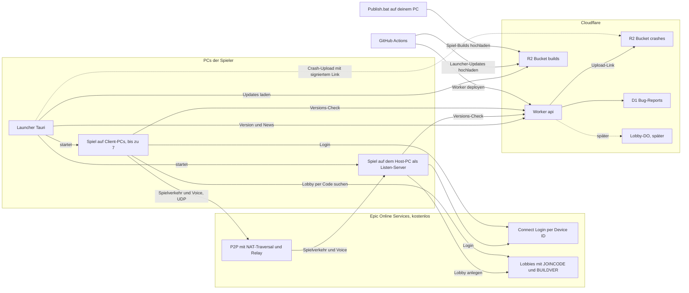
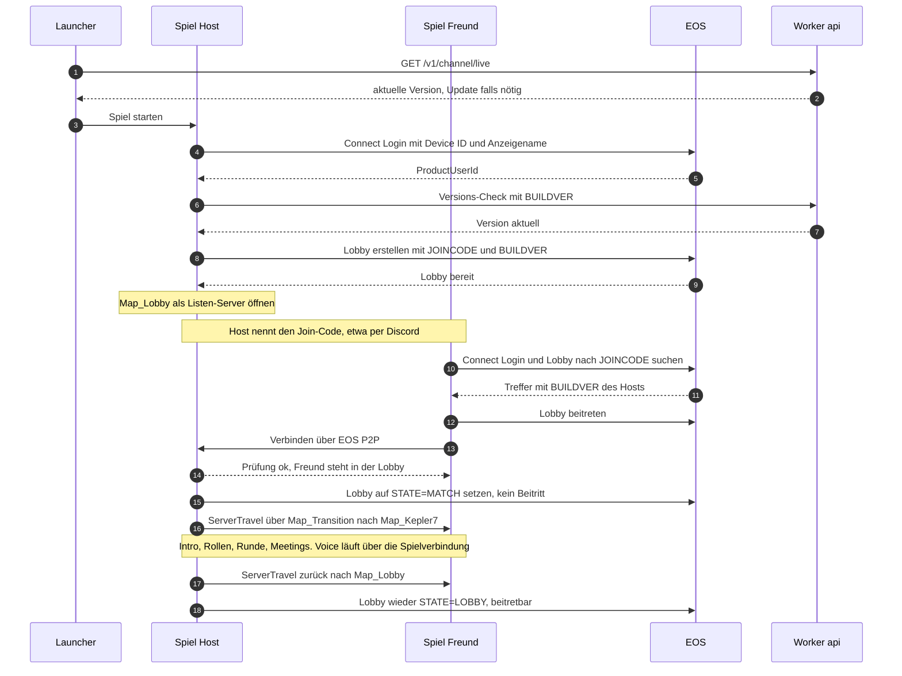

# 03 – Multiplayer, Voice & Backend (EOS + Cloudflare)

Stand: November 2026 · Teil der Planung für *How Could It Be You*

## Worum geht's

Hier steht, wie die PCs deiner Mitspieler verbunden werden, wie Lobbys mit Join-Code funktionieren, wie der Sprachchat gebaut wird (Proximity in der Runde, alle im Meeting, Geister unter sich) und was Cloudflare übernimmt. Die Grundidee: Ein Spieler hostet die Runde auf seinem eigenen PC (0 € Serverkosten). Epic Online Services (EOS) verbindet die PCs kostenlos. Cloudflare liefert Updates und ein kleines Backend. Du bekommst außerdem eine ehrliche Bewertung, was Cloudflare für ein Echtzeit-Spiel leisten kann und was nicht.

## Inhalt

1. [Kurzfassung](#1-kurzfassung)
2. [Was Cloudflare kann und was nicht](#2-was-cloudflare-kann-und-was-nicht)
3. [Lösungsvarianten im Vergleich](#3-lösungsvarianten-im-vergleich)
4. [Gesamtarchitektur](#4-gesamtarchitektur)
5. [Ablauf eines Spieleabends](#5-ablauf-eines-spieleabends)
6. [EOS einrichten Schritt für Schritt](#6-eos-einrichten-schritt-für-schritt)
7. [Session- und Lobby-System](#7-session--und-lobby-system)
8. [Voice-System](#8-voice-system)
9. [Cloudflare-Backend v1](#9-cloudflare-backend-v1)
10. [Später nach dem Prototyp](#10-später-nach-dem-prototyp)
11. [Sicherheit, Cheats und Datenschutz](#11-sicherheit-cheats-und-datenschutz)
12. [Kosten-Übersicht](#12-kosten-übersicht)
13. [Multiplayer-Tests](#13-multiplayer-tests)

---

## 1. Kurzfassung

1. **Listen-Server** (= ein Spieler ist gleichzeitig Mitspieler und Server): Der Host entscheidet alle Regeln, die anderen schicken nur Anfragen. Das kostet 0 €. Verlässt der Host das Spiel, endet die Runde für alle.
2. **EOS** (kostenlos, ohne Epic Games Store) übernimmt die Anmeldung ohne Epic-Konto (*Device ID*), Lobbys mit 6-stelligem Join-Code und die Verbindung zwischen den PCs. Dazu gehören NAT-Traversal (= Trick, mit dem zwei PCs hinter Heim-Routern direkt Kontakt aufnehmen) und ein Relay-Fallback (= Weiterleitung über Epic-Server, wenn der direkte Weg scheitert).
3. **Voice** baut Claude selbst. Die Stimmen laufen über die Spielverbindung zum Host, und der Host entscheidet pro Paket, wer es hört. Das kostet 0 € und ist schwer zu umgehen, weil niemand Pakete bekommt, die er nicht hören darf.
4. **Cloudflare** übernimmt Updates (R2), Versions-Check, News sowie Bug- und Crash-Reports (Worker + D1). **Spielverkehr überträgt Cloudflare nicht.** Bei 0 € gibt es dort kein UDP und keine Unreal-Spielserver.
5. **Später** kommen dazu: Lobby- und Matchmaking-Server als Cloudflare Durable Object, eine eigene Spieler-Identität über den Worker, Statistiken und eine Bann-Liste. Dedicated Server bleiben als Option offen, kosten aber laufend Geld und brauchen eine selbst kompilierte Engine.

---

## 2. Was Cloudflare kann und was nicht

Du wolltest Cloudflare für den Multiplayer nutzen. Die ehrliche Antwort: Für das **Drumherum** ist Cloudflare sehr gut und fast kostenlos. Für den **Echtzeit-Spielverkehr** taugt es bei 0 € nicht.

Echtzeit-Spielverkehr heißt: Jeder PC schickt viele Male pro Sekunde kleine Pakete mit Positionen, Aktionen und Stimme. Unreal nutzt dafür **UDP** (= schnelles Netzwerkprotokoll ohne Zustellgarantie; ein verlorenes Paket hält die nächsten nicht auf). Cloudflares Entwickler-Produkte sprechen dagegen fast nur HTTP und WebSocket (= dauerhafte Verbindung über TCP, also mit Zustellgarantie und Wartezeit bei Paketverlust).

| Produkt | Für uns nutzbar? | Wofür | Grenzen & Free-Tier (Stand 11/2026) | Warum nicht für Spielverkehr |
|---|---|---|---|---|
| **Workers** (= kleine Server-Programme, die in Cloudflares Rechenzentren auf Web-Anfragen antworten) | ✅ ja, v1 | Worker `api`: Versions-Check, News, Bug- und Crash-Reports. Später Login-Brücke | Free: 100.000 Anfragen/Tag (Reset 00:00 UTC), 10 ms CPU pro Anfrage, 128 MB RAM, 5 Cron-Trigger, max. 100 MB Upload pro Anfrage. Darüber: Fehler 1027 statt Kosten. Paid: ab 5 $/Monat inkl. 10 Mio. Anfragen | Kein eingehendes UDP. Eingehendes TCP direkt aus dem Internet laut Doku „derzeit nicht unterstützt“. Ausgehend nur TCP |
| **Durable Objects** (DO, = Worker mit eigenem, dauerhaftem Zustand, z. B. „eine Lobby“) | ✅ später | Lobby- und Matchmaker-Zustand, Join-Codes, Ready-Checks, öffentliche Lobby-Liste | Auch im Free-Plan, aber nur SQLite-basiert: 100.000 Anfragen/Tag, 13.000 GB-s/Tag, 5 Mio. Zeilen lesen und 100.000 schreiben pro Tag, 5 GB. Eingehende WebSocket-Nachrichten zählen 20:1. Hibernation (= Schlafmodus, offene Verbindungen kosten dann nichts) | WebSocket über TCP, Server in einem Rechenzentrum statt beim Host, kein fertiger Unreal-NetDriver dafür. Gut für ein paar Lobby-Nachrichten, ungeeignet für 30+ Updates pro Sekunde |
| **R2** (= Datei-Speicher, kompatibel zur Amazon-S3-Schnittstelle) | ✅ ja, v1 | Bucket `builds` für Spiel- und Launcher-Updates, privater Bucket `crashes` | Free pro Monat: 10 GB Speicher, 1 Mio. Schreib-Operationen (Class A), 10 Mio. Lese-Operationen (Class B). Egress (= ausgehender Datenverkehr) kostenlos. Darüber 0,015 $/GB-Monat. Aktivierung verlangt eine hinterlegte Zahlungsmethode. `r2.dev`-Adressen nur zum Testen (gedrosselt), für CDN-Caching eigene Domain nötig, max. 512 MB pro gecachter Datei | Speicher, kein Echtzeit-Dienst |
| **D1** (= SQL-Datenbank auf SQLite-Basis) | ✅ ja, v1 | Bug-Reports, Crash-Einträge, später Bann-Liste | Free: 10 Datenbanken, 500 MB pro DB, 5 GB gesamt, 5 Mio. Zeilen lesen und 100.000 schreiben pro Tag, 7 Tage „Time Travel“ (= Wiederherstellung eines älteren Stands) | Datenbank, kein Transport |
| **KV** (= weltweit verteilter Schlüssel-Wert-Speicher) | ⚪ optional | Später: zwischengespeicherte Epic-Prüfschlüssel (JWKS), Feature-Schalter | Free: 100.000 Lesezugriffe und 1.000 Schreibzugriffe pro Tag, 1 GB. Änderungen kommen verzögert überall an (*eventually consistent*), max. 1 Schreibzugriff/s pro Schlüssel | Zu träge für Zustände, die sich ständig ändern |
| **Queues** (= Warteschlange für Hintergrund-Aufgaben) | ⚪ später | Crash-Reports nachträglich auswerten | Free: 10.000 Operationen/Tag (eine Nachricht ≈ 3 Operationen), 24 h Aufbewahrung | Asynchron, keine Echtzeit |
| **Analytics Engine** (= Speicher für Ereignis-Statistiken mit SQL-Abfragen) | ⚪ später | Anonyme Match-Statistik: Modus, Map, Dauer, Siegerseite | Free: 100.000 Datenpunkte schreiben und 10.000 Abfragen pro Tag. Abrechnung laut Doku noch nicht aktiv | Nur Auswertung |
| **Turnstile** (= Captcha-Ersatz gegen Bots) | ⚪ später, nur Website | Formulare auf der eigenen Website (z. B. Konto anlegen) | Kostenlos, 20 Widgets, 10 Hostnamen pro Widget. Im Free-Plan kein „beliebiger Hostname“, also nicht in der Launcher-Oberfläche nutzbar (die läuft unter einer Tauri-internen Adresse, nicht unter deiner Domain) | Kein Netzwerkdienst |
| **Realtime SFU/TURN** (= Weiterleitung von WebRTC-Audio, -Video und -Daten; TURN = Relay-Server für NAT) | ❌ nein | – | Erste 1.000 GB/Monat frei (SFU und TURN zusammen), danach 0,05 $/GB | Bräuchte einen kompletten WebRTC-Stack (libwebrtc) im Spiel, einen eigenen NetDriver für Spieldaten und eine eigene 3D-Wiedergabe der Stimmen. Großer, riskanter C++-Umbau. EOS liefert P2P und Relays bereits kostenlos |
| **Spectrum** (= Weiterleitung beliebiger TCP/UDP-Dienste) | ❌ nein | – | Nicht im Free-Plan. Pro/Business nur als bezahlter Zusatz für Minecraft, SSH oder RDP. Eigenes UDP nur mit Enterprise-Vertrag | Enterprise-Kosten. Braucht außerdem einen Server mit öffentlicher IP und löst das NAT-Problem eines Hosts zu Hause nicht |
| **Containers** (= eigene Linux-Programme bei Cloudflare, seit 13.04.2026 allgemein verfügbar) | ❌ nein | – | Nur mit Workers Paid (5 $/Monat). Unregelmäßige Neustarts (SIGTERM, danach max. 15 min), kein garantierter Betrieb, nur linux/amd64 | Eingehend nur HTTP/WebSocket über Worker oder DO, **kein eingehendes UDP**. Ein Unreal-Server darin käme grob auf 0,04–0,10 $ pro Match-Stunde (eigene Schätzung der Recherche) und bräuchte den experimentellen WebSocket-NetDriver |
| **Workers Static Assets** (= statische Dateien direkt aus einem Worker) | ⚪ später | Website, Patchnotes, Download-Seite | Anfragen kostenlos und unbegrenzt, 25 MiB pro Datei, 20.000 Dateien | – |
| **Rate Limiting** (= Begrenzung, wie oft jemand eine Funktion aufrufen darf) | ✅ ja, v1 | Schutz der POST-Endpunkte gegen Spam | Worker-Binding mit Zeitfenster 10 s oder 60 s, nur ungefähr und pro Standort. Für strenge Limits später ein DO | – |

> **Fazit:** Cloudflare ersetzt **keinen Spielserver** und **keine NAT-Traversal** für Unreal. Bei 0 € kann kein Cloudflare-Produkt UDP-Pakete von Unreal annehmen oder weiterleiten. Im August 2026 wurde eingehendes TCP für Workers und Containers über Spectrum angekündigt, aber nur als private Beta. UDP ist als „nächster Schritt“ ohne Datum genannt. Für das Drumherum bleibt Cloudflare die richtige Wahl: Updates mit kostenlosem Egress, Versionsprüfung, Berichte und später Lobbys und Matchmaking. Bei Überschreitung des Free-Tiers gibt es Fehlermeldungen statt Rechnungen.

---

## 3. Lösungsvarianten im Vergleich

Ein **Dedicated Server** (= ein eigenständiges Server-Programm ohne Spieler, das in einem Rechenzentrum läuft) ist die Alternative zum Listen-Server.

| | **(A) Listen-Server über EOS P2P** ✅ Empfehlung | **(B) Dedicated Server** | **(C) „Alles über Cloudflare“** |
|---|---|---|---|
| So funktioniert's | Ein Spieler hostet. EOS verbindet die PCs per P2P (= direkt von PC zu PC), mit NAT-Traversal und Relay-Fallback | Server-Programm läuft auf einem gemieteten Server (z. B. eigener VPS bei Hetzner) oder bei einem Dienst wie Edgegap oder Amazon GameLift | Spielverkehr und Voice sollen über Workers, DOs, Containers oder Realtime laufen |
| Vorteile | 0 €. Kein Server-Betrieb. EOS-Relays fangen strenge Router ab. Die Spiellogik lässt sich im Editor mit demselben Listen-Server-Aufbau testen (dort noch ohne EOS) | Kein Spieler hat einen Vorteil. Runde überlebt, wenn ein Spieler geht. Fester Server, kein NAT-Problem. Bessere Basis für Anti-Cheat | Alles bei einem Anbieter |
| Nachteile | Host sieht alle Daten. Host geht → Runde endet. Ping und Stabilität hängen von Leitung und PC des Hosts ab (Upload-Empfehlung in 8.5) | Laufende Kosten. Server-Builds, Updates, Überwachung. Für Server sind EOS Sessions statt Lobbies nötig (Lobbies gehen laut Recherche nicht mit Dedicated Servern) | **Technisch nicht machbar bei 0 €** (siehe unten) |
| Kosten | 0 € | Monatliche Fixkosten (VPS) oder Abrechnung nach Nutzung (Dienste). Konkrete Preise sind nicht recherchiert | Nicht kalkulierbar, Enterprise-Verträge |
| Aufwand für dich | Gering: EOS-Portal einmal einrichten, mit 2 PCs testen | Hoch: Engine aus dem Quellcode bauen (siehe unten), Server betreiben oder Dienst einrichten | Sehr hoch: eigener Netzwerk-Unterbau in Unreal (WebRTC oder WebSocket statt UDP) |
| Cheat-Schutz | Begrenzt (Host vertraut). Server-autoritativ gegen normale Clients | Gut (Server unter deiner Kontrolle) | Theoretisch wie (B), praktisch nicht erreichbar |

**Warum (C) nicht geht:** Workers und DOs nehmen kein UDP an, Unreals Spielverbindung ist aber immer UDP. Spectrum-UDP gibt es nur im Enterprise-Vertrag. Containers kosten Geld, nehmen kein UDP an und starten unregelmäßig neu, mitten in einer Runde wäre das fatal. Realtime (WebRTC) verlangt einen eigenen Netzwerk-Unterbau in Unreal. Bei einem Projekt, dessen Code komplett Claude schreibt und das du nur testen kannst, ist dieses Risiko zu groß.

### 3.1 Migrationspfad zu Dedicated Servern

Falls das Spiel wächst, kann es später auf Dedicated Server umziehen. Dafür hält sich Claude schon jetzt an diese Regeln:

1. **Server-autoritativ:** Alle Regeln laufen in `AHCGameMode` und auf dem Server. Diese Logik läuft auf einem Dedicated Server unverändert weiter.
2. **Host = normaler Spieler:** Code unterscheidet sauber zwischen „bin ich der Server?“ (`HasAuthority()`) und „ist das mein eigener Spieler?“ (`IsLocalController()`). Nichts verlässt sich darauf, dass auf dem Server ein Spieler sitzt.
3. **Voice-Routing auf dem Server:** Die Stimme des Hosts läuft durch dieselbe Weiterleitung wie alle anderen. Auf einem Dedicated Server bleibt das System gleich.
4. **Online-Code gekapselt:** Lobbys und Join-Codes stecken nur in `UHCSessionSubsystem`. Ein Wechsel auf EOS Sessions oder ein Matchmaking über Cloudflare betrifft nur diese Klasse.

**Ehrlich:** Dedicated-Server-Builds (Build-Ziel „Server“) gehen nicht mit der Engine aus dem Epic Games Launcher. Du bräuchtest eine **aus dem Quellcode selbst gebaute Engine** (GitHub-Zugang über ein Epic-Konto, viele Gigabyte, stundenlanges Kompilieren). Wir nutzen bewusst die fertige Engine aus dem Epic Games Launcher, weil sie für dich viel einfacher ist. Dedicated Server sind deshalb ein eigenes, späteres Projekt.

---

## 4. Gesamtarchitektur



| Baustein | Aufgabe | Wer baut es |
|---|---|---|
| Launcher (Tauri) | Spiel installieren, patchen, starten. Details in [05 – Launcher & Updates](05-launcher-und-updates.md) | 🤖 Claude, gebaut von GitHub Actions |
| Spiel (Host und Clients) | Host: alle Regeln, Voice-Routing, Map-Wechsel. Clients: Eingaben senden, anzeigen, Stimme aufnehmen und abspielen | 🤖 Claude (C++), 🧑 du (Maps, Assets) |
| EOS Connect, Lobbies, P2P | Anonyme Spieler-ID (*ProductUserId*, kurz PUID) ohne Epic-Konto, Lobby per Join-Code, Spielverbindung mit NAT-Traversal und Relay | 🧑 Portal einrichten, 🤖 Code und Config |
| Worker `api` + D1 + R2 | Version, News, Reports, Crash-Uploads | 🤖 Claude, 🧑 Account und Secrets |
| GitHub Actions (= automatische Abläufe auf GitHubs Servern) | Worker deployen, Launcher bauen | 🤖 Claude |
| `Tools/Publish.bat` | Spiel-Builds packen, in Chunks zerlegen, nach R2 hochladen (Details in [05](05-launcher-und-updates.md)) | 🤖 Claude schreibt es, 🧑 du startest es |

---

## 5. Ablauf eines Spieleabends



In Worten:

1. Launcher patcht bei Bedarf (→ [05](05-launcher-und-updates.md)). Das Spiel meldet sich per Device ID bei EOS an, den Anzeigenamen wählst du einmal im Hauptmenü.
2. Der Versions-Check beim Worker ist nur ein Hinweis. Ist der Worker nicht erreichbar, spielst du trotzdem. Das Backend blockiert nie das Spielen.
3. Der Host erzeugt einen Join-Code, legt die EOS-Lobby an und öffnet `Map_Lobby` als Listen-Server. Freunde geben den Code ein, das Spiel vergleicht die Version und verbindet sich über EOS P2P.
4. Beim Start wird die Lobby gesperrt, und alle wechseln per *ServerTravel* (= der Server schickt alle Spieler gemeinsam auf eine neue Map) ins Match. Danach geht es zurück in `Map_Lobby`, und die Lobby ist wieder offen.

---

## 6. EOS einrichten Schritt für Schritt

> **Umgesetzt in 0.12.0 (2026-11-13), anders als unten geplant:** Das Spiel nutzt **nicht** `OnlineSubsystemEOS` und braucht **keinen Plugin-Patch**. `Online/HCEos` spricht das EOS-SDK selbst an: Plattform aus dem ini-Abschnitt `[EOSSDK.Platform.HCDev]` (über `EOSShared`), Device-ID-Login (`EOS_Connect_CreateDeviceId` → `EOS_Connect_Login` mit Anzeigename, beim ersten Start `EOS_Connect_CreateUser`, Token-Erneuerung nach ca. 1 h), EOS-Lobby mit `JOINCODE`, `BUILDVER`, `STATE`, Verbindung über `NetDriverEOS` aus `SocketSubsystemEOS` (P2P mit NAT-Traversal und Relay). Grund: Das Plugin in 5.8 schickt beim Login ohne Epic-Konto keinen Anzeigenamen und legt keine Device ID an, eine gepatchte Engine-Kopie dürfte nicht ins Repo. `DefaultPlatformService` bleibt `Null`, weil der Sprachchat die Voice-Schnittstelle von OSS Null braucht (OSS EOS hat keine). Die vier nicht geheimen IDs stehen in `DefaultEngine.ini`, nur das ClientSecret in der git-ignorierten `Game/Config/Windows/WindowsEngine.ini` (`Tools/SetupEOS.bat` fragt danach). Den Netztreiber schaltet `UHCSessionSubsystem` pro Spiel um: `NetDriverEOS` für Online-Lobbys, `IpNetDriver` für LAN und IP wie bisher. **Nur Windows:** Epic liefert `SocketSubsystemEOS` nicht für Linux, Linux-Spieler bleiben bei LAN/IP. Im Editor und mit `-HCOnline=Null` ist EOS aus, ebenso bei den Smoke-Test-Schaltern `-HCAutoHost`/`-HCAutoJoinCodeFile` (außer mit `-HCOnline=EOS`).

### 6.1 Begriffe im Developer Portal

| Begriff | Bedeutung |
|---|---|
| **Organisation** | Dein „Studio“ bei Epic. Gehört zu deinem Epic-Konto. Spieler brauchen kein Epic-Konto |
| **Produkt** | Das Spiel *How Could It Be You* |
| **Sandbox** | Getrennte Umgebung innerhalb des Produkts, typisch *Dev*, *Stage*, *Live*. Spieler in verschiedenen Sandboxes sehen sich nicht |
| **Deployment** | Konkrete Bereitstellung innerhalb einer Sandbox. Das Spiel nennt beim Start Sandbox und Deployment |
| **Client** | Zugangsdaten des Spiels: *ClientId* und *ClientSecret* |
| **Client Policy** | Legt fest, was ein Client darf (Connect, Lobbies, P2P …) |
| **ProductUserId (PUID)** | Die anonyme Spieler-ID, die EOS nach dem Login vergibt |

Plan: v1 und alle Freundes-Tests laufen in der **Dev-Sandbox**. Vor einem öffentlichen Release kommt ein zweites Paket Zugangsdaten für *Live* dazu.

### 6.2 🧑 Du (Editor/Test): im Developer Portal

Die Menünamen im Portal können sich ändern. Halte dich an die Begriffe, nicht an exakte Klickpfade.

1. Öffne das Epic Developer Portal (dev.epicgames.com/portal) und melde dich mit deinem Epic-Konto an. Aktiviere die Zwei-Faktor-Anmeldung. Dieses Konto ist der Schlüssel zu allem.
2. Lege eine **Organisation** an und akzeptiere die EOS-Entwicklervereinbarung (lies sie einmal durch).
3. Lege ein **Produkt** an: Name „How Could It Be You“.
4. Öffne die Produkt-Einstellungen und prüfe die **Sandboxes**. Für *Dev* muss ein **Deployment** existieren. Lege sonst eins an, Name z. B. „Dev“.
5. Lege unter Clients eine **Client Policy** an, Name „HC Game Client“. Nimm den vordefinierten Typ für Peer-to-Peer (genauer Name im Portal prüfen) oder „Custom“ mit den Rechten für **Connect**, **Lobbies** und **P2P**. Kein „Trusted Server“. Voice/RTC brauchen wir nicht, weil wir ein eigenes Voice-System haben. Nur für Plan B (Abschnitt 8.10) kommt es dazu.
6. Lege einen **Client** an, Name „HC Game Client“, mit der Policy aus Schritt 5. Jetzt siehst du **ClientId** und **ClientSecret**.
7. **Epic Account Services nicht einrichten.** Ohne Epic-Konten-Login ist nach Recherche kein *Brand Review* (= Epics Prüfung von Name, Logo und Datenschutzerklärung) nötig. Epic sagt das nicht ausdrücklich, es folgt aber daraus, dass der Brand Review zu den Epic Account Services gehört.
8. Schau unter Identity Providers nach, ob für die Device-ID-Anmeldung etwas freizuschalten ist (beim Umsetzen gegen UE 5.8 prüfen).
9. Die IDs findest du in den Produkt-Einstellungen auf der Seite mit den SDK-Zugangsdaten (heißt etwa „SDK Download & Credentials“, Name kann abweichen): ProductId, SandboxId und DeploymentId der *Dev*-Sandbox sowie ClientId und ClientSecret deines Clients.
10. Gib Claude die nicht geheimen Werte aus 6.3. Das ClientSecret trägst du selbst ein (6.4).

> **Achtung:** Viele Anleitungen im Netz sagen, du sollst die Zugangsdaten im Editor unter *Edit → Project Settings → Epic Online Services* eintragen. **Mach das nicht.** Der Editor speichert sie in `Game/Config/DefaultEngine.ini`, und die landet im Repo. Zeigt GitHub Desktop eine Änderung mit `ClientSecret`, committe sie nicht und sag Claude Bescheid.

### 6.3 Welche Werte wohin

| Wert | Geheim? | Wohin |
|---|---|---|
| ProductId | nein | an Claude (Chat) → steht in der Vorlage `WindowsEngine.ini.example` |
| SandboxId (Dev) | nein | an Claude |
| DeploymentId (Dev) | nein | an Claude |
| ClientId | nein (steckt ohnehin im Build) | an Claude |
| **ClientSecret** | **ja**, nicht ins Repo, nicht in den Chat | nur in deine lokale `Game/Config/Windows/WindowsEngine.ini` |
| EncryptionKey (64 Hex-Zeichen, für EOS-Speicherdienste, die wir nicht nutzen) | lokal halten (unkritisch) | nicht nötig (geprüft für 0.12.0: nur für Speicherdienste, die wir nicht nutzen) |
| Login zum Developer Portal | **ja** | nur bei dir, mit Zwei-Faktor-Schutz |

**Ehrlich:** Das ClientSecret landet im fertigen Spiel und lässt sich daraus auslesen. Es ist also „nicht öffentlich“, aber nicht wirklich geheim. Darum bekommt die Client Policy nur die Rechte, die ein normaler Spieler braucht. Wird das Secret missbraucht, erzeugst du im Portal ein neues, trägst es lokal ein und packst einen neuen Build.

### 6.4 Wie das Secret in den Build kommt, ohne im Repo zu landen

Die Zugangsdaten stehen in einer Config-Datei, die Git ignoriert, die Unreal aber trotzdem lädt und mit verpackt:

1. **🤖 Claude (Code):** schreibt die Vorlage `Game/Config/Windows/WindowsEngine.ini.example` mit allen nicht geheimen IDs. Dazu kommt ein Eintrag in `.gitignore` für `Game/Config/Windows/WindowsEngine.ini`.
2. **🧑 Du (Editor/Test):** Am einfachsten lässt du `Tools/SetupEOS.bat` die Datei anlegen: Das Skript fragt dich nach dem ClientSecret (Eingabe unsichtbar) und schreibt nur diese eine Datei. Von Hand geht es so: Im Explorer unter *Ansicht → Einblenden* die **Dateinamenerweiterungen** einschalten (sonst heißt die Kopie versehentlich `WindowsEngine.ini.txt`), die Vorlage kopieren, die Kopie in `WindowsEngine.ini` umbenennen (gleicher Ordner, ohne `.example`), mit dem Windows-Editor (Notepad) öffnen und `HIER_EINTRAGEN` durch dein ClientSecret ersetzen. Das brauchst du nur auf dem PC, auf dem du packst (oder EOS aus dem Editor mit `-HCOnline=EOS` testest). Wer nur das fertige Spiel startet, braucht die Datei nicht.
3. Unreal lädt `Config/Windows/WindowsEngine.ini` im Editor unter Windows und im gepackten Windows-Spiel als Plattform-Schicht über `DefaultEngine.ini` (beim Umsetzen gegen UE 5.8 prüfen). Weil die Datei nie ins Repo kommt, gehören **andere** Windows-Einstellungen nicht hinein, sondern in `DefaultEngine.ini`.
4. Fehlt die Datei (z. B. in Claudes Cloud-Umgebung oder nach einem frischen Klon), startet das Spiel trotzdem. Es schreibt `LogHCNet: Error – EOS-Zugangsdaten fehlen, siehe docs/03` und bietet nur LAN an. Genauso verhält es sich, wenn der EOS-Login scheitert (z. B. bei einer Störung bei Epic): klare Meldung im Hauptmenü, kein Hänger.

Warum nicht `Saved/`? Der Ordner `Saved` wird **nicht** mit verpackt und ist pro PC verschieden. Alternative, falls Schritt 3 in 5.8 nicht greift: `CustomConfig = "Local"` in den Target-Dateien und die Datei unter `Game/Config/Custom/Local/DefaultEngine.ini` (so lädt Epics Lyra-Beispiel seine EOS-Config, beim Umsetzen gegen UE 5.8 prüfen).

```ini
; Skizze – Game/Config/Windows/WindowsEngine.ini (NICHT im Repo, steht in .gitignore)
; Kommentare in .ini-Dateien immer in eigener Zeile.
[/Script/OnlineSubsystemEOS.EOSSettings]
+Artifacts=(ArtifactName="HCDev",ClientId="<ClientId>",ClientSecret="HIER_EINTRAGEN",ProductId="<ProductId>",SandboxId="<SandboxId>",DeploymentId="<DeploymentId>",EncryptionKey="<64 Hex-Zeichen>")
```

### 6.5 🤖 Claude (Code): Plugins und Config

In `Game/HowCouldItBeYou.uproject` aktiviert Claude die Plugins `OnlineSubsystem`, `OnlineSubsystemUtils`, `OnlineSubsystemNull`, `OnlineSubsystemEOS`, `SocketSubsystemEOS`, `EOSShared` und `AudioCapture`. Im Spielmodul kommen die Module `OnlineSubsystem`, `OnlineSubsystemUtils` (enthält `UVoipListenerSynthComponent`), `Voice`, `AudioCaptureCore` (für `Audio::FAudioCapture`), `AudioMixer`, `HTTP` und `Json` dazu, später `WebSockets` (genaue Liste beim Umsetzen gegen UE 5.8 prüfen).

Netz- und EOS-Teil der `DefaultEngine.ini` (die übrigen Abschnitte stehen in [02](02-technische-architektur-ue5.md)):

```ini
; Skizze – Game/Config/DefaultEngine.ini, Netz und EOS (beim Umsetzen gegen UE 5.8 prüfen)
[OnlineSubsystem]
DefaultPlatformService=EOS
; Kein OSS-Voice: wir nutzen ein eigenes Voice-System
bHasVoiceEnabled=false

[OnlineSubsystemEOS]
bEnabled=true

[/Script/OnlineSubsystemEOS.EOSSettings]
; Kein Epic-Konto, nur EOS Connect (Device ID)
bUseEAS=False
bUseEOSConnect=True
bUseEOSSessions=True
DefaultArtifactName=HCDev

[/Script/Engine.GameEngine]
!NetDriverDefinitions=ClearArray
+NetDriverDefinitions=(DefName="GameNetDriver",DriverClassName="/Script/SocketSubsystemEOS.NetDriverEOS",DriverClassNameFallback="/Script/OnlineSubsystemUtils.IpNetDriver")

[Voice]
; Nötig, damit FVoiceModule Opus-Encoder/-Decoder liefert (prüfen)
bEnabled=true
```

Wichtig für Claude:

- **NetDriverEOS** heißt seit UE 5.6 `/Script/SocketSubsystemEOS.NetDriverEOS`. Der alte `NetDriverEOSBase` und `bIsUsingP2PSockets` sind veraltet. Epics OSS-EOS-Doku zeigt teils noch das alte Beispiel.
- **Kein EOSPlus** (das spiegelt nur Steam oder andere Plattformen nach EOS) und **kein OSSv2** (in 5.8 weiterhin Beta).
- **Launcher-Checks aus:** `bUseLauncherChecks` in der Target-Datei bleibt aus, weil das Spiel nicht aus dem Epic Games Store startet.
- Der Host muss **eingeloggt sein, bevor** er die Map mit `?listen` öffnet. Sonst kommt „No local user to send p2p packets with“, und der Listen-Server startet nicht.
- Verbindungs-Timeout: Claude senkt ihn vom Standard (beim IpNetDriver meist 60 s) auf ca. 30 s, damit Clients einen abgestürzten Host schneller bemerken. Nicht kürzer: Beim Map-Wechsel kann der Host kurz hängen, und ein zu knapper Timeout würfe dann alle aus der Runde (Abschnitt und Schlüssel beim Umsetzen gegen UE 5.8 prüfen, Wert beim Testen anpassen).

### 6.6 Login per Device ID

Device ID ist eine EOS-Funktion für anonyme Logins: Das EOS-SDK legt auf dem PC eine ID an, die am Windows-Benutzerkonto hängt. Das Unreal-Plugin unterstützt das ab Werk aber nicht richtig. Mit `bUseEAS=False` läuft der Login über eine Funktion, die ein Plattform-Token (z. B. Steam) erwartet. Ohne Token scheitert sie mit `EOS_InvalidParameters`.

| Weg | Wie | Vorteile | Nachteile |
|---|---|---|---|
| **A: Patch** (Plan) | Projekt-lokale Kopie des Plugins `OnlineSubsystemEOS` unter `Game/Plugins/`. Claude ändert den Connect-Login: zuerst `EOS_Connect_CreateDeviceId` (Gerätename z. B. „PC Windows“; „existiert schon“ heißt: weiter zum Login), dann `EOS_Connect_Login` mit `EOS_ECT_DEVICEID_ACCESS_TOKEN` und `DisplayName` | Kleinste Änderung, sonst Standard-Plugin | Engine-Code. Nach Engine-Hotfixes Patch neu anwenden |
| B: EOS Integration Kit (EIK, MIT-Lizenz) | Fertiges Plugin mit Device-ID-Login | Kein Engine-Code, darf ins Repo | UE-5.8-Unterstützung nicht bestätigt (Hauptzweig zielt auf 5.6), müsste portiert werden |

**Wichtig bei Weg A:** Engine-Quellcode darf laut UE-Lizenz nicht in ein öffentliches Repo. Deshalb wird die Plugin-Kopie **nicht** committet.

- **🤖 Claude (Code):** schreibt `Tools/SetupEOSPlugin.bat`. Das Skript kopiert das Plugin aus deiner UE-5.8-Installation nach `Game/Plugins/OnlineSubsystemEOS` (in `.gitignore`), wendet Claudes kleine Änderung an und meldet klar, wenn die Stelle in deiner Engine-Version anders aussieht.
- **🧑 Du (Editor/Test):** führst das Skript einmal pro PC aus und nach jedem Engine-Update erneut. Danach öffnest du das Projekt („Module neu bauen: Ja“).
- Dass ein gleichnamiges Projekt-Plugin das Engine-Plugin ersetzt, ist beim Umsetzen gegen UE 5.8 zu prüfen (im Log steht dann, welches geladen wurde).
- **Woher kennt Claude die zu ändernde Stelle?** Claude sieht deine Engine-Installation nicht. Das Skript ändert deshalb nur an eindeutig erkennbaren Ankerstellen (der Connect-Login liegt vermutlich in `UserManagerEOS.cpp`, Funktion `ConnectLoginNoEAS`, beim Umsetzen prüfen). Passt eine Stelle nicht, bricht es ab und schreibt nur die wenigen betroffenen Zeilen in eine Textdatei. Die schickst du Claude, und Claude passt den Patch an. Ob die UE-Lizenz solche kurzen Auszüge im Chat erlaubt, prüft Claude vorher. Wird das zu mühsam, wechseln wir auf Weg B (EIK).

→ Offene Frage Q-B12, siehe [07](07-offene-fragen.md): Soll das Repo öffentlich oder privat sein? Default: privat, aber so geplant, dass beides geht (Plugin-Kopie nur lokal).

### 6.7 Einschränkungen von Device ID

| Einschränkung | Folge für uns |
|---|---|
| Eine PUID pro Windows-Benutzer. Mehrere Spiel-Instanzen auf demselben Windows-Konto teilen sie | **EOS-Tests brauchen 2 PCs** (oder einen Freund). Lokale Mehrspieler-Tests laufen im Editor mit OnlineSubsystemNull |
| ID hängt am Windows-Profil, nicht portabel | Neuer PC = neue PUID. In v1 egal (kein Fortschritt gespeichert). Bann-Listen auf PUID-Basis sind leicht zu umgehen |
| Ohne Epic-Konto keine Freunde, Präsenz, Einladungen oder Overlay | Join-Codes sind unser Einladungsweg |
| Login braucht einen Anzeigenamen | Name wählst du im Hauptmenü (3–16 Zeichen). Der Host macht doppelte Namen in der Lobby eindeutig („Lena 2“), weil Namensschilder und Türprotokoll Namen zeigen |

Später kann der Login auf **EOS Connect mit OpenID** umgestellt werden: eine Identität über mehrere PCs, echte Bann-Möglichkeit, mehrere Test-Instanzen auf einem PC (Abschnitt 10.4).

---

## 7. Session- und Lobby-System

**Lobby** heißt hier zweierlei: die **EOS-Lobby** (ein Eintrag bei Epic, über den man den Host per Code findet) und die **Lobby-Map** (`Map_Lobby`, in der alle schon verbunden herumlaufen und der Host Einstellungen wählt). Die Spielerliste in der Lobby-Map kommt aus Unreals Replikation (= der Server schickt Zustände automatisch an alle Clients), nicht aus EOS.

### 7.1 API von UHCSessionSubsystem

`UHCSessionSubsystem` ist ein `UGameInstanceSubsystem` (= Hilfsobjekt, das so lange lebt wie das Spiel selbst und Map-Wechsel übersteht). Die Menüs rufen nur diese Funktionen auf, nie EOS direkt.

```cpp
// Skizze – Source/HowCouldItBeYou/Online/HCSessionSubsystem.h
UENUM(BlueprintType)
enum class EHCSessionResult : uint8
{
    Success, NotFound, VersionMismatch, LobbyFull, MatchRunning, NotLoggedIn, Failed
};

UCLASS()
class HOWCOULDITBEYOU_API UHCSessionSubsystem : public UGameInstanceSubsystem
{
    GENERATED_BODY()
public:
    UFUNCTION(BlueprintCallable) void HostLobby(const FHCLobbySettings& Settings);
    UFUNCTION(BlueprintCallable) void JoinByCode(const FString& Code);
    UFUNCTION(BlueprintCallable) void LeaveLobby();
    UFUNCTION(BlueprintCallable) void StartMatch();    // nur Host
    UFUNCTION(BlueprintCallable) void ReturnToLobby(); // nur Host
    UFUNCTION(BlueprintPure) FString GetJoinCode() const;

    UPROPERTY(BlueprintAssignable) FHCOnLoginComplete OnLoginComplete;
    UPROPERTY(BlueprintAssignable) FHCOnLobbyHosted OnLobbyHosted;   // liefert den Join-Code
    UPROPERTY(BlueprintAssignable) FHCOnJoinFinished OnJoinFinished; // liefert EHCSessionResult
    UPROPERTY(BlueprintAssignable) FHCOnSessionEnded OnSessionEnded; // Grund: HostLeft, Kicked, NetworkError
};
```

| Funktion | Was passiert intern |
|---|---|
| `HostLobby` | Login sicherstellen → Join-Code erzeugen → EOS-Lobby anlegen (`bUseLobbiesIfAvailable=true`, `bUsesPresence=true`, 8 Plätze, Attribute `JOINCODE`, `BUILDVER`, `STATE=LOBBY`) → `Map_Lobby?listen` öffnen → `OnLobbyHosted` |
| `JoinByCode` | Eingabe säubern → 1 Suche nach `JOINCODE` → `STATE` und `BUILDVER` des Treffers prüfen → `JoinSession` → Verbindungs-Adresse holen (`GetResolvedConnectString`) → `ClientTravel` mit der eigenen BUILDVER als URL-Option → `OnJoinFinished` |
| `LeaveLobby` | Verbindung trennen, EOS-Lobby verlassen (Host: Lobby zerstören) → Hauptmenü |
| `StartMatch` | Lobby auf `STATE=MATCH` → ServerTravel in die Match-Map |
| `ReturnToLobby` | ServerTravel nach `Map_Lobby` → Lobby wieder `STATE=LOBBY` |

Die Flags `bUseLobbiesIfAvailable` und `bUsesPresence` müssen bei Host und Suche gleich gesetzt sein. Ein Bericht zu UE 5.5 zeigt, dass Beitritte sonst scheitern. Bei der Suche setzt Claude zusätzlich den Lobby-Suchschlüssel der Engine (`SEARCH_LOBBIES`, beim Umsetzen gegen UE 5.8 prüfen).

„Nicht beitretbar“ heißt bei uns: `STATE=MATCH`. Die Lobby bleibt während der Runde **auffindbar**, damit ein Freund die klare Meldung „Runde läuft gerade“ bekommt statt „Code nicht gefunden“. Abgewiesen wird er trotzdem doppelt: vom eigenen Client nach der Suche und vom Host in `PreLogin` (7.4). Ob EOS eine laufende Lobby von sich aus aus der Suche nimmt, beim Umsetzen prüfen.

### 7.2 Erst Null, dann EOS

**OnlineSubsystemNull** ist Unreals Test-Online-System ohne Internetdienst: Sessions nur im lokalen Netz (LAN), kein Login.

| Stufe | Online-System | Wo | Wozu |
|---|---|---|---|
| 1 | Null | Editor (PIE = Play In Editor, mehrere Spielfenster) | Spiellogik mit 4–8 Spielern, ohne Internet |
| 2 | Null | 2 PCs im selben Netz | Echte Netzwerk-Verzögerung, Voice zwischen zwei Mikrofonen |
| 3 | EOS | 2 PCs, verschiedene Internetanschlüsse | Login, Join-Code, P2P, Relay |

**🤖 Claude (Code):** `UHCSessionSubsystem` wählt das System so: im Editor immer Null, im gepackten Spiel EOS, überschreibbar per Startparameter `-HCOnline=Null` oder `-HCOnline=EOS`. (🧑 So setzt du einen Startparameter: Rechtsklick auf die Spiel-exe → *Verknüpfung erstellen* → Rechtsklick auf die Verknüpfung → *Eigenschaften* → im Feld *Ziel* hinter dem letzten Anführungszeichen ein Leerzeichen und `-HCOnline=Null` anhängen → *OK*.) Bei Null filtert Claude die LAN-Suchergebnisse selbst nach Join-Code, weil die Null-Suche Attribute eventuell nicht filtert (beim Umsetzen prüfen). (Seit 0.11.8 sucht das Spiel im LAN selbst statt über die Null-Suche: `Online/HCLanDiscovery`, UDP-Port 14011, Suche über jeden Netzwerkadapter, Antwort direkt an den Fragenden. Die Null-Suche sendet an 255.255.255.255, und Windows schickt das nur über den Adapter mit der besten Metrik hinaus, oft einen virtuellen.) Für LAN-Tests gibt es zusätzlich den Debug-Befehl `hc.Connect <IP>`. Er hängt die eigene BUILDVER automatisch an, sonst würde `PreLogin` (7.4) ablehnen. `NetDriverEOS` fällt bei IP-Adressen auf den `IpNetDriver` zurück, die Config bleibt also gleich (beim Umsetzen gegen UE 5.8 prüfen).

### 7.3 Join-Code

- 6 Zeichen aus `ABCDEFGHJKMNPQRSTUVWXYZ23456789`. Das sind 31 Zeichen **ohne** die verwechselbaren `0 O 1 I L`. Ergibt ca. 887 Millionen Kombinationen.
- Anzeige in zwei Dreiergruppen („K7M 4QX“). Bei der Eingabe sind Kleinbuchstaben, Leerzeichen und Bindestriche egal. Ungültige Zeichen markiert das Eingabefeld sofort.
- Vor dem Anlegen sucht der Host einmal nach dem Code. Ist er schon vergeben, würfelt er neu.
- Der Code ist kein Passwort. Er soll nur einfach zu sagen sein. Raten ist wegen der Menge an Kombinationen und des Suchlimits praktisch aussichtslos.

```cpp
// Skizze – Join-Code ohne verwechselbare Zeichen
FString UHCSessionSubsystem::MakeJoinCode() const
{
    static const TCHAR Alphabet[] = TEXT("ABCDEFGHJKMNPQRSTUVWXYZ23456789"); // 31 Zeichen
    FString Code;
    for (int32 i = 0; i < 6; ++i)
    {
        Code.AppendChar(Alphabet[FMath::RandRange(0, 30)]);
    }
    return Code;
}
```

**Suchlimit:** EOS erlaubt ca. 30 Lobby-Suchen pro Minute und Nutzer. Ein `JoinByCode` kostet eine Suche. Nach jedem Versuch sperrt das Menü den Knopf für 3 s, das Spiel sucht nie automatisch in Schleifen.

### 7.4 Versions-Prüfung und Beitrittsregeln

`BUILDVER` ist die Build-Kennung des Spiels, z. B. `0.3.1+build.42`, im Editor und bei lokalen Test-Builds `dev` (Herkunft und Vergabe → [05](05-launcher-und-updates.md)). Es gibt drei Schutzschichten:

1. **Launcher:** Er zwingt vor dem Start zum Update (→ [05](05-launcher-und-updates.md)).
2. **Suche:** Der Client sucht nur nach `JOINCODE`, liest `BUILDVER` aus dem Treffer und bricht mit einer klaren Meldung ab: „Der Host hat Version 0.3.2, du hast 0.3.1. Starte den Launcher neu.“ Das ist freundlicher als eine Suche, die bei falscher Version einfach „nicht gefunden“ meldet.
3. **Host:** `AHCGameMode::PreLogin` (= Prüfung, bevor ein Spieler auf den Server darf) prüft serverseitig:

| Prüfung | Ablehnung mit Meldung |
|---|---|
| `BUILDVER` aus der Beitritts-URL ≠ eigene | „Falsche Version“ |
| Phase ≠ `Lobby` (Match läuft) | „Runde läuft gerade, versuch es nach der Runde“ (v1: kein Beitritt während einer Runde) |
| Schon 8 Spieler | „Lobby ist voll“ |

`MaxMembers` ist 8 (EOS erlaubt bis 64). Jede Ablehnung schreibt eine Zeile ins Log (`LogHCNet`).

### 7.5 Ein Spieler trennt die Verbindung

| Phase | Regel |
|---|---|
| Lobby | Spieler verschwindet aus der Liste, sonst nichts |
| Intro (vor der Rollenverteilung) | Spieler fällt weg. Die Rollen verteilt der Server erst beim Übergang nach *RoleReveal*, und zwar nur unter den dann noch Verbundenen ([02](02-technische-architektur-ue5.md)) |
| RoleReveal, Playing, Meeting, Ejection | Gilt sofort als **tot**, **ohne Überreste**, und wird kein Geist. Seine Abstimmung im Meeting zählt nicht. Wer ihn gewählt hatte, darf neu wählen, sonst zählt die Stimme als „Überspringen“ (Details in [02](02-technische-architektur-ue5.md)). Danach prüft der Server die Siegbedingung (`FHCWinConditionEvaluator`). War es das Monster, gewinnt die Crew („Der Wandler hat das Spiel verlassen“, [01](01-game-design-document.md) §13) |
| GameOver | Keine Auswirkung |

Alle sehen kurz „Lena hat die Verbindung verloren.“, für Lebende und Geister gleich ([01](01-game-design-document.md) §3). Das verrät keinen heimlichen Kill und nichts über das Monster, weil das Spiel endet, wenn das Monster geht. Wiederbeitritt ist in v1 erst in der nächsten Lobby-Phase möglich. Die Regel für Trennungen während eines Jumpscares steht in [02](02-technische-architektur-ue5.md).

### 7.6 Der Host verlässt das Spiel

Unreal hat **keine Host-Migration** (= Übergabe der Server-Rolle an einen anderen Spieler). Die laufende Runde ist dann verloren. Wir behandeln das sauber:

1. **Host klickt „Beenden“:** Eine Bestätigung erscheint: „Wenn du gehst, endet die Runde für alle. Wirklich beenden?“
2. Bestätigt er, schickt der Host allen eine Nachricht „Host beendet“, wartet einen Moment (ca. 0,5 s), damit sie ankommt, zerstört die EOS-Lobby und geht ins Hauptmenü.
3. **Clients** bekommen diese Nachricht oder, bei einem Absturz, nach dem Verbindungs-Timeout einen Netzwerkfehler (`OnNetworkFailure`). `UHCGameInstance` merkt sich den Grund, verlässt die EOS-Lobby und lädt das Hauptmenü. Dort erscheint: „Der Host hat das Spiel verlassen.“ Wichtig für Claude: Die Map nicht direkt im Fehler-Ereignis wechseln, sondern erst eine Markierung setzen und danach handeln. Ein Map-Wechsel direkt im Fehler-Ereignis wird teils ignoriert.
4. Die EOS-Lobby wird in v1 mitgelöscht. **Später:** EOS kann Lobbys an einen neuen Besitzer übergeben. Der neue Besitzer könnte dann sofort eine neue Runde hosten.

### 7.7 Map-Wechsel

- Lobby → Match und zurück per `ServerTravel` mit **Seamless Travel** (= Wechsel ohne Verbindungsabbruch über die kleine Übergangs-Map `Map_Transition`). PlayerStates, Namen und gewähltes Aussehen bleiben erhalten.
- `AHCGameMode` wartet in der neuen Map, bis alle geladen haben (Timeout 60 s, Details in [02](02-technische-architektur-ue5.md)).
- Das Voice-System lebt in der GameInstance, das Mikrofon bleibt beim Wechsel offen. Nur die Wiedergabe-Komponenten hängen sich an die neuen Figuren.
- Im Editor braucht Seamless Travel eventuell `net.AllowPIESeamlessTravel 1` (beim Umsetzen gegen UE 5.8 prüfen).

---

## 8. Voice-System

### 8.1 Warum ein eigenes, vom Host weitergeleitetes Voice-System

| Lösung | Kosten | Proximity in 3D | Geister-Kanal | Wer filtert | Zustand für UE 5.8 | Urteil |
|---|---|---|---|---|---|---|
| **Eigenes Voice über die Spielverbindung** | 0 € | ✅ echte 3D-Wiedergabe mit Dämpfung | ✅ Host routet | **Host** (Clients bekommen nur, was sie hören dürfen) | Bausteine sind Engine-Teile, Code von Claude (ca. 1.500–2.500 Zeilen C++) | ✅ **gewählt** |
| EOS Voice (RTC, Lobby-Voice) | 0 € | ❌ ab Werk nur 2D. 3D nur mit umgebautem Plugin | über zweite Lobby, umständlich | Client (Lautstärke) | Berichte über Probleme in 5.6 („Host hört Clients nicht“) | Plan B |
| Unreal-VOIPTalker (eingebautes VoIP) | 0 € | ✅ grundsätzlich | ✅ über Stummschalten | Host | Mit EOS ab Werk tot (keine Voice-Schnittstelle im EOS-Subsystem). Dazu Berichte über kaputte Aufnahme in 5.6 | ❌ |
| Vivox (Unity) | bis 5.000 gleichzeitige Nutzer frei | ✅ | ✅ | Vivox-Server | Letzte bestätigte UE-Version 5.3. Ton läuft am UE-Mixer vorbei (keine eigenen Effekte), Token-Server nötig | ❌ |
| ODIN (4Players) | Produktion kostenpflichtig, ab ca. 10 €/Monat | ✅ über UE-Audio | ✅ mehrere Räume | Client | UE 5.3+ | Plan C |

Weitere Gründe: Die eigene Lösung funktioniert im Editor-Test mit mehreren Fenstern genauso wie später über EOS, du kannst sie also früh testen. Fertige, bezahlte Fab-Plugins nutzen dasselbe Prinzip. Der Ansatz ist praxiserprobt, nur nicht als Epic-Standardweg dokumentiert. Und nur bei der Weiterleitung über den Host kann ein manipulierter Client weder Geister noch weit entfernte Spieler mithören.

### 8.2 Die Pipeline

```mermaid
flowchart LR
    MIC["Mikrofon"] --> CAP["Aufnahme FAudioCapture, 16 kHz mono"]
    CAP --> GATE["Noise-Gate oder Push-to-Talk"]
    GATE --> ENC["Opus-Encoder, 20-ms-Frames"]
    ENC --> SRPC["Server-RPC unzuverlässig"]
    SRPC --> ROUTE["Host-Routing nach Phase, Zustand, Distanz"]
    ROUTE --> CRPC["Client-RPC nur an Berechtigte"]
    CRPC --> DEC["Opus-Decoder"]
    DEC --> SYN["VoipListenerSynthComponent am Kopf der Figur"]
    SYN --> ATT["Attenuation und Funk-Filter"]
    ATT --> SUB["Submix Proximity, Meeting oder Geister"]
    SUB --> OUT["Kopfhörer"]
```



1. **Aufnahme:** `Audio::FAudioCapture` aus dem AudioCapture-Plugin. Ausweichweg: `FVoiceModule::CreateVoiceCapture`. Das Signal wird auf 16 kHz mono umgerechnet.
2. **Noise-Gate** (= lässt nur Signale über einer Lautstärke-Schwelle durch, damit Lüfter und Tastatur nicht senden): Schwelle einstellbar, mit ca. 300 ms Nachlaufzeit, damit Wortenden nicht abgeschnitten werden. Alternativ Push-to-Talk (Taste V, `IA_PushToTalk`). Standard ist Sprachaktivierung.
3. **Opus** (= Audio-Codec, der Sprache stark komprimiert): Encoder und Decoder kommen aus der Engine über `FVoiceModule::Get().CreateVoiceEncoder()` bzw. `CreateVoiceDecoder()`. Ein Paket enthält 1–3 Frames à 20 ms.
4. **Transport:** RPC (= Funktionsaufruf über das Netzwerk) auf dem `AHCPlayerController`, *unzuverlässig* (= verlorene Pakete werden nicht nachgeschickt; für Sprache richtig, weil ein verspätetes Wort nutzlos ist).
5. **Routing auf dem Host:** Für jedes Paket entscheidet der Host anhand der Tabelle in 8.3, wer es bekommt. Die Stimme des Hosts selbst geht ohne RPC direkt in dieselbe Weiterleitung. Auch der Host-PC spielt nur ab, was der Host als Spieler hören darf. Ist er lebendig, empfängt sein PC Geister-Pakete zwar, spielt sie aber nicht ab.
6. **Wiedergabe:** Pro Sprecher eine `UVoipListenerSynthComponent` mit Jitter-Buffer (= kleiner Puffer, der ungleichmäßig ankommende Pakete glättet). Sie gehört zu `UHCVoiceComponent` am Kopf der Figur. Dazu kommen ein `USoundAttenuation`-Asset, eine Effekt-Kette für den Funk-Filter und Submixes (= Sammelschienen im Audio-Mixer, auf die man Effekte legt).

```cpp
// Skizze – Voice-Transport im AHCPlayerController (beim Umsetzen gegen UE 5.8 prüfen)
UENUM()
enum class EHCVoiceChannel : uint8 { Proximity, Global, Ghost };

// Client → Host: 1–3 Opus-Frames, unzuverlässig
UFUNCTION(Server, Unreliable)
void ServerVoicePacket(const TArray<uint8>& Opus, uint16 Seq);

// Host → Client: kein Name, nur eine Stream-Nummer (bei jedem Phasenwechsel neu gewürfelt)
// und die Figur (bei 2D: nullptr)
UFUNCTION(Client, Unreliable)
void ClientVoicePacket(uint8 StreamId, EHCVoiceChannel Channel, AActor* SpeakerPawn,
                       const TArray<uint8>& Opus, uint16 Seq);
```

**🤖 Claude (Code):** schreibt alle Voice-Klassen samt Unit-Tests für das Routing. Deine Editor-Arbeit steht in 8.9.

| Klasse | Lebt wo | Aufgabe |
|---|---|---|
| `UHCVoiceSubsystem` (GameInstance-Subsystem) | jeder PC | Mikrofon, Noise-Gate, Encoder, Decoder pro Stream, Einstellungen. Spielt 2D-Stimmen ohne Figur ab (Meeting, Geister, `SpeakerPawn = nullptr`) über eigene, nicht angehängte Wiedergabe-Komponenten. Auf dem Host zusätzlich das Routing |
| `UHCVoiceComponent` | an jeder Figur (`AHCCharacter`) | 3D-Wiedergabe am Kopf, Umschalten 3D ↔ 2D und Submix je Kanal |
| `FHCVoiceRouter` (reine Logik, neu) | Host | „Wer hört wen wie?“. Ohne Spielwelt per Unit-Test prüfbar (→ [04](04-qualitaet-und-tests.md)) |

**Schutz auf dem Host:** max. ca. 1.000 Byte pro Paket, max. ca. 60 Pakete/s pro Spieler, sonst verwerfen und loggen (`LogHCVoice`). Ab der Bestätigung eines Kills gilt das Opfer im Routing als Geist. Es kann also im Jumpscare nicht mehr „Es ist Ben!“ zu den Lebenden rufen.

### 8.3 Routing-Regeln

„3D“ heißt: Die Stimme kommt aus dem Kopf der Figur, mit Richtung, Entfernungs-Abfall und Dämpfung durch Wände. „2D“ heißt: gleich laut, ohne Richtung, wie Funk. „Mit Funk-Filter“ heißt: Die Wiedergabe-Komponente nutzt zusätzlich die Effektkette `SEC_Voice_Radio` (8.9). Der Submix allein filtert nichts.

| Phase | Sender | Empfänger | Hörbar? | Wie |
|---|---|---|---|---|
| Lobby | jeder | jeder | ✅ | 2D, `SMX_Voice_Meeting` ohne Funk-Filter |
| Intro, RoleReveal | jeder | jeder | ✅ | 2D, etwas leiser, damit die Cutscene hörbar bleibt |
| Playing | lebend | lebend | ✅ nur innerhalb der Reichweite (Default 20 m) | 3D am Kopf, `SA_Voice_Proximity`, `SMX_Voice_Proximity` |
| Playing | lebend | Geist | ✅ innerhalb der Reichweite um die Geist-Position (Default an, → [01](01-game-design-document.md)) | 3D am Kopf des Sprechers |
| Playing | Geist | Geist | ✅ immer, kartenweit | 2D, `SMX_Voice_Ghost` mit Hall |
| Playing | Geist | lebend | ❌ nie | Host leitet nicht weiter |
| Meeting (alle Stufen), Ejection | lebend | lebend | ✅ | 2D über Funk, `SMX_Voice_Meeting` mit Funk-Filter |
| Meeting, Ejection | lebend | Geist | ✅ | 2D über Funk |
| Meeting, Ejection | Geist | Geist | ✅ | 2D, `SMX_Voice_Ghost` |
| Meeting, Ejection | Geist | lebend | ❌ nie | – |
| GameOver | jeder | jeder | ✅ | 2D, alle wieder vereint |

Zusatzregeln:

- Das **Monster** wird wie jeder Lebende behandelt. Seine **echte Stimme** kommt aus der Figur, die es gerade darstellt. Das ist bewusst ein Hinweis für die Crew.
- **Versteckte Spieler** (Spind) sprechen normal in 3D. Wer im Spind flüstert, verrät sich.
- **Ausgeworfene** gelten wie Kill-Opfer (8.2) im Voice-Routing schon ab Beginn von *Ejection* als Geist, auch wenn ihr Geist erst nach der Sequenz erscheint ([02](02-technische-architektur-ue5.md)). Sie sprechen ab dann nur noch mit Geistern.
- **Getrennte Spieler** (7.5) senden und empfangen nichts mehr.
- **Später**, Sabotage „Kommunikation stören“: Reichweite sinkt auf 40 %, dazu Rauschen (→ [01](01-game-design-document.md)).
- **Stummschalten** einzelner Spieler geht über die Spielerliste in Lobby und Meeting. Der Wunsch geht an den Host, der Host filtert. Der Client erfährt so keine Zuordnung von Stream zu Name.

→ Offene Frage Q-A2, siehe [07](07-offene-fragen.md): Soll ein Funk-Filter Stimmen teilweise maskieren? Default: Funk-Filter nur im Meeting, in der Runde die natürliche Stimme. Ein Funk-Filter verändert die Klangfarbe nicht genug, um Stimmen unkenntlich zu machen. Echte Verfremdung (Tonhöhe/Formanten) ist nicht recherchiert.

### 8.4 Proximity-Reichweite

| Wert | Default | Einstellbar | Wo |
|---|---|---|---|
| Volle Lautstärke bis | 3 m | 1–5 m | `UHCMatchRules` |
| Hörbar bis (Reichweite) | 20 m | 10–30 m (Lobby-Einstellung, → [01](01-game-design-document.md)) | `UHCMatchRules` |
| Abfall dazwischen | natürlicher Verlauf (logarithmisch) | Kurve im Asset `SA_Voice_Proximity` | 🧑 Editor |
| Server-Grenze (darüber wird nichts gesendet) | Reichweite + 10 % (22 m) | automatisch | Host |
| Verdeckung durch Wände (Occlusion) | an: leiser und dumpfer (Tiefpass), aber nicht stumm | an/aus im Asset | 🧑 Editor |

Die Reichweite setzt Claude zur Laufzeit aus der Regel-Config in die Wiedergabe-Komponente (beim Umsetzen gegen UE 5.8 prüfen). Das Asset liefert Kurve, Verdeckung und Raumklang. Die Verdeckung nutzt Unreals eingebaute Trace-Occlusion, kein Steam Audio: Zu Steam-Audio-Occlusion auf VoIP gibt es einen Absturz-Bericht in UE 5.5.

### 8.5 Bandbreite

| Größe | Schätzung (nicht gemessen) |
|---|---|
| Ein Sprecher (Opus, 16 kHz mono) | ca. 2–4 KB/s |
| Upload eines Clients | ca. 2–4 KB/s, wenn er spricht |
| Download eines Clients | bis 7 Sprecher ≈ 15–30 KB/s |
| Upload des Hosts, schlimmster Fall (8 sprechen gleichzeitig, jeder an 7) | ca. 1–1,5 Mbit/s |

Im echten Spiel sprechen selten alle gleichzeitig, und Proximity begrenzt die Empfänger. Ein Host braucht trotzdem einen brauchbaren Upload (grobe, ungemessene Schätzung: ab ca. 5 Mbit/s für Spiel plus Voice). Reicht das Unreal-Bandbreitenlimit pro Client nicht, erhöht Claude `MaxClientRate` bzw. `ConfiguredInternetSpeed` (beim Umsetzen gegen UE 5.8 prüfen). Ein EOS-P2P-Paket fasst laut einer Drittquelle max. ca. 1.170 Byte. Unreal berücksichtigt das intern, und Voice-Pakete (meist nur wenige hundert Byte) bleiben deutlich darunter.

### 8.6 Einstellungen (Menü „Audio & Sprache“)

| Einstellung | Default | Hinweis |
|---|---|---|
| Eingabegerät | Windows-Standard | Liste der Mikrofone, Wechsel ohne Neustart |
| Mikrofon-Verstärkung | 100 % | mit Live-Pegelanzeige |
| Sprachmodus | Sprachaktivierung | oder Push-to-Talk (V) |
| Noise-Gate-Schwelle | ca. −40 dBFS (Startwert, beim Testen anpassen) | Regler direkt über der Pegelanzeige: Was über der Linie liegt, wird gesendet |
| Lautstärke Stimmen | 100 % | eigener Regler, getrennt von Effekten und Musik |
| Mikrofon-Test | aus | spielt die eigene Stimme lokal zurück (`hc.Voice.Loopback 1`) |

Nicht im Audio-Menü, sondern unter „Netzwerk“: **IP-Adresse verbergen** (Default aus, erzwingt EOS-Relays, Abschnitt 11.4).

Debug-Befehle für Tests: `hc.Voice.Loopback 0/1`, `hc.Voice.Stats 0/1` (Pakete/s, Verluste, Puffer), `hc.Voice.ShowRoutes 0/1` (nur beim Host: wer hört wen), `hc.Voice.TestTone 0/1` (sendet statt des Mikrofons einen Testton, damit du mehrere Spielfenster auf **einem** PC mit nur einem Mikrofon auseinanderhalten kannst).

### 8.7 Datenschutz und Identitätsschutz

- **Keine Aufnahme:** Stimmen werden nirgends gespeichert, weder auf dem Host noch bei Epic oder Cloudflare. Sie liegen nur kurz im Arbeitsspeicher. Ehrlich: Ein manipulierter Host könnte mitschneiden, wie bei jedem Voice-Chat, den ein Mitspieler weiterleitet.
- **Keine Sprecher-Anzeige**, nirgends im Spiel: keine Namen, kein Symbol über Köpfen, keine Liste „spricht gerade“, auch nicht im Meeting. So bleibt das Zuordnen von Stimmen eine Aufgabe für die Ohren der Crew. Einzige Ausnahme sind Anzeigen zu deinem **eigenen** Mikrofon (Pegel im Einstellungsmenü, optional ein kleines Symbol „du sendest“ im HUD), weil sie nur dich betreffen.
- **Keine Namen in Paketen:** Pakete enthalten nur eine Stream-Nummer und die Figur (im Meeting gar keine Figur, weil 2D). Die Stream-Nummern würfelt der Host bei **jedem Phasenwechsel** neu (Rundenstart, nach jedem Meeting). So kann ein manipulierter Client eine im Meeting erkannte Stimme in der nächsten Runde nicht automatisch wiederfinden. Die bekannte, grundsätzliche Lücke „Figur → PlayerState“ beschreibt [02](02-technische-architektur-ue5.md). Voice verschlimmert sie nicht.

### 8.8 Bekannte Lücken

| Lücke | Folge | Umgang |
|---|---|---|
| Keine Echo-Unterdrückung | Wer mit Lautsprechern spielt, schickt die Stimmen der anderen zurück | **Kopfhörer empfehlen** (Hinweis beim ersten Start und im Ladebildschirm) |
| Keine KI-Rauschunterdrückung | Lüfter und Tastatur können durchkommen | Noise-Gate einstellbar, Push-to-Talk möglich |
| Aufnahme-Probleme in 5.6 berichtet | Unsicher, ob 5.8 betroffen ist | Mikrofon-Aufnahme ist das **erste** Voice-Teilstück, das du testest (→ [06](06-roadmap.md)) |
| Bandbreite nur geschätzt | Host mit schwachem Upload könnte ruckeln | Messen mit `hc.Voice.Stats` und `stat net` |
| Kein oder defektes Mikrofon | Spieler kann nicht sprechen | Spiel läuft normal weiter, Hören funktioniert. Hinweis im Menü „Audio & Sprache“, Eintrag in `LogHCVoice` |

### 8.9 🧑 Du (Editor/Test): Audio-Assets für Voice

Claude gibt dir beim Umsetzen eine genaue Werte-Liste. So legst du ein Asset an: Im *Content Browser* den Ordner `Content/HowCouldItBeYou/Audio/` öffnen → Rechtsklick in die freie Fläche → oben im Menü ins Suchfeld den Asset-Typ tippen (z. B. „Sound Attenuation“) → anklicken → Namen eingeben → Enter. Per Doppelklick öffnest du das Asset, die Werte stehen im *Details*-Panel. Die genauen Menü- und Feldnamen können in 5.8 leicht abweichen.

1. `SA_Voice_Proximity` (Typ *Sound Attenuation*). Startwerte: *Attenuation Shape* = Sphere, *Inner Radius* = 300 (cm, volle Lautstärke bis 3 m), *Falloff Distance* = 1700 (bis 20 m), *Attenuation Function* = Logarithmic, *Enable Spatialization* an, *Enable Occlusion* an, *Occlusion Low Pass Filter Frequency* ca. 1500, *Occlusion Volume Attenuation* ca. 0,4 (das ist ein Faktor, kein dB-Wert, und entspricht etwa −8 dB). Die Reichweite überschreibt Claude im Spiel ohnehin aus der Lobby-Einstellung (8.4).
2. Vier Assets vom Typ *Sound Submix*: `SMX_Voice`, `SMX_Voice_Proximity`, `SMX_Voice_Meeting`, `SMX_Voice_Ghost`. Dann `SMX_Voice` per Doppelklick öffnen und die drei anderen als Kinder anhängen (im Graph verbinden oder im *Details*-Panel unter *Child Submixes* mit **+** eintragen, beim Umsetzen gegen UE 5.8 prüfen).
3. `SMX_Voice_Ghost` öffnen → im *Details*-Panel unter *Submix Effect Chain* auf **+** → ein Hall-Preset (Typ *Submix Effect Reverb Preset*) anlegen und auswählen, Einstellung „großer, kalter Raum“ (Werte nennt Claude).
4. `SEC_Voice_Radio` (Typ *Source Effect Preset Chain*; das Präfix `SEC_` steht in der Namenskonvention in [02](02-technische-architektur-ue5.md)). Vorher die Einzel-Effekte als eigene Presets anlegen: ein *Filter*-Preset als Hochpass bei ca. 300 Hz, ein zweites als Tiefpass bei ca. 3.400 Hz (zusammen ergibt das den Bandpass wie bei Funk) und ein *Bitcrusher*- oder *WaveShaper*-Preset mit wenig Wirkung für die leichte Verzerrung. Diese drei trägst du in der Kette unter *Chain* mit **+** ein. Die Effekte stammen aus dem Plugin „Synthesis and DSP Effects“. Ist es nicht aktiv, schaltet Claude es in der `.uproject` ein.
5. Die Assets eintragen: *Edit → Project Settings* → links unter *Game* auf „How Could It Be You“ (das sind die `UHCGameSettings`) → Bereich *Voice* → bei jedem Feld das passende Asset aus der Liste wählen.
6. Testen: zwei PCs im LAN, auseinandergehen, sich hinter einer Wand verstecken, ein Meeting starten (`hc.StartMeeting`), einer stirbt (`hc.KillMe`). Die Debug-Befehle beschreibt [02](02-technische-architektur-ue5.md).

### 8.10 Plan B und Plan C

| Plan | Wann | Was |
|---|---|---|
| **B: EOS-Lobby-Voice über das EOS Integration Kit** (MIT, kostenlos) | Wenn das eigene System an Aufnahme oder Qualität scheitert, oder wenn Echo-/Rauschunterdrückung wichtig wird | EIK leitet jede EOS-Stimme einzeln in eine UE-Komponente an der Figur um (echte 3D-Wiedergabe). Geister in einer zweiten Lobby mit Voice, tote Spieler im Hauptraum vom Host hart stummgeschaltet. Nachteile: Port auf 5.8 nötig, Proximity nur clientseitig (mithören per Cheat möglich), Voice-Recht in der Client Policy nötig |
| **C: ODIN** (4Players) | Nur, wenn später Budget da ist | Sauberste fertige UE-Anbindung, mehrere Räume gleichzeitig. Produktion ab ca. 10 €/Monat (Preisangaben des Anbieters widersprüchlich, vor Entscheidung prüfen) |
| Nicht | – | Vivox, Agora, Standard-EOSVoiceChat für 3D (dort ist 3D-Position nicht implementiert), VoiceSubsystem-Umbiegen auf Null (ID-Konflikte) |

---

## 9. Cloudflare-Backend v1

### 9.1 Worker-Endpunkte

Ein Worker, in der Planung kurz „api“ genannt, technischer Name `hc-api`, erreichbar unter `api.<deine-domain>` (bis die Domain da ist: `hc-api.<konto>.workers.dev`). Alle Antworten außer `/v1/files` sind JSON.

| Methode | Pfad | Zweck | Auth | Rate-Limit (pro IP) |
|---|---|---|---|---|
| GET | `/v1/health` | Lebenszeichen für Tests und CI | keine | 60/min |
| GET | `/v1/channel/<name>` | Aktuelle Version eines Kanals (`live`, `beta`): BUILDVER, Build-ID, Mindestversion. Liefert die signierte Kanal-Datei aus R2 unverändert aus (→ [05](05-launcher-und-updates.md)) | keine (Daten sind öffentlich, Echtheit über Signatur) | 60/min, Antwort 60 s gecacht |
| GET | `/v1/news` | News und Patchnotes für Launcher und Hauptmenü | keine | 60/min, 5 min gecacht |
| GET | `/v1/files/<pfad>` | **Nur Notlösung ohne Domain:** liest Patch-Dateien aus dem Bucket `builds` (→ [05](05-launcher-und-updates.md), Rechnung in 9.6) | keine | kein Limit pro IP (ein Update braucht Tausende Anfragen), es gilt nur das Tageslimit des Free-Tiers |
| POST | `/v1/report` | Bug-Report: Kategorie, Text (max. 4.000 Zeichen), BUILDVER, Map, optional Log-Auszug (max. 64 KB) → D1 | keine Nutzer-Anmeldung. Pflicht-Header mit bekannter BUILDVER, Größenlimit | 3/min, gemeinsam mit `/v1/crash` |
| POST | `/v1/crash` | Liefert eine **vorab signierte Upload-Adresse** (= zeitlich begrenzter Link, mit dem genau eine Datei direkt in R2 geladen werden darf; 10 min gültig, max. 50 MB) und legt einen D1-Eintrag an | wie oben | 3/min, gemeinsam mit `/v1/report` |

**Ehrlich zur Auth:** Ohne Spieler-Konten kann der Worker nicht prüfen, *wer* einen Report schickt. Ein Header mit der Version ist nur ein Filter gegen Zufalls-Spam, keine Sicherheit. Echte Anmeldung kommt später mit `POST /v1/auth` (Abschnitt 10.4). Die IP dient nur dem Rate-Limit und wird nicht gespeichert.

Crash-Upload: Nach einem Absturz findet der Launcher einen neuen Ordner unter `Saved/Crashes`, fragt dich, ob er ihn senden darf, und lädt ihn gepackt über den signierten Link hoch (Umsetzung im Launcher, → [05](05-launcher-und-updates.md)). Signierte Links gehen nur über die S3-Adresse von R2, nicht über die eigene Domain. Der Worker erzeugt sie mit der Bibliothek `aws4fetch`, weil das R2-Binding selbst keine signierten Links erzeugen kann.

```ts
// Skizze – Backend/src/index.ts (Router des Workers „api“)
// Env: DB (D1), BUILDS (R2, nur lesen), RL_READ und RL_WRITE (Rate-Limit-Bindings)
export default {
  async fetch(req: Request, env: Env): Promise<Response> {
    const url = new URL(req.url);
    const ip = req.headers.get("CF-Connecting-IP") ?? "unknown"; // nur fürs Limit, nie gespeichert
    // Notlösung ohne Domain: Patch-Dateien ohne Limit pro IP (sonst bricht jedes Update ab)
    if (req.method === "GET" && url.pathname.startsWith("/v1/files/")) return getFile(url, env);

    const limiter = req.method === "POST" ? env.RL_WRITE : env.RL_READ;
    if (!(await limiter.limit({ key: ip })).success) return json({ error: "rate_limited" }, 429);

    if (req.method === "GET" && url.pathname === "/v1/health") return json({ ok: true });
    if (req.method === "GET" && url.pathname.startsWith("/v1/channel/")) return getChannel(url, env);
    if (req.method === "GET" && url.pathname === "/v1/news") return getNews(env);
    if (req.method === "POST" && url.pathname === "/v1/report") return postReport(req, env);
    if (req.method === "POST" && url.pathname === "/v1/crash") return postCrash(req, env);
    return json({ error: "not_found" }, 404);
  },
};
```

### 9.2 D1-Tabellen

| Tabelle | Spalten | Zweck |
|---|---|---|
| `bug_reports` | `id`, `created_at`, `build_ver`, `channel`, `category` (gameplay/stuck/voice/network/other), `map`, `message`, `log_excerpt`, `status` (neu/gesehen/erledigt) | Rückmeldungen aus dem Spiel („Melden“-Knopf im Pausenmenü) |
| `crash_reports` | `id`, `created_at`, `build_ver`, `r2_key`, `size_bytes`, `uploaded` | Verweis auf Crash-Dateien im Bucket `crashes` |
| später `bans` | `puid`, `reason`, `created_at`, `expires_at` | Bann-Liste (Abschnitt 10.5) |
| später `players` | `puid`, `display_name`, `first_seen`, `last_seen` | nur, wenn es Konten gibt |

Keine IP-Adressen, keine Windows-Benutzernamen in D1. Den Log-Auszug hängt das Spiel nur an, wenn du im Melde-Fenster das Häkchen „Log anhängen“ setzt, und ersetzt vorher `C:\Users\<Name>` durch `%USERPROFILE%` (wie beim Crash-Upload in [05](05-launcher-und-updates.md)). Crash-Dateien im Bucket `crashes` löscht eine Lebenszyklus-Regel von R2 nach 30 Tagen automatisch. Ein täglicher Cron-Trigger (= zeitgesteuerter Aufruf des Workers) löscht die passenden Zeilen in `crash_reports` ebenfalls nach 30 Tagen und erledigte Bug-Reports nach 90 Tagen (Vorschlag). Die Tabellen legt Claude als D1-Migrationen (= nummerierte SQL-Dateien unter `Backend/migrations/`) an. Bug-Reports liest du im Cloudflare-Dashboard (D1 → Konsole). Später optional: Ein Cron-Trigger legt aus neuen Reports GitHub-Issues an, damit Claude sie direkt lesen kann. Das nur bei privatem Repo, sonst wären die Berichte öffentlich.

### 9.3 R2

Bucket `builds` (öffentlich über `patch.<deine-domain>`, Cache-Regel, Tiered Cache) für Spiel-Chunks, Manifeste, Kanal-Dateien und Launcher-Updates. Alle Details zu Aufbau, Signaturen und Upload stehen in [05 – Launcher & Updates](05-launcher-und-updates.md). Dazu kommt hier nur der **private** Bucket `crashes` (kein öffentlicher Zugriff).

### 9.4 Konfiguration des Workers

```json
{
  "name": "hc-api",
  "main": "src/index.ts",
  "compatibility_date": "2026-11-01",
  "workers_dev": true,
  "routes": [{ "pattern": "api.<deine-domain>", "custom_domain": true }],
  "d1_databases": [{ "binding": "DB", "database_name": "hc-db", "database_id": "<Database-ID aus 9.5, Schritt 6>" }],
  "r2_buckets": [{ "binding": "BUILDS", "bucket_name": "builds" }],
  "ratelimits": [
    { "name": "RL_READ", "namespace_id": "1001", "simple": { "limit": 60, "period": 60 } },
    { "name": "RL_WRITE", "namespace_id": "1002", "simple": { "limit": 3, "period": 60 } }
  ],
  "triggers": { "crons": ["17 3 * * *"] }
}
```

Skizze von `Backend/wrangler.jsonc`. **wrangler** ist Cloudflares Kommandozeilen-Werkzeug zum Hochladen von Workern. Die Zeile `routes` trägt Claude erst ein, wenn deine Domain bei Cloudflare liegt, sonst schlägt das Deployment fehl. Bis dahin läuft alles über `workers.dev`. Die Schlüssel für Rate-Limits, Routes und Cron beim Umsetzen gegen die aktuelle wrangler-Version prüfen. Die Database-ID ist nicht geheim. Geheime Werte (Zugangsschlüssel für die signierten Crash-Links) stehen nicht in dieser Datei, sondern werden als Worker-Secrets gesetzt.

### 9.5 Deployment über GitHub Actions

**🧑 Du (Editor/Test), einmalig:**

1. Cloudflare-Konto anlegen (kostenlos) und Zwei-Faktor-Anmeldung aktivieren.
2. Unter R2 eine **Zahlungsmethode hinterlegen** (Karte oder PayPal). Ohne sie lässt sich R2 nicht aktivieren, auch wenn du im Free-Tier bleibst.
3. **Domain** kaufen (ca. 10 €/Jahr, z. B. direkt bei Cloudflare) oder eine vorhandene zu Cloudflare umziehen. Bis dahin funktioniert alles über `workers.dev`. → Offene Frage Q-C4, siehe [07](07-offene-fragen.md): Name und Zeitpunkt der Domain. Default: Platzhalter `<deine-domain>`, Kauf spätestens vor dem ersten externen Test über den Launcher (wie in [05](05-launcher-und-updates.md)).
4. **API-Token** erstellen (Profil-Symbol oben rechts → *Profil* → *API-Tokens* → *Token erstellen*): Vorlage „Cloudflare Workers bearbeiten“, zusätzlich Bearbeiten-Rechte für D1 und R2. Nur für dein Konto. Die genauen Rechte nennt Claude beim Umsetzen. Der Token wird nur einmal angezeigt: sofort in Schritt 9 eintragen.
5. **Account-ID** kopieren (steht z. B. auf der Übersichtsseite *Workers & Pages* in der rechten Seitenleiste).
6. **D1-Datenbank** anlegen: links *Storage & Databases → D1* → *Erstellen* → Name `hc-db`. Die angezeigte **Database-ID** gibst du Claude (nicht geheim).
7. **R2-Bucket `crashes`** anlegen: links *R2* → *Bucket erstellen* → Name `crashes`, öffentlichen Zugriff **nicht** einschalten. Im Bucket unter *Einstellungen → Lebenszyklus-Regeln* eine Regel „Objekte nach 30 Tagen löschen“ hinzufügen. Den Bucket `builds` beschreibt [05](05-launcher-und-updates.md). (Menünamen können abweichen.)
8. Einen **R2-Zugangsschlüssel** nur für den Bucket `crashes` (Objekte lesen und schreiben) erstellen: *R2 → API-Tokens verwalten → Token erstellen*, Rechte „Objekt lesen und schreiben“, nur für den Bucket `crashes`. *Access Key ID* und *Secret Access Key* werden nur einmal angezeigt. Den Schlüssel für den Bucket `builds` beschreibt [05](05-launcher-und-updates.md).
9. Im GitHub-Repo unter *Settings → Secrets and variables → Actions → New repository secret* diese Repository-Secrets (= verschlüsselte Werte, die nur die Abläufe sehen) anlegen: `CLOUDFLARE_API_TOKEN`, `CLOUDFLARE_ACCOUNT_ID`, `R2_CRASH_ACCESS_KEY_ID`, `R2_CRASH_SECRET_ACCESS_KEY`.
10. Im Reiter *Actions* den Ablauf „Backend deploy“ links anklicken → *Run workflow* → Branch `main` → *Run workflow*. Danach `https://hc-api.<konto>.workers.dev/v1/health` im Browser öffnen. Erwartet: `{"ok":true}`.

**🤖 Claude (Code):** schreibt `.github/workflows/backend.yml`. Ablauf bei jedem Push, der `Backend/` ändert, und auf Knopfdruck (*Run workflow*):

1. Node installieren, Abhängigkeiten laden.
2. TypeScript prüfen und Tests laufen lassen (Vitest mit Cloudflares Test-Umgebung, beim Umsetzen prüfen).
3. Nur auf dem Haupt-Branch `main`, also erst nachdem du Claudes Pull Request auf GitHub mit *Merge* übernommen hast ([06](06-roadmap.md)): D1-Migrationen anwenden (`wrangler d1 migrations apply hc-db --remote`), Worker-Secrets aus den GitHub-Secrets setzen, `wrangler deploy`.
4. Danach `/v1/health` abrufen. Schlägt das fehl, wird der Ablauf rot.

Du musst nie selbst wrangler bedienen.

### 9.6 Free-Tier-Grenzen und was bei Überschreitung passiert

| Dienst | Grenze (Free) | Unser Bedarf (grob) | Bei Überschreitung |
|---|---|---|---|
| Workers | 100.000 Anfragen/Tag | Pro Spielstart ca. 2–4 Anfragen → reicht für Tausende Starts am Tag | Fehler 1027 bis 00:00 UTC. Spiel läuft weiter, nur Versions-Check und News fehlen |
| D1 | 100.000 Zeilen schreiben/Tag | ein paar Reports | Schreiben schlägt fehl bis 00:00 UTC |
| R2 | 10 GB, 1 Mio. Class A, 10 Mio. Class B pro Monat | 1–2 komplette Builds + Chunks (→ [05](05-launcher-und-updates.md)) | **kostet Geld** (Zahlungsmethode hinterlegt): 0,015 $/GB-Monat, 4,50 $ pro Mio. Class A, 0,36 $ pro Mio. Class B |
| Durable Objects (später) | 100.000 Anfragen/Tag | Tausende Lobbys/Tag möglich | Fehler bis 00:00 UTC |

Achtung: Liefert ein Worker auf `workers.dev` die Patch-Dateien aus (Notlösung ohne Domain, → [05](05-launcher-und-updates.md)), zählt jeder Chunk als Anfrage. Eine 6-GB-Installation mit 1-MiB-Chunks sind ca. 6.000 Anfragen, das Free-Tier trägt also nur grob 16 Vollinstallationen pro Tag. Spätestens dann lohnt die Domain. Workers Paid (5 $/Monat) erst, wenn die Grenzen wirklich drücken.

---

## 10. Später nach dem Prototyp

### 10.1 Entscheidungsregel: eine Quelle der Wahrheit

Lobbys gibt es entweder bei **EOS** oder in einem **Cloudflare Durable Object**, **nie in beiden**. Sonst laufen Mitgliederlisten auseinander, und Fehler sind kaum zu finden.

| Wenn … | dann |
|---|---|
| nur Freundesrunden mit Code | **EOS Lobbies** behalten (v1), Cloudflare nur für Updates und Berichte |
| öffentliche Lobby-Liste, Ready-Check, Warteschlange, Bann-Prüfung beim Beitritt gewünscht | Wechsel auf **Lobby-DO**. EOS dient dann nur noch für Login und P2P. Die EOS-Lobby-Funktionen werden abgeschaltet |

Der Wechsel betrifft nur `UHCSessionSubsystem`. Die Menüs und das Spiel bleiben gleich. Ohne EOS-Lobby bauen die Clients die P2P-Adresse des Hosts aus seiner PUID selbst zusammen (Format etwa `EOS:<PUID>:…`, laut Recherche nicht bestätigt, beim Umsetzen gegen UE 5.8 prüfen).

### 10.2 Lobby-Durable-Object

- Ein DO pro Lobby, adressiert über den Join-Code (`idFromName(joinCode)`), Standort-Hinweis Europa (`locationHint: "weur"`).
- Hält: Mitglieder (PUIDs, Namen), Host-PUID, Ready-Status, Einstellungen.
- Nutzt die **WebSocket-Hibernation**: Das DO schläft zwischen Nachrichten und kostet dann nichts. Protokoll-Pings beantwortet Cloudflare automatisch. Für unseren eigenen `ping`/`pong` (unten) richtet Claude eine automatische Antwort ein (`setWebSocketAutoResponse`), damit auch er das DO nicht weckt.
- Zeitlimits laufen über **DO-Alarme** (`setAlarm`), nicht über Timer: Ready-Check 15 s, leere Lobby löscht sich nach 10 min.
- Unreal verbindet sich mit dem WebSockets-Modul (`FWebSocketsModule`), Token im Header, Herzschlag alle 30 s, automatische Wiederverbindung. Nachrichten bündeln, nie jeden Frame senden.

```ts
// Skizze – Backend/src/lobby/protocol.ts (später)
type ClientMsg =
  | { t: "hello"; token: string; buildVer: string } // Session-JWT vom Worker
  | { t: "create"; settings: LobbySettings }
  | { t: "join"; code: string }
  | { t: "ready"; ready: boolean }
  | { t: "host_info"; eosPuid: string }              // Host meldet seine EOS-ID für P2P
  | { t: "start" }                                   // nur Host
  | { t: "leave" }
  | { t: "ping" };

type ServerMsg =
  | { t: "welcome"; you: string; lobby: LobbyState }
  | { t: "state"; lobby: LobbyState }                // nach jeder Änderung, gebündelt
  | { t: "ready_check"; deadline: number }
  | { t: "match_start"; hostPuid: string }           // Clients verbinden sich per EOS P2P zum Host
  | { t: "error"; code: "not_found" | "full" | "version" | "in_match" | "banned" }
  | { t: "kicked"; reason: string }
  | { t: "pong" };
```

Kostenschätzung der Recherche: Eine Lobby mit 8 Verbindungen und ca. 500 Nachrichten kostet ca. 25 abgerechnete Anfragen. Das Free-Tier trägt Tausende Lobbys pro Tag.

### 10.3 Matchmaker-DO

Ein DO „Matchmaker“ pro Region. Er sammelt Warte-Tickets, bildet Gruppen mit 4–8 Spielern, wählt einen Host und legt ein Lobby-DO an. Allen schickt er `{ hostPuid, lobbyCode }`. Die Spielverbindung läuft danach wie immer über EOS P2P. Sinnvoll erst, wenn es genug Spieler gibt, die mit Fremden spielen wollen.

### 10.4 Identität: EOS und Worker verbinden

| Richtung | Wie | Bringt |
|---|---|---|
| **EOS → Worker** (zuerst) | Spiel holt nach dem EOS-Login ein ID-Token (`EOS_Connect_CopyIdToken`; das UE-Plugin bietet das eventuell nicht direkt an, dann ruft Claude das EOS-SDK selbst auf, beim Umsetzen prüfen) und schickt es an `POST /v1/auth`. Der Worker prüft es gegen Epics öffentliche Schlüssel (JWKS = Liste öffentlicher Schlüssel, `https://api.epicgames.dev/auth/v1/oauth/jwks`) mit der Bibliothek `jose`: Signatur, Aussteller, Ablauf, `aud` = ClientId, `pfpid` = ProductId, `pfsid` = SandboxId. Erst dann gilt `sub` = PUID. Bann-Liste prüfen, eigenes kurzlebiges Session-JWT (z. B. 1 h) zurückgeben | Gesicherte Aufrufe an Worker und Lobby-DO, Bann-Prüfung. Device ID bleibt |
| **Worker → EOS** (OpenID, noch später) | Der Worker wird selbst Identitäts-Anbieter und stellt JWTs aus. EOS Connect wird im Portal auf diesen OpenID-Anbieter eingestellt (nur durch Anleitungen Dritter belegt, beim Umsetzen prüfen) | Eine Identität über mehrere PCs, Banns nicht durch neues Windows-Konto umgehbar, mehrere Test-Instanzen auf einem PC. Braucht ein Konto-System (z. B. Login über die Website mit Turnstile) |

Ein JWT (= signiertes Datenpaket, das beweist, wer jemand ist) ist hier ein ID-Token. ID-Tokens beweisen nur die Identität. Mit ihnen kann niemand im Namen des Spielers handeln. Vor dem Programmieren dekodiert Claude ein echtes Token und prüft die Felder.

### 10.5 Statistiken, Bann-Liste, öffentliche Lobby-Liste

- **Statistiken:** Analytics Engine für anonyme Match-Daten (Modus, Map, Dauer, Siegerseite, Spielerzahl, Anteil richtiger Auswürfe). Hilft beim Balancing ([01](01-game-design-document.md)). Spielerbezogene Werte erst mit Identität (10.4).
- **Bann-Liste:** Tabelle `bans` in D1. Der Worker verweigert gebannten PUIDs das Session-JWT, das Lobby-DO den Beitritt. Mit Device ID nur schwach wirksam, mit OpenID belastbar.
- **Öffentliche Lobby-Liste:** nur mit Lobby-DOs sinnvoll (ein „Verzeichnis“-DO, das offene Lobbys sammelt). Die EOS-Suche ist mit ca. 30 Suchen pro Minute und Nutzer dafür zu knapp.

---

## 11. Sicherheit, Cheats und Datenschutz

### 11.1 Ehrlich: Der Host sieht alles

Beim Listen-Server läuft das Spiel des Hosts als Server. Sein PC kennt alle Rollen, alle Stimmen beim Abstimmen, alle Positionen und alle Sprachpakete. Ein Host mit manipuliertem Spiel kann schummeln, und das lässt sich technisch nicht verhindern. Für Runden unter Freunden und in einer Community ist das akzeptiert. Gegen schummelnde **Clients** schützt die Server-Autorität dagegen gut.

### 11.2 Gegenmaßnahmen gegen schummelnde Clients

| Angriff | Gegenmaßnahme | Grenze |
|---|---|---|
| Rolle anderer auslesen | Rolle nur an den Besitzer repliziert (`COND_OwnerOnly`) | – |
| Stimmen vor der Auszählung sehen | Stimmen nur auf dem Server, repliziert wird nur „hat gewählt“ | – |
| Töten aus der Ferne, Abklingzeit umgehen | Jede Anfrage wird serverseitig geprüft: Reichweite, Sichtlinie, Phase, Abklingzeit | – |
| Geister oder Ferne belauschen | Voice-Routing auf dem Host. Pakete, die du nicht hören darfst, kommen nie an | Innerhalb der Server-Grenze (22 m) kann ein manipulierter Client die Wand-Dämpfung abschalten |
| Stimme einer Verkleidung zuordnen (Stream-Nummer → Name) | Keine Namen in Voice-Paketen, Stream-Nummern bei jedem Phasenwechsel neu (8.7) | Die Lücke „Figur → PlayerState“ bleibt ([02](02-technische-architektur-ue5.md)) |
| Geister sehen | Geister-Figuren werden nur an Geister gesendet ([02](02-technische-architektur-ue5.md)) | – |
| Spam von Anfragen oder Voice-Paketen | Rate-Limits pro RPC, Größenlimit, ablehnen und loggen | – |
| Durch Wände sehen (Wallhack) | – | Positionen werden prinzipbedingt repliziert. Akzeptiert ([02](02-technische-architektur-ue5.md)) |
| Verkleidung über PlayerState-Verweis durchschauen | – | Bekannte Lücke, später anonymisierte IDs ([02](02-technische-architektur-ue5.md)) |
| Worker mit Müll fluten | Rate-Limit pro IP, Größenlimits, keine Admin-Funktionen ohne Secret, Free-Tier-Fehler statt Kosten | Reports sind anonym fälschbar |
| ClientSecret aus dem Build auslesen | Client Policy mit minimalen Rechten, Secret im Portal erneuerbar | Nicht verhinderbar |

### 11.3 Easy Anti-Cheat: zurückgestellt

EOS Easy Anti-Cheat (EAC) ist kostenlos und kann Listen-Server und P2P. Trotzdem kommt es nicht in v1:

1. Unreals EOS-Plugin bringt **keine EAC-Anbindung** mit. Claude müsste sie direkt gegen das EOS-SDK schreiben (oder ein kostenpflichtiges Plugin nutzen).
2. Der Launcher müsste den EAC-**Bootstrapper** starten statt das Spiel direkt.
3. Der EAC-Dienst braucht bei der Installation **Administratorrechte** (UAC-Abfrage). Das widerspricht unserem Launcher ohne Admin-Rechte (→ [05](05-launcher-und-updates.md)).
4. Nach **jedem Build** muss ein Integritätskatalog neu erzeugt und mit jedem Patch ausgeliefert werden.
5. Der Host bleibt trotzdem die Autorität. EAC würde Host-Schummeln nur erschweren, nicht verhindern.

Neu bewerten, wenn Schummeln in öffentlichen Runden wirklich zum Problem wird.

### 11.4 Datenschutz (DSGVO)

| Daten | Wer bekommt sie | Wozu | Maßnahme |
|---|---|---|---|
| EOS-PUID (pseudonyme ID) | Epic, Host, Mitspieler | Login, Lobby, P2P | keine Verknüpfung mit Klarnamen |
| Anzeigename | Epic (beim Login), Mitspieler | Namensschild, Lobby | frei gewählt, Hinweis „keinen echten vollen Namen verwenden“ |
| **IP-Adresse** | Epic (Login, P2P, Relays), **Mitspieler** bei direkter Verbindung (der Host sieht die IPs aller, alle sehen die des Hosts), Cloudflare (bei Worker- und Download-Aufrufen) | Verbindung | Option **„IP-Adresse verbergen“** = EOS-Relays erzwingen (`ForceRelays`, kostet etwas Ping). Wie das in Unreal gesetzt wird, beim Umsetzen gegen UE 5.8 prüfen |
| Stimme | Mitspieler, Host, ggf. Epic-Relays (durchgeleitet) | Voice | nicht gespeichert |
| Crash-Reports | Cloudflare (R2), du | Fehler finden | nur mit Zustimmung im Launcher. Können Windows-Benutzernamen (in Pfaden), PC-Daten und Anzeigenamen enthalten. Löschung nach 30 Tagen |
| Bug-Reports | Cloudflare (D1), du | Fehler finden | Freitext, Hinweis „keine persönlichen Daten eintragen“. Log-Auszug nur mit Häkchen und mit ersetztem Benutzernamen (9.2). Erledigte Berichte nach 90 Tagen löschen (Vorschlag) |
| Device ID | lokal auf dem PC (EOS-SDK) | Login | – |

Für einen öffentlichen Release brauchst du eine **Datenschutzerklärung** (nennt Epic und Cloudflare als Dienstleister, die PUIDs, IPs und Voice-Durchleitung verarbeiten) und ein **Impressum** auf der Website und im Launcher. Claude kann einen Entwurf schreiben, aber das ist **keine Rechtsberatung**.

→ Offene Frage Q-C6, siehe [07](07-offene-fragen.md): Wer prüft Datenschutzerklärung und Impressum vor dem öffentlichen Release? Default: Claude liefert Entwürfe, du lässt sie vor dem ersten öffentlichen Download prüfen. Bis dahin nur geschlossene Freundes-Tests.

→ Offene Frage Q-B10, siehe [07](07-offene-fragen.md): Relays erzwingen als Standard? Default: aus (direkte Verbindung, besserer Ping, unter Freunden unkritisch), als Option im Menü. Für öffentliche Lobbys mit Fremden später neu entscheiden.

---

## 12. Kosten-Übersicht

| Posten | Kosten | Wann |
|---|---|---|
| EOS: Connect, Lobbies, P2P, Relays | 0 € (laut Epic für „die allermeisten Dienste“ kostenlos; eine ausdrückliche Aussage zu Relays fehlt) | immer |
| Spiel-Hosting (Listen-Server) und eigenes Voice-System | 0 € (nur Upload-Bandbreite des Hosts) | immer |
| Cloudflare Workers, D1, später DOs | 0 € im Free-Tier | v1 |
| R2 bis 10 GB und innerhalb der Operationen | 0 €, aber Zahlungsmethode nötig | v1 |
| R2 über 10 GB | 0,015 $ pro GB und Monat (z. B. 30 GB → ca. 0,30 $/Monat) | wenn mehrere Builds liegen |
| Eigene Domain | ca. 10 €/Jahr | spätestens vor dem ersten externen Test über den Launcher ([05](05-launcher-und-updates.md)) |
| Workers Paid | 5 $/Monat | nur bei Bedarf (über 100.000 Anfragen/Tag) |
| Code-Signatur | → [05](05-launcher-und-updates.md) | zum Release |
| ODIN (Voice Plan C) | ab ca. 10 €/Monat | nur, falls nötig |
| Dedicated Server | laufend, Höhe nicht recherchiert | nur bei Variante B |

**Kern: 0 €.** Realistisch: ca. 10 €/Jahr für die Domain, Rest nur bei Wachstum.

---

## 13. Multiplayer-Tests

Aufbau, Testmatrix und Abnahme jeder Stufe stehen in [04 – Qualität & Tests](04-qualitaet-und-tests.md) §7 (Reihenfolge in §7.4). Kurz: Die Reihenfolge ist fest, und jede Stufe muss bestehen, bevor die nächste beginnt: **1.** PIE mit OnlineSubsystemNull → **2.** LAN mit 2 PCs (gepacktes Spiel mit `-HCOnline=Null`, 7.2, oder `hc.Connect <IP>`) → **3.** EOS mit 2 PCs bzw. Freunden → **4.** strenges NAT (Relay-Fallback, „IP-Adresse verbergen“). Für Voice-Tests im PIE gilt: „Run Under One Process“ aus, Testton an (`hc.Voice.TestTone 1`), Routing mit `hc.Voice.ShowRoutes` prüfen (8.6).

**🧑 Du (Editor/Test):** Beim ersten Hosten fragt die Windows-Firewall nach. Setze den Haken bei **Private Netzwerke** und klicke *Zugriff zulassen*. Weil die Spiel-exe immer am selben Ort liegt, bleibt die Regel nach Updates erhalten (→ [05](05-launcher-und-updates.md)). Nach jedem Test schickst du Claude die Logs (`Tools/CollectLogs.bat`). Netzwerk-Meldungen stehen unter `LogHCNet`, Voice-Meldungen unter `LogHCVoice`. Den Host-Abbruch kannst du schon im Editor mit `hc.SimulateHostLeave` prüfen. Bei Verbindungsproblemen lohnt ein Blick auf status.epicgames.com. Auch Epics Relays hatten schon Ausfälle (z. B. Dezember 2025 in Europa).
