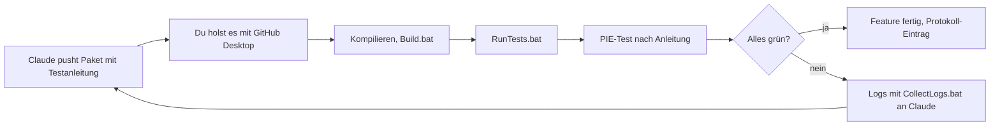
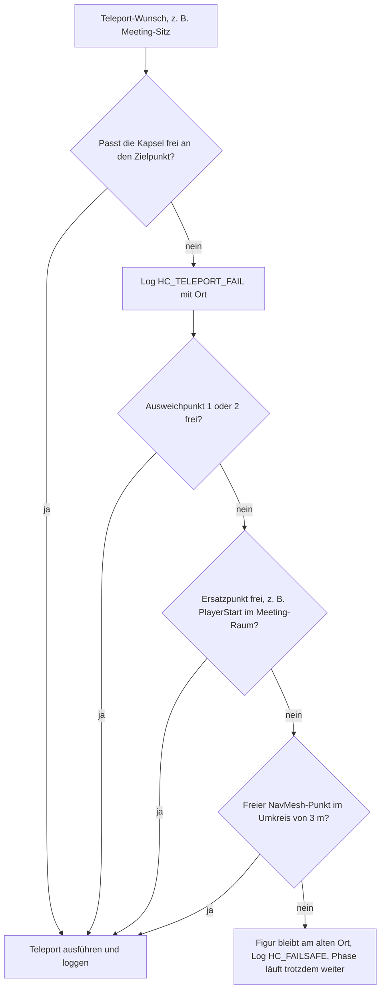
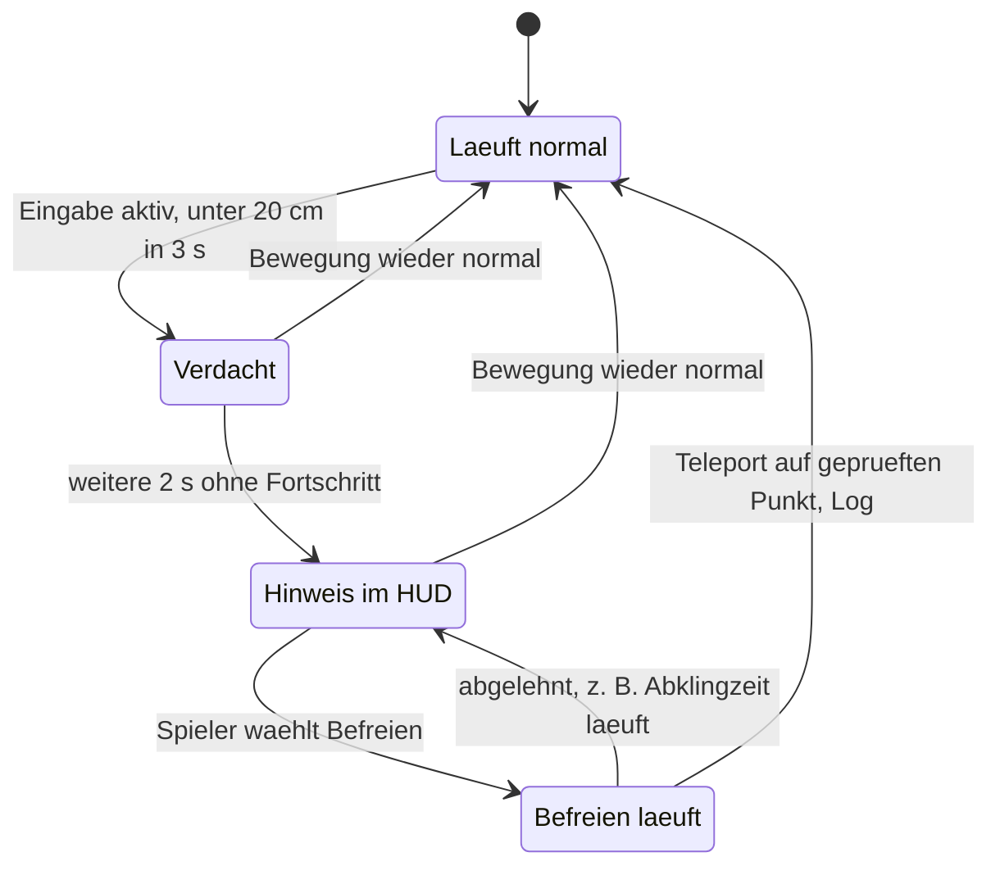
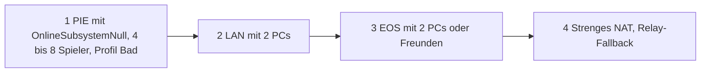
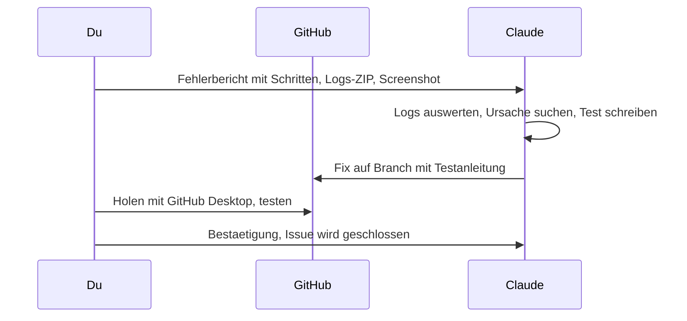

# 04 – Qualität, Spielfluss & Tests

Stand: November 2026 · Teil der Planung für *How Could It Be You*

## Worum geht's

Deine wichtigste Vorgabe lautet: Nichts darf den Spielfluss blockieren. Es soll keine Hänger, keine versperrten Türen und keine unsauberen Kollisionen geben, und Fehler sollen früh auffallen. Dieses Dokument legt dafür feste Maße fest, Kollisions-Regeln, Schutzregeln für jedes Spielsystem, automatische Prüfungen und Testabläufe. Claude schreibt die Prüf-Werkzeuge. Du startest sie per Doppelklick und schickst die Ergebnisse zurück. Wie die Systeme selbst gebaut werden, steht in [02 – Technische Architektur](02-technische-architektur-ue5.md), EOS und Voice in [03 – Multiplayer & Backend](03-multiplayer-und-backend.md).

## Inhalt

1. [Qualitätsziele und Definition of Done](#1-qualitätsziele-und-definition-of-done)
2. [Level-Design-Maße](#2-level-design-maße)
3. [Kollisions-Regeln](#3-kollisions-regeln)
4. [Anti-Blockade-Regeln für Spielsysteme](#4-anti-blockade-regeln-für-spielsysteme)
5. [Automatische Checks](#5-automatische-checks)
6. [Laufzeit-Schutz](#6-laufzeit-schutz)
7. [Multiplayer-Synchronisations-Tests](#7-multiplayer-synchronisations-tests)
8. [Playtest-Plan](#8-playtest-plan)
9. [Performance-Budget](#9-performance-budget)
10. [Bug-Workflow mit Claude](#10-bug-workflow-mit-claude)
11. [Code-Qualität](#11-code-qualität)

---

## 1. Qualitätsziele und Definition of Done

### 1.1 Qualitätsziele

| Ziel | Woran wir es messen | Zielwert |
|---|---|---|
| **Keine Hänger** | Bot-Läufer-Dauertest (Abschnitt 5e), Nutzung von „Befreien“ im Playtest | 0 Hänger in 30 Bot-Minuten, 0 × „Befreien“ pro Testabend |
| **Keine Softlocks** (= Zustand, aus dem Spieler oder Spiel nicht mehr herauskommen, z. B. Kamera bleibt im Jumpscare hängen) | Jede Phase und jede Eingabesperre hat einen Failsafe-Timer (= Notfall-Zeitlimit) | 0 |
| **Alles erreichbar** | Map-Check (Abschnitt 5b–5d) | 100 % der Stationen, Sitze, Knöpfe, Sicherungskästen und Verstecke |
| **Alle sehen dasselbe** | Testmatrix in PIE (= *Play In Editor*, das Spiel direkt im Editor starten) und im LAN | Phase, Timer, Türen und Licht bei allen gleich; Countdown-Abweichung ≤ 0,25 s |
| **Kein Info-Leck** | Testmatrix: Rolle, Stimmen und Geister nur bei Berechtigten | 0 Lecks |
| **Flüssig** | `stat unit` an festen Messpunkten (Abschnitt 9) | 60 fps @ 1080p, Grafik-Stufe Mittel, Mittelklasse-GPU |
| **Stabil** | Abstürze pro Testabend | 0 |
| **Lesbar im Dunkeln** | Sichtprüfung bei Stromausfall und Grafik-Stufe Niedrig | Wege und Interaktionspunkte bleiben erkennbar |

### 1.2 Definition of Done (für jedes Feature)

„Definition of Done“ heißt: Ein Feature gilt erst als fertig, wenn alle Punkte dieser Liste abgehakt sind. Claude hängt die Liste an jede Testanleitung an.

**🤖 Claude (Code):**
- [ ] Kompiliert bei dir ohne Fehler und ohne neue Warnungen aus eigenem Code.
- [ ] Regel-Logik steckt in einer reinen Logik-Klasse (ohne Spielwelt) und hat Unit-Tests (= kleine automatische Tests einzelner Funktionen).
- [ ] Jede Client-Anfrage wird auf dem Server geprüft. Abgelehnte Anfragen landen mit Grund im Log (`LogHCMatch`/`LogHCNet`).
- [ ] Bei jeder replizierten Property (= Wert, den der Server automatisch an Clients schickt) steht als Kommentar, wer sie sieht. Rollen-Infos sind `COND_OwnerOnly`.
- [ ] Jeder Zustand, der Kamera oder Eingabe sperrt, hat einen Failsafe (Abschnitt 6.3).
- [ ] Zahlenwerte stehen in der Config, nicht im Code.
- [ ] Ein `hc.*`-Debug-Befehl existiert, falls das Feature sonst schwer zu testen ist.
- [ ] Testanleitung mit erwarteten Ergebnissen liegt dem Push bei (Abschnitt 11.2).

**🧑 Du (Editor/Test):**
- [ ] Assets zugewiesen, Asset-Validierung grün (Abschnitt 5a).
- [ ] Platzierte Objekte erfüllen die Maße (Abschnitt 2), Kollision in der Ansicht *Player Collision* geprüft (Abschnitt 3.4).
- [ ] `Tools/RunTests.bat` grün.
- [ ] PIE mit 4 Spielern als Listen-Server und Netzwerk-Emulation „Average“: Das Feature verhält sich bei allen gleich.
- [ ] Wenn Map oder Bewegung betroffen sind: Bot-Läufer 10 min ohne Hänger.
- [ ] Sonderfälle aus der Testanleitung geprüft (z. B. Meeting startet währenddessen, Spieler trennt die Verbindung, Spieler stirbt währenddessen).
- [ ] Eintrag im Testprotokoll (Abschnitt 8.2).



---

## 2. Level-Design-Maße

Alle Maße beziehen sich auf die Spielfigur. Crew und Monster haben **dieselbe Kapsel** (= unsichtbarer Zylinder mit runden Enden, mit dem Unreal die Kollision der Figur berechnet). Lebende Spieler können nicht springen und nicht ducken: Die Steuerung in [01](01-game-design-document.md) §4.4 hat keine Sprungtaste, und der Sprung der Vorlage (`IA_Jump`) wird laut [02](02-technische-architektur-ue5.md) §3.3 nicht eingetragen. Claude schaltet das Springen zusätzlich im Code ab. Damit kann niemand auf Tische klettern oder unter Objekten feststecken. Weil die Figur Kanten bis 45 cm automatisch hochsteigt, gilt für niedrige Kisten und Bänke Regel 11 in Abschnitt 3.2.

### 2.1 Maß-Tabelle

| Maß | Wert | Begründung |
|---|---|---|
| Kapsel | Radius 40 cm, halbe Höhe 90 cm (also 80 cm breit, 180 cm hoch) | Feste Grundlage aller anderen Maße, identisch für Crew und Monster |
| Max. Stufenhöhe / begehbarer Winkel | 45 cm (`MaxStepHeight`) / 44° (`WalkableFloorAngle`) | Kanten bis 45 cm steigt die Figur automatisch hoch, darauf verlassen wir uns nur bei unbeabsichtigten Kanten. Steilere Flächen als 44° gelten als Wand: Man rutscht ab oder bleibt hängen. |
| Rampen | ≤ 30° | Deutlicher Abstand zur 44°-Grenze, damit Ungenauigkeiten im Mesh nicht zur „Wand“ werden |
| Treppen | Optisch Stufen von 15–20 cm, **Kollision als glatte Rampe** ≤ 30°, Breite ≥ 200 cm | Stufen-Kollision lässt die Kamera ruckeln und erzeugt Hänge-Kanten |
| Türschwellen | ≤ 5 cm | Schwellen sind nur Optik, die Figur merkt sie nicht |
| Gangbreite | ≥ 200 cm | Zwei Kapseln (2 × 80 cm) passen aneinander vorbei, dazu 40 cm Luft. Monster und Crew können sich überholen. |
| Kurze Engstellen (max. 100 cm lang, z. B. Schott) | ≥ 140 cm | Wie eine Tür: eine Person bequem, zwei nacheinander |
| Türöffnung | ≥ 140 cm breit × ≥ 230 cm hoch | 140 cm = Kapsel + 30 cm Luft je Seite. 230 cm = Kapsel + Kopf-Luft, keine Kamera-Clips am Türsturz |
| Freie Türzone | 150 cm vor und hinter der Tür, über die Türbreite + 50 cm je Seite | Hier stehen keine Props, Stationen oder Spinde. Wer dort steht, blockiert niemanden. |
| Deckenhöhe | Gänge ≥ 270 cm, Räume ≥ 300 cm | Kapsel 180 cm + Kamera + Platz für den Taschenlampen-Kegel, keine Kopfstöße an Lampen. In Räumen Luft für Licht, Nebel und Kamera-Arbeit |
| Hängende Teile (Rohre, Lampen, Kabel) | nur oberhalb von 230 cm über dem Laufweg | Darunter würde die Kapsel anstoßen |
| Wand-Vorsprünge im Laufbereich | ≤ 5 cm tief bis 230 cm Höhe, sonst glatt mit Blocking Volume abdecken | Rippen und Rohre an Wänden sind klassische Hänge-Fallen |
| Spalten zwischen Prop und Wand | **entweder 0 (geschlossen, notfalls per Blocking Volume) oder ≥ 200 cm** | Alles dazwischen ist eine Falle: Schmale Spalten (unter 80 cm) verkeilen die Kapsel halb, breitere werden zu Sackgassen, in denen man festklemmt oder sich festdreht. |
| Interaktions-Freifläche | 120 × 120 cm vor jeder Station, jedem Knopf, Sicherungskasten, Terminal, Türpanel, jeder Ladestation und jedem Spind, frei bis 230 cm Höhe, **neben** dem Hauptweg (ragt nicht in ein `AHCClearPathVolume`, Abschnitt 5d) | Kapsel + Drehraum. Wer arbeitet, versperrt den Gang nicht. |
| Abstand Interaktionspunkte untereinander | ≥ 250 cm (Mitte zu Mitte) | Zwei Spieler an Nachbarstationen berühren sich nicht. Der Interaktions-Trace (180 cm) trifft eindeutig das richtige Ziel. |
| Abstand Station ↔ Türmitte | ≥ 300 cm | Die Freifläche der Station liegt sicher außerhalb der Türzone |
| Verstecke (Spinde) | In Nischen, Front bündig mit der Wand, Freifläche 120 × 120 cm, Ausstiegspunkt + Ersatzpunkt | Spinde blockieren nie Durchgänge (Regel aus [01](01-game-design-document.md)) |
| Meeting-Sitze und PlayerStarts | je ≥ 8 im Meeting-Raum, Abstand ≥ 120 cm (Mitte zu Mitte), je 120 × 120 cm frei, 2 Ausweichpunkte pro Sitz | Teleport und Spawn per Kapsel-Check gelingen immer. Stühle haben keine Pawn-Kollision (Abschnitt 3). |
| Innenecken | Keine spitzen Winkel unter 90°. Spitze Ecken mit einer 45°-Fase von ≥ 30 cm per Blocking Volume glätten | In spitzen Ecken verkeilt sich die Kapsel |
| Ausgänge pro Raum | ≥ 2 (Ausnahme: bewusst gebaute kleine Sackgassen mit Fluchtweg) | Regel aus [01](01-game-design-document.md), wichtig für Sabotage und Flucht |
| Ende-zu-Ende-Laufweg | 45–60 s, also ca. 135–180 m bei 300 cm/s | Zielwert aus [01](01-game-design-document.md). Mit der Stoppuhr in der Greybox (= grober Rohbau aus Klötzen) messen |
| Kill-Z | ≥ 1.000 cm unter dem tiefsten begehbaren Boden | Kill-Z ist die Höhe, ab der Unreal eine Figur als „aus der Welt gefallen“ behandelt. Wir fangen das ab (Abschnitt 6.2). |

### 2.2 So misst du im Editor

**🧑 Du (Editor/Test):**
1. **Raster einschalten:** Oben rechts im Viewport (= 3D-Ansicht im Editor) gibt es das Raster-Symbol mit einer Zahl. Klick auf die Zahl und stelle es für Wände und Böden auf **50** oder **100**, für Feinarbeit auf **10**. Daneben liegt das Winkel-Symbol für das Drehraster: Stelle es auf **15°**. So landen Wände automatisch auf glatten Maßen und Winkeln. Baue Greybox-Teile in Vielfachen von 50 cm.
2. **Referenz-Würfel:** Der Würfel aus *Place Actors → Shapes → Cube* ist genau 100 × 100 × 100 cm (Fenster *Place Actors* über das Menü *Window → Place Actors*). Daneben siehst du sofort, ob ein Gang 2 Würfel breit ist.
3. **Lineal:** Stelle den Viewport über das Menü oben links (*Perspective*) auf *Top* oder *Front*. Halte die **mittlere Maustaste** gedrückt und ziehe. Unreal zeigt die Länge der Linie in Zentimetern an (beim Umsetzen gegen UE 5.8 prüfen).
4. **Prüfkapsel:** Claude schreibt den Helfer-Actor `AHCCapsuleGauge`. Ziehe ihn aus *Place Actors* (Suche „HCCapsuleGauge“) an eine Stelle. Er zeigt die Spieler-Kapsel (80 × 180 cm) und davor die 120 × 120 cm große Freifläche. Ist etwas mit Pawn-Kollision im Weg, färbt er sich **rot**, sonst **grün**. Er ist nur im Editor sichtbar und wird nicht ins Spiel gepackt.
5. **NavMesh anlegen und anzeigen:** Das NavMesh ist das unsichtbare Laufnetz, auf dem Unreal Wege berechnet. Einmal pro Map: *Place Actors → Volumes → Nav Mesh Bounds Volume* in die Map ziehen und mit der Skalieren-Taste (**R**) so groß ziehen, dass es alle begehbaren Böden einschließt (die Intro-Kulisse und die Luftschleusen-Kulisse dürfen draußen bleiben). Drücke dann im Viewport **P**. Grüne Flächen sind begehbar. Fehlt Grün vor einer Station oder in einer Tür, ist dort etwas im Weg. Nach größeren Umbauten im Menü *Build → Build Paths* wählen und die Map speichern, sonst prüfen die Map-Checks (Abschnitt 5b) ein veraltetes Laufnetz (Menünamen beim Umsetzen gegen UE 5.8 prüfen).
6. **Laufzeit messen:** Im PIE einmal Ende-zu-Ende gehen (ohne Sprinten) und mit der Handy-Stoppuhr messen. Ergebnis ins Testprotokoll.

---

## 3. Kollisions-Regeln

### 3.1 Grundbegriffe

| Begriff | Bedeutung |
|---|---|
| **Einfache Kollision** (*Simple Collision*) | Grobe Formen (Box, Kapsel, Kugel, Convex = konvexe Hülle ohne Einbuchtungen) um ein Mesh. Schnell, glatt, ohne Hänge-Kanten. **Standard für alles.** |
| **Komplexe Kollision** | Die echten Dreiecke des Meshes. Genau, aber teuer und voller kleiner Kanten. |
| **Complex as Simple** | Ein Schalter: Das Mesh nutzt seine Dreiecke auch für die Bewegung. Nur für große, statische Architektur, wenn eine Box nicht passt. |
| **Kanal** (*Channel*) | Kategorie, auf die Kollision reagiert. Beispiele: `Pawn` (Spielfiguren), `Visibility` (Sichtlinie), `Interaction`, `Ghost` (beide aus [02](02-technische-architektur-ue5.md)) |
| **Preset** (*Collision Profile*) | Fertige Einstellung „auf welchen Kanal wie reagieren“ (Block, Overlap = nur melden, Ignore). Du wählst ein Preset im Details-Panel unter *Collision Presets*. |
| **Blocking Volume** | Unsichtbare Wand. Damit glättest du Ecken, Treppen und Spalten. |

### 3.2 Regeln

1. **Jeder Prop hat einfache Kollision** (Box, Kapsel oder wenige Convex-Teile). Im Static Mesh Editor (Doppelklick auf das Mesh im Content Browser): Menü *Collision → Add Box Simplified Collision* bzw. *Auto Convex Collision*. Prüfen über das Viewport-Menü *Show → Simple Collision* (grüne Linien, Menünamen beim Umsetzen gegen UE 5.8 prüfen).
2. **„Complex as Simple“ nur für große statische Architektur**, z. B. eine geschwungene Hangar-Wand, und nur wenn Boxen nicht reichen. Nie an Props, nie an beweglichen Dingen, nie an Türen.
3. **Nanite-Meshes brauchen eigene einfache Kollision.** Nanite (= Technik für sehr detaillierte Umgebungs-Meshes) ändert nur die Darstellung. Für Kollision nutzt Unreal ein vereinfachtes Ersatz-Mesh bzw. deine einfachen Formen (beim Umsetzen gegen UE 5.8 prüfen). Verlass dich darauf nicht, sondern lege immer Boxen bzw. Convex-Teile an.
4. **Kleinkram ignoriert Spieler:** Becher, Werkzeug, Kabel, Papier, Ausweis-Marken und fallengelassene Items bekommen `HC_Prop_NoPawn`. Spieler laufen hindurch, das Objekt liegt trotzdem auf dem Boden. Flache Deko (Bodenleitungen, Schmutz) ist ein Decal (= aufgeklebtes Bild) ganz ohne Kollision.
5. **Keine physiksimulierten Objekte auf Laufwegen in v1.** Kein *Simulate Physics* an platzierten Objekten. Ein umgestoßener Stuhl wäre sonst eine Falle.
6. **Treppen mit Rampen-Kollision:** Das Treppen-Mesh bekommt `HC_Prop_NoPawn`. Darüber liegt ein schräg gedrehtes Blocking Volume mit `HC_PawnBlocker` (*Place Actors → Volumes → Blocking Volume*, mit **E** drehen), von der untersten bis zur obersten Stufenkante. Die obere Kante liegt bündig mit dem oberen Boden, die untere Kante ist leicht im unteren Boden versenkt. So entsteht an keinem Ende eine kleine Stufe. Geländer bekommen eine durchgehende Box ab Boden bis ≥ 110 cm. Alternative für große Treppenhäuser: im Static Mesh Editor eine einzige schräge Box als einfache Kollision anlegen und das Mesh mit `HC_Architecture` versehen. Dann blockt die Treppe auch die Sichtlinie.
7. **Blocking Volumes zum Glätten:** Spitze Ecken, Wandrippen, Spalten zwischen Regal und Wand und Lücken unter Fahrzeugen schließt du mit Blocking Volumes (`HC_PawnBlocker`). Diese blockieren nur Spieler, nicht die Sichtlinie und nicht die Interaktion.
8. **Türflügel beeinflussen das NavMesh nicht** (*Can Ever Affect Navigation* aus). Sonst schneidet eine geschlossene Tür das Laufnetz durch, und Map-Check und „Befreien“ irren sich. Claude setzt das in `AHCDoor`.
9. **Stühle im Meeting-Raum** bekommen `HC_Prop_NoPawn`. Der Tisch bekommt eine einfache Box (`HC_PropBlocking`).
10. **Lebende Spielfiguren blockieren sich nicht hart gegenseitig.** Pawn gegen Pawn steht auf *Overlap*, dazu kommt ein sanftes Auseinanderschieben (Claude, in `AHCCharacter`). Sonst könnte jemand eine Tür, einen Spind-Ausstieg oder einen Sitz mit seinem Körper versperren. Auch der Interaktions-Strahl geht durch Mitspieler hindurch, damit niemand eine Station „zustellt“ (Presets `HC_Character` und `HC_CharacterMesh`). → Offene Frage Q-A17, siehe [07](07-offene-fragen.md). Default: weiches Ausweichen statt harter Körper-Kollision.
11. **Niedrige Objekte nicht besteigbar:** Kisten, Bänke und Sockel zwischen ca. 20 und 45 cm Höhe im Laufbereich würde die Figur automatisch hochsteigen und dann oben festsitzen oder ruckeln. Solche Objekte bekommen im *Details*-Panel unter *Collision* die Einstellung *Can Character Step Up On = No* oder stehen gar nicht erst im Laufbereich (Name beim Umsetzen gegen UE 5.8 prüfen).

### 3.3 Eigene Kollisions-Presets

| Preset | Objekt-Typ | Pawn | Visibility | Interaction | Ghost | Wofür |
|---|---|---|---|---|---|---|
| `HC_Architecture` | WorldStatic | Block | Block | Block | Ignore | Wände, Böden, Decken, große feste Teile |
| `HC_PropBlocking` | WorldStatic | Block | Block | Block | Ignore | Große Props an Wänden: Tische, Regale, Container, Stations-Körper. Blockt Interaktion, damit niemand durch Möbel hindurch interagiert |
| `HC_Prop_NoPawn` | WorldDynamic | Ignore | Ignore | Ignore | Ignore | Kleinkram, Items, Stühle, Treppen-Optik. Spieler, Sichtlinie und Interaktion gehen hindurch, Wände und Böden blockt es weiter (wichtig für Items, die per Trace auf den Boden gesetzt werden) |
| `HC_Interactable` | WorldDynamic | Ignore | Ignore | **Block** | Ignore | Unsichtbare Interaktions-Hitbox an Stationen, Knöpfen, Spinden, Überresten |
| `HC_PawnBlocker` | WorldStatic | Block | Ignore | Ignore | Ignore | Blocking Volumes zum Glätten, Rampen über Treppen |
| `HC_Ghost` | Ghost | Ignore | Ignore | Ignore | – | Kugel der Geister-Figur. Blockt nur WorldStatic, alle normalen Objekte ignorieren aber den Kanal `Ghost`, deshalb wirkt nur `HCGhostBounds` als Wand |
| `HCGhostBounds` (Name aus [02](02-technische-architektur-ue5.md)) | WorldStatic | Ignore | Ignore | Ignore | **Block** | Map-Grenzen für Geister |
| `HC_Character` | Pawn | **Overlap** | Ignore | Ignore | Ignore | Kapsel von `AHCCharacter`, identisch für Crew und Monster. Wie das Engine-Preset `Pawn` (das Visibility ebenfalls ignoriert, beim Umsetzen gegen UE 5.8 prüfen), aber Pawn gegen Pawn nur Overlap (Regel 10) |
| `HC_CharacterMesh` | Pawn | Ignore | Block | **Ignore** | Ignore | Sichtbares Figur-Mesh. Wie das Engine-Preset `CharacterMesh`, aber Interaction aus. Sichtlinien-Prüfungen (Kill, Melden) treffen das Mesh, der Interaktions-Strahl geht durch Mitspieler hindurch |

```ini
; Skizze – Config/DefaultEngine.ini, Ergänzung zu den Kanälen aus 02 (Syntax beim Umsetzen gegen UE 5.8 prüfen)
[/Script/Engine.CollisionProfile]
; Interaction steht laut 02 standardmäßig auf Block, deshalb muss jedes Preset, das nicht blocken soll, es ausdrücklich auf Ignore setzen
+Profiles=(Name="HC_Prop_NoPawn",CollisionEnabled=QueryAndPhysics,ObjectTypeName="WorldDynamic",CustomResponses=((Channel="Pawn",Response=ECR_Ignore),(Channel="Visibility",Response=ECR_Ignore),(Channel="Camera",Response=ECR_Ignore),(Channel="Interaction",Response=ECR_Ignore)),HelpMessage="Kleinkram: liegt auf dem Boden, Spieler laufen hindurch")
+Profiles=(Name="HC_PawnBlocker",CollisionEnabled=QueryAndPhysics,ObjectTypeName="WorldStatic",CustomResponses=((Channel="Visibility",Response=ECR_Ignore),(Channel="Camera",Response=ECR_Ignore),(Channel="Interaction",Response=ECR_Ignore)),HelpMessage="Unsichtbare Glaettung, blockiert nur Spieler")
; HC_Architecture, HC_PropBlocking, HC_Interactable, HC_Ghost, HCGhostBounds, HC_Character und HC_CharacterMesh folgen demselben Muster
```

### 3.4 Kollision sichtbar machen

1. **Im Editor:** Viewport-Menü *Lit* → *Player Collision*. Du siehst genau das, woran die Spielfigur stößt. Alles, was hier im Gang auftaucht, ist ein Problem.
2. Zusätzlich *Show → Collision* für die Umrisse aller Kollisionsformen.
3. **Im PIE:** Konsole (Taste `^`) → `show collision`. Noch einmal eingeben schaltet es wieder aus.
4. **Im Static Mesh Editor:** Viewport-Menü *Show → Simple Collision* zeigt die einfachen Formen in Grün (Menüname beim Umsetzen gegen UE 5.8 prüfen).

**🤖 Claude (Code):** Presets in der ini, `AHCCapsuleGauge`, weiches Ausweichen zwischen Spielfiguren, Validator-Regeln dazu (Abschnitt 5a).

**🧑 Du (Editor/Test):** Presets beim Platzieren wählen, Kollision an Meshes anlegen, Blocking Volumes zum Glätten setzen, jede Map einmal komplett in *Player Collision* abfahren.

---

## 4. Anti-Blockade-Regeln für Spielsysteme

Die Maße aus Abschnitt 2 sichern die Map. Diese Tabelle sichert die Spielsysteme. Jede Regel hat eine technische Absicherung im Code oder in einem Check.

| System | Risiko | Regel | Technische Absicherung |
|---|---|---|---|
| **Türen** (`AHCDoor`) | Tür schließt auf einem Spieler, Spieler klemmt im Rahmen, Spieler an der Notentriegelung versperrt die Öffnung | Tür schließt nie, solange jemand im Rahmen steht. Türflügel blockieren erst, wenn sie ganz zu sind. Das Türpanel hängt seitlich neben der Öffnung, seine Standfläche liegt außerhalb der Öffnung. | Server prüft eine Box im Rahmen auf Pawns, Wiederholung nach 0,25 s. Steht trotzdem jemand in einer geschlossenen Tür, öffnet sie sofort (Prüfung alle 0,5 s). Details in [02](02-technische-architektur-ue5.md). |
| **Sabotage: Tür verriegeln** | Spieler eingesperrt, einziger Weg abgeschnitten | Max. 10 s, nur Türen mit `bSabotageable`, nie Meeting-Raum, nie Druckschleusen | Server-Timer öffnet nach 10 s. Map-Check prüft alle sabotierbaren Türen **gleichzeitig zu** (Abschnitt 5b). Steht jemand im Rahmen, wartet die Sperre max. 2 s und scheitert dann ohne Abklingzeit. |
| **Sabotage: Stromausfall** | Weg nicht mehr erkennbar, Sicherungskasten nicht zu finden | Rote Notbeleuchtung zeigt Wege und Silhouetten. Sicherungskasten im Gang, aus zwei Richtungen erreichbar | Notstrom kommt automatisch nach max. 90 s zurück ([01](01-game-design-document.md)). Validator: jeder `AHCPowerSector` hat einen `AHCFuseBox`, dessen Freifläche frei ist. |
| **Teleport ins Meeting** | Spieler landet in Wand, Tisch oder auf einem anderen Spieler | Nur auf vorab platzierte `AHCMeetingSeat`-Punkte | Kapsel-Check vor jedem Teleport, dann 2 Ausweichpunkte, dann PlayerStart. Jeder Fehlschlag wird geloggt (`HC_TELEPORT_FAIL`). Siehe Ablauf unten. |
| **Teleport „Befreien“** | Befreien setzt jemanden an eine noch schlechtere Stelle, Monster missbraucht es zur Flucht | Nur auf geprüfte letzte Laufpunkte in der Nähe | Kapsel-Check, Abklingzeit 60 s (`UnstuckCooldownSeconds`), 10 s nach einem eigenen Kill gesperrt, geloggt (Abschnitt 6.1) |
| **Verstecke** (`AHCHidingLocker`) | Ausstieg blockiert, Spieler sitzt fest im Spind | Max. 20 s im Spind, danach 30 s Sperre (`LockerMaxSeconds`, `LockerCooldownSeconds`, [01](01-game-design-document.md)). Ausstiegspunkt per Kapsel-Check | Ausstiegspunkt → Ersatz-Ausstieg → nächster NavMesh-Punkt im Umkreis von 3 m → Befreien-Logik. Meeting-Start holt alle heraus, ebenso das Öffnen durch einen anderen Spieler. Trennt der Insasse die Verbindung, wird der Spind frei. Die Spind-Tür hat keine Pawn-Kollision, die Kapsel des Insassen ist im Spind ohne Kollision. |
| **Kill-Positionierung** | Opfer oder Monster werden in eine Wand geschoben, Sperre endet nie | Der Server verschiebt keine Figur, die Attacke läuft an Ort und Stelle | Sperrzeit ≈ 2,5 s per Server-Timer. Server-Failsafe macht das Opfer spätestens nach `JumpscareServerFailsafeSeconds` (3 s laut [02](02-technische-architektur-ue5.md)) zum Geist. Das Monster wird danach immer freigegeben, auch wenn das Opfer die Verbindung trennt. |
| **Überreste** (`AHCRemains`) | Überreste versperren eine Tür oder einen Gang | Blutlache = Decal, ID-Marke = `HC_Prop_NoPawn`. Nur die Hitbox (`HC_Interactable`) reagiert, und nur auf Interaktion. | Validator prüft das Preset an `BP_HCRemains`. Überreste blockieren keinen Tür-Check, weil der nur Pawns sucht. Beim Meeting-Start werden alle entfernt. |
| **Geister** (`AHCGhostPawn`) | Geist fliegt aus der Map oder sieht sie von außen | Keine Welt-Kollision, nur `HCGhostBounds` | Liegt ein Geist außerhalb der NavMesh-Grenzen + 10 m, setzt der Server ihn in den Meeting-Raum zurück und loggt das. |
| **Monster** | Monster bleibt woanders hängen als die Crew | Gleiche Kapsel und gleiche Bewegungswerte wie die Crew. Die wahre Gestalt erscheint nur im Jumpscare und Intro. | Ein einziger Charakter (`AHCCharacter`) für beide Rollen. Werte kommen aus `UHCGameSettings`. Validator prüft, dass `BP_HCCharacter` sie nicht überschreibt. Wartungsschächte (später) bekommen geprüfte Ein- und Ausstiegspunkte wie Spinde. |
| **Aufgaben-Stationen** | Station steht im Durchgang, Spieler an der Station blockiert den Weg | Nie frei im Gang, nie in Türzonen oder auf Treppen. Liegt eine Station an einem Gang (z. B. *Kamera justieren*, [01](01-game-design-document.md) §5) oder hängt dort ein Sicherungskasten, sitzt sie in einer Wandnische (≥ 120 cm breit und tief), damit ihre Freifläche außerhalb des `AHCClearPathVolume` liegt. Freifläche 120 × 120 cm neben dem Hauptweg. Stationen sind **nie exklusiv**: Mehrere Spieler können gleichzeitig arbeiten. | Map-Checks 5b–5d. Bewegung, Esc, Meeting-Start, Tod und Disconnect brechen jede Aufgabe sofort ab (Server). |
| **Kameras/Terminals** (`AHCSecurityCamera`-Monitor, `AHCDoorLogTerminal`) | Spieler bleibt in der Kamera-Ansicht gefangen, Eingabe hängt | E oder Esc beendet die Ansicht immer (A/D wechseln am Monitor die Kamera, laut [01](01-game-design-document.md) §4.4). Monitor-Pult an der Wand mit Freifläche | Meeting-Start, Kill und Phasenwechsel schließen die Ansicht zwangsweise. Danach wird der Eingabe-Modus neu gesetzt (Abschnitt 6.4). |
| **Cutscenes** (Intro, Auswurf) | Eingabe bleibt gesperrt, Kamera bleibt in der Sequenz | Jede Eingabesperre hat einen Failsafe | Server: Intro endet spätestens nach Sequenzlänge + 5 s (`IntroTimeoutExtraSeconds`), Auswurf spätestens nach `EjectionTime` + 2 s ([02](02-technische-architektur-ue5.md) §8.7). Client: Lädt die Sequenz nicht, wird sofort übersprungen und geloggt. |
| **Jumpscare** | Kamera bleibt beim Opfer hängen | Kamera und Eingabe werden immer zurückgegeben | Client: Der Director beendet sich nach Dauer + 1,5 s selbst, spätestens nach 5 s (`JumpscareClientFailsafeSeconds`, [02](02-technische-architektur-ue5.md) §7.6). Server-Failsafe siehe Kill-Positionierung. |
| **Spawn** (Rollen-Enthüllung) | Zwei Spieler spawnen ineinander | ≥ 8 PlayerStarts mit 120 cm Abstand | Spawn mit „Position anpassen, aber immer spawnen“ (*Spawn Collision Handling*, beim Umsetzen gegen UE 5.8 prüfen), danach Kapsel-Check und Log |
| **Abstimmung** | Ein Spieler (AFK = nicht am Platz) hält das Meeting auf | Niemand kann das Meeting durch Nicht-Handeln verlängern | Timer endet immer. Wer nicht abstimmt, zählt als „Überspringen“. |
| **UI-Fokus** | Mauszeiger bleibt sichtbar, Eingabe geht nur noch an die UI, nach Alt-Tab reagiert nichts | Genau eine Stelle entscheidet den Eingabe-Modus | Zentrale Funktion pro Phase + Wächter (Abschnitt 6.4). Esc funktioniert immer. |

**Ablauf jedes Teleports** (Meeting-Sitz, Spind-Ausstieg, Spawn). „Befreien“ nutzt dieselbe Kapsel-Prüfung, aber eigene Ziele (Abschnitt 6.1):



---

## 5. Automatische Checks

Weil du kein C++ liest, sind diese Checks Claudes Sicherheitsnetz. **🤖 Claude schreibt sie. 🧑 Du startest sie per Doppelklick** und schickst das Ergebnis zurück.

| Check | Wann | Wie gestartet |
|---|---|---|
| (a) Editor-Validatoren, (d) Laufweg-Volumen | beim Speichern + in `RunTests.bat` | automatisch bzw. Doppelklick |
| (b) Map-Erreichbarkeit, (c) Freiraum-Check | in `RunTests.bat` | Doppelklick |
| (e) Bot-Läufer | nach Map-Änderungen, vor Playtests | Konsolenbefehl im PIE |
| (f) Unit-Tests | in `RunTests.bat` (Ausführung siehe 5g) | Doppelklick |

### 5a. Editor-Validatoren

Ein Validator ist eine C++-Klasse (Unterklasse von `UEditorValidatorBase`), die Unreal beim Speichern oder auf Knopfdruck über jedes Asset laufen lässt. Sie meldet Fehler im *Message Log*. Claude schreibt Validatoren in C++, weil Blueprint-Validatoren laut Forenberichten ihre Ergebnisse nicht zuverlässig loggen.

| ID | Prüft | Ergebnis |
|---|---|---|
| HC-V01 | Namens-Präfixe und Ordner laut [02](02-technische-architektur-ue5.md) (`BP_`, `SM_`, `SMX_` …) | Warnung |
| HC-V02 | Static Mesh mit aktiver Kollision, aber ohne einfache Kollision (und nicht bewusst „Complex as Simple“) | Fehler |
| HC-V03 | „Complex as Simple“ an einem Mesh unter 3 m Größe oder in einem Blueprint-/beweglichen Actor | Fehler |
| HC-V04 | Nanite-Mesh ohne eigene einfache Kollision | Fehler |
| HC-V05 | Platzierte Komponente mit *Simulate Physics* (in v1 verboten) | Fehler |
| HC-V06 | Kleines Objekt (Bounds unter 50 cm) blockiert den Kanal Pawn | Fehler → `HC_Prop_NoPawn` |
| HC-V07 | Kollisions-Preset ist weder ein `HC_`-Preset noch in der Erlaubt-Liste (z. B. „BlockAll“ an Props) | Warnung |
| HC-V08 | Textur größer als 4096 px (Fehler) bzw. größer als 2048 px an Props (Warnung) | Fehler/Warnung |
| HC-V09 | Interaktions-Blueprints (Kinder von `AHCTaskStation`, `AHCDoor`, `AHCFuseBox`, `AHCHidingLocker` …): Replikation an, Dormancy wie vorgegeben, Hitbox mit `HC_Interactable` | Fehler |
| HC-V10 | `BP_HCCharacter`: Kapsel 40/90, Stufe 45 cm, Winkel 44° (gleich der Config) | Fehler |
| HC-V11 | Map-Pflichtinhalt: NavMeshBoundsVolume, ≥ 8 `AHCMeetingSeat`, genau 1 `AHCEmergencyButton`, Trigger Box mit Tag `HC.MeetingRoom`, ≥ 8 PlayerStarts im Meeting-Raum, `HCGhostBounds`, Kill-Z gesetzt | Fehler |
| HC-V12 | Türen: Öffnung ≥ 140 × 230 cm, Meeting-Raum-Türen `bSabotageable = false`, Türflügel ohne NavMesh-Einfluss | Fehler |
| HC-V13 | Interaktionspunkte: Freifläche 120 × 120 cm frei (Kapsel-Overlap), Abstand untereinander ≥ 250 cm, zur Türmitte ≥ 300 cm | Fehler/Warnung |
| HC-V14 | Spinde: Ausstiegs- und Ersatzpunkt vorhanden und frei, Spind nicht in einem `AHCClearPathVolume` | Fehler |
| HC-V15 | Jede `AHCTaskStation` hat eine gültige `TaskId`. Jeder `AHCPowerSector` hat einen `AHCFuseBox`. | Fehler |
| HC-V16 | `AHCSecurityCamera`: *Capture Every Frame* und *Capture On Movement* aus ([02](02-technische-architektur-ue5.md) §12.1) | Fehler |
| HC-V17 | Pawn-blockierende Kollision in einem `AHCClearPathVolume` (siehe 5d) | Fehler |

```cpp
// Skizze – HowCouldItBeYouEditor/Validators/HCStaticMeshValidator.cpp (Signaturen gegen UE 5.8 prüfen)
const UBodySetup* Body = CastChecked<UStaticMesh>(Asset)->GetBodySetup();
const bool bHasSimple = Body && Body->AggGeom.GetElementCount() > 0;
if (Body && !bHasSimple && Body->CollisionTraceFlag != CTF_UseComplexAsSimple)
{
    // Meldung so formulieren, dass du weißt, was zu tun ist
    AssetFails(Asset, FText::FromString(TEXT("HC-V02: Keine einfache Kollision. Static Mesh Editor: Collision > Add Box Simplified Collision.")));
    return EDataValidationResult::Invalid;
}
```

Die Regeln HC-V11 bis HC-V17 prüfen platzierte Actors in einer Map, nicht einzelne Assets. Dank „One File Per Actor“ wird jeder Actor als eigene Datei gespeichert und dabei geprüft. Ob das Prüfen beim Speichern für Map-Actors in 5.8 so greift, testet Claude im ersten Paket (beim Umsetzen gegen UE 5.8 prüfen). Sicher laufen alle Regeln in `RunTests.bat`.

**🧑 Du (Editor/Test):** Rechtsklick auf ein Asset oder einen Ordner im Content Browser → *Asset Actions → Validate Assets* bzw. *Validate Assets in Folder* (Menünamen beim Umsetzen gegen UE 5.8 prüfen). Das Fenster *Message Log* öffnet sich mit dem Ergebnis. Rote Einträge behebst du nach dem Hinweistext. Verstehst du einen Hinweis nicht, schick ihn Claude.

### 5b. Map-Erreichbarkeit (NavMesh-Pfade)

Ein Automation-Test lädt jede Map (`Map_Kepler7`, `Map_Europa` …) und prüft, ob man vom Spawn zu jedem wichtigen Punkt laufen kann.

1. Start: jeder PlayerStart im Meeting-Raum.
2. Ziele: Standpunkt vor jeder `AHCTaskStation`, jeder `AHCMeetingSeat` (und seine Ausweichpunkte), `AHCEmergencyButton`, jeder `AHCFuseBox`, `AHCDoorLogTerminal`, Monitor-Pult, jede Ladestation, Ein- und Ausstiegspunkte jedes `AHCHidingLocker`, je ein Punkt vor und hinter jeder Tür.
   Vorher wartet der Test, bis das NavMesh der Map fertig geladen bzw. gebaut ist. Deshalb nach Umbauten *Build → Build Paths* und speichern (Abschnitt 2.2).
3. Jeder Punkt wird zuerst mit `ProjectPointToNavigation` auf das NavMesh gesetzt. Gelingt das nicht, ist das schon ein Fehler („Punkt liegt nicht auf dem Laufnetz“).
4. Dann `UNavigationSystemV1::FindPathToLocationSynchronously(...)`. **Fehler**, wenn kein Pfad zurückkommt, er ungültig ist oder `IsPartial()` meldet (= der Pfad endet vor dem Ziel).
5. **Sabotage-Durchgang:** Dieselbe Prüfung noch einmal, diesmal mit **allen** sabotierbaren Türen gesperrt. Technisch trägt jede sabotierbare Tür einen Nav-Modifier im Türrahmen (nicht am Türflügel, siehe Regel 8 in 3.2). Er schneidet nichts aus dem NavMesh, sondern markiert die Fläche als Bereich `UHCNavArea_SabotageDoor` mit normalen Laufkosten. Bots und „Befreien“ merken davon nichts. Nur der Abfrage-Filter `UHCNavFilter_NoSabotageDoors` des Tests schließt den Bereich aus (beim Umsetzen gegen UE 5.8 prüfen). Jeder Punkt muss trotzdem erreichbar bleiben.
6. Ergebnis: Liste „OK / FEHLER: Name, Position, Grund“ im Testbericht.

```cpp
// Skizze – HowCouldItBeYouEditor/Commandlets/HCMapReachabilityTest.cpp (Automation-Test, Ordner laut 02 §3.1)
UNavigationPath* Path = UNavigationSystemV1::FindPathToLocationSynchronously(
    World, SpawnLocation, TargetLocation, nullptr, bSabotagePass ? UHCNavFilter_NoSabotageDoors::StaticClass() : nullptr);
if (!Path || !Path->IsValid() || Path->IsPartial())
    AddError(FString::Printf(TEXT("Nicht erreichbar: %s bei %s"), *Target->GetActorLabel(), *TargetLocation.ToString()));
```

Das NavMesh muss zur Kapsel passen. Claude stellt das in der Config ein:

```ini
; Skizze – NavMesh-Agent = Spieler-Kapsel (Abschnitts- und Schlüsselnamen beim Umsetzen gegen UE 5.8 prüfen)
[/Script/NavigationSystem.RecastNavMesh]
AgentRadius=40.0
AgentHeight=180.0
AgentMaxSlope=44.0
; Seit UE 5.2 steht die Stufenhöhe evtl. je NavMesh-Auflösung (NavMeshResolutionParams) statt hier
AgentMaxStepHeight=45.0
; Statisches, in der Map gespeichertes NavMesh: Türen schneiden es ohnehin nicht (Regel 8)
RuntimeGeneration=Static
; Evtl. zusätzlich SupportedAgents unter [/Script/NavigationSystem.NavigationSystemV1] mit denselben Maßen
```

**Ehrlich:** Das NavMesh ist nur eine **Annäherung** an die echte Kapsel-Bewegung. Es ist aus Rasterzellen aufgebaut, glättet Kanten und kennt keine Kollisions-Presets im Detail. Ein Pfad kann also existieren, obwohl die Kapsel an einer Rohrkante hängen bleibt. Umgekehrt kann eine 1-cm-Lücke im NavMesh einen Fehler melden, obwohl man durchlaufen kann. Deshalb gibt es zusätzlich (c), (d) und (e).

### 5c. Freiraum-Check (Kapsel-Overlap und Kapsel-Sweep)

Dieser Check prüft mit der **echten** Kapsel-Form statt mit dem NavMesh.

1. **An Interaktionspunkten:** Am Standpunkt vor jeder Station, jedem Sitz, Knopf, Sicherungskasten, jeder Ladestation und jedem Spind-Ausstieg prüft ein Overlap-Test (= „überlappt diese Form etwas?“), ob eine Kapsel 40/90 frei hineinpasst. Die Kapsel schwebt dabei 2 cm über dem Boden, damit der Boden selbst nicht zählt. Dazu kommt eine Box für die Freifläche 120 × 120 × 230 cm.
2. **Auf Pfad-Stichproben:** Entlang jedes in (b) gefundenen Pfads wird alle 50 cm eine Kapsel zum nächsten Punkt geschoben (Sweep = Form entlang einer Strecke bewegen und Treffer melden). Jeder Treffer mit einem Pawn-blockierenden Objekt wird mit Objektname und Position gemeldet. Für den Sweep ist die Kapsel um die Stufenhöhe (45 cm) angehoben und entsprechend kürzer, so wie die Spielfigur selbst über kleine Kanten steigt. Sonst würden Rampen und Treppen-Rampen fälschlich als Hindernis gemeldet.
3. **Tür-Durchgang:** Pro Tür ein Sweep von 150 cm vor bis 150 cm hinter der Tür, Tür offen.

Technisch nutzt Claude dafür `OverlapBlockingTestByChannel` bzw. `SweepSingleByChannel` auf dem Kanal `Pawn` mit einer Kapsel 40/90, also genau der Spielerform (beim Umsetzen gegen UE 5.8 prüfen). Derselbe Code steckt in `AHCCapsuleGauge` und in den Teleport-Prüfungen des Spiels.

### 5d. „Freier Laufweg“-Volumen (`AHCClearPathVolume`)

Hauptwege sollen garantiert leer bleiben, auch wenn später beim Dekorieren jemand „nur kurz“ eine Kiste hinstellt.

1. 🤖 Claude schreibt `AHCClearPathVolume`, ein unsichtbares Box-Volumen, das nur im Editor existiert.
2. 🧑 Du legst solche Volumen entlang aller Hauptwege, durch jede Tür (inklusive Türzone) und über jede Treppe bzw. Rampe: In *Place Actors* nach „HCClearPathVolume“ suchen, in den Gang ziehen, mit **R** auf Länge und Breite ziehen. Es ist etwas schmaler als der Gang (10 cm Abstand zu jeder Wand), seine Unterkante liegt 5 cm über dem Boden, und es reicht bis 230 cm Höhe. So ragen Wände und Boden selbst nicht hinein. Auf Treppen und Rampen drehst du es mit **E** parallel zur Schräge, ebenfalls 5 cm darüber.
3. Der Validator HC-V17 meldet **jedes** Objekt mit Pawn-blockierender Kollision, das in ein solches Volumen hineinragt, mit Name und Position.
4. Ausnahmen: `AHCDoor` (bewegt sich und ist abgesichert) und Objekte mit dem Actor-Tag `HC.AllowInPath`. Dieses Tag setzt du nur nach Rücksprache mit Claude.

**Tipp:** Lege die Volumen schon in der Greybox an. Dann fängt der Check jede spätere Deko-Kiste automatisch ab.

### 5e. Bot-Läufer-Dauertest

KI-Bots laufen in PIE 10–30 Minuten lang Wege ab, so oft, wie kein Mensch sie testen würde.

**So startest du ihn (🧑 Du):**
1. Map öffnen, PIE mit 1 Spieler starten (Listen-Server).
2. Konsole (`^`): `hc.BotRun 6 20` startet 6 Bots für 20 Minuten. Erlaubt sind 1–7 Bots (mit dir höchstens 8 Figuren, so viele Sitze gibt es) und 10–30 Minuten.
3. Zuschauen ist optional. Mit **F8** (*Eject*) löst du dich von deiner Figur und fliegst frei herum.
4. Am Ende erscheint „Bot-Lauf fertig: X Hänger“. Mit `hc.BotRunStop` brichst du vorzeitig ab.

**Was die Bots tun (🤖 Claude):**
- Ein Bot ist ein normaler `BP_HCCharacter` mit einem KI-Controller (`AHCBotController`), also gleiche Kapsel und gleiche Bewegung wie Spieler.
- `hc.BotRun` startet einen eigenen Testablauf: Bots bekommen einen eigenen Spieler-Eintrag (PlayerState), damit Meeting-Sitze und Türen sie wie Spieler behandeln. Es gibt keine Rollen, keine Kills und keine Siegprüfung, damit der Lauf nicht vorzeitig endet.
- Jeder Bot wählt zufällige Ziele: Stationen, Sitze, Knopf, Sicherungskästen, Ladestationen, Spind-Ausstiege, Punkte vor und hinter Türen und zu 20 % zufällige, vom Spawn aus erreichbare NavMesh-Punkte. Er geht oder sprintet zufällig.
- Alle 2 Minuten passiert ein Ereignis: Stromausfall in einem Sektor, eine sabotierte Tür oder ein Meeting (`hc.StartMeeting`). Im Bot-Lauf dauern Diskussion und Abstimmung nur je 5 s, damit die Bots nicht die meiste Zeit sitzen. So werden Sitz-Teleports und Türsperren in jedem Lauf mehrfach getestet, über viele Läufe hinweg hundertfach.
- **Hänger-Erkennung:** Hat ein Bot ein Ziel, kommt aber in 3 s weniger als 20 cm voran, ist das ein Hänger. Nicht als Hänger zählen gesperrte Zeiten (Meeting, Teleport) und das Warten vor einer verriegelten Tür. Dort plant der Bot mit dem Sabotage-Filter aus 5b einen Umweg. Der Lauf schreibt Zeit, Bot, Position, Ziel und eine fertige `BugItGo`-Zeile in eine CSV-Datei (= Tabelle als Text, öffnet in Excel). Am Ort erscheint eine rote Debug-Kugel. Dann versucht der Bot zurückzutreten und neu zu planen. Klappt das nach 10 s nicht, nutzt er die Befreien-Logik (wird extra gezählt).
- **Zeitüberschreitung:** Braucht ein Bot länger als die doppelte erwartete Laufzeit + 5 s, wird das als Umweg/Problemstelle geloggt.
- Optional: pro neuer Hänger-Stelle ein Screenshot aus einer Beobachter-Kamera (beim Umsetzen gegen UE 5.8 prüfen).

```cpp
// Skizze – Debug/HCBotController.cpp (nur Development-Builds), alle 0,5 s
const FVector Pos = GetPawn()->GetActorLocation();
// Weniger als 20 cm Fortschritt in 3 s, obwohl ein Ziel aktiv ist und nichts sperrt = Hänger
if (HasActiveMoveTarget() && !IsMovementLocked() && FVector::Dist(Pos, PositionSecondsAgo(3.0)) < 20.f)
{
    GetBotRun()->ReportHang(this, Pos, CurrentTarget); // CSV-Zeile + Log HC_BOT_HANG
    DrawDebugSphere(GetWorld(), Pos, 50.f, 12, FColor::Red, /*bPersistentLines*/ true);
    TryRecover(); // zurücktreten, neu planen, zuletzt Befreien-Logik
}
```

**Ergebnis:** `Game/Saved/HCBotRun/BotRun_<Map>_<Datum>.csv` (Trennzeichen Semikolon) und eine Zusammenfassung `..._Summary.txt` mit Laufzeit, Bot-Minuten, erreichten Zielen, Hängern (gesamt und als Stellen auf 100 cm zusammengefasst), Zeitüberschreitungen, unerreichbaren Zielen, Befreiungen und den schlimmsten Stellen mit `BugItGo`-Zeile, z. B. `BugItGo 1250 -340 120 0 90 0`. **Ziel: 0 Hänger.**

**🧑 Du:** Kopiere die `BugItGo`-Zeile in die Konsole im PIE. Die Kamera springt genau an die Stelle (beim Umsetzen gegen UE 5.8 prüfen). Schick Claude die Summary-Datei (sie ist in `CollectLogs.bat` enthalten). Meist ist die Lösung ein Blocking Volume oder ein verschobener Prop.

**Wann:** nach jeder Map-Änderung 10 min, vor jedem Playtest 30 min. Die Map „Ikarus“ mit ihren Container-Gassen läuft besonders oft ([01](01-game-design-document.md)).

### 5f. Unit-Tests der Regel-Logik

Die Regeln stecken in reinen C++-Klassen ohne Spielwelt (siehe [02](02-technische-architektur-ue5.md)). Claude testet sie mit CQTest (= Test-Framework, das mit Unreal mitkommt). Diese Tests laufen in Sekunden und ohne Map. Testnamen beginnen mit `HowCouldItBeYou.Rules.…`.

**`FHCVoteTally` (Abstimmung):** alle 9 Fälle aus [02](02-technische-architektur-ue5.md) §8.6. Dazu: 8 Spieler wählen alle A (A raus), nur ein einziger Stimmberechtigter, er wählt B (B raus, 1 Stimme gegen 0 × Überspringen), Stimme von jemandem, der nicht in der Wählerliste steht (ignoriert), gleiche Eingabe zweimal ausgewertet (identisches Ergebnis).

**`FHCWinConditionEvaluator` (Siegbedingungen):**

| Testfall | Eingabe | Erwartet |
|---|---|---|
| Monster ausgeworfen | Monster 0, Crew 3 | Crew |
| Letzte Crew und Monster gleichzeitig getrennt | Monster 0, Crew 0 | Crew (Regel 1 vor Regel 2, sonst wäre 0 ≥ 0 Parität) |
| Parität | Monster 1, Crew 1 | Monster |
| Normalzustand | Monster 1, Crew 2 | niemand |
| Alle Aufgaben, Infiltration | 30/30, `bCrewWinsByTasks` an | Crew |
| Alle Aufgaben, Evakuierung | 30/30, `bCrewWinsByTasks` aus | niemand |
| Aufgaben fertig und Parität gleichzeitig | 30/30, Monster 1, Crew 1 | Monster (Parität vor Aufgaben) |
| Keine Aufgaben vorhanden | 0/0 | niemand (0/0 gilt **nicht** als „alle erledigt“) |
| Timer abgelaufen, 2 Crew leben | Timer an | Crew |
| Timer abgelaufen, Parität | Monster 1, Crew 1 | Monster |
| Timer abgelaufen, zu wenig Crew | `MinCrewAliveAtTimeout` = 3, Monster 1, Crew 2 | Monster |
| Timer abgelaufen, aber Timer aus | Infiltration | niemand |
| 2 Monster (spätere Option) | Monster 2, Crew 2 | Monster |

**`FHCRoleAssigner` (Rollen):**

| Testfall | Erwartet |
|---|---|
| 4 bzw. 8 Spieler, 1 Monster | genau 1 Monster, Rest Crew |
| Gleicher Seed (= Zufalls-Startwert) | gleiches Ergebnis |
| 10.000 verschiedene Seeds, 8 Spieler | jeder Spieler wird in 12,5 % ± 1,5 % der Fälle Monster (fair verteilt) |
| Erzwungenes Monster bzw. erzwungene Crew (`hc.ForceRole`) | wird respektiert. Überzählige Zwangs-Monster werden ignoriert und geloggt. |
| `NumMonsters` ≥ Spielerzahl, leere Liste, doppelte IDs | begrenzt (mind. 1 Crew), kein Absturz |

**`FHCTaskAssigner` (Aufgaben):**

| Testfall | Erwartet |
|---|---|
| Standard-Anzahlen aus der Config (Default laut [01](01-game-design-document.md): 1 gemeinsame, 2 lange, 3 kurze) | jeder Crew-Spieler bekommt genau diese Mischung, die gemeinsame ist bei allen gleich |
| Stationen und Sichtbarkeit | keine Station doppelt pro Spieler, höchstens 1 sichtbare Aufgabe |
| Streuung | über ≥ 3 Bereiche, falls die Map so viele hat; sonst Warnung, kein Fehler |
| Monster | Fake-Liste mit gleicher Länge und Struktur, zählt nicht zu `TotalTasks` (= Crew × Aufgaben pro Spieler) |
| Zu wenige Stationen / gleicher Seed | Anzahl reduziert und geloggt, keine Endlosschleife / gleiche Verteilung |

**Formwandel-Validierung:** Die Prüfliste aus `UHCShapeshiftComponent` ([02](02-technische-architektur-ue5.md) §6.3) wird als reine Funktion herausgelöst (Arbeitsname `FHCShapeshiftValidator`) und getestet:

| Testfall | Erwartet |
|---|---|
| Anfragender ist Crew, Phase ist nicht *Playing*, Abklingzeit läuft, Verwandlung läuft schon, Monster in Kill-Sperre oder im Spind | abgelehnt (je ein eigener Test) |
| Ziel ist man selbst, tot, getrennt oder schon die aktuelle Gestalt | abgelehnt |
| Gültiges, lebendes Ziel / Abklingzeit 0 (= keine) | erlaubt |
| Ziel stirbt während der 1,5 s / Meeting startet in Verkleidung / Dauer 0 | Abbruch ohne Abklingzeit / sofort zurück, danach volle Abklingzeit / keine automatische Rückverwandlung |
| Kopiertes Ziel stirbt während der Verkleidung / kopiertes Ziel trennt die Verbindung | Verkleidung bleibt bis Ablauf (`bRevertWhenTargetDies = False`) / Rückverwandlung startet ([02](02-technische-architektur-ue5.md) §6.3) |

Zusätzlich gibt es einen **Config-Test**: Alle Modi in `DefaultGame.ini` lassen sich laden, und alle Zeiten und Reichweiten liegen in sinnvollen Grenzen (z. B. `VotingTime` > 0, `KillRange` ≤ 300 cm).

```cpp
// Skizze – Source/HowCouldItBeYou/Tests/HCVoteTallyTests.cpp (CQTest-Makros beim Umsetzen gegen UE 5.8 prüfen)
#include "CQTest.h"
TEST_CLASS(VoteTally, "HowCouldItBeYou.Rules")
{
    TEST_METHOD(RelativeMehrheit_WirftAus)
    {
        const TArray<int32> Voters = {1, 2, 3, 4, 5, 6, 7};
        // 3x Spieler 1, 2x Spieler 2, 2x Überspringen
        const TMap<int32, int32> Votes = {{1, 1}, {2, 1}, {3, 1}, {4, 2}, {5, 2}, {6, FHCVoteTally::SkipId}, {7, FHCVoteTally::SkipId}};
        ASSERT_THAT(AreEqual(1, FHCVoteTally::Count(Voters, Voters, Votes).EjectedPlayerId));
    }
};
```

**Regel für Bugfixes:** Wird ein Fehler in der Regel-Logik gefunden, schreibt Claude zuerst einen Test, der den Fehler zeigt, und repariert dann den Code. So kommt derselbe Fehler nie zurück (Regressionstest).

### 5g. Ausführung: `Tools/RunTests.bat`

„Headless“ heißt: Unreal läuft ohne Fenster und ohne Grafik, nur für die Tests.

**🧑 Du (Editor/Test):**
1. Editor schließen (sonst sperren sich Editor und Test gegenseitig Dateien).
2. Doppelklick auf `Tools/RunTests.bat`.
3. Das Skript baut zuerst das Projekt (wie `Build.bat`) und startet dann alle Tests, die mit `HowCouldItBeYou` beginnen: Unit-Tests, Validatoren, Map-Checks. Validatoren sind eigentlich keine Tests. Damit sie trotzdem mitlaufen, schreibt Claude einen Automation-Test `HowCouldItBeYou.Validation.AllAssets`, der die Prüfung für alle Assets und Maps unter `/Game/HowCouldItBeYou` aufruft. Alternative ist ein zweiter Aufruf mit dem eingebauten Commandlet `-run=DataValidation` (beides beim Umsetzen gegen UE 5.8 prüfen).
4. Nach 2–10 Minuten steht am Ende **„ALLE TESTS GRÜN“** oder **„X TESTS FEHLGESCHLAGEN“** mit einer kurzen Liste.
5. Grün: weiter mit dem PIE-Test aus der Testanleitung. Rot: Kopiere die Zusammenfassung in den Chat an Claude **oder** führe `Tools/CollectLogs.bat` aus und schick die ZIP. Sie enthält `Game/Saved/TestReports/` und die Logs.

```bat
rem Skizze – Tools/RunTests.bat, Kernzeile (Pfade und Rückgabewerte beim Umsetzen gegen UE 5.8 prüfen)
"%UE_ROOT%\Engine\Binaries\Win64\UnrealEditor-Cmd.exe" "%~dp0..\Game\HowCouldItBeYou.uproject" ^
  -ExecCmds="Automation RunTests HowCouldItBeYou;Quit" -unattended -nullrhi -nopause ^
  -ReportExportPath="%~dp0..\Game\Saved\TestReports"
```

Danach wertet ein kleines Skript von Claude den Testbericht aus und schreibt `Game/Saved/TestReports/HC_TestSummary.txt`. Die Zusammenfassung im Fenster ist derselbe Text.

Der Bot-Läufer (5e) läuft nicht in `RunTests.bat`: Er dauert 10–30 Minuten, und du sollst Hänger-Stellen sehen können. Deshalb startest du ihn im PIE.

---

## 6. Laufzeit-Schutz

Checks finden Fehler vor dem Spiel. Der Laufzeit-Schutz fängt das ab, was trotzdem passiert. Er ist in **allen** Builds aktiv, auch im fertigen Spiel.

### 6.1 Hänger-Erkennung und „Befreien“ (`/unstuck`)

1. **Laufpunkte merken (Server):** Einmal pro Sekunde speichert der Server für jede lebende Figur ihre Position, wenn sie auf begehbarem Boden steht und der Punkt auf dem NavMesh liegt. Er hält einen Ringpuffer mit den letzten 10 Punkten.
2. **Verdacht (lokal):** Hältst du die Bewegungstaste, kommst aber in 3 s weniger als 20 cm voran (und bist nicht gesperrt, z. B. durch Meeting oder Kill), schreibt das Spiel `HC_STUCK_SUSPECT` mit Position ins Log. Nach weiteren 2 s zeigt das HUD „Steckst du fest? Esc → Befreien“.
3. **Befreien:** Im Pause-Menü „Feststecken? Befreien“ (entspricht `/unstuck`). Der Server prüft: Phase *Playing*, nicht in Kill-Sperre oder Spind, Abklingzeit 60 s vorbei, kein eigener Kill in den letzten 10 s. Die 10-s-Sperre nach einem Kill kann nur das Monster treffen. Eine Ablehnung sieht nur der Anfragende selbst, sie verrät also nichts. Der Debug-Befehl `hc.Unstuck` ([02](02-technische-architektur-ue5.md) §18) ist dieselbe Funktion ohne Abklingzeit, nur in Development-Builds.
4. **Ziel:** der jüngste gespeicherte Punkt, der ≥ 1 m von der aktuellen Position entfernt liegt und per Kapsel-Check frei ist. Fallback: nächster freier NavMesh-Punkt im Umkreis von 10 m. Letzter Fallback: ein Meeting-Sitz (wird als `HC_UNSTUCK_FAR` gewarnt).
5. **Log:** Jede Befreiung schreibt `HC_UNSTUCK` mit Map, Startposition, Ziel und `BugItGo`-Zeile. Die Match-Zusammenfassung zählt alle Befreiungen. Zielwert: 0. Jede Befreiung ist ein Hinweis auf eine Map-Stelle, die Claude mit dir repariert.



### 6.2 Kill-Z und Out-of-Bounds

- Fällt eine lebende Figur unter die Kill-Z, würde Unreal sie normalerweise zerstören. `AHCCharacter` überschreibt das (`FellOutOfWorld`, beim Umsetzen gegen UE 5.8 prüfen): Die Figur wird auf den letzten sicheren Laufpunkt gesetzt, **nicht getötet**. Log `HC_OUT_OF_BOUNDS`.
- Der Server prüft außerdem alle 2 s, ob eine lebende Figur außerhalb der NavMeshBoundsVolume-Grenzen + 5 m steht. Dann gilt dasselbe.
- Geister: siehe Tabelle in Abschnitt 4. Auch `AHCGhostPawn` überschreibt `FellOutOfWorld`, sonst würde Unreal einen Geist, der unter die Kill-Z fliegt, einfach zerstören. Er landet stattdessen im Meeting-Raum.
- **🧑 Du:** Menü *Window → World Settings* öffnen und in jeder Map unter *World → Kill Z* einen Wert mindestens 1.000 cm unter dem tiefsten Boden eintragen (Validator HC-V11 prüft, dass der Wert gesetzt ist). Beispiel: Der tiefste Boden liegt bei Z = −600, dann Kill Z = −1600.

### 6.3 Failsafe-Timer

Jeder Moment, der Kamera oder Eingabe übernimmt, hat ein hartes Zeitlimit. Normalerweise endet er früher. Der Failsafe greift nur, wenn etwas schiefgeht (Paketverlust, Absturz eines Clients, Alt-Tab).

| Moment | Normales Ende | Failsafe | Was dann passiert |
|---|---|---|---|
| Laden nach Map-Wechsel | alle haben geladen | 60 s (`AllPlayersLoadedTimeoutSeconds`) | Runde startet, wer fehlt, wird entfernt |
| Intro-Cutscene | alle melden „fertig“ oder Skip-Mehrheit | Sequenzlänge + 5 s | Server schaltet auf *RoleReveal* |
| Rollen-Enthüllung | Server-Timer 5 s (`RoleRevealSeconds`) | Timer endet immer | *Playing* |
| Kill-Sperre | 2,5 s (`KillLockDuration`) | Server ≈ 3 s (`JumpscareServerFailsafeSeconds`) | Opfer wird Geist, Monster frei |
| Jumpscare beim Opfer | Dauer der Variante | Dauer + 1,5 s, spätestens 5 s (`JumpscareClientFailsafeSeconds`, Client) | Director gibt Kamera und Eingabe frei |
| Gathering (Meeting-Start) | 3 s (`GatheringTime`) | 3 s + 2 s | Teleports, die noch fehlen, nutzen den Fallback |
| Diskussion / Abstimmung / Ergebnis | Server-Timer 60 / 45 / 5 s, Abstimmung endet früher, wenn alle gewählt haben | Timer endet immer | Wer nicht abgestimmt hat, zählt als „Überspringen“ |
| Auswurf-Sequenz | Sequenzende (ca. 8 s, `EjectionTime`) | `EjectionTime` + 2 s, also ca. 10 s ([02](02-technische-architektur-ue5.md) §8.7) | Siegprüfung, weiter |
| Ergebnis-Bildschirm | Host klickt „Zur Lobby“ | 15 s (`GameOverScreenSeconds`) | zurück in die Lobby |
| Spind | Spieler steigt aus | 20 s | automatischer Ausstieg (Abschnitt 4) |
| Sabotierte Tür | – | 10 s | Tür öffnet |
| Stromausfall | Reparatur | 90 s | Notstrom kommt zurück |
| Halten-Interaktion | Loslassen, Bewegung oder fertig | Server misst selbst. Bei Disconnect oder Verlassen der Reichweite bricht er sofort ab, spätestens nach Soll-Dauer + 2 s ist die Interaktion beendet | Laufender Schritt abgebrochen, erledigte Teilschritte bleiben ([02](02-technische-architektur-ue5.md) §9.4) |

### 6.4 Eingabe-Modus-Reset

Der Eingabe-Modus legt fest, ob Maus und Tastatur an das Spiel oder an die UI gehen und ob der Mauszeiger sichtbar ist. Hängt er falsch, kann man sich nicht mehr bewegen oder nicht mehr klicken.

1. **Eine zentrale Funktion** `AHCPlayerController::ApplyInputModeForPhase()` entscheidet anhand von Phase, Meeting-Stufe und offenem Bildschirm: Runde und Diskussion = nur Spiel (in der Diskussion nur Umschauen), Abstimmung, Aufgaben-Minispiel und Menü = UI mit Mauszeiger, Gathering/Ergebnis/Cutscene = Eingabe gesperrt (wie in [02](02-technische-architektur-ue5.md) §8.4).
2. Sie läuft bei jedem Phasenwechsel (`OnRep`), beim Schließen jedes Widgets, nach jedem Jumpscare und jeder Cutscene und wenn das Spielfenster wieder den Fokus bekommt (nach Alt-Tab).
3. **Wächter:** Einmal pro Sekunde vergleicht er den gewünschten mit dem tatsächlichen Zustand. Bei einer Abweichung setzt er den Modus neu und loggt `HC_INPUT_RESET`.
4. **Esc funktioniert immer:** Es öffnet das Pause-Overlay. Beim Schließen wird der Modus neu gesetzt. Das ist dein Notausgang, falls doch etwas hängt.

### 6.5 Log-Marker

Damit Claude deine Logs schnell durchsuchen kann, beginnen wichtige Einträge mit festen Markern:

| Marker | Bedeutung |
|---|---|
| `HC_STUCK_SUSPECT` | Verdacht auf Feststecken (Position) |
| `HC_UNSTUCK` / `HC_UNSTUCK_FAR` | Befreiung durchgeführt / nur über weiten Fallback |
| `HC_TELEPORT_FAIL` | Teleport-Ziel war belegt, Fallback genutzt |
| `HC_OUT_OF_BOUNDS` | Figur außerhalb der Map zurückgesetzt |
| `HC_FAILSAFE` | Ein Failsafe-Timer hat gegriffen (mit Name des Moments) |
| `HC_INPUT_RESET` | Eingabe-Modus war falsch und wurde korrigiert |
| `HC_BOT_HANG` | Hänger im Bot-Lauf |
| `HC_PLAYER_MARK` | Ein Tester hat eine Stelle markiert (Abschnitt 8.3) |

Jeder `HC_FAILSAFE`-Eintrag ist ein Fehler, den Claude sucht. Der Failsafe verhindert nur, dass ihr hängen bleibt.

---

## 7. Multiplayer-Synchronisations-Tests

Das Spiel läuft als **Listen-Server** (= ein Spieler ist gleichzeitig Host und Server). Der Server entscheidet alles, Clients bekommen Ergebnisse per Replikation (= der Server schickt Zustände automatisch an alle Clients). Hier prüfst du, ob wirklich alle dasselbe sehen.

### 7.1 PIE für Mehrspieler einrichten

**🧑 Du (Editor/Test):**
1. In der Symbolleiste neben dem **Play**-Knopf auf die drei Punkte (⋮) klicken.
2. **Number of Players:** 4 für den Alltag, 8 für Volllast-Tests.
3. **Net Mode:** *Play As Listen Server*. Das erste Fenster ist der Host, die anderen sind Clients.
4. *Advanced Settings…* öffnen (führt zu *Editor Preferences → Level Editor → Play*).
5. **Run Under One Process:** Für schnelle Logik-Tests **an** (alle Spieler in einem Prozess, startet schnell). Für realistische Tests und **immer für Voice: aus**. Dann läuft jeder Spieler in einem eigenen Prozess, wie auf echten PCs.
6. **Enable Network Emulation:** an. Ziel (*Emulation Target*): alle (*Everyone*). Profil: *Average* für den Alltag, *Bad* für den Stresstest. Für harte Tests ein eigenes Profil mit ca. 250 ms Verzögerung je Richtung und 10 % Paketverlust. Epic empfiehlt Stresstests bei etwa 500 ms Ping (= Hin- und Rücklaufzeit) und mindestens 10 % Verlust.
7. *Multiplayer Window Size* klein stellen (z. B. 640 × 360), damit alle Fenster auf den Bildschirm passen. Start mit **Play**. Die Namen der Felder und Menüs können in 5.8 leicht anders heißen (beim Umsetzen gegen UE 5.8 prüfen).

**Arbeitsspeicher:** Jeder zusätzliche Prozess lädt die Map komplett. Grob geschätzt brauchen 4 getrennte Prozesse mit Greybox-Map 16 GB RAM, 8 Prozesse eher 32 GB. Wird es knapp, teste 8 Spieler im Ein-Prozess-Modus und Voice mit 4 getrennten Prozessen.

### 7.2 Testmatrix

**Hinweis:** Die Testfälle heißen T1–T16, damit sie nicht mit den Meilensteinen M0–M15 aus [06](06-roadmap.md) verwechselt werden. In 06 werden Testfälle deshalb mit ihrem Namen genannt, z. B. „Testfall *Meeting-Teleport*“.

| # | Prüfung | So testest du | Erwartet |
|---|---|---|---|
| T1 | Rolle nur beim Besitzer | Match starten, in jedem Fenster Rollen-Bildschirm ansehen. In einem Client `hc.ShowDebug 2` und `hc.ListPlayers`, danach dasselbe beim Host | Jeder sieht nur seine Rolle. Der Rollen-Bildschirm ist für Crew und Monster gleich lang. Im Client zeigen Overlay und Spielerliste keine fremden Rollen, nur beim Host zeigt Stufe 2 alle ([02](02-technische-architektur-ue5.md) §18). |
| T2 | Verkleidung bei allen | Im Fenster des Monster-Spielers `hc.Shapeshift <Spieler>`, dann alle Fenster prüfen, auch eine Sicherheitskamera | Alle sehen dasselbe neue Aussehen samt Namensschild, Geräusch und Effekt bei allen in der Nähe |
| T3 | Kill-Sync | Monster tötet einen Client | Opfer: Jumpscare, danach Geist. Zeugen: Attacke + Schrei. Bei allen liegen die Überreste an derselben Stelle. |
| T4 | Überreste | Durch die Überreste laufen, melden | Keine Kollision, Melden klappt, beim Meeting-Start verschwinden sie bei allen |
| T5 | Meeting-Teleport | `hc.StartMeeting`, mehrmals hintereinander | Alle Lebenden sitzen bei allen Fenstern am selben, festen Platz, kein `HC_TELEPORT_FAIL` |
| T6 | Stimmen verdeckt | Zwei Clients stimmen ab | Andere sehen nur „hat gewählt“, nicht wofür, bis zur Auszählung |
| T7 | Auszählung gleich | Abstimmung beenden | Alle Fenster zeigen dasselbe Ergebnis und dieselben aufgedeckten Stimmen |
| T8 | Sabotage-Licht | `hc.Sabotage Power <Id>` | Sektor ist in allen Fenstern dunkel, Notlicht rot. Nach Reparatur überall wieder hell |
| T9 | Türen | Tür sabotieren, sich in den Rahmen stellen | Tür schließt nicht auf dem Spieler. Nach 10 s überall offen |
| T10 | Timer | Countdown im Meeting in allen Fenstern vergleichen (Profil *Bad*) | Abweichung ≤ 0,25 s, Phasenwechsel bei allen gleichzeitig |
| T11 | Geister unsichtbar | `hc.KillMe` in einem Client, Geist fliegt zum Host und zu Lebenden | Lebende (auch der Host) sehen den Geist nicht. Andere Geister sehen ihn halbtransparent. |
| T12 | Disconnect während Meeting | Während *Voting* in einem Client-Fenster Konsole → `disconnect` | Stimme wird gelöscht, Meeting läuft weiter. Bei Monster-Disconnect gewinnt die Crew sofort. |
| T13 | Host verlässt | `hc.SimulateHostLeave`, später echt (Host-Prozess schließen, braucht getrennte Prozesse oder 2 PCs) | Alle Clients: Meldung „Host hat das Spiel verlassen“ → Hauptmenü, kein Hänger |
| T14 | Späte Pakete / Verlust | Ganze Runde mit Profil *Bad* | Keine doppelten Kills, keine verlorenen Stimmen, Türen ruckeln höchstens kurz. Voice darf aussetzen. |
| T15 | Voice-Routing | Getrennte Prozesse, Testton (`hc.Voice.TestTone 1`) und `hc.Voice.ShowRoutes`, Details in [03](03-multiplayer-und-backend.md) | Nähe in der Runde, alle im Meeting, Geister nur unter sich. Nirgends wird angezeigt, wer gerade spricht |
| T16 | Intro synchron | Match mit Intro, 2 Fenster nebeneinander | Gleiche Stelle der Sequenz in beiden Fenstern, Überspringen per Mehrheit klappt überall |

**Info-Leck-Stichproben** (bei jedem größeren Paket kurz mitprüfen):
- Das Unbehagen-System (z. B. Herzschlag, Atmen) reagiert auf Dunkelheit und Alleinsein, nie darauf, ob das Monster in der Nähe ist. Test: Als Crew neben dem Monster und neben einem Crew-Mitglied stehen, beides muss gleich klingen.
- Abklingzeiten, Sabotage-Menü und Fake-Aufgaben des Monsters erzeugen bei anderen weder Geräusch noch Anzeige.
- Es gibt keine Namen über Köpfen und keine Liste der Lebenden ([01](01-game-design-document.md) §13). Das Namensschild auf dem Anzug zeigt bei einer Verkleidung die kopierte Identität, nirgends erscheint der echte Name.

### 7.3 Nützliche Konsolenbefehle

| Befehl | Wirkung |
|---|---|
| `stat net` | Netzwerk-Statistik: Ping, ein- und ausgehende Bytes pro Sekunde, Paketverlust |
| `stat unit` | Bildzeiten (siehe Abschnitt 9) |
| `Net PktLag=200` | 200 ms künstliche Verzögerung in diesem Fenster (prüfen, in neueren Versionen evtl. `NetEmulation.PktLag`) |
| `Net PktLoss=10` | 10 % Paketverlust (prüfen) |
| `Net PktLagVariance=50` / `Net PktDup=2` | Schwankung ± 50 ms / 2 % doppelte Pakete (prüfen) |
| `Log LogHCNet Verbose` | Mehr Details zur Verbindung ins Log |
| `disconnect` | Dieser Client trennt die Verbindung |
| `hc.ShowDebug 0/1/2` / `hc.ListPlayers` | Eigenes Overlay (Stufe 2 zeigt Rollen, nur beim Host) bzw. Spielerliste ins Log ([02](02-technische-architektur-ue5.md) §18) |

Die `Net Pkt…`-Befehle wirken nur in Development-Builds, nicht in Shipping-Builds. Für Tiefenanalysen gibt es *Networking Insights* in Unreal Insights (Start mit `-NetTrace=1 -trace=net`, beim Umsetzen gegen UE 5.8 prüfen). Das brauchst du erst, wenn Claude danach fragt.

### 7.4 Testreihenfolge



| Stufe | Was du brauchst | Was du zusätzlich prüfst |
|---|---|---|
| 1. PIE | nur deinen PC | Komplette Testmatrix |
| 2. LAN | 2 PCs im selben Netz, Windows-Firewall-Freigabe beim ersten Start (Haken bei *Private Netzwerke*). Beitritt per Join-Code über OnlineSubsystemNull oder direkt mit `hc.Connect <IP>` ([03](03-multiplayer-und-backend.md)) | Echte Prozesse, echte Leistung beim Host, M13 echt, zwei echte Mikrofone (Proximity und Dämpfung durch Wände nach Gehör) |
| 3. EOS | 2 PCs **oder** ein Freund. Zwei Spiele unter demselben Windows-Benutzer teilen dieselbe EOS-Identität und können sich nicht gegenseitig testen ([03](03-multiplayer-und-backend.md)) | Device-ID-Login, Lobby per Join-Code, Beitritt nur bei gleicher Version, volle Lobby, Host verlässt, Client trennt sich mitten in der Runde, Verbindung über das Internet |
| 4. Strenges NAT | Ein Spieler im Handy-Hotspot. Mobilfunk nutzt oft Carrier-NAT, das direkte Verbindungen verhindert (Annahme, nicht für jeden Anbieter gesichert). Zusätzlich einmal mit der Option „IP-Adresse verbergen“, die Relays erzwingt ([03](03-multiplayer-und-backend.md)) | Verbindung klappt trotzdem über Epics Relay (= Weiterleitungs-Server), Ping höher, Spiel bleibt spielbar |

Erst wenn eine Stufe grün ist, geht es zur nächsten. Fehler aus Stufe 3 oder 4, die in Stufe 1 nicht auftreten, liegen fast immer an EOS-Einstellungen oder der Firewall ([03](03-multiplayer-und-backend.md)).

---

## 8. Playtest-Plan

Ein Playtest ist eine Testrunde mit echten Mitspielern. Die Reihenfolge der Meilensteine, ihre Ziele und Abnahmen stehen in [06 – Roadmap](06-roadmap.md) §4. Hier steht, was du bei welchem Stand zusätzlich prüfst. Die Testfälle (M1–M16) meinen immer die Testmatrix aus 7.2.

### 8.1 Checklisten pro Meilenstein

**Greybox und Bewegung** (Meilenstein M1 in 06, eine Map als Klötzchen-Version):
- [ ] Alle Maße aus Abschnitt 2 eingehalten, `AHCClearPathVolume` auf allen Hauptwegen
- [ ] `RunTests.bat` grün, Bot-Läufer 30 min ohne Hänger, Map komplett in *Player Collision* abgefahren
- [ ] Ende-zu-Ende-Laufweg 45–60 s gemessen

**Kern-Loop lokal** (Meilensteine M2–M5: Rollen, Aufgaben, Kill, Geist, Meeting, Abstimmung, Sieg im PIE):
- [ ] Eine komplette Runde von Lobby bis Ergebnis-Bildschirm ohne Debug-Befehl
- [ ] Jede Aufgabe einmal als Crew, einmal als Monster (Fake) durchgespielt
- [ ] Testfälle T1, T3–T7 und T10–T13 im PIE grün (T13 vorerst mit `hc.SimulateHostLeave`), kein `HC_FAILSAFE` im Log
- [ ] Basis-Jumpscare gesehen (M4), Option „Intensität reduzieren“ wirkt

**Formwandel** (Meilenstein M6):
- [ ] Testfall T2 grün, Meeting-Start beendet jede Verwandlung, Info-Leck-Stichproben aus 7.2 geprüft

**Horror, Licht und Voice** (Meilensteine M7 und M8, weitere Jumpscare-Varianten erst M11):
- [ ] Testfälle T8, T9 (falls Tür-Sabotage schon drin ist) und T15 grün
- [ ] Stromausfall: Wege im Notlicht erkennbar, auch auf Grafik-Stufe Niedrig
- [ ] Performance-Messpunkte (Abschnitt 9) im Ziel

**Multiplayer im Netz** (LAN schon in M8, EOS in M9 = Prototyp):
- [ ] Lobby hosten, per Join-Code beitreten, Runde spielen, zurück in die Lobby, zweite Runde
- [ ] M13 und M14 echt getestet, Stufen 2–4 aus Abschnitt 7.4 grün, 3 Runden am Stück ohne Absturz

**Launcher und erster externer Test** (Parallel-Strang L und M15 Closed Beta):
- [ ] Gepackter Build über den Launcher installiert und gestartet ([05](05-launcher-und-updates.md))
- [ ] Ein Freund, der das Projekt nicht kennt, kommt ohne Hilfe in eine Runde
- [ ] Testabend mit 3–5 Runden, Protokoll und Logs an Claude

**Nach dem Prototyp** ([06](06-roadmap.md) §4.3): Mit der Intro-Cutscene (M10) kommt Testfall T16 dazu. Nach dem Art-/Sound-Pass (M12) und bei jeder neuen Map (M14) laufen alle Map-Checks, die Kollisions-Abfahrt in *Player Collision* und der Bot-Läufer (30 min) noch einmal komplett, weil echte Meshes neue Hänge-Kanten mitbringen.

### 8.2 Testprotokoll-Vorlage

Kopiere diese Tabelle für jeden Testabend in eine Textdatei oder ein geteiltes Dokument:

```markdown
# Testprotokoll – <Datum>

Build / Commit: <z. B. Commit-Kennung aus GitHub Desktop>
Map / Modus: Map_Kepler7 / Infiltration
Spieler: <Anzahl> · Netz: PIE / LAN / EOS · Host-PC: <Name>

| Runde | Dauer | Gewinner | Grund | Hänger / Befreien (Ort) | Bugs (kurz) | Grusel 1–5 | Fairness 1–5 |
|---|---|---|---|---|---|---|---|
| 1 |  |  |  |  |  |  |  |
| 2 |  |  |  |  |  |  |  |
| 3 |  |  |  |  |  |  |  |

Auffälligkeiten (Performance, Ton, Licht):
Was hat Spaß gemacht:
Was war unfair oder langweilig:
Logs gesammelt (CollectLogs.bat): ja / nein
```

### 8.3 Wie Freunde Feedback geben

1. **Direkt nach jeder Runde (1 Minute im Voice):** Was war unfair? Ist jemand hängen geblieben, wo? Du notierst es im Protokoll.
2. **Stelle markieren:** In Test-Builds (Development) drückt ein Tester **F9**, wenn etwas komisch ist. Das Spiel schreibt `HC_PLAYER_MARK` mit Position und Zeit ins Log und zeigt kurz „Markiert“. Später findet Claude die Stelle im Log, ohne dass jemand Koordinaten abschreiben muss. F9 ist in der Standardbelegung von [01](01-game-design-document.md) §4.4 frei. Im Editor (PIE) löst F9 eventuell zusätzlich den Editor-Screenshot aus. Das schadet nicht (beim Umsetzen gegen UE 5.8 prüfen).
3. **Nach dem Abend (kurzer Fragebogen, 2 Minuten):**
   - Wie gruselig war es? (1–5)
   - Wie fair hat es sich angefühlt? (1–5)
   - Wie oft wusstest du **sicher**, wer das Monster ist? (nie / manchmal / oft / immer)
   - Hast du das Monster an der Stimme erkannt? (nie / manchmal / immer)
   - Wo hast du dich verlaufen oder bist hängen geblieben?
   - Was war langweilig?
4. **Logs:** Der Host sammelt nach jedem Abend seine Logs (`Tools/CollectLogs.bat`), weil der Host-Log die vollständige Wahrheit enthält. Clients schicken ihre Logs nur, wenn sie ein Problem hatten. Später kommt ein Bug-Report direkt aus dem Spiel dazu ([03](03-multiplayer-und-backend.md)).

**🤖 Claude (Code):** Wertet Protokoll, Fragebogen und die Match-Zusammenfassungen in `LogHCMatch` aus und vergleicht mit den Zielwerten aus [01](01-game-design-document.md) §14. Schlägt neue Config-Werte vor.

---

## 9. Performance-Budget

### 9.1 Ziele

| Stufe | Ziel | Hardware-Klasse |
|---|---|---|
| **Mittel** (Hauptziel) | 60 fps @ 1080p | Mittelklasse-GPU, z. B. RTX 3060 / RX 6600 XT (8 GB VRAM). Mittel braucht kein Hardware-Raytracing, läuft also auch auf Karten ohne RT-Kerne ([02](02-technische-architektur-ue5.md) §15.1) |
| **Hoch** | 60 fps @ 1080p, MegaLights an | Voraussetzung für MegaLights: RTX 2000 / RX 6000 / Arc oder neuer mit DX12 + SM6. Für 60 fps vermutlich eher ab RTX-3070-Klasse (Schätzung, nach den ersten Messungen anpassen) |
| **Niedrig** | ≥ 45 fps @ 1080p, Ziel 60 | Mindest-Hardware (Vorschlag unten) |

**Mindest-Hardware (Vorschlag):** GTX 1660 / RX 5600 XT (6 GB VRAM), 6-Kern-CPU der Klasse i5-8400 / Ryzen 5 2600, 16 GB RAM, SSD, Windows 10/11 64 Bit. → Offene Frage Q-B7, siehe [07](07-offene-fragen.md). Default: dieser Vorschlag, endgültig nach den ersten Messungen.

**Frame-Budget** bei 60 fps = 16,6 ms pro Bild. Planungswerte für Mittel, nach den ersten Messungen anpassen:

| Bereich | Budget |
|---|---|
| Game-Thread (Spiel-Logik, auf dem Host inklusive Server und Voice-Weiterleitung) | ≤ 8 ms, auf dem Host ≤ 10 ms |
| Draw-Thread (Vorbereitung der Zeichenbefehle) | ≤ 8 ms |
| GPU gesamt | ≤ 14 ms (2,6 ms Reserve) |
| davon: Lumen (GI + Reflexionen) / Schatten (Virtual Shadow Maps) / volumetrischer Nebel / Sicherheitskamera (nur wenn ein Monitor benutzt wird) | ≤ 4 ms / ≤ 3 ms / ≤ 1 ms / ≤ 1 ms |
| VRAM | ≤ 6 GB |

Der **Host** rendert und ist gleichzeitig Server. Deshalb sollte immer der stärkste PC der Gruppe hosten.

### 9.2 So misst du

1. Messen nie im Editor-Viewport, sondern im *Standalone Game* (Play-Menü → *Standalone Game*) oder im gepackten Development-Build. Der Editor kostet selbst Leistung.
2. 1080p, gewünschte Grafik-Stufe, VSync aus. Konsole: `r.VSync 0` und `t.MaxFPS 0` (keine Bildraten-Grenze).
3. `stat unit`: zeigt *Frame*, *Game*, *Draw* und *GPU* in Millisekunden. Der größte Wert bestimmt die Bildrate. Ist *GPU* der größte, liegt es an der Grafik, ist *Game* der größte, an der Logik.
4. `stat gpu`: zeigt, welche Grafik-Bereiche wie viel kosten (Lumen, Schatten, Nebel …).
5. `ProfileGPU`: zerlegt ein einzelnes Bild ganz genau (Tastenkürzel Strg+Umschalt+Komma, beim Umsetzen gegen UE 5.8 prüfen). Schick Claude einen Screenshot davon.
6. **Unreal Insights** (= Epics Analyse-Programm für Aufzeichnungen): erst nötig, wenn Claude danach fragt. Dann Spiel mit `-trace=default` starten, Unreal Insights öffnen (`Engine/Binaries/Win64/UnrealInsights.exe` im Engine-Ordner oder im Editor über das Menü *Tools*), die `.utrace`-Datei laden und Claude Screenshots der größten Posten schicken (beim Umsetzen gegen UE 5.8 prüfen).
7. **Feste Messpunkte:** Pro Map legt Claude 5–6 `BugItGo`-Positionen fest, z. B. Atrium, Hangar, Reaktor, Kommandozentrale mit 8 Spielern, dunkler Sektor mit 8 Taschenlampen. Die 8 Figuren liefert der Bot-Läufer (`hc.BotRun 7 10`, funktioniert auch im Standalone-Spiel und im Development-Build). Trag die Werte jedes Mal in dieselbe Tabelle ein, dann sieht man Verschlechterungen sofort.

### 9.3 Lumen, MegaLights und Schatten-Lichter

Die Grafik-Stufen selbst beschreibt [02](02-technische-architektur-ue5.md) §15.1. Für das Budget gilt:
- **MegaLights nur auf Hoch.** Es braucht RT-fähige Hardware (siehe oben). Auf Mittel/Niedrig ist es aus.
- **Lumen „Medium/Lite“** (Beta in 5.8) auf Mittel. Es soll laut Epic etwa doppelt so schnell sein wie Lumen High. Forenberichte nennen Artefakte (schwarze Flecken unter bewegten Objekten). Beides auf deiner Hardware vergleichen und Screenshots an Claude.
- **Schatten-Lichter:** Auf Mittel und Niedrig werfen nur die eigene Taschenlampe und wenige Schlüssel-Leuchten Schatten. Flackernde Deko-Lichter ohne Schatten.
- **Prüfung auf Niedrig:** Ohne Lumen darf es nicht stockfinster werden. Wege und Interaktionspunkte bleiben sichtbar (Qualitätsziel „Lesbar im Dunkeln“).

### 9.4 SceneCapture-Kosten (Sicherheitskameras)

Eine Sicherheitskamera rendert die Szene ein zweites Mal. Regeln aus [02](02-technische-architektur-ue5.md) §12.1: nur eine Kamera gleichzeitig, nur wenn jemand lokal den Monitor benutzt, ca. 10 Bilder pro Sekunde, 480 × 270 Pixel, teure Effekte aus.

**🧑 Du:** Einmal mit `stat unit` vor dem Monitor stehen, dann den Monitor benutzen. Der GPU-Wert darf um höchstens ca. 1 ms steigen. Steigt er mehr, Screenshot von `stat gpu` an Claude.

### 9.5 Netzwerk-Budget

| Datenstrom | Pro Client | Host gesamt (7 Clients) | Sicherheit |
|---|---|---|---|
| Spielzustand (Bewegung, Türen, Phasen) | ca. 5–15 KB/s empfangen, wenige KB/s senden | ca. 35–105 KB/s Upload (0,3–0,9 Mbit/s) | Schätzung, mit `stat net` messen |
| Voice (Opus-Audiocodec, 20-ms-Pakete) | ca. 2–4 KB/s senden, bis 7 × 2–4 KB/s empfangen | Worst Case 8 gleichzeitige Sprecher ≈ 1–1,5 Mbit/s Upload | Schätzung aus der Recherche, nicht gemessen |
| **Summe** | ca. 0,3 Mbit/s empfangen | Worst Case ca. 2,5 Mbit/s Upload | – |

**Empfehlung:** Der Host hat ≥ 5 Mbit/s Upload. Unreal begrenzt die Datenrate pro Verbindung. Claude prüft die 5.8-Standardwerte (`MaxClientRate`, `ConfiguredInternetSpeed`) und hebt sie an, falls `stat net` eine Sättigung zeigt (beim Umsetzen gegen UE 5.8 prüfen). Die Voice-Technik selbst steht in [03](03-multiplayer-und-backend.md).

**🧑 Du:** Bei LAN- und EOS-Tests einmal im Host-Fenster `stat net` während eines Meetings (alle reden) ablesen und den Ausgangswert ins Testprotokoll schreiben.

---

## 10. Bug-Workflow mit Claude

### 10.1 Was du schickst

| Teil | Warum | Wie |
|---|---|---|
| Schritte zum Nachstellen | Claude kann nicht selbst spielen | „1. Runde starten 2. Als Monster in den Spind 3. …“ |
| Erwartet / tatsächlich | Damit klar ist, was falsch ist | „Erwartet: Tür öffnet nach 10 s. Tatsächlich: bleibt zu.“ |
| Wie oft | Trennt Zufall von festem Fehler | immer / manchmal / einmal |
| Build / Commit | Damit Claude den richtigen Code ansieht | Commit-Kennung in GitHub Desktop (*History*) |
| Map und Position | Für Hänger und Kollision | Konsole: `BugIt` speichert Screenshot und Position, die `BugItGo`-Zeile steht im Log (beim Umsetzen gegen UE 5.8 prüfen). Oder F9 in Test-Builds. |
| Logs | Die wichtigste Quelle | `Tools/CollectLogs.bat` → ZIP mit Logs, Testberichten, Bot-Lauf-CSV und Absturzberichten (Inhalt siehe unten) |
| Screenshot / Video | Für optische Fehler | Win + Umschalt + S (Screenshot), Win + Alt + R (Videoaufnahme über die Xbox Game Bar) |
| Bei Kompilier-Fehlern | Claude sieht den Fehler sonst nicht | Komplette Ausgabe von `Build.bat` (sie landet auch in der ZIP) |

**Was `Tools/CollectLogs.bat` einsammelt** (🤖 Claude schreibt das Skript, 🧑 du startest es per Doppelklick): `Game/Saved/Logs/` (auch die Dateien weiterer PIE-Prozesse), `Game/Saved/TestReports/`, `Game/Saved/HCBotRun/`, `Game/Saved/Crashes/`, die letzte `Build.bat`-Ausgabe (`Game/Saved/Logs/Build_<Datum>.txt`), die Logs des gepackten Spiels an beiden Orten aus [02](02-technische-architektur-ue5.md) §18.3 und die Launcher-Logs ([05](05-launcher-und-updates.md)). Ergebnis ist eine Datei `HC_Logs_<Datum>.zip` auf deinem Desktop (Vorschlag). Logs können deinen Windows-Benutzernamen in Dateipfaden enthalten. Hängst du die ZIP an ein Issue in einem **öffentlichen** Repo, kann sie jeder sehen.



### 10.2 GitHub-Issue-Vorlage

Ein Issue ist ein Eintrag in der Fehlerliste des Repos (auf GitHub im Reiter *Issues* → *New issue*). Claude legt diese Vorlage als `.github/ISSUE_TEMPLATE/bug.md` an, mit einem kurzen Kopfteil (`name`, `about`), damit GitHub sie zur Auswahl anbietet. Du kannst sie auch einfach kopieren:

```markdown
## Fehler: <kurzer Titel, z. B. "Spind-Ausstieg in Quartiere blockiert">

**Priorität:** Blocker / Kritisch / Normal / Kosmetik · **Wie oft:** immer / manchmal / einmal
**Build / Commit:** <Kennung> · **Map / Modus / Netz:** Map_Kepler7 / Infiltration / PIE 4 Spieler (Average)

### Schritte
1.
2.

### Erwartet / Tatsächlich
Erwartet:
Tatsächlich:

### Position
BugItGo <x y z pitch yaw roll> (oder Uhrzeit der F9-Markierung)

### Anhänge
- [ ] Logs-ZIP (Tools/CollectLogs.bat)
- [ ] Screenshot / Video
- [ ] Ausgabe von RunTests.bat bzw. Build.bat (bei Test- oder Kompilier-Fehlern)
```

### 10.3 Prioritäten

| Priorität | Beispiele | Reaktion |
|---|---|---|
| **Blocker** | Kompiliert nicht, Absturz, Runde kann nicht beendet werden, Softlock (Spieler kommt nicht mehr heraus) | Sofort, alles andere wartet |
| **Kritisch** | Hänger an einer Map-Stelle, falsche Siegbedingung, Rolle oder Stimme sichtbar für Unberechtigte (Info-Leck), Clients sehen unterschiedliche Zustände, `HC_FAILSAFE` im Log | Vor dem nächsten Playtest behoben |
| **Normal** | Falscher Text, Aufgabe zählt doppelt bei seltenem Ablauf, Sound fehlt | Im nächsten Paket |
| **Kosmetik** | Clipping einer Textur, kleiner Licht-Fehler | Gesammelt, gebündelt behoben |

Jeder Hänger ist mindestens **Kritisch**, weil das Ziel 0 Hänger lautet.

---

## 11. Code-Qualität

### 11.1 Konventionen

Die Code-Konventionen (Präfix `HC`, englische Bezeichner und deutsche Kommentare, Server-Logik markiert, keine Logik in Blueprints, keine Zahlen im Code) stehen in [02](02-technische-architektur-ue5.md) §20. Für Tests und Qualität kommen dazu:
- Testnamen nach dem Muster `HowCouldItBeYou.<Bereich>.<Klasse>.<Fall>`, z. B. `HowCouldItBeYou.Rules.VoteTally.Gleichstand`.
- Jeder Bugfix in Regel-Logik bekommt einen Regressionstest (Abschnitt 5f).
- Wichtige Log-Einträge nutzen die Marker aus Abschnitt 6.5.
- Jede neue Map-Klasse (z. B. ein neues Interactable) bekommt Validator-Regeln und wird in den Map-Check aufgenommen.

### 11.2 Kleine Schritte, jeder Push mit Testanleitung

Claude liefert in kleinen Paketen, die jeweils für sich kompilieren. Ein Paket ist höchstens ein Feature-Stück, z. B. „Tür-Logik ohne Sabotage“. Jeder Push enthält eine Testanleitung nach diesem Muster:

```markdown
## Was ist neu
Türen öffnen automatisch und schließen nie auf Spielern.

## So testest du
1. GitHub Desktop: Branch holen, Projekt öffnen (Module neu bauen: Ja)
2. Tools/RunTests.bat → erwartet: ALLE TESTS GRÜN
3. PIE, 2 Spieler, Listen Server, Profil Average. Client 1 stellt sich in den Türrahmen, Host geht weg.

## Erwartet
Tür bleibt offen, solange Client 1 im Rahmen steht. Danach schließt sie in beiden Fenstern.
Wenn nicht: Tools/CollectLogs.bat ausführen, ZIP an Claude. Sonst: Definition of Done aus 04, Abschnitt 1.2.
```

Vor jedem Push prüft Claude den eigenen Code gegen eine feste Liste: `HasAuthority()` an Regel-Code, Replikations-Bedingungen, abgelehnte Anfragen geloggt, Failsafe vorhanden, Tests ergänzt, Includes vollständig.

### 11.3 CI für Launcher und Backend

CI (*Continuous Integration*) heißt: GitHub führt bei jedem Push automatisch Tests aus. Das kostet dich nichts und läuft ohne dein Zutun.

| Bereich | Was automatisch läuft | Wo |
|---|---|---|
| Launcher (Rust) | Formatierung (`cargo fmt`), Code-Prüfung (`cargo clippy`), Tests (`cargo test`) für `hcpatch`, `hcpublish` und den Tauri-Kern | GitHub Actions: `hcpatch`/`hcpublish` auf `ubuntu-latest` (spart Windows-Minuten), Tauri-Kern und Windows-Besonderheiten (Hardlinks, Umbenennen, Sperren) auf `windows-latest` ([05](05-launcher-und-updates.md) §10.4) |
| Backend (TypeScript) | Typprüfung (`tsc`), Tests der Worker | GitHub Actions (Deploy des Workers über `backend.yml`, siehe [03](03-multiplayer-und-backend.md)) |
| Configs und Doku (optional) | Kleines Prüfskript: keine Kommentare am Zeilenende in `.ini`-Dateien, Pflicht-Abschnitte vorhanden | GitHub Actions |

```yaml
# Skizze – .github/workflows/tests.yml (Bau, Signatur und Upload des Launchers stehen in 05)
name: tests
on: [push, pull_request]
jobs:
  launcher-core:
    # Patch-Bibliothek und Publish-Werkzeug brauchen weder Windows noch die Web-UI (spart Windows-Minuten, 05 §10.4)
    runs-on: ubuntu-latest
    defaults: { run: { working-directory: Launcher } }
    steps:
      - uses: actions/checkout@v4
      - run: cargo fmt --all -- --check && cargo clippy -p hcpatch -p hcpublish -- -D warnings && cargo test -p hcpatch -p hcpublish
  launcher-windows:
    runs-on: windows-latest
    defaults: { run: { working-directory: Launcher } }
    steps:
      - uses: actions/checkout@v4
      - uses: actions/setup-node@v4
        with: { node-version: 22 }
      # Zuerst die Web-UI bauen: Der Tauri-Kern erwartet beim Kompilieren den fertigen UI-Ordner (beim Umsetzen prüfen)
      - run: npm ci && npm run build
        working-directory: Launcher/ui
      # Tauri-Kern und Windows-Besonderheiten der Patch-Bibliothek (Hardlinks, Umbenennen, Sperren)
      - run: cargo clippy --workspace -- -D warnings && cargo test --workspace
  backend:
    runs-on: ubuntu-latest
    defaults: { run: { working-directory: Backend } }
    steps:
      - uses: actions/checkout@v4
      - uses: actions/setup-node@v4
        with: { node-version: 22 }
      - run: npm ci && npx tsc --noEmit && npm test
```

Ist ein CI-Lauf rot, sieht Claude das in der nächsten Arbeitssitzung selbst auf GitHub und repariert es. Du musst dafür nichts tun. Siehst du im Reiter *Actions* ein rotes Kreuz, reicht ein kurzer Hinweis an Claude. Bau, Signatur und Veröffentlichung des Launchers beschreibt [05](05-launcher-und-updates.md).

### 11.4 Warum UE-C++ nur auf deinem PC kompiliert (ehrlich)

- Die Standard-Runner von GitHub (= die Rechner, auf denen GitHub Actions läuft) garantieren laut GitHub nur ca. 14 GB SSD-Speicher. Eine UE-5.8-Installation mit ihren Dutzenden GB passt nicht verlässlich hinein.
- Die Engine kommt bei uns als Binärversion aus dem Epic Games Launcher, mit Anmeldung. Sie lässt sich nicht einfach automatisch auf einen fremden Server laden. Einen eigenen Engine-Build aus dem Quellcode haben wir bewusst ausgeschlossen.
- Claude kann in seiner Cloud-Umgebung kein Unreal starten.
- **Folge:** Kompilier-Fehler fallen erst bei dir auf. Dagegen helfen kleine Pakete, Claudes Prüfliste vor jedem Push und die vollständige `Build.bat`-Ausgabe, die du bei Fehlern zurückschickst.
- **Spätere Option:** Dein PC wird ein „self-hosted Runner“ (= GitHub darf auf deinem PC Aufträge starten, kostenlos). Dann kompiliert jeder Push automatisch, solange dein PC läuft. Nachteil: Der Runner führt Code aus dem Repo auf deinem PC aus, das ist nur bei einem privaten Repo vertretbar. → Offene Frage Q-C11, siehe [07](07-offene-fragen.md). Default: nicht in v1.

### 11.5 Statische Analyse (optional)

Statische Analyse heißt: Ein Programm sucht Fehler im Code, ohne ihn auszuführen.

- **MSVC-Analyse:** `Tools/Build.bat analyze` ruft das Unreal Build Tool mit `-StaticAnalyzer=VisualCpp` auf (beim Umsetzen gegen UE 5.8 prüfen). Dauert deutlich länger als ein normaler Build, deshalb nur vor größeren Meilensteinen.
- **Formatierung:** Eine `.clang-format`-Datei sorgt für einheitliches Aussehen. Die Prüfung braucht keine Engine und kann deshalb als zusätzlicher kleiner Schritt in der CI laufen (`clang-format --dry-run --Werror` über `Game/Source`). Ziel: 0 Warnungen aus eigenem Code.

**🤖 Claude (Code):** Konventionen einhalten, Testanleitung pro Push, CI-Workflows, Prüfskripte, Issue-Vorlage, Regressionstests.

**🧑 Du (Editor/Test):** Nach Anleitung testen, Ergebnisse und Logs zurückmelden, bei roten Tests nicht weiterbauen, sondern zuerst Claude Bescheid geben.
