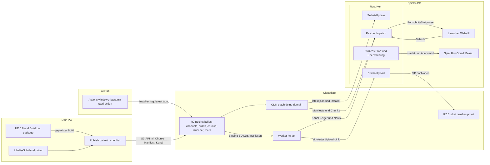
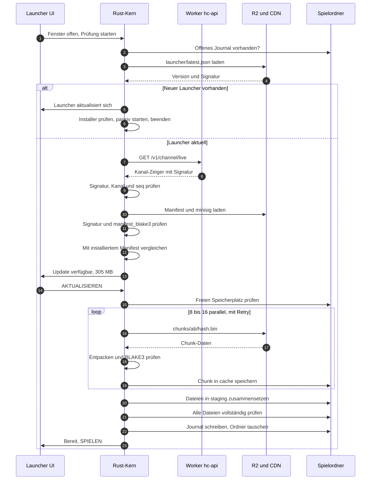
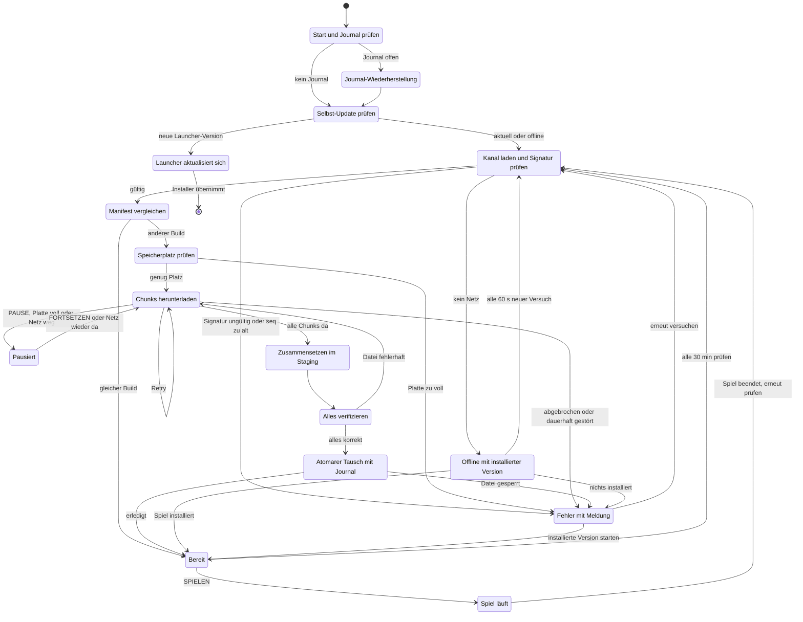
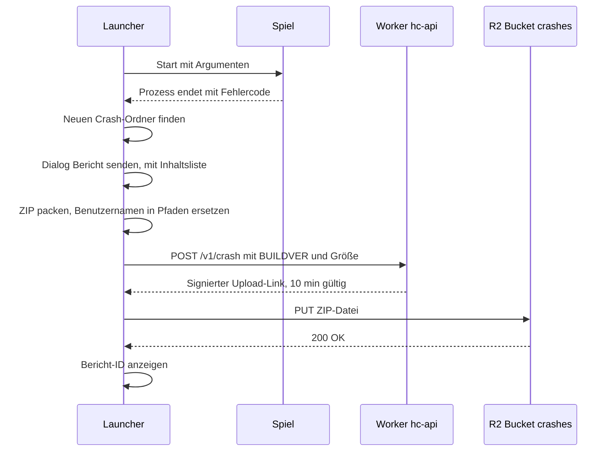

# 05 – Launcher & Update-System (Cloudflare R2)

Stand: November 2026 · Teil der Planung für *How Could It Be You*

## Worum geht's

*How Could It Be You* erscheint nur über einen eigenen **Launcher** (= kleines Programm, mit dem Spieler das Spiel installieren, aktualisieren und starten). Wir bauen ihn mit **Tauri 2** (Rust-Kern + kleine Web-Oberfläche). Updates liegen als kleine, geprüfte Datenstücke („Chunks“) in **Cloudflare R2**. Der Launcher lädt nur die Stücke, die ihm fehlen, und tauscht die Spielversion erst aus, wenn alles vollständig und korrekt ist.
Claude schreibt den gesamten Code: Launcher, Patch-Bibliothek `hcpatch`, Veröffentlichungs-Werkzeug `hcpublish`, Skripte und CI. Du packst das Spiel in Unreal, veröffentlichst per Doppelklick auf `Tools/Publish.bat` und testest unter Windows nach Checkliste.

**Inhalt**

1. [Anforderungen](#1-anforderungen)
2. [Technikwahl](#2-technikwahl)
3. [Gesamtarchitektur](#3-gesamtarchitektur)
4. [Patch-Format im Detail](#4-patch-format-im-detail)
5. [Update-Ablauf](#5-update-ablauf)
6. [Fortschrittsanzeige und Launcher-Fenster](#6-fortschrittsanzeige-und-launcher-fenster)
7. [Spielstart und Versions-Gate](#7-spielstart-und-versions-gate)
8. [UE-Packaging für kleine Patches](#8-ue-packaging-für-kleine-patches)
9. [Veröffentlichen (Publish-Pipeline)](#9-veröffentlichen-publish-pipeline)
10. [Launcher-Selbst-Update und CI](#10-launcher-selbst-update-und-ci)
11. [Sicherheit](#11-sicherheit)
12. [Code-Signatur und SmartScreen](#12-code-signatur-und-smartscreen)
13. [Kosten und Speicher-Rechnung](#13-kosten-und-speicher-rechnung)
14. [Umsetzungsplan in Schritten](#14-umsetzungsplan-in-schritten)
15. [Projektstruktur](#15-projektstruktur)

---

## 1. Anforderungen

### 1.1 Aus deiner Anfrage (Pflicht)

| # | Anforderung | Umsetzung | Abschnitt |
|---|---|---|---|
| A1 | Spiel starten | SPIELEN-Knopf. Der Launcher startet die Spiel-exe, überwacht sie und kommt nach Spielende zurück | [7](#7-spielstart-und-versions-gate) |
| A2 | Automatisch auf neue Version prüfen | Beim Start und alle 30 min: signierten Kanal-Zeiger laden und mit der installierten Version vergleichen | [5](#5-update-ablauf) |
| A3 | Nur geänderte Daten laden | Inhaltsdefinierter Chunk-Store: Es werden nur Chunks geladen, die auf deinem PC fehlen | [4](#4-patch-format-im-detail) |
| A4 | Fortschritt anzeigen | Phase, Bytes, Geschwindigkeit, Restzeit, Pause/Fortsetzen | [6](#6-fortschrittsanzeige-und-launcher-fenster) |
| A5 | Vertrieb nur über den Launcher | Das Spiel hat keinen eigenen Updater, Lobbys prüfen `BUILDVER` | [7](#7-spielstart-und-versions-gate) |
| A6 | Hosting über Cloudflare R2 | Bucket `builds`, öffentlich lesbar über `patch.<deine-domain>` mit CDN-Cache | [3](#3-gesamtarchitektur) |

### 1.2 Sinnvolle Extras

| Extra | Warum | Ab Schritt |
|---|---|---|
| **Selbst-Update des Launchers** | Sonst müsste jeder Tester bei jeder Launcher-Änderung neu installieren | L5 |
| **Dateien überprüfen/reparieren** | Hilft bei kaputten Dateien (Virenscanner, Absturz). Nutzt denselben Code wie das Update | L3 |
| **News/Patchnotes** | Was ist neu, wann ist der nächste Spieleabend | L4 |
| **Einstellungen** | Ordner, Kanal (live/beta), Download-Limit, Verhalten beim Spielstart, Absturzberichte | L3 |
| **Deinstallation** | Spiel im Launcher entfernen, Launcher über „Apps“ in Windows | L5 |
| **Offline-Verhalten** | Ohne Internet startet die installierte Version trotzdem (z. B. für LAN-Tests) | L4, L6 |
| **Absturzbericht** | Nach Zustimmung landet der Bericht in R2. Du gibst ihn per Bericht-ID an Claude weiter ([7.2](#72-absturz-erkennung-und-bericht)) | L7 |
| **Fortsetzen, Logs sammeln, Downloads pausieren während das Spiel läuft** | Robustheit. Ein Download würde beim Host die Leitung verstopfen | L3–L6 |

**Bewusst nicht in v1:** Mac/Linux, Konto/Login im Launcher, Shop, Mod-Verwaltung, Verteilung zwischen Spielern (P2P), Anti-Cheat-Bootstrapper (Begründung in [03 – Multiplayer & Backend](03-multiplayer-und-backend.md)).

---

## 2. Technikwahl

Versionsstände laut Paketquellen am 05.11.2026: tauri 2.12.5, tauri-plugin-updater 2.14.1, Electron 45.2.3 (electron-updater 6.8.11), Avalonia 12.1.5, Velopack 1.2.161.

| Option | Installer-Größe | Sicherheit | Updater für den Launcher | CI-Build ohne dein Kompilieren | Eignung für Multi-GB-Spieldaten | Lizenz |
|---|---|---|---|---|---|---|
| **Tauri 2** | ca. 1–10 MB (Drittquellen, kein offizieller Wert) | Rust-Kern (speichersicher), Web-UI darf nur freigegebene Befehle aufrufen | ja, `tauri-plugin-updater`, Signatur ist Pflicht | ja, `tauri-apps/tauri-action` auf `windows-latest` | gut, über eigenen Rust-Chunk-Store mit schnellem Hashing | MIT / Apache-2.0 |
| Electron | ca. 85–110 MB (Drittquellen) | Chromium + Node.js, Härtung muss man selbst konfigurieren | ja, electron-updater (Deltas nur für die App selbst) | ja | mäßig: Hashing vieler GB in JavaScript ist langsamer, bräuchte native Erweiterungen | MIT |
| .NET + Avalonia | mehrere 10 MB mit .NET-Laufzeit (Schätzung) | speichersicher (C#) | nein, meist mit Velopack kombiniert | ja | möglich, aber Patcher selbst schreiben, zweite Sprache neben Rust | MIT |
| Velopack | klein (Rust-basiert) | installiert ohne Admin nach `%LocalAppData%` | ja, sein Hauptzweck | ja | schlecht: Deltas pro Datei, laut Doku keine Datei über 2 GB, Ketten über Zwischenversionen | MIT |
| butler/wharf (itch.io) | Zusatzprogramm | eigene `.sig` ist nur eine Hash-Liste, Echtheit müssten wir selbst signieren | nein, nur Patcher | ja (fertige exe) | ordentlich, aber Patches je Versions-Paar, Neuinstallation braucht Vollarchiv, Publisher braucht den alten Build | MIT |
| Epic BuildPatchTool | – | – | – | nein: Laufzeit ist UE-C++, der Launcher müsste ein Unreal-Programm sein | sehr gut (dafür gebaut) | Nutzung außerhalb des Epic Games Store ungeklärt |

**Entscheidung: Tauri 2 + eigener Chunk-Store (Prinzip wie Steam/Epic).** Gründe:

- **Eine Sprache für alles:** Launcher-Kern, Patch-Bibliothek und Publish-Werkzeug sind Rust. Claude kann die komplette Patch-Logik in seiner Cloud-Umgebung testen, ohne Windows und ohne Unreal.
- **Kleiner Installer, fertiger signierter Selbst-Updater**, Bau komplett in GitHub Actions. Du kompilierst den Launcher nie selbst.
- **Jede Version aktualisiert direkt auf jede Version**, ohne Patch-Ketten. Installieren, Aktualisieren und Reparieren sind derselbe Code.
- **Das Publish-Werkzeug braucht den alten Build nicht**, nur die Liste der Chunks, die schon in R2 liegen.
- **Chunks ändern sich nie.** Das CDN (= weltweites Cache-Netz von Cloudflare) kann sie unbegrenzt zwischenspeichern, Fortsetzen nach Abbruch ist trivial.
- butler bleibt **Plan B**, falls Patches zu groß werden ([8.5](#85-plan-b-wenn-patches-zu-groß-sind)).

---

## 3. Gesamtarchitektur



**Wer macht was:** 🤖 Claude schreibt Web-UI (`Launcher/ui`), Rust-Kern (`Launcher/src-tauri`), die Crates (= Rust-Pakete, also Bibliotheken oder Programme) `hcpatch`/`hcpublish`, den Worker `hc-api` ([03](03-multiplayer-und-backend.md)) und die GitHub-Abläufe. 🧑 Du legst einmal Bucket, Tokens und Schlüssel an und startest `Publish.bat`.

| Adresse | Zweck | Bemerkung |
|---|---|---|
| `https://patch.<deine-domain>/` | öffentlicher Lesezugriff auf `builds` mit CDN | Normalfall ab dem ersten externen Test |
| `https://api.<deine-domain>/v1/…` | Worker `hc-api` | bis zur Domain: `hc-api.<konto>.workers.dev` |
| `https://<ACCOUNT_ID>.r2.cloudflarestorage.com` | S3-API (= Amazon-kompatible Upload-Schnittstelle) | nur `hcpublish`, CI und signierte Crash-Links. Über die eigene Domain gehen im Free-Plan max. 100 MB pro Anfrage |
| `https://pub-<id>.r2.dev/` | Test-Adresse von R2 | laut Cloudflare rate-limitiert, nur für deine eigenen Tests |
| `https://hc-api.<konto>.workers.dev/v1/files/<pfad>` | Notlösung ohne Domain: Worker liest aus R2 | kein CDN-Cache, jeder Chunk ist eine Worker-Anfrage (100.000/Tag frei) |

→ Offene Frage Q-C4, siehe [07](07-offene-fragen.md): Wann wird die Domain gekauft? Default: Platzhalter `<deine-domain>`, Kauf (ca. 10 €/Jahr) spätestens vor dem ersten externen Test über den Launcher (den ersten Test-Build bekommen Freunde laut [06](06-roadmap.md) M9 noch als ZIP), bis dahin `r2.dev` für deine eigenen Tests.

---

## 4. Patch-Format im Detail

### 4.1 Grundidee mit Alltagsbeispiel

Stell dir das Spiel als dickes Buch vor. Korrigierst du einen Satz, willst du den Lesern nicht das ganze Buch neu schicken, sondern nur die betroffene Seite.

- **Chunk** (= Datenstück): Jede Datei wird in Stücke von ca. 1 MiB zerschnitten.
- **Hash** (= digitaler Fingerabdruck): Aus jedem Stück wird eine 64-stellige Kennung berechnet. Gleicher Inhalt ergibt immer denselben Fingerabdruck, ein geändertes Bit einen völlig anderen.
- **Inhaltsadressiert:** Jeder Chunk liegt unter seinem Fingerabdruck. Gleiche Stücke in verschiedenen Dateien oder Versionen liegen nur einmal in R2.
- **Manifest** (= Packliste): Pro Build eine Liste „Datei X besteht aus den Chunks A, B, C in dieser Reihenfolge“.

Der Launcher vergleicht die neue Packliste mit dem, was er hat, und lädt nur fehlende Chunks.

**Warum „inhaltsdefiniert“?** Würde man stur alle 1 MiB schneiden und fügt vorne ein paar Bytes ein, verrutschen alle Schnittstellen dahinter, und jedes Stück sähe „neu“ aus. **FastCDC** (*Content-Defined Chunking*) schneidet an Stellen, die sich aus dem Inhalt selbst ergeben, ungefähr wie „schneide immer nach einem Satz, der mit ‚Und‘ beginnt“. Nach einer Einfügung trifft der Schnitt nach ein bis zwei Stücken wieder dieselben Stellen.

### 4.2 Parameter

| Parameter | Wert | Begründung |
|---|---|---|
| Zerlegung | FastCDC (Crate `fastcdc` 5.0, Modul `v2020`, deterministisch) | gleiche Datei ergibt immer dieselben Chunks |
| Chunk-Größe | min 256 KiB / Ø 1 MiB / max 4 MiB | Epic nutzt feste 1 MiB, Steam ca. 1 MB. Kleiner hieße viel mehr Anfragen, größer größere Patches |
| Fingerabdruck | BLAKE3-256 der **unkomprimierten** Daten (Crate `blake3` 1.8), 64 Hex-Zeichen | sehr schnell, mehrere Threads, kryptografisch sicher |
| Kompression | zstd (= schnelles, verbreitetes Kompressionsverfahren; Crate `zstd` 0.14), Stufe 9 (einstellbar) | UE-Paks sind schon komprimiert und schrumpfen kaum, zstd speichert solche Blöcke praktisch ohne Aufschlag. exe/DLLs schrumpfen deutlich |
| Signatur | Ed25519 (= modernes Verfahren für digitale Unterschriften) im minisign-Format (= kleines, verbreitetes Signatur-Werkzeug). Prüfen im Launcher mit `minisign-verify` 0.3, Signieren in `hcpublish` z. B. mit der Crate `minisign` (beim Umsetzen prüfen) | dasselbe Format wie der Tauri-Updater, aber eigener Schlüssel |
| Parallelität | 8–16 gleichzeitige Downloads | volle Leitung auch bei kleinen Chunks |

### 4.3 Aufbau des Buckets `builds`

R2 hat keine echten Ordner, ein „Ordner“ ist nur der Anfang des Dateinamens (Präfix).

```text
[Bucket „builds“]                         (öffentlich lesbar über patch.<deine-domain>)
├── channels/
│   ├── live.json                         signierter Kanal-Zeiger für Spieler (nie cachen)
│   └── beta.json                         signierter Kanal-Zeiger für Tester (nie cachen)
├── builds/
│   ├── 0.3.0_build.42/
│   │   ├── manifest.json.zst             Packliste, zstd-komprimiert (unveränderlich)
│   │   └── manifest.json.zst.minisig     Signatur der Packliste
│   └── 0.2.9_build.41/ …
├── chunks/
│   └── 00/ … ff/                         Präfix = erste 2 Zeichen des Fingerabdrucks
│       └── ab3f…9c.bin                   zstd-komprimierter Chunk, Name = BLAKE3 der Rohdaten
├── meta/
│   └── history.json                      nur für hcpublish: alle je vergebenen Build-Nummern und seq-Stände,
│                                         Datum, ab wann ein Build nicht mehr behalten wird (nie cachen)
└── launcher/
    ├── latest.json                       Updater-Info für Tauri (nie cachen, immer zuletzt hochladen)
    ├── HCIBY-Launcher_0.4.0_x64-setup.exe  (+ .sig)
    └── HCIBY-Launcher-setup.exe          feste Download-Adresse für neue Spieler
```

Die oberste Zeile ist der Bucket selbst. Der Präfix `builds/` darin heißt nur zufällig genauso. Der Ordnername `0.3.0_build.42` ist die Build-ID mit `_` statt `+`, weil `+` in Webadressen manchmal als Leerzeichen gelesen wird. Die Endung `.bin` ist Absicht: Cloudflare cacht `.bin` von sich aus.

### 4.4 Manifest (Packliste)

Skizze – `manifest.json` vor der Kompression (gekürzt):

```json
{
  "format": 1, "build_id": "0.3.0+build.42", "version": "0.3.0", "build_number": 42,
  "config": "Development", "created_at": "2026-11-20T19:42:00Z",
  "chunking": { "algo": "fastcdc-v2020", "min": 262144, "avg": 1048576, "max": 4194304,
                "hash": "blake3-256", "codec": "zstd" },
  "launch": { "exe": "HowCouldItBeYou/Binaries/Win64/HowCouldItBeYou.exe", "args": [] },
  "total_size": 6123456789,
  "files": [
    { "path": "HowCouldItBeYou/Content/Paks/pakchunk0-Windows.ucas", "size": 1932735283,
      "blake3": "9f2c…e1",
      "chunks": [ { "h": "ab3f…9c", "s": 1048576, "z": 1032001 },
                  { "h": "17c0…4a", "s": 734112,  "z": 730950 } ] },
    { "path": "BuildInfo.json", "size": 212, "blake3": "5d0e…77",
      "chunks": [ { "h": "5d0e…77", "s": 212, "z": 180 } ] }
  ]
}
```

`path` ist relativ mit `/` und wird vor jeder Nutzung streng geprüft ([11.3](#113-prüfregeln-im-launcher)). `size`/`blake3` gelten für die **ganze** Datei (Endprüfung). `h`, `s`, `z` sind Fingerabdruck, Rohgröße und komprimierte Größe eines Chunks. `launch` sagt, welche exe gestartet wird. Bei 6 GB sind das ca. 6.000 Chunk-Einträge, komprimiert wenige hundert KB.

### 4.5 Kanal-Zeiger

Ein **Kanal** (`live` für alle, `beta` für Tester) zeigt auf genau einen Build. Der Zeiger ist klein, signiert und das Einzige, was beim Veröffentlichen „umschaltet“. Damit nie eine alte Signatur zu einem neuen Zeiger passt, stecken Inhalt und Signatur **in derselben Datei**: `{ "payload": "<Base64>", "minisig": "<Signatur>" }`. Base64 (= Textkodierung für beliebige Bytes) sorgt dafür, dass genau die signierten Bytes geprüft werden. Entschlüsselt enthält `payload` (Skizze):

```json
{
  "format": 1, "channel": "live", "seq": 17,
  "build_id": "0.3.0+build.42", "version": "0.3.0", "build_number": 42,
  "manifest": "builds/0.3.0_build.42/manifest.json.zst", "manifest_blake3": "c41a…08",
  "install_size": 6123456789, "download_size_full": 5834567890,
  "min_launcher_version": "0.4.0", "published_at": "2026-11-20T20:05:00Z",
  "notes": "Neue Map Europa-Bohrstation, Meeting-Fixes"
}
```

| Feld | Wozu |
|---|---|
| `seq` | Laufende Nummer, steigt bei **jeder** Änderung des Kanals. Der Launcher merkt sich die höchste gesehene und lehnt kleinere ab (Rollback-Schutz) |
| `build_id` | = `BUILDVER` im Spiel ([7.3](#73-versions-gate)) |
| `manifest_blake3` | bindet den Zeiger fest an genau dieses Manifest |
| `min_launcher_version` | Ist der Launcher älter, aktualisiert er sich zuerst selbst (z. B. bei neuem Manifest-Format) |
| `install_size`, `download_size_full` | Speicherplatz-Prüfung und Anzeige bei Neuinstallation |

Der Worker liefert diese Datei über `GET /v1/channel/live` unverändert aus (60 s gecacht, siehe [03](03-multiplayer-und-backend.md)). Ist er nicht erreichbar, liest der Launcher sie direkt von `patch.<deine-domain>/channels/live.json`. Die Echtheit kommt in beiden Fällen nur aus der Signatur.

### 4.6 Zwei getrennte Signatur-Schlüssel

| Schlüssel | Signiert | Privater Teil liegt |
|---|---|---|
| **Updater-Schlüssel** (Tauri, minisign) | Launcher-Installer (`.sig`) | GitHub-Secret + Offline-Backup |
| **Inhalts-Schlüssel** (minisign, Ed25519) | Manifeste und Kanal-Zeiger | nur auf deinem PC, passwortgeschützt + Offline-Backup |

Die öffentlichen Teile sind in den Launcher einkompiliert. Die Trennung begrenzt den Schaden: Geht der **Inhalts-Schlüssel** verloren oder wird er gestohlen, bringt ein Launcher-Update (signiert mit dem Updater-Schlüssel) einen neuen. Beim **Updater-Schlüssel** hilft der andere Schlüssel nicht: Dann müssen alle den Launcher einmal neu installieren ([11.2](#112-schlüsselverwaltung)).

### 4.7 Cache-Header

**Cache-Control** (= Angabe, wie lange CDN und Programme eine Datei zwischenspeichern dürfen) setzt `hcpublish` beim Hochladen:

| Pfad | Cache-Control | Grund |
|---|---|---|
| `chunks/**`, `builds/**` | `public, max-age=31536000, immutable` | Inhalt ändert sich nie |
| `channels/*.json`, `launcher/latest.json`, `meta/*` | `no-cache` | muss sofort umschalten |
| `launcher/HCIBY-Launcher_<version>_x64-setup.exe` + `.sig` | `public, max-age=31536000, immutable` | Name enthält die Version, Inhalt ändert sich nie |
| `launcher/HCIBY-Launcher-setup.exe` (feste Adresse) | `public, max-age=300` | wird bei jedem Release überschrieben, neue Spieler sollen höchstens 5 min alte Versionen bekommen |

🧑 **Du (einmalig, sobald die Domain da ist):** Im Cloudflare-Dashboard links deine Domain wählen → *Caching* → *Cache Rules* → *Create rule*. Regel 1 „chunks und builds cachen“: Bedingung *URI Path* beginnt mit `/chunks/` **oder** `/builds/` → *Eligible for cache*, Edge-TTL „Use cache-control header“. Regel 2 „Zeiger nie cachen“: *URI Path* beginnt mit `/channels/` oder `/meta/` oder ist gleich `/launcher/latest.json` → *Bypass cache*. Danach *Caching* → *Tiered Cache* → **Smart Tiered Caching** einschalten (= Cloudflare holt fehlende Dateien über wenige zentrale Rechenzentren aus R2, das spart Lesezugriffe). Menünamen können abweichen, Claude schickt dir beim Umsetzen die aktuellen Klicks. Die Cache-Grenze von 512 MB pro Datei im Free-Plan stört nicht, kein Chunk ist größer als 4 MiB.

### 4.8 Ordner auf dem Spieler-PC

```text
%LOCALAPPDATA%\Programs\HowCouldItBeYou\        Spielordner (in den Einstellungen änderbar)
├── game\                                       aktive Version, FESTER Pfad
│   ├── BuildInfo.json, HowCouldItBeYou.exe, Engine\…
│   └── HowCouldItBeYou\Binaries\Win64\HowCouldItBeYou.exe
├── staging\                                    neue Version im Aufbau (nur während eines Updates)
├── game.old\                                   alte Version (nur Sekunden, während des Tauschs)
├── cache\chunks\ab\ab3f…9c.bin                 geladene, geprüfte Chunks (zum Fortsetzen)
└── state\installed.json, journal.json          installierter Build + Manifest-Kopie, Journal nur beim Tausch
```

Der Launcher selbst liegt, wo der Tauri-Installer ihn hinlegt (`%LOCALAPPDATA%\…`, ohne Admin). Seine Einstellungen und die höchste gesehene `seq` je Kanal liegen in seinem App-Datenordner, seine Logs im Tauri-Log-Ordner, vermutlich `%LOCALAPPDATA%\com.howcoulditbeyou.launcher\logs\` (beim Umsetzen prüfen). `CollectLogs.bat` und „Logs sammeln“ nehmen sie mit.

**Wohin das Spiel selbst schreibt** (Spielstände, Spiel-Einstellungen, Logs, Absturz-Ordner): Ein **Shipping**-Build schreibt nach `%LOCALAPPDATA%\HowCouldItBeYou\Saved\`. Ein **Development**-Build schreibt ohne Zusatz in den Spielordner, also nach `game\HowCouldItBeYou\Saved\` ([02](02-technische-architektur-ue5.md) §18.3). Das wäre gefährlich, weil der Tausch in 5.4 den alten Spielordner löscht. Deshalb startet der Launcher das Spiel immer mit dem UE-Startparameter `-SaveToUserDir`. Dann landet `Saved` auch bei Development-Builds unter `%LOCALAPPDATA%\HowCouldItBeYou\Saved\` (beim Umsetzen gegen UE 5.8 prüfen). Updates und „Überprüfen“ berühren diesen Ordner nie. Als Sicherheitsnetz übernimmt der Tausch einen `Saved`-Ordner aus dem alten Spielordner (5.4, Schritt 5), etwa wenn jemand das Spiel direkt gestartet hat.

Der feste Pfad `game\` ist wichtig: Windows-Firewall-Regeln gelten pro exe-Pfad. Läge jede Version in einem neuen Ordner, käme beim Host nach jedem Update erneut die Firewall-Abfrage.

---

## 5. Update-Ablauf

### 5.1 Sequenz



### 5.2 Zustandsautomat des Launchers



Zwei Regeln, damit niemand hängen bleibt: Aus **jedem** Fehlerzustand gibt es einen Weg zurück (erneut versuchen, reparieren oder die installierte Version starten). Und erscheint während des Spielens ein Update, wird es höchstens heruntergeladen (nur wenn du das in den Einstellungen erlaubst). Getauscht wird erst nach Spielende.

### 5.3 Die Schritte im Detail

1. **Journal prüfen.** Liegt `state/journal.json` vor, wurde ein Tausch unterbrochen. Er wird erst zu Ende geführt oder zurückgerollt ([5.4](#54-atomarer-tausch-und-journal)).
2. **Selbst-Update** über `tauri-plugin-updater` ([10](#10-launcher-selbst-update-und-ci)). Ein neuer Launcher kommt immer **vor** dem Spiel-Update, damit er neue Formate versteht.
3. **Kanal laden:** Signatur prüfen → `channel` muss dem gewählten Kanal entsprechen → `seq` ≥ höchste gesehene → `min_launcher_version` prüfen.
4. **Manifest:** Signatur über die komprimierten Bytes prüfen, BLAKE3 mit `manifest_blake3` vergleichen, erst dann entpacken (mit Größenlimit) und lesen.
5. **Vergleich (Plan):** Gleicher Pfad, gleiche Größe, gleicher Fingerabdruck wie installiert → **unverändert** (später per Hardlink übernommen). Sonst wird die Datei **neu gebaut**: Jeder ihrer Chunks kommt aus einer installierten Datei (bekannt aus dem alten Manifest) oder aus dem Cache, nur der Rest kommt auf die Download-Liste (jeder Fingerabdruck einmal).
6. **Speicherplatz:** Bedarf = Größe aller neu zu bauenden Dateien (sie entstehen komplett in `staging`) + Download-Größe + 500 MB Reserve. **Achtung:** Ändert sich ein Asset in einem 1,8-GB-Container, ist der Download vielleicht nur 300 MB, der Platzbedarf aber 2,1 GB (plus Reserve). Deshalb Container ≤ ca. 2 GB ([8](#8-ue-packaging-für-kleine-patches)).
7. **Download:** Jeder Chunk wird als `.part` geschrieben, entpackt, geprüft und erst dann umbenannt. Fehler (Timeout, HTTP 5xx, falscher Fingerabdruck) → neuer Versuch nach 1, 2, 4, 8, 16 s, nach 6 Fehlversuchen Pause mit Meldung. Ohne Netz geht es automatisch weiter, sobald es wieder da ist. Teil-Downloads (HTTP-Range) braucht es bei max. 4 MiB pro Chunk nicht.
8. **Zusammensetzen:** **Hardlink** (= zweiter Dateiname für dieselben Daten, kostet keinen Platz) für unveränderte Dateien, neue Dateien Chunk für Chunk schreiben. Lokal gelesene Chunks werden erneut geprüft und bei Abweichung nachgeladen. Ohne NTFS (z. B. exFAT-USB-Platte) gibt es keine Hardlinks, dann wird kopiert, und die Platzprüfung in Schritt 6 zählt die ganze Installation doppelt.
9. **Verifizieren:** Jede Datei in `staging` wird komplett gehasht. Getauscht wird nur, wenn alles stimmt.
10. **Atomarer Tausch** ([5.4](#54-atomarer-tausch-und-journal)), danach `game.old` und benutzte Cache-Chunks löschen.

### 5.4 Atomarer Tausch und Journal

**Atomar** heißt: Danach ist entweder komplett die alte oder komplett die neue Version da, nie eine Mischung. Das **Journal** ist ein kleines Protokoll, in dem der Launcher vor jedem Schritt notiert, was er tut. So weiß er nach einem Stromausfall, wo er war.

1. Prüfen, dass kein Spielprozess läuft (auch keiner, der direkt ohne Launcher gestartet wurde: Prozessliste nach exe-Dateien im Spielordner durchsuchen).
2. `journal.json` schreiben, z. B. `{ "op": "swap", "from": "0.2.9+build.41", "to": "0.3.0+build.42", "step": "begin" }`, und auf die Platte zwingen (*fsync*).
3. `game` → `game.old` umbenennen, Journal `step: "old_moved"`.
4. `staging` → `game` umbenennen, Journal `step: "new_in_place"`.
5. `installed.json` als Temp-Datei schreiben und per Umbenennen ersetzen. Gibt es im alten Ordner einen `Saved`-Ordner, wird er übernommen.
6. Journal löschen, dann `game.old` löschen.

Der Strom kann **zwischen** einem Umbenennen und dem Journal-Eintrag ausfallen. Das Journal hinkt dann einen Schritt hinterher. Deshalb entscheidet beim Start der **tatsächliche Ordnerzustand**, das Journal sagt nur, dass ein Tausch lief und von welchem auf welchen Build. Welcher Build in `game` liegt, verrät die `BuildInfo.json` darin.

| Gefunden beim Start | Bedeutung | Reaktion |
|---|---|---|
| Journal, `game` (alter Build) + `staging` | Absturz vor Schritt 3 | Tausch fortsetzen (Staging ist geprüft) |
| Journal, `game.old` + `staging`, kein `game` | Absturz zwischen 3 und 4 (Journal steht auf `begin` oder `old_moved`) | Schritt 4 nachholen |
| Journal, nur `game.old` | Staging verloren | `game.old` → `game` zurück, Update neu starten |
| Journal, `game` (neuer Build), mit oder ohne `game.old` | Absturz nach Schritt 4 (Journal steht auf `old_moved` oder `new_in_place`) | Schritte 5–6 nachholen |
| kein Journal, aber `game.old` | Absturz in Schritt 6 nach dem Löschen des Journals | `game.old` löschen |
| kein Journal, aber `staging` | abgebrochenes Update vor dem Tausch | `staging` beim nächsten Update weiterverwenden (wird ohnehin komplett geprüft) |
| Journal unlesbar | Platte beschädigt | „Dateien überprüfen“ erzwingen |

Ordner umbenennen geht unter Windows auf demselben Laufwerk in einem Schritt, scheitert aber, solange ein Programm eine Datei darin offen hält (siehe 5.5).

### 5.5 Fehlerfälle

| Fall | Verhalten | Meldung (Beispiel) |
|---|---|---|
| **Offline** | installierte Version startbar, News aus dem lokalen Cache, alle 60 s neuer Versuch | „Keine Verbindung. Du kannst die installierte Version spielen.“ |
| **Worker down, CDN ok** | Zeiger direkt vom CDN lesen | keine |
| **Signatur ungültig** | abbrechen, nichts verwenden, Vorfall loggen | „Update-Daten sind nicht echt. Bitte melde das.“ |
| **seq zu alt** | wie oben, Meldung erst nach 3 Versuchen in 5 min (könnte ein veralteter Cache sein) | „Update-Server liefert veraltete Daten.“ |
| **Platte voll (vorher)** | gar nicht erst anfangen, Bedarf anzeigen | „Es fehlen 1,2 GB auf Laufwerk C:.“ |
| **Platte voll (währenddessen)** | sofort pausieren, nichts tauschen, Cache bleibt | „Speicher voll. Gib Platz frei und klicke Fortsetzen.“ |
| **Spiel läuft** | Download darf laufen (wenn erlaubt), Tausch wartet bis Spielende | „Update wird nach Spielende installiert.“ |
| **Datei gesperrt** (Explorer, Virenscanner) | 10 Versuche über ca. 30 s, dann Meldung | „Ein Programm blockiert den Spielordner. Schließe offene Explorer-Fenster.“ |
| **Antivirus entfernt eine Datei** | Verifizieren/Schnellprüfung findet sie, Datei neu bauen, bei Wiederholung Hinweis | „Dein Virenscanner hat eine Spieldatei entfernt (vermutlich Fehlalarm).“ |
| **Abbruch / Absturz im Download** | `.part`-Reste löschen, geprüfte Chunks behalten, fortsetzen | „Update wird fortgesetzt.“ |
| **Stromausfall im Tausch** | Wiederherstellung nach Tabelle 5.4 | „Unterbrochenes Update wurde abgeschlossen.“ |
| **Launcher zu alt** | Selbst-Update erzwingen, scheitert es: Link zur Website | „Bitte Launcher neu installieren.“ |

### 5.6 Überprüfen und Reparieren

„Dateien überprüfen“ ist ein Update vom installierten Build auf **denselben** Build mit der Regel „vertraue keiner Datei“: Jede Datei komplett hashen (für 6 GB geschätzt 10–30 s auf einer SSD, 1–3 min auf einer Festplatte; die Platte ist der Flaschenhals), fehlerhafte Dateien wie in 5.3 neu bauen (intakte Chunks werden wiederverwendet), Tausch wie gewohnt. Zusätzlich prüft der Launcher bei jedem Start schnell, ob alle Dateien da sind und die richtige Größe haben, und schlägt sonst „Reparieren“ vor.

---

## 6. Fortschrittsanzeige und Launcher-Fenster

### 6.1 Phasen, Geschwindigkeit, Restzeit

| Phase (Anzeige) | Was gezählt wird | Anteil am Gesamtbalken |
|---|---|---|
| 1 Vorbereiten | Zeiger/Manifest laden, vorhandene Dateien nach wiederverwendbaren Chunks durchsuchen | 5 % |
| 2 Herunterladen | komprimierte Bytes (`z`) der fehlenden Chunks | 70 % |
| 3 Zusammensetzen | geschriebene Bytes in `staging` | 12 % |
| 4 Überprüfen | gehashte Bytes | 12 % |
| 5 Installieren | Tausch und Aufräumen | 1 % |

- Der Rust-Kern schickt alle 250 ms ein Ereignis `hc-progress` an die Oberfläche (Phase, erledigt, gesamt, Geschwindigkeit, Restzeit). Bei Reparatur ohne Download werden die Anteile neu verteilt.
- Der **Balken und die Prozentzahl** zeigen den Gesamtfortschritt nach den Anteilen oben, die **Zeile darunter** Bytes und Restzeit der aktuellen Phase. Im Fenster-Entwurf (6.3) sind 186 von 305 MB geladen, also 61 % der Download-Phase und 5 % + 0,61 × 70 % ≈ 48 % insgesamt.
- **Geschwindigkeit:** gleitender Durchschnitt über ca. 5 s, damit die Zahl nicht springt.
- **Restzeit:** verbleibende Bytes ÷ Geschwindigkeit, erst nach 3 s, gerundet („noch ca. 4 Min.“). Unter 10 KB/s steht „Warte auf Netzwerk …“.

### 6.2 Der große Knopf

| Zustand | Text | Klick bewirkt |
|---|---|---|
| Nicht installiert | INSTALLIEREN | Ordner bestätigen → Installation |
| Update verfügbar | AKTUALISIEREN | Update starten |
| Update läuft | PAUSE / FORTSETZEN | anhalten bzw. weiter |
| Aktuell | SPIELEN | Spiel starten |
| Spiel läuft | SPIEL LÄUFT … (gesperrt) | nichts, verhindert Doppelstart |
| Offline, Spiel installiert | OFFLINE SPIELEN | installierte Version starten |
| Prüfung fehlgeschlagen | REPARIEREN | Überprüfen und Reparieren |

Ist ein gültiges Update verfügbar und du bist online, gibt es kein „trotzdem spielen“. Mit alter Version könntest du ohnehin keiner Lobby mit der neuen Version beitreten ([7.3](#73-versions-gate)). **Ausnahme, damit niemand ausgesperrt wird:** Scheitert das Update dauerhaft (Platte voll, Server liefert ungültige Daten, Datei bleibt gesperrt), zeigt der Fehler-Dialog zusätzlich „Installierte Version starten“. Lobbys mit der neuen Version bleiben dann zu, eine Runde mit Freunden auf demselben alten Stand klappt aber.

### 6.3 Fenster-Entwurf

```text
┌──────────────────────────────────────────────────────────────────────┐
│ HOW COULD IT BE YOU                          [Einstellungen] [_] [X] │
│ ░░░░░░░ Hintergrund: dunkler Stationsgang, rotes Notlicht ░░░░░░░    │
├────────────────────────────────┬─────────────────────────────────────┤
│ NEUIGKEITEN                    │ Kanal: live         Status: online  │
│                                │                                     │
│ > 0.3.0 - Europa-Bohrstation   │ Installiert:  0.2.9+build.41        │
│   Neue Map, Meeting-Fixes      │ Verfügbar:    0.3.0+build.42        │
│ > Spieleabend Freitag 20 Uhr   │ Download:     305 MB                │
│ > Patchnotes 0.2.9             │ Platzbedarf:  2,1 GB (frei 84 GB)   │
│                                │                                     │
│ [Alle Patchnotes]              │ ┌─────────────────────────────────┐ │
│                                │ │          AKTUALISIEREN          │ │
│                                │ └─────────────────────────────────┘ │
├────────────────────────────────┴─────────────────────────────────────┤
│ Lade herunter (Phase 2/5)  ████████████████░░░░░░░░░░░░░░░░░  48 %   │
│ 186 von 305 MB | 11,4 MB/s | noch ca. 10 s    [Pause] [Abbrechen]    │
├──────────────────────────────────────────────────────────────────────┤
│ Launcher 0.4.0 | Dateien überprüfen | Logs sammeln | Hilfe           │
└──────────────────────────────────────────────────────────────────────┘
```

**Stil:** fast schwarzer Hintergrund, kaltes Grau für Text, Notlicht-Rot nur für Knopf und Warnungen, Statuszeilen in Monospace wie auf einem Stations-Terminal, leichtes Flackern per CSS. Respektiert die Windows-Einstellung „Animationen reduzieren“ (dann kein Flackern). Feste Größe ca. 1100 × 650 px, eigener Fensterrahmen.
🧑 **Du (Editor/Test):** Du lieferst später ein Hintergrundbild (z. B. Screenshot aus Kepler-7, 1920 × 1080) und ein Logo als PNG.

### 6.4 Einstellungen

| Einstellung | Default |
|---|---|
| Installationsordner (mit „Verschieben“) | `%LOCALAPPDATA%\Programs\HowCouldItBeYou` |
| Kanal | `live` (`beta` mit Warnhinweis „kann instabil sein“) |
| Download-Limit | unbegrenzt (einstellbar in MB/s) |
| Downloads pausieren, während das Spiel läuft | an |
| Nach dem Spielstart | minimieren (Alternativen: in den Infobereich, schließen) |
| Absturzberichte | jedes Mal fragen (Alternativen: immer, nie) |
| Zusätzliche Startparameter | leer (für Experten, z. B. `-windowed`) |
| Sprache | Deutsch (Texte in einer JSON-Datei, Englisch später) |
| Spiel deinstallieren | Knopf, mit Rückfrage zu Spielständen |

→ Offene Frage Q-B15, siehe [07](07-offene-fragen.md): Soll `beta` für alle wählbar sein? Default: ja, mit Warnhinweis.

---

## 7. Spielstart und Versions-Gate

### 7.1 Prozess starten und überwachen

| Punkt | Festlegung |
|---|---|
| exe | aus `launch.exe` im Manifest, z. B. `game\HowCouldItBeYou\Binaries\Win64\HowCouldItBeYou.exe` (Development) bzw. `…\HowCouldItBeYou-Win64-Shipping.exe` (Shipping). Namen beim Umsetzen gegen UE 5.8 prüfen |
| Arbeitsverzeichnis | Ordner der exe |
| Argumente | `launch.args` + `-hclauncher -hcchannel=live -SaveToUserDir` (siehe 4.8) + deine zusätzlichen Startparameter, als Liste übergeben |
| Start | direkt (`std::process::Command`), **ohne** Shell, ohne Admin |
| Doppelstart | Launcher läuft nur einmal (`tauri-plugin-single-instance`), SPIELEN ist gesperrt, solange das Spiel läuft |

Gestartet wird die echte exe unter `Binaries\Win64\`, nicht die kleine Start-exe im Hauptordner. So sieht der Launcher das richtige Prozess-Ende, und die Firewall-Regel hängt an der exe, die tatsächlich die Netzwerkverbindung öffnet.

Nach dem Start minimiert sich der Launcher, wartet auf das Prozess-Ende (merkt sich Startzeit und Exit-Code = Rückgabewert beim Beenden, 0 heißt „alles in Ordnung“) und pausiert Downloads. Nach Spielende holt sich das Fenster zurück, prüft erneut auf Updates und zeigt bei Bedarf den Absturz-Dialog. Der Wechsel von Development auf Shipping ändert den exe-Namen, dann kommt beim Host einmalig eine neue Firewall-Abfrage.

### 7.2 Absturz-Erkennung und Bericht

**Erkennung:** Exit-Code ≠ 0 **oder** ein neuer Ordner in `%LOCALAPPDATA%\HowCouldItBeYou\Saved\Crashes\` seit dem Spielstart. Zur Sicherheit schaut der Launcher auch in `game\HowCouldItBeYou\Saved\Crashes\` nach, falls `-SaveToUserDir` nicht greift (Pfade und Exit-Codes beim Umsetzen gegen UE 5.8 prüfen). Hast du den Launcher nach dem Spielstart geschlossen (Einstellung „schließen“), findet er neue Crash-Ordner beim nächsten Start und fragt dann. Ob dafür der UE-Crash-Reporter mitgepackt werden muss (Option „Include Crash Reporter“) oder der Minidump (= Speicherabbild zum Absturzzeitpunkt) auch ohne ihn entsteht, prüft Claude in L7 mit einem absichtlichen Absturz über den neuen Debug-Befehl `hc.CrashTest` (nur Development).



- **Zustimmung:** Der Dialog zeigt, was gesendet wird (Absturz-Infos, Minidump, letztes Log, Build-ID). Ohne Klick auf „Senden“ geht nichts raus. → Offene Frage Q-B16, siehe [07](07-offene-fragen.md): Standard-Verhalten? Default: jedes Mal fragen.
- **Datensparsam:** `C:\Users\<Name>` wird in Logs durch `%USERPROFILE%` ersetzt. Ein Minidump kann trotzdem Teile des Arbeitsspeichers enthalten, das sagt der Dialog ehrlich.
- **Grenzen:** max. 50 MB (sonst wird das Log auf die letzten 2 MB gekürzt), Link 10 min gültig. Signierte Links funktionieren nur über die S3-Adresse von R2, deshalb erzeugt sie der Worker ([03](03-multiplayer-und-backend.md)).
- **Für Claude lesbar:** Minidumps brauchen die passenden Debug-Symbole (PDB-Dateien). `Build.bat package` bewahrt sie pro Build auf deinem PC auf, Spieler bekommen sie nicht.
- **So kommt der Bericht zu Claude:** Claude hat keinen Zugang zu deinem Cloudflare-Konto. 🧑 Du lädst den Bericht über die Bericht-ID herunter (Cloudflare-Dashboard → *R2* → Bucket `crashes` → Datei mit der ID → *Download*) und legst ihn in `%HC_BUILDS%\crashes\`. Weil die PDB-Dateien für den Chat zu groß sind, liefert Claude ein kleines Skript, das den Bericht auf deinem PC mit den passenden Symbolen auswertet und nur einen lesbaren Text-Aufrufstapel erzeugt. Den schickst du Claude (Werkzeug beim Umsetzen wählen und prüfen, z. B. `minidump-stackwalk` aus dem Projekt rust-minidump).

### 7.3 Versions-Gate

- `hcpublish` schreibt beim Veröffentlichen `BuildInfo.json` in den Hauptordner des Builds (neben die kleine Start-exe, also `game\BuildInfo.json`), z. B. `{ "build_id": "0.3.0+build.42", "version": "0.3.0", "build_number": 42 }`. Sie liegt nicht im Pak. So muss für die Versionsnummer nichts neu gepackt werden, und der Pak-Inhalt bleibt unverändert.
- Das Spiel liest sie beim Start aus seinem Hauptordner (in C++ voraussichtlich über `FPaths::RootDir()`, beim Umsetzen gegen UE 5.8 prüfen). `build_id` ist der Wert von `BUILDVER`. Fehlt sie (Editor, PIE, eigener Test-Build), ist `BUILDVER = "dev"`.
- Ehrlich: Die Datei ist reiner Text. Wer sie absichtlich ändert, kommt zwar in eine Lobby mit anderer Version, hat dann aber andere Spieldaten als der Host, was meist mit Verbindungsfehlern endet. Das Gate schützt vor Versehen, nicht vor Absicht.
- Nur gleiche `BUILDVER` können zusammen spielen. Suche, Meldung und `AHCGameMode::PreLogin` stehen in [03 – Multiplayer & Backend](03-multiplayer-und-backend.md).

### 7.4 Kein Update ohne Launcher

- Das Spiel enthält **keinen** Update-Code. Über den Launcher gestartet (mit `-SaveToUserDir`) schreibt es nie in seinen Installationsordner. Direkt gestartet legt ein Development-Build dort einen `Saved`-Ordner an, den der Launcher beim nächsten Update übernimmt und beim Überprüfen in Ruhe lässt (er steht nicht im Manifest).
- Direkt gestartet (ohne `-hclauncher`) läuft es, zeigt im Hauptmenü aber „Starte über den Launcher, um Updates zu erhalten“. Die Lobby-Prüfung verhindert gemischte Versionen.
- Der Installer legt nur eine Verknüpfung zum **Launcher** an, nicht zur Spiel-exe.

---

## 8. UE-Packaging für kleine Patches

**Packen** (*Packaging*) heißt: Unreal macht aus dem Projekt ein eigenständiges Spiel. **Cooken** wandelt dabei die Assets ins Format der Zielplattform um. Sie landen in Containern: **Pak** (`.pak`) und **IoStore** (`.utoc` = Inhaltsverzeichnis, `.ucas` = Daten). Ziel: Eine kleine Änderung im Projekt soll auch nur eine kleine Änderung in diesen Containern bewirken.

### 8.1 Projekt-Einstellungen

🤖 **Claude (Code):** setzt die Werte vorab in `Game/Config/DefaultGame.ini` und `Game/Config/DefaultCrypto.ini`.

🧑 **Du (Editor/Test):** einmal im Editor prüfen, ob Unreal sie übernommen hat:

1. *Edit → Project Settings* öffnen.
2. **Project → Packaging:**
   - **Use Pak File**: an · **Use Io Store**: an · **Generate Chunks**: an · *Advanced* → **Force One Chunk Per File**: an (ein Asset, das mehrere Maps nutzen, landet nur einmal im Build statt doppelt)
   - **Build Configuration**: `Development` für geschlossene Tests, `Shipping` für den öffentlichen Release
   - **Include Debug Files**: aus (Symbole bewahrt `Build.bat` getrennt auf)
   - **Include Prerequisites Installer**: aus, dafür **Include app-local prerequisites**: an (Visual-C++-Laufzeit-DLLs neben der exe, keine Admin-Installation; Optionsname beim Umsetzen gegen UE 5.8 prüfen)
   - *Advanced* → **Max Chunk Size** so, dass Container höchstens ca. 2 GB werden (Unreal teilt dann in `_s1`, `_s2` …; beim Umsetzen prüfen)
3. **Project → Crypto** (bzw. *Encryption/Signing*): **alle Verschlüsselungs-Haken aus** (Pak-Index, INI, UAsset) und **Pak-Signierung aus**. Verschlüsselung ließe jede Version komplett anders aussehen, der Schlüssel steckt ohnehin in der exe. Echtheit sichert die Manifest-Signatur.
4. **Game → Asset Manager:** In *Primary Asset Types to Scan* muss `PrimaryAssetLabel` mit Ordner `/Game` stehen (meist schon Standard).
5. Sieht etwas anders aus: Screenshot an Claude.

**Build-Konfiguration** (= wie Unreal die exe baut): *Development* hat Konsole, `hc.*`-Debug-Befehle und Logs. Ehrlich: Damit können auch Tester Debug-Befehle eingeben und so eventuell schummeln. Für Tests unter Freunden ist das vertretbar. *Shipping* ist schneller, ohne Konsole und schreibt standardmäßig keine Logs. Claude aktiviert sie dort (`bUseLoggingInShipping` in der Target-Datei, beim Umsetzen prüfen).
→ Offene Frage Q-B14, siehe [07](07-offene-fragen.md): Ab wann Shipping für Tester? Default: Development in allen geschlossenen Tests, Shipping ab dem öffentlichen Release.

### 8.2 Primary Asset Labels (ein Container pro Map)

Ein **Primary Asset Label** ist ein kleines Daten-Asset, das Unreal sagt: „Alles in diesem Ordner gehört in Container Nummer X.“ Ändert sich nur Kepler-7, ändert sich nur der Kepler-7-Container. Die Ordner folgen der Content-Struktur aus [02](02-technische-architektur-ue5.md) §3.2: Jede Match-Map liegt mit ihrem Label in einem eigenen Unterordner von `Maps/`.

| Chunk-ID | Inhalt | Label-Asset |
|---|---|---|
| 0 | Basis: Engine, Charaktere, UI, gemeinsame Materialien und Sounds | automatisch, kein Label |
| 10 | Map Kepler-7 | `Content/HowCouldItBeYou/Maps/Kepler7/PAL_Kepler7` |
| 11 | Map Europa-Bohrstation | `Content/HowCouldItBeYou/Maps/Europa/PAL_Europa` |
| 12 | Map Ikarus (später) | `Content/HowCouldItBeYou/Maps/Ikarus/PAL_Ikarus` |
| 20 | Intro-Cutscene und Jumpscare-Medien | `Content/HowCouldItBeYou/Cinematics/PAL_Cinematics` und `Content/HowCouldItBeYou/Monster/PAL_Monster` (beide Chunk-ID 20) |

🧑 **Du (Editor/Test)**, pro Zeile ab Chunk 10:

1. Content Browser → Ordner laut Tabelle → Rechtsklick → *Miscellaneous → Data Asset* → Klasse **PrimaryAssetLabel** → Name laut Tabelle.
2. Öffnen: **Chunk ID** laut Tabelle, **Label Assets in My Directory**: an, **Is Runtime Label**: an, **Cook Rule**: *Always Cook*. Speichern.

Assets, die mehrere Maps nutzen, gehören in gemeinsame Ordner (Chunk 0). Bekannt ist, dass Label-Chunk-IDs und PakFileRules nicht immer wie erwartet zusammenspielen (UE-192370). Deshalb zeigt `publish --dry-run`, welche Container entstanden sind und wie groß sie sind.

```ini
; Skizze – Game/Config/DefaultGame.ini und DefaultCrypto.ini (Schlüsselnamen beim Umsetzen gegen UE 5.8 prüfen)
[/Script/UnrealEd.ProjectPackagingSettings]
UsePakFile=True
bUseIoStore=True
bGenerateChunks=True
bForceOneChunkPerFile=True
BuildConfiguration=PPBC_Development
IncludeDebugFiles=False
IncludePrerequisites=False
IncludeAppLocalPrerequisites=True

[/Script/CryptoKeys.CryptoKeysSettings]
bEncryptPakIniFiles=False
bEncryptPakIndex=False
bEncryptUAssetFiles=False
bEnablePakSigning=False
```

### 8.3 `Tools/Build.bat package`

`Build.bat` ohne Argument kompiliert nur (wie in [04 – Qualität & Tests](04-qualitaet-und-tests.md)). Mit `package` packt es zusätzlich. Normalerweise ruft `Publish.bat` das für dich auf. Dahinter steckt **UAT** (*Unreal Automation Tool* = Unreals Kommandozeilen-Werkzeug zum Bauen, Cooken und Packen) mit dem Befehl `BuildCookRun`. Das ist derselbe Weg, den der Editor bei *Platforms → Windows → Package Project* geht.

```bat
@echo off
rem Skizze – Tools/Build.bat package [Development|Shipping]  (UAT-Schalter beim Umsetzen gegen UE 5.8 prüfen)
set CONFIG=%2
if "%CONFIG%"=="" set CONFIG=Development
call "%UE_ROOT%\Engine\Build\BatchFiles\RunUAT.bat" BuildCookRun ^
  -project="%~dp0..\Game\HowCouldItBeYou.uproject" ^
  -platform=Win64 -clientconfig=%CONFIG% ^
  -build -cook -stage -pak -iostore -manifests -compressed -package -archive ^
  -applocaldirectory="%UE_ROOT%\Engine\Binaries\ThirdParty\AppLocalDependencies" ^
  -archivedirectory="%HC_BUILDS%\pending" -nodebuginfo ^
  -unattended -utf8output -nop4
if errorlevel 1 (echo PACKEN FEHLGESCHLAGEN - Ausgabe an Claude schicken & exit /b 1)
rem PDB-Dateien aus Game\Binaries\Win64 nach %HC_BUILDS%\symbols\<Zeitstempel> sichern
powershell -NoProfile -File "%~dp0Save-Symbols.ps1"
```

**Achtung:** Beim direkten UAT-Aufruf gelten nicht alle Packaging-Einstellungen aus 8.1 automatisch. Der Editor übersetzt einige davon selbst in Schalter, z. B. *Generate Chunks* → `-manifests`, Kompression → `-compressed`, *Include app-local prerequisites* → `-applocaldirectory=…`. Welche Schalter UE 5.8 genau braucht, ist nicht bestätigt (beim Umsetzen gegen UE 5.8 prüfen). Der einfachste Abgleich: 🧑 Du packst einmal über den Editor (*Platforms → Windows → Package Project*) und schickst Claude die Zeile aus dem *Output Log*, die mit `RunUAT` beginnt. Claude übernimmt die Schalter dann in `Build.bat`. UAT legt im Archiv-Ordner einen Unterordner `Windows\` an, den `hcpublish` als Wurzel des Builds nimmt (beim Umsetzen prüfen).

`HC_BUILDS` (Default `%USERPROFILE%\HCBuilds`) und `UE_ROOT` stehen in `Tools/local.bat`, die nicht ins Repo kommt. **Nie** verwendet werden `-createreleaseversion`/`-generatepatch` (der eingebaute UE-Patch-Weg): Er ersetzt immer ganze Assets, IoStore-Patches können nichts löschen, und es gibt bekannte Fehler mit Pak-Signaturen (UE-207430, UE-295497). Wir packen immer **vollständige** Builds, der Chunk-Store berechnet den Unterschied.

**Deterministisch cooken** (= gleiche Eingabe ergibt gleiche Bytes): Veröffentliche immer vom selben PC mit derselben Engine-Version. Ein Engine-Update (z. B. 5.8.1 → 5.8.2) kann einmalig einen großen Patch auslösen. Das ist normal, sollte aber angekündigt werden.

### 8.4 Messverfahren (früh, in L2)

Dass ein Chunk-Store auf UE-IoStore-Containern kleine Patches liefert, ist eine technische Herleitung, noch keine Messung. Deshalb:

1. **Build A** packen: `Publish.bat` → „Nur messen (dry-run)“. Das Werkzeug speichert ein lokales Manifest von A und lädt nichts hoch.
2. **Build B0** ohne jede Änderung erneut packen → dry-run gegen A.
3. Eine kleine Änderung machen: Map Kepler-7 öffnen, einen Prop im Viewport anklicken und mit dem Verschiebe-Werkzeug (Taste `W`) etwa 1 m zur Seite ziehen, aber nicht in einen Laufweg. Dazu eine Material-Instanz aus dem Kepler-7-Ordner doppelklicken, eine Farbe ändern und speichern. Mit *File → Save All* (Strg+Umschalt+S) alles sichern → **Build B1** → dry-run gegen A.
4. Die ausgegebene Tabelle an Claude schicken.
5. Die Test-Änderung wieder verwerfen: In GitHub Desktop die geänderten Dateien markieren → Rechtsklick → *Discard changes* (Editor vorher schließen).

| Messung | Zielwert | Wenn verfehlt |
|---|---|---|
| B0 gegen A (Determinismus) | neue Daten ≤ Größe der exe + 50 MB | Cook nicht deterministisch → Claude sucht die Ursache |
| B1 gegen A (kleine Änderung) | ≤ exe + ca. 3 × Größe der geänderten Assets + 50 MB | Plan B testen (8.5) |
| Container | ein Satz `.pak/.utoc/.ucas` pro Chunk-ID, jeder ≤ ca. 2 GB | Labels/Chunk-Größe korrigieren |
| Neue Map dazu | ungefähr nur Map-Container + exe | Assets liegen in falschen Ordnern |

### 8.5 Plan B, wenn Patches zu groß sind

Der Reihe nach testen, jeweils mit dem Messverfahren:

1. **Ausrichtung/Padding** auf 1-MiB-Grenzen, damit Änderungen nicht alles dahinter verschieben. Kandidaten: `-iostorepatchpaddingalign` (laut Epic „vorläufig“, UE-272843) bzw. die Steam-Empfehlung `-patchpaddingalign=1048576 -blocksize=1048576`. Ob und wie diese Schalter in UE 5.8 heißen, ist nicht bestätigt (beim Umsetzen gegen UE 5.8 prüfen).
2. **Unkomprimierte Container:** größere Installation, aber deutlich kleinere Patches. Der Chunk-Store komprimiert ja selbst.
3. **exe-Delta:** später optional `zstd --patch-from` nur für die Spiel-exe.
4. **butler als Zusatzprogramm** (MIT): `butler diff` zwischen zwei vollen Builds, `butler apply` im Launcher (`-j` liefert Fortschritt als JSON). Kleinere Patches, aber Ketten je Versions-Paar, Vollarchiv für Neuinstallationen, alter Build muss aufbewahrt werden, Signatur müssten wir selbst ergänzen.

---

## 9. Veröffentlichen (Publish-Pipeline)

### 9.1 Versions-Schema

| Teil | Beispiel | Wer legt ihn fest |
|---|---|---|
| Versionsnummer (*SemVer* = Haupt.Neben.Korrektur) | `0.3.0` | du. `Publish.bat` schlägt vor: Neben-Nummer +1 bei neuen Inhalten, letzte Stelle +1 bei reinen Fehlerkorrekturen |
| Build-Nummer | `42` | automatisch: höchste je vergebene Nummer laut `meta/history.json` + 1. Eine Nummer wird **nie** wiederverwendet, auch nicht nach dem Aufräumen. Sonst gäbe es zwei verschiedene Builds mit derselben `BUILDVER`, und das CDN hätte unter dem alten Pfad noch das alte Manifest gespeichert (`immutable`) |
| **Build-ID** = `BUILDVER` | `0.3.0+build.42` | automatisch |
| Ordner in R2 | `builds/0.3.0_build.42/` | automatisch |

### 9.2 Ablauf in 5 Schritten

🧑 **Du (Editor/Test):**

1. **Vorbereiten:** In GitHub Desktop den neuesten Stand holen, Editor schließen, `Tools/RunTests.bat` muss grün sein.
2. **Packen:** Doppelklick `Tools/Publish.bat` → im Menü „Veröffentlichen“ wählen → Versionsnummer bestätigen (Enter = Vorschlag) → Konfiguration wählen (Enter = Development). Das Skript ruft `Build.bat package` auf. Beim ersten Mal grob 30–90 min, danach deutlich weniger.
3. **Kontrollieren:** Zusammenfassung, z. B. „Neu hochzuladen: 312 MB in 298 Chunks · Patch für 0.2.9+build.41: 305 MB · geänderte Dateien: 3“. Ab 25 % der Installationsgröße fragt das Skript „ungewöhnlich großer Patch, trotzdem weiter?“.
4. **Kanal wählen und signieren:** `beta` (Default) oder `live`, Passwort des Inhalts-Schlüssels eingeben. Am Ende steht **„VERÖFFENTLICHT: 0.3.0+build.42 auf beta (seq 9)“**.
5. **Selbst testen, dann freigeben:** Dein Launcher (Kanal `beta`) aktualisiert sich, du spielst kurz an. Passt alles: `Publish.bat` → „Beta nach Live übernehmen“. Dabei wird nichts hochgeladen, nur der Live-Zeiger umgestellt. **Nicht mitten in einem Spieleabend umstellen:** Wer dann den Launcher neu startet, bekommt die neue Version und kann nicht mehr zu Mitspielern mit der alten.

Jeder Lauf schreibt `%HC_BUILDS%\logs\publish-<Build-ID>.log`. Bei Problemen schickst du diese Datei an Claude.

### 9.3 Was im Hintergrund passiert

🤖 **Claude (Code):** `hcpublish publish` arbeitet streng in dieser Reihenfolge, damit kein Spieler je einen Zeiger auf fehlende Daten sieht:

1. `meta/history.json` laden und die nächste Build-Nummer vergeben. `%HC_BUILDS%\pending` in `%HC_BUILDS%\<Build-ID>` umbenennen, den Unterordner `Windows\` als Wurzel nehmen, `*.pdb` ausschließen, `BuildInfo.json` schreiben. Den passenden Symbol-Ordner aus `Build.bat` in `%HC_BUILDS%\symbols\<Build-ID>` umbenennen, damit `Analyze-Crash.ps1` später die richtigen Symbole findet.
2. Alle Dateien zerlegen und hashen (mehrere Threads, für 6 GB grob 1–3 min).
3. Vorhandene Chunks in R2 auflisten (eine List-Operation pro 1.000 Einträge, mit lokalem Cache).
4. **Nur neue Chunks** komprimieren und per S3-API hochladen (8 parallel, Retry, Cache-Control `immutable`).
5. Manifest bauen, komprimieren, signieren, Manifest + `.minisig` hochladen und eine Kopie nach `%HC_BUILDS%\<Build-ID>\` legen (für Rollback und dry-run).
6. **Gegenprobe:** Manifest über die öffentliche Adresse laden, Signatur prüfen, alle neuen Chunks per HEAD-Anfrage (= fragt nur, ob die Datei existiert und wie groß sie ist) prüfen.
7. Kanal-Zeiger signieren und mit `no-cache` hochladen. Neue `seq` = höchster bekannter Wert aus aktuellem Zeiger und `meta/history.json` + 1. So bleibt sie auch dann steigend, wenn ein Zeiger einmal verloren geht. Danach `meta/history.json` aktualisieren.
8. Aufräumen anbieten (9.5).

Kommandos: `publish`, `publish --dry-run [--against <manifest>]`, `promote --from beta --to live`, `rollback <kanal>`, `gc`, `keygen`, `setup`. `Publish.bat` zeigt sie als Menü. Jeder Kanal hat seine eigene `seq`. `promote` erzeugt einen Live-Zeiger mit Live-`seq + 1` auf den aktuellen Beta-Build.

### 9.4 Rollback

Ein **Rollback** (= Rückkehr zu einer älteren Version) ist nur ein neuer Zeiger. Weil die `seq` nie kleiner werden darf, bekommt er eine **höhere** `seq`, zeigt aber auf den **alten** Build:

| Zeitpunkt | live-Zeiger | Was Launcher tun |
|---|---|---|
| Montag | seq 15 → `0.2.9+build.41` | aktuell |
| Dienstag, Update | seq 16 → `0.3.0+build.42` (Fehler!) | aktualisieren auf 42 |
| Dienstag, Rollback | **seq 17 → `0.2.9+build.41`** | akzeptieren (17 > 16), zurück auf 41, nur geänderte Chunks |
| Angreifer spielt alten Zeiger seq 15 ein | – | abgelehnt (15 < 17) |

🧑 **Du:** `Publish.bat` → „Rollback“ → Kanal → Build aus der Liste → Passwort. Möglich sind alle Builds, die noch in R2 liegen. Ist einer schon gelöscht, lädt `hcpublish` fehlende Chunks aus `%HC_BUILDS%\<Build-ID>` und das dort gespeicherte Manifest **unverändert** (Byte für Byte) erneut hoch, damit es zu einem eventuell noch gecachten Stand passt. Bewahre deshalb die letzten 3 gepackten Builds lokal auf.

### 9.5 Garbage Collection (alte Chunks löschen)

**Garbage Collection** (= Müllabfuhr für Daten, die niemand mehr braucht) läuft nach jedem Publish auf Nachfrage oder über „Aufräumen“:

1. **Behalten:** alle Builds, auf die ein Kanal zeigt, plus die letzten **2** Builds je Kanal.
2. **Markieren:** Alle Chunks in den Manifesten dieser Builds sind „in Benutzung“.
3. **Löschen:** Chunks, die nicht in Benutzung sind **und** deren letzter Build seit mindestens 7 Tagen nicht mehr behalten wird (Datum steht in `meta/history.json`; R2 selbst merkt sich nicht, wann eine Datei zuletzt gelesen wurde), **und** die selbst älter als 7 Tage sind (Upload-Datum aus der R2-Liste, schützt Chunks eines abgebrochenen Publish). Dazu die Ordner nicht behaltener Builds. Die Schonfrist schützt Spieler mitten im Download. Löschen ist bei R2 kostenlos, vorher zeigt ein dry-run die Liste.

→ Offene Frage Q-C10, siehe [07](07-offene-fragen.md): Wie viele Builds aufbewahren? Default: 2 je Kanal + 7 Tage Schonfrist.

### 9.6 Zugangsdaten (einmalig)

🧑 **Du (Editor/Test):**

1. Falls noch nicht geschehen (L2 kommt laut [06](06-roadmap.md) vor der Worker-Einrichtung in L4): Cloudflare-Konto anlegen, Zwei-Faktor-Anmeldung einschalten und unter R2 eine Zahlungsmethode hinterlegen, wie in [03](03-multiplayer-und-backend.md) §9.5, Schritte 1–2. Dann Cloudflare-Dashboard → *R2* → *Create bucket* → Name **`builds`** → *Create*.
2. Bucket → *Settings* → **Public access**: zuerst die `r2.dev`-Adresse (*Public Development URL*) für eigene Tests einschalten. Sobald die Domain da ist, **Custom Domain** `patch.<deine-domain>` verbinden, dann Cache-Regel und Smart Tiered Cache (4.7). `r2.dev` erst abschalten, wenn dein Launcher per Update die neue Adresse kennt (10.1), sonst findet er sein eigenes Update nicht mehr. Menünamen können abweichen.
3. R2 → *Manage API Tokens* → *Create API Token* → Name **„publish“**, Rechte *Object Read & Write*, unter *Specify bucket(s)* nur `builds` → *Create*. Angezeigt werden *Access Key ID* und *Secret Access Key*, nur dieses eine Mal. Fenster offen lassen bis Schritt 4.
4. `Tools/Publish.bat` → „Einrichten“: Account-ID (steht rechts auf der R2-Übersichtsseite), *Access Key ID* und *Secret Access Key* eingeben. Das Geheimnis landet in der **Windows-Anmeldeinformationsverwaltung** (= Passwort-Tresor von Windows), nicht in einer Datei.
5. Im selben Menü „Inhalts-Schlüssel erzeugen“: langes Passwort wählen und im Passwort-Manager speichern. Der private Schlüssel landet in `%USERPROFILE%\.hciby\content.key`. Den angezeigten **öffentlichen** Schlüssel schickst du Claude, er wird in den Launcher eingebaut.
6. **Backup:** `content.key` auf einen USB-Stick kopieren und getrennt vom PC aufbewahren.

**Niemals** Schlüssel, Tokens oder `content.key` committen, in den Chat kopieren oder per Discord schicken. Die `.gitignore` sperrt `*.key`, `Tools/local.bat` und `.env`-Dateien. Ist ein Token doch sichtbar geworden: im Dashboard löschen, neu erzeugen, „Einrichten“ wiederholen.

---

## 10. Launcher-Selbst-Update und CI

### 10.1 So funktioniert das Selbst-Update

1. Beim Start lädt `tauri-plugin-updater` `https://patch.<deine-domain>/launcher/latest.json`. Die Adressen sind eine Liste: Liefert die erste kein 2xx, wird die nächste versucht.
2. Die ganze Datei wird geprüft, dann die Version verglichen.
3. Ist sie neuer: Installer laden, Signatur mit dem eingebauten öffentlichen Updater-Schlüssel prüfen, Installer im Modus `passive` starten (kleines Fortschrittsfenster, keine Fragen). Der Launcher beendet sich dabei und startet nach der Installation neu (wie genau, steht unter der Liste).
4. Ohne gültige Signatur passiert nichts. Signieren ist bei Tauri Pflicht, HTTPS ist im Release erzwungen. Ältere Versionen installiert der Updater nie, eine alte `latest.json` kann also keinen Rückschritt auslösen.

Ob der Launcher nach dem Installer von selbst neu startet, prüft Claude beim Umsetzen. Sonst ergänzt Claude im Installer einen Neustart am Ende. **Adressen wechseln:** Die Update-Adressen sind in den Launcher einkompiliert. Kommt später die eigene Domain dazu, bringt ein Launcher-Update die neue Adresse. Die alte Adresse muss so lange erreichbar bleiben, bis alle Launcher dieses Update haben.

Skizze – `Launcher/src-tauri/tauri.conf.json` (Feldnamen beim Umsetzen gegen Tauri 2.12 prüfen):

```json
{
  "productName": "How Could It Be You", "version": "0.4.0",
  "identifier": "com.howcoulditbeyou.launcher",
  "bundle": {
    "targets": ["nsis"], "createUpdaterArtifacts": true,
    "windows": { "nsis": { "installMode": "currentUser" },
                 "webviewInstallMode": { "type": "downloadBootstrapper" } }
  },
  "plugins": { "updater": {
    "pubkey": "RWQ…(öffentlicher Updater-Schlüssel)…",
    "endpoints": ["https://patch.<deine-domain>/launcher/latest.json"],
    "windows": { "installMode": "passive" } } }
}
```

**NSIS** (= verbreitetes Installer-System für Windows, das Tauri für die `-setup.exe` nutzt) im Modus `currentUser` installiert ohne Admin nach `%LOCALAPPDATA%`. **WebView2** (= in Windows eingebaute Browser-Komponente für die Oberfläche) ist ab Windows 10 1803 und in Windows 11 vorhanden. `downloadBootstrapper` lädt sie nur nach, falls sie fehlt (+0 MB). `embedBootstrapper` (+ca. 1,8 MB) ist die Alternative für sehr alte Systeme.

### 10.2 GitHub-Actions-Ablauf

```yaml
# Skizze – .github/workflows/launcher-release.yml (Eingaben von tauri-action beim Umsetzen prüfen)
name: launcher-release
on:
  push: { tags: ["launcher-v*"] }
  workflow_dispatch:
jobs:
  release:
    runs-on: windows-latest
    permissions: { contents: write }
    steps:
      - uses: actions/checkout@v4
      - uses: dtolnay/rust-toolchain@stable
      - { uses: Swatinem/rust-cache@v2, with: { workspaces: Launcher } }
      - { uses: actions/setup-node@v4, with: { node-version: 22 } }
      - { run: npm ci, working-directory: Launcher/ui }
      - uses: tauri-apps/tauri-action@v1
        env:
          GITHUB_TOKEN: ${{ secrets.GITHUB_TOKEN }}
          TAURI_SIGNING_PRIVATE_KEY: ${{ secrets.TAURI_SIGNING_PRIVATE_KEY }}
          TAURI_SIGNING_PRIVATE_KEY_PASSWORD: ${{ secrets.TAURI_SIGNING_PRIVATE_KEY_PASSWORD }}
        with:
          projectPath: Launcher
          tagName: launcher-v__VERSION__
          releaseName: "Launcher v__VERSION__"
          uploadUpdaterJson: true
          updaterJsonPreferNsis: true
      - { run: cargo build -p hcpublish --release --locked, working-directory: Launcher }
      - name: Upload nach R2 (latest.json zuletzt)
        env:
          AWS_ACCESS_KEY_ID: ${{ secrets.R2_LAUNCHER_ACCESS_KEY_ID }}
          AWS_SECRET_ACCESS_KEY: ${{ secrets.R2_LAUNCHER_SECRET_ACCESS_KEY }}
          R2_ENDPOINT: https://${{ secrets.CLOUDFLARE_ACCOUNT_ID }}.r2.cloudflarestorage.com
          GH_TOKEN: ${{ secrets.GITHUB_TOKEN }}
        run: pwsh Launcher/scripts/upload-launcher.ps1
```

Was `upload-launcher.ps1` tut (🤖 Claude):

1. Installer als `HCIBY-Launcher_<version>_x64-setup.exe` (ohne Leerzeichen) mit `.sig` hochladen, dazu eine Kopie als `HCIBY-Launcher-setup.exe`.
2. `latest.json` erzeugen und **als Letztes** mit `no-cache` hochladen. So zeigt sie nie auf eine Datei, die noch fehlt.
3. `hcpublish.exe` an das GitHub-Release hängen (`gh release upload`). Von dort lädst du sie einmalig herunter (GitHub → *Releases* → neuestes `launcher-v…` → *Assets* → `hcpublish.exe`) und legst sie nach `Tools/bin/`. `Publish.bat` sagt dir, wenn eine neuere Version nötig ist.

Skizze – `launcher/latest.json` (`signature` = **Inhalt** der `.sig`-Datei, nicht ihr Pfad; der Windows-Schlüssel heißt `windows-x86_64`):

```json
{
  "version": "0.4.0", "notes": "Fortschrittsanzeige verbessert", "pub_date": "2026-11-20T18:00:00Z",
  "platforms": { "windows-x86_64": {
    "signature": "dW50cnVzdGVkIGNvbW1lbnQ6…",
    "url": "https://patch.<deine-domain>/launcher/HCIBY-Launcher_0.4.0_x64-setup.exe" } }
}
```

### 10.3 Versionierung des Launchers

- Eigene SemVer-Nummer, unabhängig vom Spiel (`0.1.0`, `0.2.0` …), in `tauri.conf.json` und `Cargo.toml`. Claude erhöht sie.
- Neben-Nummer +1, wenn sich Manifest- oder Kanal-Format ändert. Dann setzt `hcpublish` `min_launcher_version` entsprechend. Der Launcher liest immer mindestens das vorherige Format noch.
- Ein Release startet, wenn Claude nach deinem OK den Tag `launcher-vX.Y.Z` pusht, oder du klickst in *Actions* auf „Run workflow“.

### 10.4 GitHub-Minuten: privates vs. öffentliches Repo

| Repo | Windows-Runner | Kosten |
|---|---|---|
| öffentlich | 4 vCPU, 16 GB RAM | Standard-Runner unbegrenzt kostenlos |
| privat | 2 vCPU, 8 GB RAM | GitHub Free enthält 12 $/Monat, Windows kostet 0,010 $/min → ca. 1.200 Windows-Minuten/Monat |

Ein Launcher-Release dauert grob 10–20 min (Schätzung). Teurer sind die Tests bei jedem Push ([04](04-qualitaet-und-tests.md)). Deshalb laufen `hcpatch`-/`hcpublish`-Tests auch auf Linux-Runnern, nur Tauri-Bau und Windows-spezifische Tests brauchen `windows-latest`. Ein öffentliches Repo hieße aber: Jeder kann den Spiel-Code lesen.
→ Offene Frage Q-B12, siehe [07](07-offene-fragen.md): Repo öffentlich oder privat? Default: privat, Minuten im Blick behalten.

### 10.5 Einmalige Einrichtung des Updater-Schlüssels

🧑 **Du (Editor/Test):** Private Schlüssel erzeugst du auf deinem PC, nicht Claude. So tauchen sie nie in Claudes Umgebung oder im Chat auf.

1. Node.js installieren: auf nodejs.org den Windows-Installer der Version **LTS** laden und mit den Standard-Einstellungen durchklicken. Dann Windows-Taste → `cmd` tippen → Enter. In das schwarze Fenster den Befehl einfügen, den Claude dir gibt, sinngemäß `npx @tauri-apps/cli signer generate -w %USERPROFILE%\.hciby\updater.key` (beim Umsetzen prüfen), Enter, Passwort wählen. Claude prüft beim Umsetzen auch, ob `hcpublish keygen` einen Tauri-kompatiblen Schlüssel erzeugen kann. Dann entfällt Node.js.
2. GitHub → *Settings → Secrets and variables → Actions*: `TAURI_SIGNING_PRIVATE_KEY` (Inhalt von `updater.key`), `TAURI_SIGNING_PRIVATE_KEY_PASSWORD`, `R2_LAUNCHER_ACCESS_KEY_ID` und `R2_LAUNCHER_SECRET_ACCESS_KEY` (eigener R2-Token „ci-launcher“ für Bucket `builds`, anlegen wie in 9.6, Schritt 3), jeweils über *New repository secret*. `CLOUDFLARE_ACCOUNT_ID` legst du nur an, falls es noch nicht aus [03](03-multiplayer-und-backend.md) §9.5 existiert (L5 kann vor L4 kommen).
3. Den **öffentlichen** Schlüssel (`updater.key.pub`) an Claude schicken.
4. `updater.key` + Passwort offline sichern. **Geht dieser Schlüssel verloren, können installierte Launcher nie wieder automatisch aktualisiert werden**, dann müssten alle neu installieren.

---

## 11. Sicherheit

### 11.1 Bedrohungen und Schutz

| Was könnte passieren | Schutz |
|---|---|
| Manipulierte Spieldateien werden untergeschoben | Manifest und Kanal-Zeiger signiert, jeder Chunk und jede Datei per BLAKE3 geprüft |
| Alter Zeiger mit bekannter Lücke wird eingespielt | `seq`-Prüfung |
| Beta-Zeiger wird als Live ausgegeben | Feld `channel` ist mitsigniert und wird geprüft |
| Manifest enthält `../../Windows/…` | strenge Pfad-Prüfung (11.3) |
| „Zip-Bombe“ als Chunk | Entpacken mit festem Limit (4 MiB pro Chunk, Manifest max. 64 MB) |
| R2-Token wird gestohlen | Angreifer kann nichts Gültiges einschleusen (alles signiert), nur löschen → Token sperren, neu veröffentlichen |
| Signatur-Schlüssel wird gestohlen | Inhalts-Schlüssel: neuer Schlüssel per Launcher-Update (signiert mit dem Updater-Schlüssel). Dabei vergisst der Launcher die mit dem alten Schlüssel gesehene `seq`. Sonst könnte ein Dieb einen Zeiger mit riesiger `seq` einspielen und alle echten Zeiger danach blockieren. Updater-Schlüssel: Spieler installieren den Launcher einmal neu |
| Bösartige News-Texte | nur reiner Text bzw. kleines, sicheres Markdown, nie HTML. Links öffnen im normalen Browser |
| Web-UI wird ausgenutzt | Tauri-Capabilities (= Liste erlaubter Befehle): nur eine kleine, feste Liste wie `get_state`, `start_update`, `pause`, `resume`, `cancel`, `play`, `verify`, `send_crash_report`, `open_logs`, `settings_*` (endgültige Liste beim Umsetzen). Kein Dateizugriff aus JavaScript, strenge CSP (= Regel, welche Inhalte die Seite laden darf), keine fremden Webseiten im Fenster |

### 11.2 Schlüsselverwaltung

| Schlüssel | Privater Teil | Öffentlicher Teil | Backup | Bei Verlust |
|---|---|---|---|---|
| Updater-Schlüssel | GitHub-Secret + `%USERPROFILE%\.hciby\updater.key` | `tauri.conf.json` | USB-Stick + Passwort-Manager | Launcher müssen einmal neu installiert werden |
| Inhalts-Schlüssel | nur `%USERPROFILE%\.hciby\content.key` (Passwort) | `Launcher/keys/content.pub` (einkompiliert) | USB-Stick + Passwort-Manager | neuer Schlüssel per Launcher-Update |
| R2-Token „publish“ | Windows-Anmeldeinformationsverwaltung | – | nicht nötig | neu erzeugen |
| R2-Token „ci-launcher“ | GitHub-Secrets | – | nicht nötig | neu erzeugen |
| Code-Signing-Zertifikat (später) | Cloud-HSM des Anbieters | – | beim Anbieter | neu ausstellen lassen |

Der Launcher kennt zwei öffentliche Inhalts-Schlüssel (aktuell + nächster). So lässt sich ein Schlüssel ohne Unterbrechung tauschen.

### 11.3 Prüfregeln im Launcher

1. **Signatur vor jeder Nutzung:** Zeiger und Manifest werden geprüft, **bevor** sie entpackt oder gelesen werden.
2. **Bindung:** `manifest_blake3` passt zum Manifest, `build_id` ist in beiden gleich.
3. **Rollback-Schutz:** höchste gesehene `seq` je Kanal wird gespeichert, kleinere werden abgelehnt.
4. **Jeder Chunk:** Entpacken mit Limit, BLAKE3 = Dateiname, Rohgröße = `s`.
5. **Jede Datei:** nach dem Zusammensetzen kompletter BLAKE3 und Größe wie im Manifest.
6. **Pfade:** relativ, nur `/` als Trenner, kein `..` oder `.`, nicht leer, kein Laufwerksbuchstabe, kein `:` (verhindert auch versteckte NTFS-Datenströme), keine Steuerzeichen und keine unter Windows verbotenen Zeichen `< > " | ? *`, keine reservierten Windows-Namen (`CON`, `NUL`, `COM1` …, auch mit Endung wie `NUL.txt`), kein Punkt/Leerzeichen am Ende, keine Duplikate, die sich nur in Groß-/Kleinschreibung unterscheiden, max. 400 Zeichen (lange Pfade per `\\?\`). Das Ziel muss innerhalb von `staging` liegen. Symlinks gibt es im Manifest nicht.

```rust
// Skizze – Launcher/crates/hcpatch/src/paths.rs
pub fn validate_rel_path(p: &str) -> Result<(), PathError> {
    if p.is_empty() || p.len() > 400 { return Err(PathError::Length); }
    if p.starts_with('/') || p.contains('\\') || p.contains(':') { return Err(PathError::NotRelative); }
    if p.chars().any(|c| c.is_control() || "<>\"|?*".contains(c)) { return Err(PathError::BadChar); }
    for part in p.split('/') {
        if part.is_empty() || part == "." || part == ".." { return Err(PathError::Traversal); }
        if part.ends_with('.') || part.ends_with(' ') { return Err(PathError::WindowsName); }
        if is_reserved_dos_name(part) { return Err(PathError::Reserved); }
    }
    Ok(())
}
```

### 11.4 Rechte, Pfade, Datenschutz

- **Nie Admin-Rechte.** Launcher und Spiel liegen unter `%LOCALAPPDATA%`. Läuft der Launcher „als Administrator“, warnt er, weil sonst Dateien entstehen, die später nicht mehr änderbar sind.
- Eigener Ordner erlaubt, aber nicht unter `C:\Program Files` (bräuchte Admin), nicht im Laufwerks-Stamm, nicht in OneDrive (Synchronisierung sperrt und verändert Dateien). Spielordner und Cache liegen auf **demselben Laufwerk** (Hardlinks, atomarer Tausch).
- **Nur HTTPS** (Rust-TLS über `reqwest` 0.13), keine Rückfalloption auf HTTP. Zertifikats-Pinning ist unnötig, die Signaturen sichern die Echtheit.
- **Datenschutz:** Ohne Zustimmung gehen nur Abfragen von Kanal und News raus (Cloudflare sieht dabei technisch deine IP), Absturzberichte nur nach Zustimmung. Eine kurze Datenschutzerklärung (Menü *Hilfe*) kommt vor dem öffentlichen Release.

---

## 12. Code-Signatur und SmartScreen

**Code-Signatur** (*Authenticode*) heißt: Eine exe trägt eine Unterschrift mit Zertifikat, die zeigt, wer sie veröffentlicht hat. Das ist unabhängig von unseren minisign-Signaturen, die nur der Launcher prüft. **SmartScreen** ist der Windows-Schutz, der bei unbekannten heruntergeladenen Programmen warnt.

### 12.1 Die ehrliche Lage für eine Privatperson in Deutschland

| Weg | Für dich möglich? | Kosten | Bemerkung |
|---|---|---|---|
| Unsigniert | ja | 0 € | „Der Computer wurde durch Windows geschützt“. Jede neue Version beginnt bei null Ruf |
| **Azure Artifact Signing** (früher Trusted Signing) | **nein** als Privatperson: Einzelpersonen nur in USA/Kanada | Basic 9,99 $/Monat | Firmen in der EU (z. B. UG/GmbH) dürfen. Laut Community-Berichten scheitern EU-Einzelunternehmer teils an der Prüfung. Liefe per `signCommand` direkt in CI |
| **OV-Zertifikat** für Einzelpersonen, z. B. Certum „Standard Code Signing in the Cloud“ (SimplySign) | ja (mit Ausweis) | ca. 110–170 €/Jahr (Händlerpreise schwanken) | Schlüssel liegt seit 2023 Pflicht in einem HSM (= Hardware-Tresor), hier Certums Cloud. Seit 01.03.2026 max. 460 Tage gültig. Ob SimplySign unbeaufsichtigt in GitHub Actions signieren kann, ist **nicht bestätigt** |
| EV-Zertifikat | ja | deutlich teurer | **lohnt nicht**: Laut Microsoft-Doku (2026) umgeht EV SmartScreen nicht mehr |
| SignPath Foundation (kostenlos) | nein | 0 € | nur für reine Open-Source-Projekte |

**Auch mit Zertifikat** warnt SmartScreen anfangs, zeigt aber deinen Namen als Herausgeber, bis sich Ruf aufgebaut hat. Laut Microsoft dauert das „mehrere Wochen und Hunderte saubere Installationen“, ohne feste Schwelle. Der Ruf bleibt über Versionen erhalten, solange der Herausgeber gleich bleibt.

### 12.2 Smart App Control (Windows 11)

Smart App Control blockiert **unsignierte** Programme ohne Ruf, und zwar **alle** exe-Dateien, nicht nur Downloads. Einzelne Programme lassen sich nicht freigeben. Seit dem April-2026-Update (KB5083769) lässt es sich ohne Neuinstallation von Windows wieder einschalten, es werden also mehr Tester damit unterwegs sein.

- Bei solchen Testern startet ein unsigniertes Spiel **gar nicht**. Sie müssten Smart App Control ausschalten.
- Dateien, die der Launcher selbst schreibt, tragen normalerweise keine „aus dem Internet“-Markierung (*Mark-of-the-Web*), deshalb sollte SmartScreen bei der Spiel-exe nicht nachfragen. Das ist allgemeines Windows-Wissen, in der Recherche nicht eigens geprüft. Smart App Control greift trotzdem.
- Unsignierte, sich ständig ändernde exe-Dateien lösen erfahrungsgemäß öfter Fehlalarme von Virenscannern aus.

### 12.3 Plan

1. **Geschlossene Tests: unsigniert.** Text für Tester:
   > „Windows warnt beim ersten Start, weil das Programm noch nicht signiert ist. Klicke auf **Weitere Informationen** → **Trotzdem ausführen**. Unter Windows 11 mit aktiver *Intelligenter App-Steuerung* (Smart App Control) startet das Spiel noch nicht. Bitte melde dich dann bei mir.“
2. **Vor dem öffentlichen Release:** OV-Zertifikat kaufen und **alle** exe-Dateien signieren: Launcher, Setup und Deinstallationsprogramm, Spiel-exe und die kleine Start-exe im Hauptordner. Ob auch DLLs dazugehören, prüft Claude beim Umsetzen.
3. **Reihenfolge:** erst Authenticode, dann Tauri-`.sig` bzw. Manifest-Signatur, weil Authenticode die Datei verändert. Für das Spiel signiert `Publish.bat` die exe vor dem Zerlegen. Für den Launcher signiert die CI per `signCommand`. Klappt das mit SimplySign nicht in CI, baut Claude den Ablauf um: CI baut unsigniert → du signierst lokal per Skript → das Skript erzeugt `.sig`/`latest.json` und lädt hoch.

→ Offene Frage Q-C3, siehe [07](07-offene-fragen.md): Wann wird signiert, und mit welchem Weg? Default: unsigniert bis zum ersten öffentlichen Release, dann Certum-OV für dich als Privatperson. Firma + Azure Artifact Signing nur, falls du ohnehin eine gründest.

---

## 13. Kosten und Speicher-Rechnung

### 13.1 R2-Preise (Stand 05.11.2026)

| Posten | Free pro Monat | Darüber |
|---|---|---|
| Speicher (Standard) | 10 GB-Monat (= Durchschnitt über den Monat) | 0,015 $ pro GB-Monat |
| Class A (Schreiben, Auflisten) | 1 Mio. | 4,50 $ pro Mio. |
| Class B (Lesen: GET, HEAD) | 10 Mio. | 0,36 $ pro Mio. |
| Egress (= ausgehender Datenverkehr) und Löschen | kostenlos | kostenlos |

Verbrauch wird zur nächsten Einheit aufgerundet. R2 lässt sich nur mit hinterlegter Zahlungsmethode aktivieren, Überschreitungen kosten also echtes (kleines) Geld.

### 13.2 Beispielrechnung: Spiel mit 6 GB

Annahmen: 6 GB installiert, gespeicherte Chunks ca. 5,8 GB pro Vollbuild (Paks sind schon komprimiert), zwei Builds werden aufbewahrt.

| Szenario | Belegung in R2 | Speicherkosten/Monat |
|---|---|---|
| **Gut:** deterministischer Cook, Build 2 teilt 95 % mit Build 1 | 5,8 GB + 0,3 GB neu + 0,3 GB Schonfrist-Reste + Manifeste (wenige MB) + Launcher-Installer (ca. 3 × 10 MB) ≈ **6,5 GB** | 0 $ |
| **Mittel:** jeder zweite Build bringt eine neue Map (+1,5 GB) | ≈ 8–9 GB | 0 $ |
| **Schlecht:** Cook nicht deterministisch, je Build 3 GB neu | 5,8 + 3 + 3 (Schonfrist) ≈ 11,8 GB | 2 GB × 0,015 $ ≈ **0,03 $** |

Zeigen `beta` und `live` auf verschiedene Builds, behält die Garbage Collection bis zu 4 Builds (2 je Kanal). Weil sich die Builds die meisten Chunks teilen, kommen im guten Fall nur einige hundert MB dazu. Selbst 30 GB kosten nur ca. 0,30 $/Monat. Speicher ist kein echtes Risiko, solange die Garbage Collection läuft.

### 13.3 Operationen

| Vorgang | Operationen (grob) |
|---|---|
| Erstes Hochladen eines 6-GB-Builds | ca. 5.900 PUT (Class A) + ca. 6 List |
| Späteres Publish mit 300 MB Änderung | ca. 300 PUT + 6 List + 300 HEAD (Gegenprobe) |
| **Vollinstallation** eines Spielers | ca. 5.700–6.000 GET (Ø 1 MiB pro Chunk, Dateien unter 256 KiB sind je ein Chunk) + 3 kleine Dateien |
| Update mit 300 MB | ca. 300 GET |

- Mit Domain und CDN-Cache erreichen viele GETs R2 gar nicht (Cache-Treffer), es zählen nur Fehlgriffe.
- Selbst ohne Cache reichen 10 Mio. Class B für ca. 1.600 Vollinstallationen pro Monat. Danach kostet eine Vollinstallation ca. 0,002 $.
- **Notlösung ohne Domain (Worker auf workers.dev):** Jeder Chunk ist eine Worker-Anfrage. 100.000 frei pro Tag ÷ 6.000 ≈ **16 Vollinstallationen pro Tag**, danach Fehler bis 00:00 UTC. Für mehr als eine Handvoll Tester führt kein Weg an der Domain vorbei.

| Gesamtkosten | Betrag | Wann |
|---|---|---|
| R2 | 0 € im Normalfall, wenige Cent bei Ausreißern | ab L2 |
| Domain | ca. 10 €/Jahr | vor dem ersten externen Test |
| GitHub Actions | 0 € (öffentlich) bzw. im Free-Kontingent (privat) | ab L0 |
| Code-Signatur (OV) | ca. 110–170 €/Jahr | vor dem öffentlichen Release |

Zum Vergleich für Spieler: 6 GB dauern bei 100 Mbit/s ca. 8 min, bei 50 Mbit/s ca. 16 min.

---

## 14. Umsetzungsplan in Schritten

Der Launcher kann **parallel** zur Spielentwicklung entstehen, weil Claude große Teile ohne Unreal testen kann. Die Einordnung in den Gesamtplan steht in [06 – Roadmap](06-roadmap.md).

| Schritt | Ziel | 🤖 Claude (Code) | 🧑 Du (Editor/Test) | Test/Abnahme |
|---|---|---|---|---|
| **L0** Repo + CI-Gerüst | baubares Gerüst, CI grün | Cargo-Workspace (Kapitel 15), leere Crates, Tauri-App mit „Hallo“-Fenster, Rust-Teil von `tests.yml` ([04](04-qualitaet-und-tests.md)), `launcher-release.yml` erst ohne Upload, `.gitignore` für Schlüssel | in *Actions* nachsehen, Artefakt herunterladen und installieren | Installation ohne Admin-Abfrage (SmartScreen-Warnung ist normal), Fenster öffnet, Deinstallation über „Apps“ klappt |
| **L1** `hcpatch` | komplette Patch-Logik als getestete Bibliothek | Module aus Kapitel 15, Unit- und Eigenschafts-Tests (= Tests mit Tausenden zufälligen Fällen). **Komplett in Claudes Cloud-Umgebung testbar**, Windows-Besonderheiten (Hardlinks, Umbenennen, Sperren) zusätzlich auf `windows-latest` | nichts | `cargo test` grün auf Linux und Windows. 1.000 zufällige Änderungen → Update → Ergebnis byte-gleich. Jeder Absturzpunkt aus 5.4 wird korrekt wiederhergestellt |
| **L2** `hcpublish` | Builds veröffentlichen, messen, zurückrollen, aufräumen | Kommandos aus 9.3, lokaler S3-Ersatz als Testhilfe (PUT/GET/HEAD/LIST/DELETE + gezielte Fehler), `Publish.bat`, `Build.bat package`, danach Test gegen echten Test-Bucket | R2 einrichten (9.6), Inhalts-Schlüssel erzeugen, `hcpublish.exe` nach `Tools/bin/`, **Messverfahren 8.4** mit dem Greybox-Stand | zweites Publish lädt nur neue Chunks, Messwerte erfüllen 8.4 (sonst zuerst Plan B), Zeiger im Dashboard sichtbar |
| **L3** Oberfläche, Installieren, Aktualisieren, Überprüfen | Tester kann installieren und aktualisieren | Tauri-Befehle/-Ereignisse, Oberfläche (Kapitel 6), Ordnerwahl, Pause/Fortsetzen, Einstellungen, Reparieren, Schnellprüfung | Checkliste A | Checkliste A grün |
| **L4** Spielstart, Versionsprüfung, News | spielen über den Launcher, gleiche Versionen in der Lobby | Prozess-Start (7.1), `BuildInfo.json` schreiben und im Spiel lesen (C++, Anbindung an `BUILDVER` aus [03](03-multiplayer-und-backend.md)), News mit Cache, Offline-Modus, „Logs sammeln“ | Checkliste B, Beitritt mit zwei PCs auf verschiedenen Builds | Checkliste B grün, Beitritt mit falscher Version scheitert mit klarer Meldung |
| **L5** Selbst-Update, Installer, CI-Release | Launcher aktualisiert sich selbst, Releases automatisch | Updater, Upload nach R2 (10.2), Deinstallation (beim Entfernen des Launchers per NSIS-Hook fragen, ob Spieldaten mit weg sollen; beim Umsetzen prüfen) | Updater-Schlüssel und Secrets (10.5), Launcher 0.1.0 installieren, auf 0.1.1 warten | Selbst-Update klappt, manipulierte `latest.json` im Test-Bucket wird abgelehnt |
| **L6** Fehler-Robustheit | nichts macht die Installation kaputt | Fehler-Injektion (HTTP 500, Timeout, abgeschnittene Antworten, verfälschte Bytes, falsche Signatur, alte `seq`), Absturzpunkte im Tausch, klare Meldungen für alle Fälle aus 5.5 | Checkliste C | Checkliste C grün, nie ein Mischzustand |
| **L7** Absturzberichte + Signatur | Abstürze erreichen Claude, Release signiert | Erkennung, Dialog, Upload über `/v1/crash`, `hc.CrashTest`, Symbol-Ablage. Mit Zertifikat: Signier-Schritte (12.3) | Development-Build, `hc.CrashTest` in der Konsole, Bericht-ID an Claude. Später Zertifikat bestellen | Claude liest den Aufrufstapel aus dem Bericht, signierte exe zeigt deinen Namen |

### 14.1 Testplan

**🤖 Rust-Unit-Tests** (laufen bei Claude und in CI):

| Bereich | Beispiele |
|---|---|
| Chunker | gleiche Datei → gleiche Chunks. Einfügung vorne → höchstens 2 neue Chunks. Grenzen min/max. Leere und 1-Byte-Dateien |
| Manifest/Kanal | verlustfrei lesen/schreiben, Größenlimit, `seq` kleiner → Ablehnung, falscher `channel`, `min_launcher_version` |
| Signatur | gültig/ungültig, falscher Schlüssel, vertauschter Payload, Wechsel-Schlüssel |
| Pfade | jede Regel aus 11.3 mit Gegenbeispiel |
| Plan | richtige Download-Liste, Wiederverwendung aus lokalen Dateien, Platzberechnung |
| Tausch/Journal | jeder Absturzpunkt aus Tabelle 5.4 |
| Fortschritt | Glättung der Geschwindigkeit, Restzeit erst nach 3 s |

**🤖 Integrationstest:** Zwei Test-Builds (je ca. 200 MB) per `hcpublish` in den lokalen S3-Ersatz → Kern installiert Build 1 → aktualisiert auf 2 → byte-gleich → Rollback auf 1 → wieder gleich. Dasselbe mit Fehler-Injektion. Vor jedem Release zusätzlich gegen den echten Test-Bucket.

**🧑 Windows-Checkliste für dich:**

*Teil A – Installieren und Aktualisieren (L3)*
- [ ] Neuinstallation in den Standardordner ohne Admin-Abfrage, außerdem in einen Ordner auf einem zweiten Laufwerk
- [ ] Windows-Konto mit Umlaut oder Leerzeichen im Namen (z. B. Test-Konto „Jörg Test“). Anlegen: *Einstellungen → Konten → Andere Benutzer → Konto hinzufügen → „Ich kenne die Anmeldeinformationen für diese Person nicht“ → „Benutzer ohne Microsoft-Konto hinzufügen“*. Abmelden, als „Jörg Test“ anmelden, Launcher-Installer dort ausführen (Menünamen können je nach Windows-Version abweichen)
- [ ] Update auf neuen Build, angezeigte Größe passt ungefähr
- [ ] Datei im Spielordner löschen → Schnellprüfung meldet es → Reparieren
- [ ] Ein Zeichen in `BuildInfo.json` ändern → „Dateien überprüfen“ repariert

*Teil B – Spielen (L4)*
- [ ] SPIELEN startet das Spiel, Launcher minimiert sich und kommt nach dem Beenden zurück
- [ ] Zweiter Klick und zweiter Launcher-Start werden verhindert
- [ ] WLAN aus → OFFLINE SPIELEN klappt, News aus dem Cache
- [ ] Update erscheint, während das Spiel läuft → Installation erst nach Spielende

*Teil C – Robustheit (L6)*
- [ ] Download abbrechen, Launcher neu starten → setzt fort. WLAN mitten im Download trennen → pausiert, setzt fort
- [ ] Launcher im Task-Manager während „Installieren“ beenden → nächster Start meldet „unterbrochenes Update abgeschlossen“
- [ ] PC während „Zusammensetzen“ hart ausschalten (Ein-Knopf lange drücken; vorher alle anderen Programme schließen und alles speichern) → nächster Start repariert sich selbst
- [ ] Explorer-Fenster im Spielordner offen lassen → verständliche Meldung, danach klappt es
- [ ] Kleine virtuelle Platte als Spielordner → „Speicher voll“ vorab bzw. saubere Pause. Anlegen: Rechtsklick auf *Start* → *Datenträgerverwaltung* → *Aktion → Virtuelle Festplatte erstellen* → Ort z. B. `D:\test.vhdx`, Größe 2 GB → *OK*. Dann Rechtsklick auf den neuen „Datenträger“ links → *Datenträger initialisieren* → *OK*. Rechtsklick auf den freien Bereich → *Neues einfaches Volume* → durchklicken, Dateisystem NTFS. Im Launcher unter *Einstellungen* einen Unterordner auf dem neuen Laufwerk wählen (z. B. `E:\HCTest`, nicht das Laufwerk selbst, siehe 11.4). Die Datenträgerverwaltung fragt nach Admin-Rechten, das ist für diesen Test in Ordnung
- [ ] Windows Defender aktiv, gesamter Ablauf ohne Fehlalarm (sonst Meldung an Claude)

Ergebnisse trägst du in die Testliste aus [04](04-qualitaet-und-tests.md) ein. Bei Fehlern schickst du die „Logs sammeln“-ZIP + Beschreibung an Claude.

---

## 15. Projektstruktur

```text
/Launcher
├── Cargo.toml                    Workspace: crates/hcpatch, crates/hcpublish, src-tauri
├── crates/
│   ├── hcpatch/                  Patch-Bibliothek (Launcher + hcpublish)
│   │   ├── src/                  lib, chunker (FastCDC + BLAKE3), manifest, sig, paths,
│   │   │                         plan (Vergleich, Platzbedarf), store (Chunk-Quellen), fetch (Download,
│   │   │                         Retry), assemble (Staging, Hardlinks), verify, swap (Journal), progress
│   │   └── tests/                common/fake_s3.rs (S3-Ersatz mit Fehler-Injektion), roundtrip.rs, swap_crash.rs
│   └── hcpublish/                Kommandozeilen-Werkzeug für deinen PC
│       └── src/                  main (publish, promote, rollback, gc, keygen, setup), r2 (S3-API,
│                                 Bibliothek beim Umsetzen wählen, z. B. aws-sdk-s3), keys, gc, report
├── src-tauri/
│   ├── tauri.conf.json, Cargo.toml, icons/
│   ├── capabilities/default.json freigegebene Befehle für die Web-UI
│   └── src/                      main, commands, state (Zustandsautomat 5.2), game (Prozess),
│                                 crash, news, settings
├── ui/                           Web-Oberfläche: TypeScript + Vite, ohne großes Framework
│   └── src/                      main.ts, progress.ts, settings.ts, styles.css, i18n/de.json, assets/
├── keys/                         nur ÖFFENTLICHE Schlüssel: content.pub (+ content-next.pub)
└── scripts/upload-launcher.ps1   CI: Upload nach R2, latest.json zuletzt

/Tools
├── Build.bat                     kompilieren, mit "package" packen (8.3)
├── Publish.bat                   Menü: veröffentlichen, messen, beta nach live, Rollback, aufräumen, einrichten
├── RunTests.bat                  siehe 04
├── CollectLogs.bat               siehe 04, nimmt zusätzlich Launcher-Logs sowie Logs und Crashes des gepackten Spiels
│                                 an beiden Orten aus 4.8 mit
├── SetupEOSPlugin.bat            EOS-Plugin-Kopie mit Device-ID-Patch und lokaler WindowsEngine.ini (03)
├── Save-Symbols.ps1              PDB-Dateien je Build sichern
├── Analyze-Crash.ps1             Absturzbericht lokal mit den Symbolen auswerten, Text für Claude (7.2)
├── local.example.bat             Vorlage für local.bat (UE_ROOT, HC_BUILDS), local.bat ist nicht im Repo
└── bin/hcpublish.exe             aus dem GitHub-Release, nicht im Repo

/.github/workflows
├── tests.yml                     Rust- und TS-Tests (04)
├── launcher-release.yml          Launcher bauen, signieren, nach R2 laden (10.2)
└── backend.yml                   Worker deployen (03)
```

Im `Launcher/Cargo.toml` stehen die gemeinsamen Versionen (Stand der Recherche: `fastcdc` 5.0, `blake3` 1.8, `zstd` 0.14, `reqwest` 0.13, `minisign-verify` 0.3; beim Umsetzen aktualisieren). Das Release-Profil ist auf Größe getrimmt (`opt-level = "s"`, LTO, `panic = "abort"`, `strip`), nur `blake3` bekommt `opt-level = 3`, damit das Hashing schnell bleibt.
