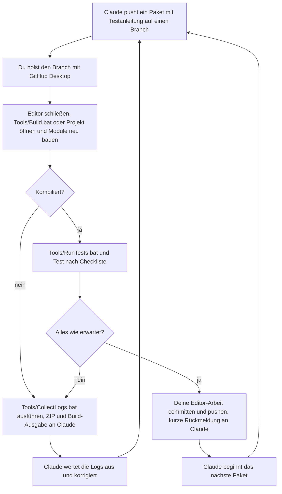
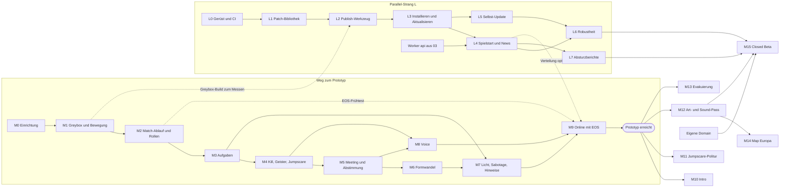

# 06 – Roadmap bis zum spielbaren Prototyp

Stand: November 2026 · Teil der Planung für *How Could It Be You*

## Worum geht's

Diese Roadmap legt die Reihenfolge fest, bis du mit 4–8 Freunden online eine komplette Runde auf der Greybox-Map Kepler-7 spielen kannst. Sie passt zu unserer Aufteilung: Claude schreibt den gesamten Code, du baust im Editor, kompilierst und testest. Jeder Meilenstein nennt, was Claude liefert, welche Editor-Schritte du machst, woran wir „fertig“ erkennen und wie viele Stunden du ungefähr brauchst. Kalenderdaten gibt es bewusst nicht, weil dein Zeitbudget offen ist.

## Inhalt

1. [So arbeiten wir zusammen](#1-so-arbeiten-wir-zusammen)
2. [Definition „Spielbarer Prototyp“](#2-definition-spielbarer-prototyp)
3. [Prioritäten-Übersicht (MoSCoW)](#3-prioritäten-übersicht-moscow)
4. [Meilensteine](#4-meilensteine)
5. [Abhängigkeits-Diagramm](#5-abhängigkeits-diagramm)
6. [Risiken und Gegenmaßnahmen](#6-risiken-und-gegenmaßnahmen)
7. [Tipps für Anfänger](#7-tipps-für-anfänger)

---

## 1. So arbeiten wir zusammen

### 1.1 Der Arbeitszyklus

Ein paar Begriffe vorab:
- **Repo** (= Repository): der Projektordner auf GitHub mit dem ganzen Verlauf.
- **Branch** (= Arbeitszweig): eine Parallelversion, auf der neue Arbeit entsteht, ohne `main` zu stören.
- **Commit** (= gespeicherter Stand mit Beschreibung). **Push** lädt ihn hoch, **Pull** holt fremde Commits zu dir.
- **Paket:** eine kleine Lieferung von Claude mit Testanleitung (Muster in [04 – Qualität & Tests](04-qualitaet-und-tests.md) §11.2).



Ein Durchlauf kostet dich typischerweise 15–60 Minuten (Schätzung). Ein Meilenstein besteht meist aus 3–8 Paketen.

### 1.2 Regeln

1. **Kleine Schritte.** Jedes Paket kompiliert für sich und ist einzeln testbar. Ist etwas rot, baust du nicht weiter, sondern meldest es zuerst.
2. **Ein Meilenstein = ein Branch**, z. B. `claude/m3-aufgaben`. Du arbeitest im Editor auf demselben Branch (GitHub Desktop: *Current Branch*). Ist der Meilenstein abgenommen, öffnet Claude einen **Pull Request** (= Antrag, den Branch in `main` zu übernehmen). Du klickst auf GitHub *Merge* und wechselst danach in GitHub Desktop unter *Current Branch* auf den nächsten Branch, den Claude dir nennt. Der Parallel-Strang L läuft auf eigenen Branches, die vor allem `/Launcher`, `/Backend` und `/Tools` berühren. Die wenigen Teile mit Spiel-C++ (z. B. `BuildInfo.json` lesen in L4, `hc.CrashTest` in L7) liefert Claude als kleines Paket auf dem gerade aktiven Meilenstein-Branch, damit du nie zwei Unreal-Stände parallel testen musst.
3. **Nie zwei Leute an derselben Map oder demselben Asset.** `.umap`- und `.uasset`-Dateien sind Binärdateien und lassen sich nicht zusammenführen. Bei einem Konflikt überlebt nur eine Version. Claude ändert nie Binärdateien. Hilft später ein Freund im Editor, sprecht vorher ab, wer welche Map hat.
4. **Immer nach einem erfolgreichen Test committen und pushen.** GitHub ist zugleich dein Backup. Commit-Text mit Meilenstein, z. B. „M1: Gang Nord und Quartiere gebaut“.
5. **Vor dem Arbeiten zuerst holen:** *Fetch origin* bzw. *Pull origin*.
6. **Projekteinstellungen gehören Claude.** Änderst du im Editor etwas unter *Project Settings*, schreibt Unreal in `Game/Config/*.ini`. Diese Dateien pflegt Claude. Ausnahme sind Werte, die laut Testanleitung du einstellst. Sonst sag Claude, was du geändert hast, und committe es getrennt.
7. **Engine-Version bleibt fest** (der 5.8.x-Hotfix aus M0). Engine-Updates im Epic Games Launcher nur nach Absprache, weil danach z. B. der EOS-Patch neu angewendet werden muss ([03](03-multiplayer-und-backend.md) §6.6).

### 1.3 Was „Kompilieren“ für dich bedeutet

Claude schreibt C++ als Text. Damit Unreal ihn ausführen kann, muss dein PC ihn **kompilieren** (= in Maschinencode übersetzen). Das erledigt der Compiler aus Visual Studio, gesteuert vom *Unreal Build Tool*. Ergebnis ist eine DLL-Datei (= Programmbaustein) in `Game/Binaries/Win64`, die der Editor beim Start lädt. Visual Studio öffnen oder Code lesen musst du dafür nie.

| Weg | Wann | Was du siehst |
|---|---|---|
| `Game/HowCouldItBeYou.uproject` doppelklicken → „Module neu bauen?“ → **Ja** | Alltag nach einem Pull | Fortschrittsfenster, danach der Editor. Bei einem Fehler nur eine kurze Meldung |
| `Tools/Build.bat` doppelklicken | Wenn der erste Weg scheitert, und immer, wenn Claude darum bittet | Komplette Ausgabe, am Ende „BUILD ERFOLGREICH“ oder „BUILD FEHLGESCHLAGEN“. Die Ausgabe landet auch in der ZIP von `CollectLogs.bat` |

- **Editor vorher schließen.** Bei offenem Editor blockiert *Live Coding* (= Unreals Neu-Kompilieren während der Editor läuft) Builds von außen. Live Coding (Strg+Alt+F11) benutzt du nicht.
- Der erste Build dauert grob 5–20 Minuten, danach meist 1–5 Minuten (Schätzung, je nach PC).
- Wenn Builds seltsam scheitern: Editor zu, die Ordner `Game/Binaries` und `Game/Intermediate` löschen, neu bauen. Das ist harmlos, beides wird komplett neu erzeugt.

```bat
rem Skizze – Tools/Build.bat, Kernzeilen (Pfade und Parameter beim Umsetzen gegen UE 5.8 prüfen)
rem local.bat setzt UE_ROOT, z. B. C:\Program Files\Epic Games\UE_5.8 (Vorlage: Tools/local.example.bat)
call "%~dp0local.bat"
call "%UE_ROOT%\Engine\Build\BatchFiles\Build.bat" HowCouldItBeYouEditor Win64 Development ^
  -Project="%~dp0..\Game\HowCouldItBeYou.uproject" -WaitMutex
```

---

## 2. Definition „Spielbarer Prototyp“

Der Prototyp ist erreicht, wenn **alle** Punkte abgehakt sind:

- [ ] **Map:** 1 Greybox-Map Kepler-7 (`Map_Kepler7`, = grober Rohbau aus Klötzen) nach Grundriss in [01](01-game-design-document.md) §11.1 und Maßen in [04](04-qualitaet-und-tests.md) §2
- [ ] **Modus:** Infiltration (Crew gewinnt durch alle Aufgaben oder Auswurf des Monsters, Monster gewinnt bei Gleichstand der Lebenden)
- [ ] **Online:** 4–8 Spieler mit Freunden über EOS: Anmeldung per Device ID, Lobby mit 6-stelligem Join-Code, P2P-Verbindung inklusive Relay
- [ ] **Rollen:** genau 1 Monster, zufällig, private Rollen-Enthüllung
- [ ] **Aufgaben:** ≥ 4 Typen (Halten, Abfolge, Minispiel, Mehrstufig), Verteilung, Fortschrittsbalken, Fake-Aufgaben, Geister-Aufgaben
- [ ] **Kill:** mit Basis-Jumpscare (Platzhalter-Monster, Sound-Stinger), Überresten, Melden und Geistern
- [ ] **Meeting:** Notfall-Knopf und Melden, Teleport auf Sitze, Diskussion, Abstimmung, Auswurf
- [ ] **Formwandel:** in jeden lebenden Spieler, 8 Identitäten (Farbe, Symbol, Name)
- [ ] **Sabotage:** Stromausfall pro Sektor, Reparatur am Sicherungskasten
- [ ] **Voice:** Proximity in der Runde, alle im Meeting, Geister nur unter sich, nirgends eine Anzeige, wer spricht
- [ ] **Keine Info-Lecks:** keine Namen über Köpfen, keine Liste der Lebenden, kein Kill-Feed, Rollen nur beim Besitzer ([01](01-game-design-document.md) §10 „Regel: Keine Informations-Lecks“)
- [ ] **Siegbedingungen und Ergebnis-Bildschirm** (Monster enthüllt, zurück in die Lobby)
- [ ] **Debug-Befehle** `hc.*` ([02](02-technische-architektur-ue5.md) §18)
- [ ] **Automatische Checks grün:** `Tools/RunTests.bat` (Unit-Tests, Validatoren, Map-Checks), Bot-Läufer 30 min ohne Hänger, 3 Online-Runden am Stück ohne Absturz

**Bewusst nicht enthalten:** finale Intro-Cutscene (im Prototyp steht eine Texttafel „Es ist einer von euch.“), Art-Pass (alles Greybox und Platzhalter), Map 2 und 3, Modus 2 „Evakuierung“, Launcher-Release (Strang L läuft parallel), hübsche UI-Designs, Verstecke, Code-Signatur.

---

## 3. Prioritäten-Übersicht (MoSCoW)

MoSCoW ist eine einfache Sortierung: **Must** = ohne das kein Prototyp. **Should** = im Prototyp geplant, darf bei Zeitnot nach hinten rutschen. **Could** = nach dem Prototyp. **Won't for now** = bewusst zurückgestellt.

| Feature | Priorität | Meilenstein | Details |
|---|---|---|---|
| Projekt, Repo, Git LFS, Build-/Test-Skripte | Must | M0 | [02](02-technische-architektur-ue5.md) §3, [04](04-qualitaet-und-tests.md) §5g |
| Greybox Kepler-7 | Must | M1 | [01](01-game-design-document.md) §11.1, [04](04-qualitaet-und-tests.md) §2 |
| Spielfigur: Ego-Kamera, Gehen/Sprinten, Taschenlampe mit Akku | Must | M1 | [02](02-technische-architektur-ue5.md) §4.2 |
| Interaktion, automatische Türen | Must | M1 | [02](02-technische-architektur-ue5.md) §10, §11 |
| Map-Checks, Validatoren, Unit-Tests | Must | ab M1, wächst mit | [04](04-qualitaet-und-tests.md) §5 |
| Laufzeit-Schutz (`/unstuck`, Failsafes, Kill-Z) | Must | M1–M4 | [04](04-qualitaet-und-tests.md) §6 |
| Match-Phasen, Lobby (lokal), Rollen + Enthüllung | Must | M2 | [02](02-technische-architektur-ue5.md) §5, [03](03-multiplayer-und-backend.md) §7 |
| Siegbedingungen Infiltration, Ergebnis-Bildschirm | Must | M2 | [01](01-game-design-document.md) §9 |
| Debug-Befehle `hc.*`, Epilepsie-Warnung, „Host hat verlassen“ | Must | M2 | [02](02-technische-architektur-ue5.md) §16, §18, [03](03-multiplayer-und-backend.md) §7.6 |
| Aufgaben (4 Typen), Fake- und Geister-Aufgaben | Must | M3, M4 | [01](01-game-design-document.md) §5, [02](02-technische-architektur-ue5.md) §9 |
| Kill, Überreste, Melden, Geister, Basis-Jumpscare, Option „Jumpscare-Intensität reduzieren“ | Must | M4 | [02](02-technische-architektur-ue5.md) §7 |
| Meeting, Notfall-Knopf, Abstimmung, Auswurf | Must | M5 | [01](01-game-design-document.md) §8, [02](02-technische-architektur-ue5.md) §8 |
| Formwandel mit 8 Identitäten | Must | M6 | [01](01-game-design-document.md) §4.2, [02](02-technische-architektur-ue5.md) §6 |
| Stromausfall-Sabotage, Notlicht, feste Belichtung, Nebel, Grund-Sounds | Must | M7 | [02](02-technische-architektur-ue5.md) §11, §15 |
| Voice: Proximity, Meeting, Geister | Must | M8 | [03](03-multiplayer-und-backend.md) §8 |
| EOS: Device-ID-Login, Lobby mit Join-Code, P2P | Must | M9 | [03](03-multiplayer-und-backend.md) §6–7 |
| Verwandlungsspuren (Schleim 60 s) | Should | M6 | [01](01-game-design-document.md) §6 |
| Tür-Sabotage, Türprotokoll, Sicherheitskameras | Should | M7 | [01](01-game-design-document.md) §6–7 |
| Sichtbare Aufgaben (Bio-Scan, Shuttle betanken), Kamera justieren | Should | M7 | [01](01-game-design-document.md) §5 |
| Grafik-Stufen, Unbehagen-System, Ladestationen L1–L3 | Should | M7 | [02](02-technische-architektur-ue5.md) §15, [01](01-game-design-document.md) §10 |
| Auswurf-Sequenz `LS_Ejection` (ohne sie: Text auf Schwarz) | Should | M5 | [02](02-technische-architektur-ue5.md) §8.7 |
| Push-to-Talk, Noise-Gate, Mikrofon-Test | Should | M8 | [03](03-multiplayer-und-backend.md) §8.6 |
| Launcher, Patch-System, Worker `api` | Should (parallel) | L0–L7 | [05](05-launcher-und-updates.md), [03](03-multiplayer-und-backend.md) §9 |
| Intro-Cutscene | Could | M10 | [01](01-game-design-document.md) §2, [02](02-technische-architektur-ue5.md) §14 |
| Jumpscare-Varianten, echtes Monster-Modell | Could | M11 | [02](02-technische-architektur-ue5.md) §7 |
| Art-/Sound-Pass, Verstecke (Spinde), `WBP_`-Designs | Could | M12 | [01](01-game-design-document.md) §10–11 |
| Modus Evakuierung | Could | M13 | [01](01-game-design-document.md) §9 |
| Map 2 Europa-Bohrstation | Could | M14 | [01](01-game-design-document.md) §11.2 |
| Closed Beta über den Launcher | Could | M15 | [05](05-launcher-und-updates.md) |
| Map 3 Ikarus, Modus 3 Quarantäne/Blackout | Won't for now | nach Release | [01](01-game-design-document.md) §9, §11.3 |
| Wartungsschächte (Platz in der Greybox reservieren) | Won't for now | nach Release | [01](01-game-design-document.md) §4.2, §11.1, [07](07-offene-fragen.md) Q-A11 |
| Sabotage „Kommunikation stören“ und „Kernschmelze“, Vitalmonitor | Won't for now | nach dem Prototyp | [01](01-game-design-document.md) §6–7, [07](07-offene-fragen.md) Q-B2 |
| 2 Monster bei 7–8 Spielern | Won't for now | – | → Offene Frage Q-A4, siehe [07](07-offene-fragen.md). Default: 1 Monster |
| Cloudflare-Lobby/Matchmaker (Durable Objects), Login per OpenID | Won't for now | nach Release | [03](03-multiplayer-und-backend.md) §10 |
| Easy Anti-Cheat, Dedicated Server, Host-Migration | Won't for now | – | [03](03-multiplayer-und-backend.md) §3, §11 |
| GAS, Iris, Push Model, OSSv2, Ducken | Won't for now | – | [02](02-technische-architektur-ue5.md) §1 |
| Code-Signatur (ca. 110–170 €/Jahr) | Won't for now | vor Release | [05](05-launcher-und-updates.md) |

---

## 4. Meilensteine

Für jeden Meilenstein gilt zusätzlich die *Definition of Done* aus [04](04-qualitaet-und-tests.md) §1.2: u. a. `RunTests.bat` grün, PIE (= *Play In Editor*, Spiel direkt im Editor) mit 4 Spielern als Listen-Server mit Netzwerk-Emulation „Average“, Eintrag im Testprotokoll.

> **Hinweis:** M0–M15 meint hier immer **Meilensteine**. Die Testfälle der Testmatrix in [04](04-qualitaet-und-tests.md) §7.2 heißen T1–T16, z. B. „Testfall T5 *Meeting-Teleport*“.

### 4.1 Übersicht

| Meilenstein | Ergebnis | Priorität | Aufwand für dich |
|---|---|---|---|
| M0 Einrichtung | Werkzeuge laufen, Projekt kompiliert | Must | 4–8 h + Downloads |
| M1 Greybox & Bewegung | Begehbares Kepler-7, 4 Spieler im PIE | Must | 15–30 h |
| M2 Match-Ablauf & Rollen | Runde von Lobby bis Ergebnis | Must | 4–8 h |
| M3 Aufgaben | Crew kann durch Aufgaben gewinnen | Must | 6–12 h |
| M4 Kill, Überreste, Geister, Jumpscare | Monster tötet, Tote werden Geister | Must | 6–12 h |
| M5 Meeting & Abstimmung | Kern-Loop lokal komplett | Must | 5–10 h |
| M6 Formwandel | Monster verwandelt sich | Must | 6–12 h |
| M7 Licht, Sabotage & Hinweise | Stromausfall, erster Atmosphäre-Pass | Must (Teile Should) | 10–20 h |
| M8 Voice | Proximity-, Meeting- und Geister-Voice | Must | 4–8 h |
| M9 Online mit EOS | Erster Online-Playtest = **Prototyp** | Must | 6–12 h + Testabend |
| L0–L7 (parallel) | Launcher und Backend | Should | 8–15 h, verteilt |

**Summe bis zum Prototyp:** ca. 65–135 Stunden für dich (grobe Schätzung), dazu der Strang L. Am stärksten schwanken Greybox und Atmosphäre. → Offene Frage Q-B17, siehe [07](07-offene-fragen.md): Wie viele Stunden pro Woche hast du? Default: keine Kalenderplanung, nur Reihenfolge.

### M0 – Einrichtung

**Ziel:** Alle Werkzeuge laufen, das leere Projekt liegt im Repo, und Claudes erster Code kompiliert bei dir. · **Priorität:** Must

**🤖 Claude (Code):**
- Branch `claude/m0-einrichtung` mit `.gitignore`, `.gitattributes`, `Tools/Build.bat`, `Tools/RunTests.bat`, `Tools/CollectLogs.bat`, `Tools/local.example.bat` und der Ordnerstruktur:

```text
/docs  /Launcher  /Backend  /Tools  /.github/workflows
```

Den Ordner `/Game` legt Claude bewusst **nicht** an. Er entsteht in Schritt 16 aus deinem frisch erzeugten Projekt. Gäbe es ihn schon, könntest du deinen Projektordner nicht in `Game` umbenennen.

- Nach deinem Projekt-Push: Editor-Modul `HowCouldItBeYouEditor`, Log-Kategorien `LogHC`, `LogHCMatch`, `LogHCNet`, `LogHCVoice`, ein leeres `UHCGameSettings`, Test-Ordner mit einem ersten Unit-Test. Claude liest die C++-Dateien der Vorlage und baut darauf auf.

```gitattributes
# Skizze – .gitattributes (Auszug): Binärdateien des UE-Projekts über Git LFS
* text=auto
# Windows-Skripte immer mit Windows-Zeilenenden, sonst kann cmd.exe sie falsch lesen
*.bat text eol=crlf
*.uasset filter=lfs diff=lfs merge=lfs -text
*.umap   filter=lfs diff=lfs merge=lfs -text
# Rohdateien nur unter Game/ per LFS. Launcher-Icons bleiben normale Git-Dateien,
# damit Claude (klont ohne LFS-Dateien) und die CI sie ohne LFS bekommen
Game/**/*.png filter=lfs diff=lfs merge=lfs -text
Game/**/*.wav filter=lfs diff=lfs merge=lfs -text
Game/**/*.fbx filter=lfs diff=lfs merge=lfs -text
```

Die `.gitignore` schließt u. a. `Binaries/`, `Intermediate/`, `Saved/`, `DerivedDataCache/`, `.vs/`, `*.sln`, deine `Game/Config/Windows/WindowsEngine.ini`, die lokale EOS-Plugin-Kopie ([03](03-multiplayer-und-backend.md) §6.4 und §6.6) sowie `*.key` und `Tools/local.bat` aus. In `Tools/local.bat` merken sich die Skripte deine lokalen Pfade, z. B. den Engine-Ordner `UE_ROOT` ([05](05-launcher-und-updates.md) §8.3). Du legst sie in Schritt 20 aus der Vorlage `Tools/local.example.bat` an. Die LFS-Option `lockable` lassen wir weg, solange nur du im Editor arbeitest. Sonst wären Dateien ohne Sperre schreibgeschützt, und Unreal könnte nicht speichern.

**🧑 Du (Editor/Test):**

*A. Konten*
1. **Epic-Games-Konto** anlegen oder nutzen, Zwei-Faktor-Anmeldung einschalten. Du brauchst es für den Epic Games Launcher und in M9 für das Developer Portal.
2. **GitHub:** Dein Repo `mniklas189-png/how-could-it-be-you` existiert. Zwei-Faktor einschalten.
3. **Cloudflare:** noch nicht, erst im Strang L (L2).

*B. PC prüfen*
4. Windows 10/11 64 Bit, SSD mit ca. 150–250 GB frei (grobe Schätzung für Engine, Visual Studio, Projekt und Caches), 32 GB RAM empfohlen (16 GB gehen, dann weniger PIE-Fenster, [04](04-qualitaet-und-tests.md) §7.1), Grafikkarte mit DirectX 12.
5. Arbeitsordner kurz und **außerhalb von OneDrive**, z. B. `C:\Dev\how-could-it-be-you`. Lange Pfade und Cloud-Synchronisierung machen Unreal-Projekte kaputt.

*C. Installieren*
6. **Epic Games Launcher** installieren und anmelden → *Unreal Engine* → *Bibliothek* → `+` bei *Engine-Versionen* → neueste **5.8.x** → *Installieren*. Unter *Optionen*: Android, iOS und Linux abwählen (spart Platz). *Starter Content*, *Templates and Feature Packs* und *Engine Source* angehakt lassen (Starter Content wird damit nur installiert, ins Projekt holst du ihn erst bei Bedarf). *Editor symbols for debugging* erst, wenn Claude darum bittet (Optionsnamen beim Umsetzen gegen UE 5.8 prüfen).
7. **Visual Studio Community 2022, Version 17.14** (kostenlos). Im Installer die Workloads *Desktopentwicklung mit C++*, *Spieleentwicklung mit C++* (rechts in den Details zusätzlich *IDE-Unterstützung für Unreal Engine* und den *Unreal Engine Test Adapter* anhaken, Namen beim Umsetzen prüfen) und *.NET-Desktopentwicklung*. Unter *Einzelne Komponenten*: MSVC-Toolset **14.44** und **Windows 11 SDK 10.0.26100**. Ehrlich: Epic nennt für 5.8 offiziell Visual Studio 2026 als Empfehlung und 2022 (17.14) als Minimum. Wir nehmen trotzdem 2022, weil mit 5.8.x und Visual Studio 2026 mehrfach Build-Probleme berichtet wurden.
8. Öffne nach der Engine-Installation `C:\Program Files\Epic Games\UE_5.8\Engine\Config\Windows\Windows_SDK.json` (Standardpfad) mit dem Windows-Editor und schick den Inhalt an Claude. Claude gleicht die empfohlenen Versionen ab.
9. **GitHub Desktop** installieren und mit GitHub anmelden. Git LFS (= Erweiterung, die große Binärdateien getrennt speichert) bringt GitHub Desktop mit, du musst es nicht extra installieren.
10. Optional jetzt, spätestens in M8: ein Headset.

*D. Repo holen*
11. GitHub Desktop → *File → Clone repository* → `how-could-it-be-you` → Ziel `C:\Dev\how-could-it-be-you`.
12. *Current Branch* → `claude/m0-einrichtung`. Jetzt liegen `.gitignore`, `.gitattributes` und `Tools/` im Ordner. **Diese Dateien müssen da sein, bevor das Projekt entsteht.** Sonst landen Binärdateien ohne LFS im Repo. Zeigt GitHub Desktop jetzt den Hinweis, dass das Repo Git LFS nutzt und LFS eingerichtet werden muss („Initialize Git LFS“), bestätige ihn. Erscheint er nicht, schließe GitHub Desktop einmal und öffne es wieder.

*E. Projekt anlegen*
13. Unreal 5.8 im Epic Games Launcher starten (*Bibliothek* → bei 5.8 auf *Starten*). Es öffnet sich zuerst der **Projekt-Browser**, noch nicht der Editor. Ist er auf Deutsch, findest du die Einträge sinngemäß (Spiele, Ego-Perspektive). Die Sprache stellst du in Schritt 17 um.
14. Projekt-Browser → *Games* → *First Person* → Variante **Survival Horror** (Auswahlfeld rechts). *Project Defaults*: **C++**, *Desktop*, Qualität *Maximum*, *Starter Content* aus, *Raytracing* aus (Claude schaltet die Raytracing-Voraussetzungen für MegaLights später per ini ein, [02](02-technische-architektur-ue5.md) §15.1). Feldnamen beim Umsetzen gegen UE 5.8 prüfen.
15. Speicherort `C:\Dev\how-could-it-be-you`, Name **HowCouldItBeYou** → *Create*. Unreal legt dann den Unterordner `HowCouldItBeYou` an, kompiliert und erzeugt beim ersten Start Shader. Das kann lange dauern. Öffnet sich dabei Visual Studio von selbst, schließe es einfach.
16. Editor schließen. Im Explorer den neuen Ordner `HowCouldItBeYou` in **`Game`** umbenennen. Ein komplettes, frisch angelegtes Projekt darfst du so umbenennen, einzelne Assets nie (Abschnitt 7.4). Lösche danach in `Game` die Ordner `Binaries`, `Intermediate` und `.vs` (falls vorhanden) sowie die Datei `HowCouldItBeYou.sln`. Darin stehen noch die alten Pfade, und alles wird neu erzeugt.
17. `Game\HowCouldItBeYou.uproject` doppelklicken. Fragt Unreal „Module neu bauen?“, wähle **Ja**. Wenn der Editor offen ist: Editor-Sprache auf Englisch stellen (*Edit → Editor Preferences → General → Region & Language → Editor Language*, im deutschen Editor *Bearbeiten → Editor-Einstellungen*), Editor neu starten. Die meisten Tutorials und Claudes Anleitungen nutzen die englischen Menünamen. Danach den Editor wieder schließen.

*F. Erster Commit*
18. GitHub Desktop zeigt die Änderungen. Erwartet: `Game/Source`, `Game/Config`, `Game/Content`, `Game/HowCouldItBeYou.uproject`. **Nicht** erlaubt: `Binaries`, `Intermediate`, `Saved`, `DerivedDataCache`. Tauchen sie auf: stoppen und Claude fragen.
19. Commit-Text „M0: Projekt aus Vorlage First Person / Survival Horror“ → *Commit to claude/m0-einrichtung* → *Push origin*. Öffne danach auf github.com im Branch irgendeine `.uasset`-Datei unter `Game/Content`: Dort muss „Stored with Git LFS“ stehen. Fehlt der Hinweis, arbeite nicht weiter und sag Claude Bescheid (das lässt sich reparieren, wird aber mit jedem weiteren Commit aufwendiger). Sonst Claude Bescheid geben, dass das Projekt oben ist.

*G. Erstes Kompilieren mit Claudes Code*
20. Claude pusht den ersten eigenen Code. *Pull origin*. Im Explorer unter *Ansicht → Einblenden* die **Dateinamenerweiterungen** einschalten, dann `Tools\local.example.bat` kopieren und die Kopie in `local.bat` umbenennen. Mit dem Windows-Editor öffnen und prüfen, ob `UE_ROOT` auf deinen Engine-Ordner zeigt (Standard `C:\Program Files\Epic Games\UE_5.8`). Dann `Tools\Build.bat` → erwartet „BUILD ERFOLGREICH“.
21. Projekt öffnen → *Edit → Project Settings*. Der Eintrag „How Could It Be You“ ist da.
22. Editor schließen → `Tools\RunTests.bat` → „ALLE TESTS GRÜN“. Dann `Tools\CollectLogs.bat` einmal zur Probe ausführen und die ZIP an Claude schicken.

**Fertig, wenn …**
- [ ] UE 5.8.x, Visual Studio 2022 17.14 (MSVC 14.44, SDK 10.0.26100) und GitHub Desktop installiert, `Windows_SDK.json` mit Claude abgeglichen
- [ ] `Game/HowCouldItBeYou.uproject` im Repo, `.uasset`-Dateien laufen über LFS (GitHub zeigt bei der Datei „Stored with Git LFS“), keine Binaries/Intermediate/Saved im Commit
- [ ] `Build.bat` und `RunTests.bat` grün, die CollectLogs-ZIP ist bei Claude angekommen

**Aufwand für dich:** 4–8 h aktive Arbeit, dazu mehrere Stunden Download und Installation nebenher. · **Abhängigkeiten:** keine.
**Lernhinweis:** Lerne parallel die Editor-Grundlagen: Viewport-Navigation, Content Browser, Outliner, Details-Panel. Mehr brauchst du für M1 nicht.

### M1 – Greybox & Bewegung

**Ziel:** Du läufst mit 4 Spielern durch eine begehbare Klötzchen-Version von Kepler-7. Türen funktionieren, und der erste automatische Map-Check ist grün. · **Priorität:** Must

**🤖 Claude (Code):**
- `AHCCharacter` mit Ego-Kamera und First Person Rendering (gegen Clipping in engen Gängen), Gehen 300 cm/s, Sprinten 500 cm/s mit Ausdauer, kein Springen, kein Ducken, Taschenlampe mit Akku. Ob sie an ist, sehen alle.
- Grundgerüst `AHCGameMode`, `AHCPlayerController` (Spawnen). `UHCInteractionComponent` + `IHCInteractable` (Trace 180 cm, Hervorhebung, Prüfung auf dem Server).
- `AHCDoor`: öffnet automatisch, schließt nie auf Spielern, nutzt Dormancy (= Tür schickt nur bei Änderungen Daten über das Netz).
- Helfer `AHCCapsuleGauge` und `AHCClearPathVolume`, Editor-Validatoren, Map-Check (Pfad vom Spawn zu jedem wichtigen Punkt), Hänger-Erkennung + `/unstuck`, Kill-Z-Schutz, Bot-Läufer `hc.BotRun` ([04](04-qualitaet-und-tests.md) §5–6). Der Pflichtinhalt-Check HC-V11 prüft jeweils nur, was es schon gibt (Geister-Grenzen ab M4, Sitze und Notfall-Knopf ab M5). So wird `RunTests.bat` nicht rot, nur weil ein späterer Meilenstein fehlt.
- NavMesh-Einstellungen passend zur Kapsel (Radius 40 cm, Höhe 180 cm, [04](04-qualitaet-und-tests.md) §5b) in der Config.
- Liste der Input Actions, die du anlegst.

**🧑 Du (Editor/Test):**
1. Im Content Browser den Ordner `Content/HowCouldItBeYou/Blueprints` anlegen. Darin per Rechtsklick → *Blueprint Class* → unten *All Classes* aufklappen → `HCCharacter` suchen → *Select* → Name `BP_HCCharacter`. Genauso `BP_HCGameMode`, `BP_HCPlayerController` und `BP_HCDoor` (von `HCDoor`, als Türflügel reicht ein flacher Würfel). Meshes aus der Vorlage übernehmen und in `BP_HCGameMode` die Klassen-Verweise eintragen (Pawn = `BP_HCCharacter`, Controller = `BP_HCPlayerController`, [02](02-technische-architektur-ue5.md) §4.3). Input Actions `IA_*` und `IMC_Default` nach Claudes Liste ([02](02-technische-architektur-ue5.md) §3.3).
2. Neue Map `Map_Kepler7` (*File → New Level → Basic*) unter `Content/HowCouldItBeYou/Maps/Kepler7/` speichern (jede Match-Map bekommt einen eigenen Unterordner, [02](02-technische-architektur-ue5.md) §3.2). In den *World Settings* (Menü *Window → World Settings*) „One File Per Actor“ (*Use External Actors*) einschalten (beim Umsetzen gegen UE 5.8 prüfen). Danach zeigt GitHub Desktop viele kleine Dateien unter `Content/__ExternalActors__/`. Die gehören mit in jeden Commit.
3. Raster auf 50 bzw. 100 stellen ([04](04-qualitaet-und-tests.md) §2.2). Grundriss nach dem Plan in [01](01-game-design-document.md) §11.1 (ca. 90 × 75 m): erst Böden pro Raum, dann Wände, dann Türöffnungen (≥ 140 × 230 cm), zuletzt Decken. Werkzeug: *Place Actors → Shapes → Cube* (skalieren) oder der *Modeling*-Modus mit *Box*. Der Würfel ist 100 × 100 × 100 cm, sein Mittelpunkt liegt in der Mitte. Beispiel für 10 m Gang: Boden mit *Scale* 10 / 2,5 / 0,2 (250 cm breit), zwei Wände mit 10 / 0,2 / 2,7 links und rechts direkt neben dem Boden. Dann bleibt der Gang ≥ 200 cm breit und ≥ 270 cm hoch ([04](04-qualitaet-und-tests.md) §2.1). Die Zahlen trägst du im *Details*-Panel unter *Transform → Scale* ein.
4. Pro Raum ein Ordner im Outliner (Rechtsklick → *Create Folder*), Actors sprechend benennen (`Wall_GangNord_01`). Pro Stromsektor eine Würfelfarbe (Nord, Ost, Süd-West). Nischen für die Spinde S1–S5 und die dunklen Nischen gleich mit einplanen (≥ 120 × 120 cm frei davor, abseits der Laufwege), ebenso die Öffnungen für spätere Wartungsschächte (Reaktor ↔ Medbay, Quartiere ↔ Hangar, vorerst zugemauert) und die Wandnischen (≥ 120 × 120 cm) in den Gängen für die Sicherungskästen SK-N, SK-O, SK-SW und die Aufgabe *Kamera justieren* an K1 und K3 ([04](04-qualitaet-und-tests.md) §4). Sonst stehen diese Dinge später im Weg ([07](07-offene-fragen.md) Q-A10, Q-A11).
5. Spiel-Actors findest du über *Window → Place Actors* (Suche `HC` zeigt Claudes Klassen). 8 PlayerStarts (*Place Actors → Basic → Player Start*) mit ≥ 120 cm Abstand in die Kommandozentrale. Eine *Trigger Box* (*Basic*) über die ganze Kommandozentrale, im *Details*-Panel unter *Actor → Tags* mit **+** den Tag `HC.MeetingRoom` eintragen (kill-freier Meeting-Raum, [02](02-technische-architektur-ue5.md) §8.12). In den *World Settings* *Kill Z* auf mindestens 1.000 cm unter den tiefsten Boden setzen ([04](04-qualitaet-und-tests.md) §6.2).
6. *Place Actors → Volumes → Nav Mesh Bounds Volume* in den Viewport ziehen und mit **R** (Skalieren) so groß ziehen, dass es die ganze Station samt Böden umschließt. Im Viewport **P** drücken: Auf allen Wegen und in allen Türen muss es grün sein.
7. `BP_HCDoor` in jede Türöffnung setzen, vor jede Tür eine `AHCCapsuleGauge`. `AHCClearPathVolume` entlang aller Hauptwege und durch jede Tür legen, 10 cm schmaler als der Gang je Seite und 230 cm hoch ([04](04-qualitaet-und-tests.md) §5d). Ein paar einfache Punktlichter mit *Mobility = Movable*, damit du etwas siehst und sie in M7 bei Stromausfall ausgehen können.
8. Testen: Editor schließen, `RunTests.bat`. Dann Editor öffnen, PIE mit 4 Spielern als *Listen Server* ([04](04-qualitaet-und-tests.md) §7.1). Laufzeiten mit der Stoppuhr messen ([01](01-game-design-document.md) §11.1). Die Map in der Ansicht *Player Collision* abfahren ([04](04-qualitaet-und-tests.md) §3.4). Zum Schluss im PIE `hc.BotRun 6 30`.

**Fertig, wenn …**
- [ ] Maße aus [04](04-qualitaet-und-tests.md) §2.1 eingehalten, `AHCClearPathVolume` auf allen Hauptwegen, `AHCCapsuleGauge` an allen Türen grün
- [ ] Map-Check grün: jeder Raum vom Spawn erreichbar
- [ ] PIE mit 4 Spielern: Alle sehen sich laufen und sprinten, Taschenlampen der anderen sind sichtbar, Türen verhalten sich in allen Fenstern gleich
- [ ] Ende-zu-Ende-Laufweg 45–60 s, Bot-Läufer 30 min ohne Hänger
- [ ] `/unstuck` setzt dich auf einen gültigen Punkt zurück, ein Sturz unter die Map endet nicht im Nichts (Kill-Z-Schutz)

**Aufwand für dich:** 15–30 h. Die Greybox ist dein größter Brocken bis zum Prototyp. · **Abhängigkeiten:** M0.
**Lernhinweis:** Level-Blockout (Greybox) und *Modeling*-Modus, Kollision sichtbar machen ([04](04-qualitaet-und-tests.md) §3.4).

### M2 – Match-Ablauf & Rollen

**Ziel:** Eine Runde läuft von der Lobby bis zum Ergebnis-Bildschirm. Rollen werden verteilt, jeder sieht nur seine eigene, die Siegbedingungen sind getestet. · **Priorität:** Must

**🤖 Claude (Code):**
- Phasen-Automat `EHCMatchPhase` in `AHCGameMode`/`AHCGameState` mit Countdowns per Server-Zeitstempel ([02](02-technische-architektur-ue5.md) §5). Die Phase *Intro* zeigt vorerst nur eine Texttafel.
- `UHCSessionSubsystem` gegen OnlineSubsystemNull (= Unreals Netzwerk-Ersatz für Editor und LAN): Hosten, per Join-Code beitreten, verlassen, zurück in die Lobby ([03](03-multiplayer-und-backend.md) §7).
- `FHCRoleAssigner`, `FHCWinConditionEvaluator`, `UHCMatchRules` „Infiltration“, Unit-Tests dazu.
- Prototyp-Oberflächen in C++: Epilepsie-Warnung, Hauptmenü (mit Namenseingabe), Lobby, Rollen-Enthüllung, HUD-Gerüst, Ergebnis. Bewusst ohne Namen über Köpfen, ohne Liste der Lebenden und ohne Kill-Feed ([02](02-technische-architektur-ue5.md) §16).
- Debug-Befehle `hc.ShowDebug`, `hc.ListPlayers`, `hc.ForceRole`, `hc.EndMatch`, `hc.SetTimer`, `hc.SkipIntro`, `hc.SimulateHostLeave`. Fehlerweg „Host hat das Spiel verlassen“.

**🧑 Du (Editor/Test):**
1. Leere Maps `Map_MainMenu` und `Map_Transition` anlegen (*File → New Level → Empty Level*, dann *File → Save Current Level As* nach `Content/HowCouldItBeYou/Maps/`). Dazu `Map_Lobby` (*Basic*) als kleinen Greybox-Raum mit 8 PlayerStarts. Welche Map beim Start lädt, stellt Claude in der Config ein.
2. In `BP_HCGameMode` die Klassen-Verweise nach Claudes Liste prüfen.
3. Test A: PIE in `Map_Lobby`, 4 Spieler als Listen-Server. Host startet die Runde, Rollen in allen Fenstern ansehen, `hc.EndMatch Crew`, Ergebnis, zurück in die Lobby. Klappt der Map-Wechsel im Editor nicht, braucht es eventuell `net.AllowPIESeamlessTravel 1` ([03](03-multiplayer-und-backend.md) §7.7, Claude sagt dir dann Bescheid).
4. Test B: 2 Spieler mit *Net Mode: Play Standalone* und *Run Under One Process* aus. Beide starten im Hauptmenü, einer hostet und nennt den Code, der andere tritt per Code bei (LAN über OnlineSubsystemNull, beim Umsetzen gegen UE 5.8 prüfen).
5. `hc.SimulateHostLeave` ausprobieren.

**Fertig, wenn …**
- [ ] Unit-Tests grün: bei 4–8 Spielern genau 1 Monster, Paritätsregel, „Monster ausgeworfen = sofort Crew-Sieg“
- [ ] Testfall *Rolle nur beim Besitzer* grün: `hc.ShowDebug 2` zeigt alle Rollen nur im Host-Fenster, in Client-Fenstern nie ([02](02-technische-architektur-ue5.md) §18)
- [ ] Im HUD keine Namen über Köpfen, keine Liste der Lebenden
- [ ] 3 Runden hintereinander Lobby → Ergebnis → Lobby ohne Neustart
- [ ] Host-Abbruch: Alle Clients landen mit Meldung im Hauptmenü

**Aufwand für dich:** 4–8 h. · **Abhängigkeiten:** M1.
**Lernhinweis:** Grundbegriffe Listen-Server und Replikation (= der Server schickt Zustände automatisch an alle Clients) in [02](02-technische-architektur-ue5.md) §2 lesen. Programmieren musst du dafür nichts.

> **Tipp:** Hast du schon einen zweiten PC (oder einen Freund zum Testen), kann Claude nach M2 die EOS-Anbindung als **EOS-Frühtest** vorziehen (nur Login, Lobby und Join-Code). Du machst dann die Schritte 1–4 aus M9 und testest mit zwei PCs. Das entschärft das größte technische Risiko früh (Abschnitt 6).

### M3 – Aufgaben

**Ziel:** Die Crew erledigt Aufgaben und kann damit gewinnen. Das Monster hat glaubwürdige Fake-Aufgaben. · **Priorität:** Must

**🤖 Claude (Code):**
- `AHCTaskStation` mit den vier Typen Halten, Abfolge, Minispiel, Mehrstufig. Minispiel-Overlays in C++. Bewegung oder Esc bricht ab.
- `UHCTaskComponent`, `FHCTaskAssigner` (1 gemeinsame, 2 lange, 3 kurze Aufgaben, über ≥ 3 Bereiche gestreut, max. 1 sichtbare) mit Unit-Tests, Fortschrittsbalken, Fake-Aufgaben, Siegbedingung „alle Aufgaben“, `hc.CompleteAllTasks`.
- **Prototyp-Set:** 9 Aufgaben aus [01](01-game-design-document.md) §5 (#1, #3, #4, #5, #6, #7, #9, #11, #12), alle vier Typen. #2 Bio-Scan, #8 Kamera justieren und #10 Shuttle betanken folgen in M7, weil sie Kameras bzw. sichtbare Effekte brauchen.
- Map-Check und Bot-Läufer nehmen jede Station auf: erreichbar, 120 × 120 cm frei, ≥ 250 cm Abstand zur nächsten Station, ≥ 300 cm zur Türmitte ([04](04-qualitaet-und-tests.md) §2.1).

**🧑 Du (Editor/Test):**
1. Pro Aufgabe eine Kindklasse `BP_TaskStation_<Name>` anlegen (wie in M1 Schritt 1, Elternklasse `HCTaskStation`) und nur Mesh und Sound zuweisen. Ein Würfel oder ein Prop aus der Vorlage reicht.
2. Stationen laut Raumtabelle in [01](01-game-design-document.md) §11.1 platzieren und die `TaskId` eintragen. Bei mehrstufigen Aufgaben liegt jeder Schritt im richtigen Raum.
3. Vor jede Station eine `AHCCapsuleGauge` stellen: Ist sie grün?
4. Jede Aufgabe einmal als Crew und einmal als Monster erledigen, einmal durch Bewegung abbrechen. Die Rolle erzwingst du **vor** dem Rundenstart in der Lobby mit `hc.ForceRole <Spieler> Monster`, sie gilt für die nächste Rollenverteilung. Danach Editor schließen, `RunTests.bat`, dann im PIE `hc.BotRun 6 30`.

**Fertig, wenn …**
- [ ] Unit-Tests der Verteilung grün
- [ ] Als Crew steigt der Balken bei allen gleich. Als Monster läuft die Aufgabe gleich ab, der Balken bleibt stehen
- [ ] Crew gewinnt mit 4 Spielern durch Aufgaben, ohne Debug-Befehl
- [ ] Map-Check: alle Stationen erreichbar und frei

**Aufwand für dich:** 6–12 h. · **Abhängigkeiten:** M2.
**Lernhinweis:** Blueprint-Kindklassen anlegen und im Details-Panel Assets zuweisen. Das brauchst du ab jetzt ständig.

### M4 – Kill, Überreste, Geister, Basis-Jumpscare

**Ziel:** Das Monster kann töten, das Opfer erlebt einen Jumpscare, Überreste bleiben liegen, und Tote spielen als Geister weiter. · **Priorität:** Must

**🤖 Claude (Code):**
- `UHCKillComponent`: ≤ 200 cm, freie Sichtlinie, Abklingzeit 30 s, erster Kill frühestens nach 20 s, nicht im Meeting-Raum, Sperre ca. 2,5 s.
- `AHCJumpscareDirector` (läuft nur beim Opfer), `UHCJumpscareData`, Failsafe-Timer (= Notfall-Zeitlimit) auf Server und Client, Option „Jumpscare-Intensität reduzieren“.
- `AHCRemains` ohne Kollision, Melden bis 250 cm. Bis M5 löst Melden nur ein Platzhalter-Ereignis aus.
- `AHCGhostPawn`: unsichtbar für Lebende, fliegt frei innerhalb der Map-Grenzen. Geister-Aufgaben, Monster-Sieg bei Parität, `hc.KillMe`, `hc.Jumpscare`.

**🧑 Du (Editor/Test):**
1. **Platzhalter-Monster** `SK_Monster`: das Mannequin der Vorlage mit dunklem, nassem Material und verzerrter Skalierung, oder ein kostenloses Fab-Asset (Lizenz notieren, Abschnitt 6).
2. Aus einer vorhandenen Animation eine Montage `AM_Jumpscare_Lunge` machen (Rechtsklick auf die Animation → *Create → Create AnimMontage*, Menüname beim Umsetzen gegen UE 5.8 prüfen).
3. Camera Shake `BP_CS_Jumpscare` (Blueprint-Klasse von *CameraShakeBase*, im *Details*-Panel als Muster *Perlin Noise* wählen, Namen beim Umsetzen gegen UE 5.8 prüfen) nach Claudes Werten.
4. Stinger `SW_Stinger_01` und Schrei `SW_Scream_01` importieren (WAV-Datei in den Content Browser ziehen), dazu `SA_Scream`. Nur CC0, eigene Aufnahmen oder Fab.
5. Data Asset (= Datensatz-Datei) `DA_Jumpscare_Lunge` im Ordner `Content/HowCouldItBeYou/Monster/` anlegen (Name und Ort wie in der Config, [02](02-technische-architektur-ue5.md) §17): Content Browser → Rechtsklick → *Miscellaneous → Data Asset* → Klasse `HCJumpscareData`. Öffnen und die Felder nach Claudes Liste ausfüllen.
6. Kindklassen `BP_HCRemains` (von `HCRemains`) und `BP_HCGhostPawn` (von `HCGhostPawn`) anlegen wie in M1 und nach Claudes Liste in `BP_HCGameMode` eintragen. Überreste: Decal-Material (= Bild, das auf den Boden „geklebt“ wird) `M_Decal_Blood` und eine einfache ID-Marke in `BP_HCRemains`. Geist: halbtransparentes Material in `BP_HCGhostPawn`.
7. **Grenzen für Geister:** sechs flache *Blocking Volumes* (*Place Actors → Volumes*) als Wände, Boden und Decke rund um die Station, bei jeder Platte unter *Collision → Collision Presets* `HCGhostBounds` wählen. Keine einzelne große Box, darin säße der Geist fest ([02](02-technische-architektur-ue5.md) §7.12).
8. PIE mit 4 Spielern, am besten *Run Under One Process* aus.

**Fertig, wenn …**
- [ ] Testfälle *Kill-Sync*, *Überreste* und *Geister unsichtbar* grün, auch für den Host
- [ ] Nach 10 Test-Kills kein `HC_FAILSAFE` im Log. Mit 4 Spielern gewinnt das Monster nach dem 2. Kill
- [ ] Option „Intensität reduzieren“ wirkt (kein Blitz, leiserer Stinger)
- [ ] Geister erledigen Aufgaben, Lebende sehen und hören an der Station nichts. Kein Geist fliegt aus der Map hinaus (die `HCGhostBounds`-Platten halten)
- [ ] Trennt das Opfer oder das Monster während des Jumpscares die Verbindung, bleibt niemand gesperrt (Failsafe greift)

**Aufwand für dich:** 6–12 h. · **Abhängigkeiten:** M3 (Geister-Aufgaben).
**Lernhinweis:** Assets importieren (FBX, WAV), Animation Montages, Data Assets.

### M5 – Meeting & Abstimmung

**Ziel:** Der Kern-Loop läuft lokal komplett: Aufgaben, Kill, Melden, Meeting, Abstimmung, Auswurf, Sieg. · **Priorität:** Must

**🤖 Claude (Code):**
- `AHCMeetingManager` mit `EHCMeetingStage` (Gathering → Discussion 60 s → Voting 45 s → Results). Teleport auf `AHCMeetingSeat` mit Kapsel-Check, Überreste verschwinden.
- `AHCEmergencyButton` (1× pro Spieler und Match, Abklingzeit nach Meeting-Ende), Melden aus M4 angebunden.
- `FHCVoteTally` mit Unit-Tests (Gleichstand, Überspringen, Nichtwähler), verdeckte Stimmen, Meeting-Oberfläche in C++.
- Phase *Ejection* mit einfacher Luftschleusen-Kamera (Should: `LS_Ejection`, sonst Text auf Schwarz), Reset der Kill-Abklingzeit (ab M6 auch der Formwandel-Abklingzeit), `hc.StartMeeting`.

**🧑 Du (Editor/Test):**
1. Kommandozentrale einrichten: Tisch und Stühle als einfache Blöcke, Stühle ohne Pawn-Kollision ([04](04-qualitaet-und-tests.md) §3).
2. 8 `AHCMeetingSeat` (*Place Actors*, Suche `HC`) mit ≥ 120 cm Abstand und je 2 Ausweichpunkten ([04](04-qualitaet-und-tests.md) §2.1).
3. Kindklasse `BP_HCEmergencyButton` (von `HCEmergencyButton`, Mesh und Alarmton) anlegen, genau einmal in der Kommandozentrale aufstellen, Freifläche mit `AHCCapsuleGauge` prüfen.
4. Luftschleuse: die Kulisse an der Hangar-Westwand (nicht begehbar, [01](01-game-design-document.md) §11.1) mit einem Kamera-Punkt nach Claudes Anleitung.
5. Testen: Knopf, Melden, Abstimmung in 4 Fenstern. `hc.StartMeeting` mehrmals hintereinander. Ein Client trennt während *Voting* die Verbindung.

**Fertig, wenn …**
- [ ] Testfälle *Meeting-Teleport*, *Stimmen verdeckt*, *Auszählung gleich*, *Timer* und *Disconnect während Meeting* grün
- [ ] Auswurf: Alle sehen denselben Text („… war der Wandler.“ bzw. „… war nicht der Wandler.“, [01](01-game-design-document.md) §8), spätestens nach ca. 10 s geht es weiter, auch wenn die Sequenz fehlt (Failsafe, [02](02-technische-architektur-ue5.md) §8.7)
- [ ] Eine komplette Runde lokal ohne Debug-Befehl, bis das Monster ausgeworfen ist und die Crew gewinnt ([04](04-qualitaet-und-tests.md) §8.1 „Kern-Loop lokal“)

**Aufwand für dich:** 5–10 h. · **Abhängigkeiten:** M4.
**Lernhinweis:** Kamera-Actors und ein erster Blick in den Sequencer (= Unreals Werkzeug für Zwischensequenzen). Das bereitet M10 vor.

### M6 – Formwandel

**Ziel:** Das Monster verwandelt sich in lebende Mitspieler, alle sehen dasselbe, und die Verwandlung hinterlässt Hinweise. · **Priorität:** Must

**🤖 Claude (Code):**
- `FHCAppearance`, `UHCAppearanceComponent` (Körper, Anzugfarbe, Emblem, Namensschild, auch an den eigenen Armen) und Identitätswahl in der Lobby.
- `UHCShapeshiftComponent`: Q halten → Radialmenü der lebenden Spieler, Verwandlung 1,5 s, Dauer 45 s, Abklingzeit 30 s, Ende beim Meeting-Start ([01](01-game-design-document.md) §4.2). Unit-Tests: nur lebende Ziele.
- 3D-Geräusch (ca. 8 m), Effekt-Auslöser, Spur-Decal 60 s (Should), `hc.Shapeshift`.

**🧑 Du (Editor/Test):**
1. Master-Material `M_Suit` nach Claudes Schritt-für-Schritt-Anleitung (Farbe und Emblem als Parameter).
2. 8 Material-Instanzen (= Varianten eines Materials mit eigenen Werten) für Rot, Blau, Gelb, Grün, Orange, Violett, Weiß, Türkis: `MI_Suit_Red` … `MI_Suit_Turquoise`.
3. 8 Embleme `T_Emblem_*` (Dreieck, Kreis, Quadrat, Kreuz, Stern, Raute, Balken, Welle) als 256 × 256 PNG, weiß auf transparent. Claude kann dir SVG-Vorlagen als Text liefern, die du z. B. mit dem kostenlosen Programm Inkscape als PNG exportierst.
4. In `BP_HCCharacter` die Listen der `UHCAppearanceComponent` füllen: im Panel *Components* die Komponente anklicken, im *Details*-Panel bei jeder Liste auf **+** und das Asset wählen. Reihenfolge wie die 8 Identitäten in [01](01-game-design-document.md) §13 (Slot 1 = Rot/Dreieck usw., [02](02-technische-architektur-ue5.md) §6.8). Für den Anfang reichen 1–2 Körper-Varianten.
5. Niagara-Effekt (= Partikelsystem) `NS_Shapeshift` aus einer Vorlage, Decal `M_Decal_ShapeshiftTrail`, MetaSound `MS_Shapeshift` und `SA_Shapeshift` (8 m).
6. Mit 3–4 PIE-Clients testen, auch während eines Meetings.

**Fertig, wenn …**
- [ ] Testfall *Verkleidung bei allen* grün (Farbe, Emblem, Namensschild überall gleich)
- [ ] Geräusch in ca. 8 m hörbar, Spur 60 s sichtbar, Meeting-Start beendet die Verwandlung ohne Effekt
- [ ] Tote stehen nicht zur Wahl, das Monster sieht die kopierte Gestalt an den eigenen Ärmeln

**Aufwand für dich:** 6–12 h. · **Abhängigkeiten:** M5.
**Lernhinweis:** Materialien und Material-Instanzen, Einstieg in Niagara und MetaSounds.

### M7 – Licht, Sabotage & Hinweise

**Ziel:** Stromausfälle machen Sektoren dunkel, die Crew repariert sie, und Kepler-7 bekommt seinen ersten Horror-Look. · **Priorität:** Must (mit Should-Teilen)

**🤖 Claude (Code):**
- Must: `AHCPowerSector` und `AHCFuseBox` (3 Schalter, ca. 4 s), Flackern, rote Notbeleuchtung, Notstrom nach 90 s, Abklingzeit 45 s, Sabotage über den Stationsplan, Ansage für alle, `hc.Sabotage`. Auto-Exposure (= automatische Helligkeitsanpassung) projektweit aus.
- Should: Tür-Sabotage in `AHCDoor` (max. 10 s, nie den letzten Weg, nie den Meeting-Raum) samt Map-Check „alle sabotierbaren Türen zu“, `AHCDoorLogTerminal` mit Scannern, `AHCSecurityCamera`, die Aufgaben #2, #8 und #10, Ladestationen für die Taschenlampe, Grafik-Stufen (dabei schaltet Claude die Raytracing-Voraussetzungen für MegaLights per ini ein, [02](02-technische-architektur-ue5.md) §15.1), Unbehagen-System (reagiert nur auf Dunkelheit und Alleinsein, nie auf die Nähe des Monsters).

**🧑 Du (Editor/Test):**
1. Pro Sektor (Nord, Ost, Süd-West, [01](01-game-design-document.md) §11.1) einen `AHCPowerSector` platzieren. Lichter zuordnen: Sektor anklicken, im *Details*-Panel bei der Liste `Lights` auf **+** und mit der Pipette das Licht im Viewport wählen, oder den Lichtern den Actor-Tag `HC.Sector.<Name>` geben ([02](02-technische-architektur-ue5.md) §11.2). Alle Lichter, die ausgehen sollen, auf *Mobility = Movable*. Rote Notlichter in jeden Gang.
2. Kindklasse `BP_HCFuseBox` (von `HCFuseBox`) anlegen und als SK-N, SK-O und SK-SW in die Gänge stellen, jeweils aus zwei Richtungen erreichbar, nie in einer Sackgasse.
3. *Post Process Volume* (= Bereich mit Bildeffekten, *Place Actors → Volumes*) mit *Infinite Extent (Unbound)* an, *Exposure → Metering Mode = Manual* ([02](02-technische-architektur-ue5.md) §15.2). Ein Häkchen links neben einem Feld schaltet es erst frei. Dazu *Exponential Height Fog* mit *Volumetric Fog* an.
4. Grund-Sounds: Stations-Brummen pro Sektor (verstummt bei Stromausfall), Lüftung, Alarmton.
5. Should: Kameras K1–K5 und Monitore im Sicherheitsraum, 4 Türscanner an den Atrium-Schotts, die 6 sabotierbaren Türen laut [01](01-game-design-document.md) §11.1 im *Details*-Panel mit `bSabotageable` markieren, Stationen #2, #8, #10 und Ladestationen L1–L3 platzieren.
6. In der Werkzeugleiste oben rechts *Settings → Engine Scalability Settings → Low* wählen und durch die dunklen Sektoren laufen: Wege müssen erkennbar bleiben. Danach wieder *Epic*. Leistung misst du **nicht** im Editor-Viewport, sondern im *Standalone Game* (Play-Menü → *Standalone Game*) mit `stat unit` an den Messpunkten aus [04](04-qualitaet-und-tests.md) §9.2.

**Fertig, wenn …**
- [ ] Testfall *Sabotage-Licht* grün (und *Türen*, falls Tür-Sabotage drin ist)
- [ ] Stromausfall: Wege im Notlicht auch auf Niedrig erkennbar, Reparatur klappt, die Kommandozentrale wird nie dunkel
- [ ] 60 fps bei 1080p auf Mittel an den Messpunkten ([04](04-qualitaet-und-tests.md) §9.1). Liegt dein PC deutlich unter oder über der Mittelklasse, schreib deine Hardware zu den Messwerten
- [ ] Should: Das Türprotokoll zeigt „Person an zwei Orten“, Kameras zeigen die aktuelle Gestalt, Map-Check mit allen sabotierbaren Türen zu ist grün
- [ ] Should: Unbehagen-Test ohne Info-Leck: allein im Dunkeln stehen, einmal mit dem Monster und einmal mit einem Crew-Mitglied unsichtbar hinter der Wand nebenan (`hc.ForceRole`). Herzschlag und Vignette verhalten sich in beiden Fällen gleich

**Aufwand für dich:** 10–20 h. · **Abhängigkeiten:** M3 und M6 (Kameras und Protokoll zeigen die aktuelle Gestalt).
**Lernhinweis:** Beleuchtung mit Lumen (= Unreals dynamische Lichtberechnung), Post Process, Nebel. Klick-für-Klick-Anleitung für Licht und den ersten MetaSound: [02](02-technische-architektur-ue5.md) §15.6.
→ Offene Frage Q-A18, siehe [07](07-offene-fragen.md): Gehören Türsperre, Türprotokoll und Kameras fest in den Prototyp? Default: Should, rutschen bei Zeitnot nach M12.

### M8 – Voice

**Ziel:** Proximity-Voice in der Runde, alle hören sich im Meeting, Geister sprechen nur unter sich. Erst im PIE, dann mit zwei PCs. · **Priorität:** Must

**🤖 Claude (Code):** `UHCVoiceSubsystem` und `UHCVoiceComponent` in Teilstücken ([03](03-multiplayer-und-backend.md) §8):
1. Mikrofon-Aufnahme mit lokalem Rückkanal (`hc.Voice.Loopback 1`) **zuerst**, weil für 5.6 Aufnahme-Probleme berichtet wurden.
2. Kodierung, Transport und Routing auf dem Host. Dazu `hc.Voice.ShowRoutes`, `hc.Voice.Stats` und `hc.Voice.TestTone 1` (sendet einen Testton statt des Mikrofons, für Tests mit mehreren Fenstern auf einem PC, [03](03-multiplayer-und-backend.md) §8.6).
3. Wiedergabe am Kopf der Figur mit Dämpfung, Submixes für Proximity, Meeting und Geister. Keine Namen in den Voice-Paketen, keine Sprecher-Anzeige.
4. Einstellungen: Gerät, Noise-Gate, Push-to-Talk, Mikrofon-Test.
5. `Tools/Build.bat package` für einen ersten Test-Build, falls L2 es noch nicht geliefert hat ([05](05-launcher-und-updates.md) §8.3).

**🧑 Du (Editor/Test):**
1. Audio-Assets nach [03](03-multiplayer-und-backend.md) §8.9 anlegen (`SA_Voice_Proximity`, `SMX_Voice_*`, Hall für Geister, `SEC_Voice_Radio`) und in den Projekteinstellungen eintragen.
2. Mit Headset den Rückkanal testen (`hc.Voice.Loopback 1`), Pegel und Noise-Gate einstellen.
3. PIE mit 4 Spielern und **Run Under One Process aus**: in jedem Fenster `hc.Voice.TestTone 1`, dann Routing mit `hc.Voice.ShowRoutes` im Host-Fenster prüfen (auseinandergehen, Meeting, Geist).
4. LAN mit 2 PCs (z. B. Laptop eines Freundes): Editor schließen, `Tools/Build.bat package` ausführen (dauert beim ersten Mal lange), den gepackten Ordner aus `%USERPROFILE%\HCBuilds\pending` per USB-Stick auf den zweiten PC kopieren. Beide starten das Spiel, einer hostet, der andere verbindet sich mit `hc.Connect <IP des Hosts>` (IP zeigt `ipconfig` in der Eingabeaufforderung). Dann: zwei echte Stimmen, hinter Wände gehen. Die Windows-Firewall-Abfrage beim Host erlauben.

**Fertig, wenn …**
- [ ] Rückkanal klingt sauber, Testfall *Voice-Routing* grün
- [ ] Lebende hören nie Geister, nirgends wird angezeigt, wer spricht
- [ ] Host-Upload laut `hc.Voice.Stats` im erwarteten Rahmen (geschätzt 2–4 KB/s pro Sprecher)

**Aufwand für dich:** 4–8 h. · **Abhängigkeiten:** M4 (Geister), M5 (Meeting).
**Lernhinweis:** Sound Attenuation (= wie ein Geräusch mit Entfernung leiser wird) und Submixes.

### M9 – Online mit EOS → Prototyp erreicht

**Ziel:** Freunde treten über das Internet per Join-Code bei, und ihr spielt die erste Online-Runde. · **Priorität:** Must

**🤖 Claude (Code):** Online-Config mit EOS (OSS v1, `NetDriverEOS` mit IpNetDriver als Rückfall), Vorlage `WindowsEngine.ini.example`, `Tools/SetupEOSPlugin.bat` für den Device-ID-Patch, `UHCSessionSubsystem` auf EOS-Lobbys mit `JOINCODE` und `BUILDVER`, verständliche Fehlertexte, Packaging-Einstellungen, Testanleitung für die Stufen 3 und 4 ([03](03-multiplayer-und-backend.md) §6–7).

**🧑 Du (Editor/Test):**
1. Developer Portal einrichten nach [03](03-multiplayer-und-backend.md) §6.2 (Organisation, Produkt, Sandbox *Dev*, Deployment, Client Policy, Client). Nicht geheime IDs an Claude.
2. Editor schließen, `Tools/SetupEOSPlugin.bat` doppelklicken ([03](03-multiplayer-und-backend.md) §6.4 und §6.6). Das Skript kopiert das EOS-Plugin, wendet den Device-ID-Patch an, legt `Game/Config/Windows/WindowsEngine.ini` aus der Vorlage an und fragt dich nach dem ClientSecret. GitHub Desktop darf diese Datei **nie** in den Änderungen zeigen. Meldet das Skript eine Abweichung, schick Claude die erzeugte Textdatei.
3. Projekt öffnen, Module neu bauen. Im Log steht, dass das Projekt-Plugin geladen wurde.
4. Einmal die Packaging-Einstellungen nach [05](05-launcher-und-updates.md) §8.1 prüfen. Dann Editor schließen und das Spiel packen mit `Tools/Build.bat package` (Konfiguration *Development*, [05](05-launcher-und-updates.md) §8.3). Der Build landet außerhalb des Repos.
5. Build verteilen. → Offene Frage Q-B13, siehe [07](07-offene-fragen.md). Default: ZIP über einen privaten Link. Das ist kein Release, sondern nur ein Test; veröffentlicht wird weiterhin ausschließlich über den Launcher. Das Spiel zeigt ohne Launcher den Hinweis „Starte über den Launcher …“ ([05](05-launcher-und-updates.md) §7.4). Sind L3 und L4 schon fertig, nimm den Launcher. Dann brauchst du laut [05](05-launcher-und-updates.md) auch die Domain. Schick deinen Testern vorab den SmartScreen-Text aus [05](05-launcher-und-updates.md) §12.3 („Weitere Informationen → Trotzdem ausführen“). Wer unter Windows 11 *Intelligente App-Steuerung* (Smart App Control) eingeschaltet hat, kann das unsignierte Spiel gar nicht starten. Lass das vor dem Testabend in der Windows-Sicherheit prüfen.
6. Stufe 3 aus [04](04-qualitaet-und-tests.md) §7.4: 2 PCs an verschiedenen Anschlüssen. Hosten, Code, Beitreten, falsche Version wird abgewiesen (wie du eine zweite Version erzeugst, steht in Claudes Testanleitung), Host verlässt. Die Firewall-Abfrage beim Host erlauben.
7. Stufe 4: Ein Spieler im Handy-Hotspot, damit der Relay-Weg getestet wird.
8. **Prototyp-Playtest:** 4–8 Freunde, 3–5 Runden, Testprotokoll ([04](04-qualitaet-und-tests.md) §8.2), Rundendauer notieren (Ziel 10–15 min), Logs aller Spieler einsammeln. Spielt der Host mit, lässt er das Debug-Overlay aus (`hc.ShowDebug 0`), denn Stufe 2 zeigt ihm alle Rollen.

**Fertig, wenn …**
- [ ] Stufen 3 und 4 grün, 3 Runden am Stück online mit ≥ 4 Spielern ohne Absturz
- [ ] Alle Punkte aus Abschnitt 2 abgehakt → **Prototyp erreicht**

**Aufwand für dich:** 6–12 h plus Testabend. · **Abhängigkeiten:** M7, M8 (praktisch alles davor). Zwei PCs oder ein Freund sind Pflicht, weil sich zwei Spiele unter demselben Windows-Benutzer dieselbe EOS-Identität teilen.
**Lernhinweis:** Projekt packen, Windows-Firewall-Freigaben.

### 4.2 Parallel-Strang L – Launcher & Backend

Launcher (Tauri 2), Patch-System und Cloudflare-Worker sind reiner Text-Code in Rust und TypeScript. Claude entwickelt und testet sie **ohne Unreal** in der Cloud. GitHub Actions (= automatische Abläufe auf GitHubs Servern) baut den Launcher-Installer, du kompilierst ihn nie selbst. Der Strang blockiert den Prototyp nicht. Dein Aufwand: insgesamt ca. 8–15 h, verteilt (vor allem die Windows-Checklisten A–C). Ziele, Abnahmen und Checklisten jeder Phase stehen in [05 – Launcher & Updates](05-launcher-und-updates.md) §14. Hier steht nur, wann du ran musst:

| Phase | Inhalt | 🧑 Du musst … | Frühestens |
|---|---|---|---|
| L0 | Repo-Struktur und CI-Gerüst | Im Reiter *Actions* nachsehen, ob alles grün ist, Test-Installer laden und installieren (SmartScreen-Warnung ist normal) | sofort, parallel zu M0 |
| L1 | Patch-Bibliothek `hcpatch` | nichts | nach L0 |
| L2 | `hcpublish`, `Tools/Publish.bat`, `Tools/Build.bat package` | Cloudflare-Konto mit Zwei-Faktor, R2 aktivieren (verlangt eine Zahlungsmethode; im Free-Tier 0 €, Überschreitungen kosten wenige Cent, [05](05-launcher-und-updates.md) §13), Bucket `builds` und Token anlegen, Inhalts-Schlüssel erzeugen und offline sichern ([05](05-launcher-und-updates.md) §9.6), `hcpublish.exe` nach `Tools/bin/`. Primary Asset Labels anlegen ([05](05-launcher-und-updates.md) §8.2) und die Packaging-Einstellungen prüfen (§8.1). Dann das Patch-Messverfahren mit dem Greybox-Stand ([05](05-launcher-und-updates.md) §8.4) | ab M1 (packbarer Greybox-Stand) |
| L3 | Launcher-Oberfläche: Installieren, Aktualisieren, Überprüfen | Checkliste A aus [05](05-launcher-und-updates.md) §14.1 | nach L2 |
| L4 | Spielstart, Versionsprüfung, News | Checkliste B (mit 2 PCs). Vorher Worker `api` einrichten nach [03](03-multiplayer-und-backend.md) §9.5: API-Token, Account-ID, D1-Datenbank `hc-db`, Bucket `crashes` mit eigenem Zugangsschlüssel, GitHub-Secrets, dann im Reiter *Actions* „Backend deploy“ starten und `/v1/health` prüfen (ca. 30–60 min, Schätzung) | nach L3 |
| L5 | Selbst-Update, Installer, CI-Release | Node.js installieren, Updater-Schlüssel erzeugen, Secrets und den R2-Token „ci-launcher“ anlegen, Schlüssel **offline sichern** ([05](05-launcher-und-updates.md) §10.5). Geht er verloren, kann sich kein installierter Launcher mehr aktualisieren | nach L3 |
| L6 | Fehler-Robustheit | Checkliste C | nach L4, L5 |
| L7 | Absturzberichte, später Code-Signatur | `hc.CrashTest` ausprobieren, Bericht-ID an Claude. Zertifikat erst vor dem öffentlichen Release | nach L4 |
| Domain | Eigene Domain für R2 mit CDN-Caching | Domain kaufen (ca. 10 €/Jahr) oder umziehen und mit Cloudflare verbinden. → Offene Frage Q-C4, siehe [07](07-offene-fragen.md). Default laut [05](05-launcher-und-updates.md): Platzhalter `<deine-domain>`, Kauf vor dem ersten externen Test über den Launcher, bis dahin `r2.dev` | spätestens vor M15 |

Bei einem privaten Repo stehen GitHub Free laut Recherche ca. 1.200 Windows-Minuten pro Monat zur Verfügung, bei einem öffentlichen unbegrenzt. → Offene Frage Q-B12 (öffentlich oder privat), siehe [07](07-offene-fragen.md). Default: privat, und so geplant, dass beides geht ([03](03-multiplayer-und-backend.md) §6.6, [05](05-launcher-und-updates.md) §10.4).

### 4.3 Nach dem Prototyp

| Meilenstein | Inhalt | 🧑 Du machst vor allem | Aufwand (sehr grob) |
|---|---|---|---|
| M10 Intro-Cutscene | `LS_Intro_Kepler7`, 60–90 s mit 4 NPCs, Kulisse als abgesperrter Bereich von `Map_Kepler7` ([02](02-technische-architektur-ue5.md) §14.1). 🤖 Claude: synchroner Start, Überspringen per Mehrheit, Timeout | Die komplette Sequenz im Sequencer | 15–30 h |
| M11 Jumpscare-Politur | Mehrere `DA_Jumpscare_*`-Varianten, echtes Monster-Modell, Post-Process-Effekte | Modell, Montagen, Sounds | 8–15 h |
| M12 Art-/Sound-Pass Kepler-7 | Echte Meshes (Fab, Nanite), MegaLights-Beleuchtung, MetaSounds, Audio Gameplay Volumes, Spinde, `WBP_`-Designs (Anleitung für Licht, Nanite und Klang: [02](02-technische-architektur-ue5.md) §15.6). Danach alle Map-Checks erneut | Art und Sound, danach Bot-Läufer | 30–60 h |
| M13 Modus Evakuierung | `UHCMatchRules` „Evakuierung“: 12-min-Timer, Aufgaben als Werkzeuge, periodischer Stromausfall, kürzere Kill-Abklingzeit | Vor allem testen | 3–6 h |
| M14 Map 2 Europa-Bohrstation | Greybox mit 3 Ebenen, dann Art-Pass | Wie M1 + M12 | 30–60 h |
| M15 Closed Beta | Verteilung nur über den Launcher (L0–L7 und Domain fertig), Testgruppe, Crash-Reports, Patch-Rhythmus | Testabende, Feedback sammeln | 5–10 h + Testabende |

Danach grob: **Alpha** (alle v1-Features: 2 Maps, 2 Modi, Lobby-Einstellungen komplett, Datenschutzerklärung) → **Beta** (öffentlicher Test über den Launcher, Leistung auf Mindest-Hardware, Code-Signatur, Fab-Lizenzen und EULA prüfen) → **Release 1.0**. Map 3 „Ikarus“, Modus 3, Wartungsschächte und Cloudflare-Lobbys kommen frühestens nach dem Release.

---

## 5. Abhängigkeits-Diagramm

Pfeile bedeuten „muss vorher fertig sein“. Gestrichelt heißt: hilfreich, aber kein Muss.



---

## 6. Risiken und Gegenmaßnahmen

| Risiko | Wahrscheinlichkeit | Gegenmaßnahme |
|---|---|---|
| **Kompilierfehler**, weil Claude in der Cloud nicht kompilieren kann | hoch | Kleine Pakete, Claudes Prüfliste vor jedem Push ([04](04-qualitaet-und-tests.md) §11.2), komplette `Build.bat`-Ausgabe zurück. Später optional dein PC als Build-Runner. → Offene Frage Q-C11, siehe [07](07-offene-fragen.md). Default: nicht in v1 |
| **UE-5.8-Details weichen ab** (Menü-, API- oder INI-Namen) | mittel | Unsicheres ist in allen Dokumenten mit „(beim Umsetzen gegen UE 5.8 prüfen)“ markiert. Claude baut dort zuerst einen kleinen Prüf-Schritt mit Log-Ausgabe ein |
| **Device-ID-Patch** klappt nicht oder bricht nach einem Engine-Hotfix | mittel | Skript meldet Abweichungen ([03](03-multiplayer-und-backend.md) §6.6), Engine-Version fest, EOS-Frühtest nach M2. Plan B: EOS Integration Kit (MIT, Port auf 5.8 nötig) |
| **Voice-Qualität:** Echo, Rauschen, Aufnahme-Fehler | mittel | Kopfhörer empfehlen, Noise-Gate und Push-to-Talk, Aufnahme als erstes Teilstück testen. Plan B/C in [03](03-multiplayer-und-backend.md) §8.10 |
| **Patch-Größen** größer als erwartet | mittel | Schon in L2 mit dem Greybox-Stand messen ([05](05-launcher-und-updates.md) §8.4). Packaging-Regeln: keine Verschlüsselung, immer volle Builds, Chunks je Map. Plan B in [05](05-launcher-und-updates.md) §8.5 |
| **LFS-Kontingent** (GitHub Free: 10 GiB Speicher, 10 GiB Download pro Monat; ohne Zahlungsmethode wird LFS danach gesperrt) | gering bis zum Prototyp, hoch ab M12 | Keine Rohdateien ins Repo, Texturen meist ≤ 2K, Claude lädt keine LFS-Dateien. Verbrauch monatlich in den GitHub-Einstellungen prüfen. Vor M12 Umzug auf einen LFS-Server mit Cloudflare R2 oder auf Diversion. → Offene Frage Q-B9, siehe [07](07-offene-fragen.md). Default: GitHub LFS bis zum Prototyp, vor M12 Umzug auf den LFS-Server mit R2 |
| **Leistung von Lumen/MegaLights** auf schwachen PCs | hoch bei älteren GPUs | MegaLights nur auf Hoch (braucht RTX 2000 / RX 6000 / Arc), Niedrig ohne Lumen, regelmäßig auf *Low* prüfen, Messpunkte aus [04](04-qualitaet-und-tests.md) §9. Der stärkste PC hostet |
| **Motivation und Umfang** | hoch | Greybox zuerst, jeder Meilenstein spielbar, erste LAN-Runden mit Freunden, sobald ein Test-Build packbar ist (spätestens M8), Should-Punkte konsequent streichen, wenn es zäh wird |
| **Host-Abbrüche** (Unreal hat keine Host-Migration) | mittel | Saubere Meldung + zurück ins Menü, Bestätigung beim Verlassen, der stabilste PC mit Kabel-LAN hostet |
| **Asset-Lizenzen** | mittel | Nur Fab (Standard-Lizenz, nur gekocht ausliefern, nie als Rohdatei), CC0 oder Eigenes. Claude führt eine Lizenzliste im Repo, du trägst jedes fremde Asset ein |
| **Unsigniertes Spiel wird blockiert** (SmartScreen, Smart App Control) | mittel bei Freundes-Tests | SmartScreen: „Trotzdem ausführen“. Smart App Control blockiert unsignierte Programme ganz: Freunde prüfen den Status vor dem Testabend in der Windows-Sicherheit (M9 Schritt 5). Signatur zum Release ([05](05-launcher-und-updates.md) §12, [07](07-offene-fragen.md) Q-C3) |
| **Datenverlust** | gering | Nach jedem Test committen und pushen, Editor-Autosave an lassen, ab und zu eine Kopie des Repo-Ordners (ohne `Binaries`, `Intermediate`, `Saved`, `DerivedDataCache`) auf eine externe Platte |
| **EOS-Störung** (Relays hatten z. B. im Dezember 2025 einen Ausfall in Europa) | gering | status.epicgames.com prüfen, LAN als Ausweichweg |

---

## 7. Tipps für Anfänger

### 7.1 Lernpfad

Lerne nur, was der nächste Meilenstein braucht. Die offiziellen, kostenlosen Kurse und Tutorials findest du in der Epic Developer Community (dev.epicgames.com/community). Suche dort nach diesen Themen. Kurse für UE 5.x sind meist übertragbar, Menünamen können leicht abweichen.

| Wann | Thema | Wofür |
|---|---|---|
| M0–M1 | Editor-Grundlagen (erste Stunde im Editor), Level-Blockout, *Modeling*-Modus, Kollision | Greybox |
| M2–M3 | Blueprint-Grundlagen nur zum Anlegen von Kindklassen, Gameplay Framework im Überblick | Asset-Hüllen verstehen |
| M4 | Assets importieren, Fab nutzen, Animation Montages, Data Assets | Jumpscare |
| M5 | Kamera-Actors, erster Blick in den Sequencer | Auswurf, Vorbereitung Intro |
| M6 | Materialien und Material-Instanzen, Niagara-Einstieg | Anzüge, Effekte |
| M7 | Beleuchtung mit Lumen, Post Process, Nebel, MetaSounds, `stat unit` | Atmosphäre |
| M8 | Sound Attenuation, Submixes, Projekt packen | Voice, erster LAN-Test |
| M9 | Windows-Firewall, Fehlersuche im Log | Online-Test |
| M10 | Sequencer und Cinematics | Intro |

### 7.2 Greybox-Tipps

- Immer mit Raster bauen (50/100 cm), Drehung in 15°-Schritten. Der 100-cm-Würfel ist dein Lineal.
- Raum für Raum bauen und nach jedem Raum kurz im PIE durchlaufen, nicht erst am Ende.
- Keine Deko in der Greybox. Jedes Objekt mit Kollision ist eine mögliche Hänger-Stelle.
- Spalten zwischen Objekt und Wand sind entweder 0 oder ≥ 200 cm ([04](04-qualitaet-und-tests.md) §2.1).
- Farben pro Sektor und klare Namen im Outliner sparen später Stunden.
- Nach jeder Änderung: **P** für das NavMesh, *Player Collision* ansehen, `hc.BotRun 6 10`.

### 7.3 Sicherungen

- Nach jedem grünen Test committen und pushen. GitHub ist dein wichtigstes Backup.
- Editor-Autosave nicht abschalten. Wiederherstellen kannst du aus `Game/Saved/Autosaves`.
- Hast du dich verrannt: In GitHub Desktop per Rechtsklick auf eine Datei *Discard changes* (setzt sie auf den letzten Commit zurück). Vorher Editor schließen. Bei einer Map mit „One File Per Actor“ gehören die Dateien unter `Content/__ExternalActors__/` (und `__ExternalObjects__`) dazu. Verwirf sie zusammen mit der `.umap`, sonst passt die Map nicht mehr zu ihren Actors.
- Die Schlüssel aus L2 (`content.key`) und L5 (`updater.key`) mit ihren Passwörtern und dein ClientSecret gehören zusätzlich auf einen USB-Stick bzw. in einen Passwort-Manager, nie ins Repo und nie in den Chat.

### 7.4 Typische Anfängerfehler

| Fehler | Folge | So richtig |
|---|---|---|
| Assets im Windows-Explorer verschieben oder umbenennen | Verweise brechen, Assets „fehlen“ | Nur im Content Browser verschieben oder umbenennen |
| Redirectors liegen lassen (= unsichtbare Weiterleitungen, die Unreal beim Verschieben anlegt) | Unordnung, später kaputte Verweise | Nach dem Verschieben: Rechtsklick auf den Ordner → *Fix Up Redirectors* (in 5.8 evtl. *Update Redirector References*) |
| Große Rohdateien ins Projekt (PSD, 8K-Texturen, unkomprimierte Videos) | LFS-Kontingent schnell aufgebraucht | Rohdateien außerhalb des Repos aufbewahren, Texturen in passender Größe importieren |
| Dieselbe Map gleichzeitig mit jemand anderem bearbeiten | Eine Version geht verloren | Absprechen, wer welche Map hat |
| Vorlagen-Blueprints umhängen (reparenten) oder Logik in Blueprints bauen | Doppelte oder versteckte Logik | Nur `BP_HC*`-Kindklassen anlegen und Assets zuweisen ([02](02-technische-architektur-ue5.md) §4.3) |
| Engine-Update „mal eben“ installieren | Build- oder EOS-Fehler | Nur nach Absprache mit Claude |
| EOS-Zugangsdaten unter *Project Settings → Epic Online Services* eintragen, wie viele Tutorials es zeigen | Das ClientSecret landet in `DefaultEngine.ini` und damit im Repo | Nur über `Tools/SetupEOSPlugin.bat` bzw. die lokale `WindowsEngine.ini` ([03](03-multiplayer-und-backend.md) §6.2–6.4) |
| Ungeprüft „Save All“ und alles committen | Versehentliche Änderungen landen im Repo | Vor jedem Commit die Änderungsliste in GitHub Desktop lesen. Unbekannte Dateien zuerst Claude zeigen |

### 7.5 So beschreibst du Claude einen Fehler

Claude kann nicht selbst spielen und nicht auf deinen Bildschirm schauen. Die vollständige Vorlage steht in [04](04-qualitaet-und-tests.md) §10. Kurzform:

1. **Was hast du gemacht?** Schritte zum Nachstellen.
2. **Was hast du erwartet, was ist passiert?**
3. **Wie oft?** Immer, manchmal, einmal.
4. **Was hat sich seit dem letzten funktionierenden Stand geändert?** (Commit-Kennung aus GitHub Desktop → *History*)
5. **Anhänge:** ZIP von `CollectLogs.bat`. Bei Kompilierfehlern die **komplette** `Build.bat`-Ausgabe, denn der erste Fehler ist wichtiger als der letzte. Bei Hängern die `BugItGo`-Zeile, bei Optik-Fehlern einen Screenshot.

| Schwer zu lösen | Schnell zu lösen |
|---|---|
| „Das Meeting geht nicht.“ | „PIE, 4 Spieler, Average. Client 2 meldet Überreste im Lager → alle werden teleportiert, aber Client 3 steht vor dem Tisch statt am Sitz. Immer reproduzierbar. Commit a1b2c3d. Logs-ZIP und Screenshot anbei.“ |
