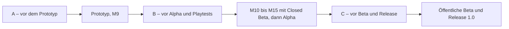
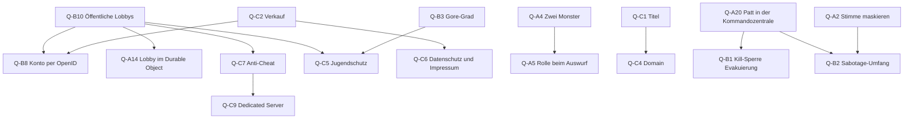

# 07 – Offene Design-Fragen

Stand: November 2026 · Teil der Planung für *How Could It Be You*

## Worum geht's

Hier stehen alle Entscheidungen, die du als Spiel-Verantwortlicher treffen solltest. Jede Frage hat einen **Default** (= Standardwert, mit dem Claude plant und programmiert, solange du nichts anderes sagst). Nichts blockiert also, wenn du eine Frage offen lässt. Die Priorität sagt, bis wann eine Antwort sinnvoll ist: **A** vor dem Prototyp, **B** vor Alpha und Playtests, **C** später (geschäftlich/rechtlich). Ganz unten steht eine Checkliste zum Ausfüllen, die du Claude zurückschickst.

## Inhalt

1. [So benutzt du diese Liste](#1-so-benutzt-du-diese-liste)
2. [A – vor dem Prototyp klären](#2-a--vor-dem-prototyp-klären)
3. [B – vor Alpha und Playtests](#3-b--vor-alpha-und-playtests)
4. [C – später: geschäftlich und rechtlich](#4-c--später-geschäftlich-und-rechtlich)
5. [Abhängigkeiten zwischen den Fragen](#5-abhängigkeiten-zwischen-den-fragen)
6. [Entscheidungs-Checkliste](#6-entscheidungs-checkliste)

---

## 1. So benutzt du diese Liste



Die Meilensteine M0–M15 stehen in [06 – Roadmap](06-roadmap.md), danach folgen dort grob Alpha, öffentliche Beta (= erster Download für Fremde) und Release 1.0. Jede Frage nennt, bis zu welchem Meilenstein die Antwort spätestens da sein sollte. Die beiden Spielmodi heißen **Infiltration** (klassisch, Start-Modus, kein Timer) und **Evakuierung** (Überleben mit Timer), Details in [01](01-game-design-document.md) §9.

1. Lies zuerst Gruppe A. Das dauert etwa 20 Minuten.
2. Trag in der [Checkliste](#6-entscheidungs-checkliste) deine Antwort ein: **„OK“** = Default übernehmen, eine **Optionsnummer** wie „(2)“ oder ein **eigener Wert** wie „Reichweite 15 m“. Eine leere Zeile bedeutet: Default.
3. Schick die Tabelle an Claude.

- **🤖 Claude (Code):** übernimmt die Antworten in die Config (= Text-Datei mit Einstellungen: `UHCMatchRules`, `UHCGameSettings` in `Config/DefaultGame.ini`), ändert bei Bedarf den Code, passt die Dokumente 01–06 an und vermerkt hier „entschieden“.
- **🧑 Du (Editor/Test):** testest geänderte Werte im nächsten PIE-Test (= Play In Editor, das Spiel direkt im Editor starten; wie du mehrere Spieler einstellst, steht in [04](04-qualitaet-und-tests.md) §7.1). Viele Werte sind später auch Lobby-Einstellungen (= Werte, die der Host vor dem Match im Wartebereich einstellt, [01](01-game-design-document.md) §12). Du legst dich also nicht für immer fest.

Zahlenwerte (Abklingzeiten, Reichweiten, Timer) korrigieren ohnehin die Playtests. Wichtiger sind die **Regeln**, weil sie Code und Maps prägen. So landet eine Antwort technisch in der Config:

```ini
; Skizze – Config/DefaultGame.ini, Schlüsselnamen wie in 02
; (Abschnittsnamen beim Umsetzen gegen UE 5.8 prüfen)
[Infiltration HCMatchRules]
; Q-A4: Anzahl Monster
NumMonsters=1
; Q-A1: Sekunden, 0 = unbegrenzt bzw. keine Abklingzeit
ShapeshiftDuration=45
ShapeshiftCooldown=30
; Q-A5 und Q-A8
bConfirmEjectRole=True
bAnonymousVotes=False
bGhostTasksCount=True
```

**Schon entschieden: deine Antworten auf meine Rückfragen.** Diese Punkte sind keine offenen Fragen mehr, alle Dokumente bauen darauf auf:

| Thema | Deine Antwort | Was daraus folgt | Wo |
|---|---|---|---|
| Kommunikation | Proximity-Voice in der Runde, Voice für alle im Meeting | Eigenes, vom Host weitergeleitetes Voice-System. Geister sprechen nur untereinander, keine Sprecher-Anzeige | [03](03-multiplayer-und-backend.md) §8 |
| Budget | 0 € | Listen-Server, EOS und Cloudflare im kostenlosen Rahmen. Realistisch fallen nur ca. 10 €/Jahr für die Domain an | [03](03-multiplayer-und-backend.md) §1, §12 |
| Programmiererfahrung | keine | „C++-first, Editor-minimal“: Blueprints nur als Asset-Hüllen, Zahlen in Text-Configs | [02](02-technische-architektur-ue5.md) §1 |
| Aufgabenteilung | Claude schreibt den gesamten Code (C++, Configs, Launcher, Backend). Du baust Maps und Assets, legst kleine Blueprint-Kindklassen an, erstellst die Sequencer-Cutscene, kompilierst und testest | Jedes System nennt „🤖 Claude (Code)“ und „🧑 Du (Editor/Test)“, jedes Paket kommt mit Testanleitung | [06](06-roadmap.md) §1 |
| Engine | Unreal Engine 5.8 | Binärversion aus dem Epic Games Launcher, fester Hotfix-Stand | [06](06-roadmap.md) M0 |
| Lieferumfang | zuerst nur die Planungsdokumente, Code nach Freigabe | Diese Dokumente 01–07. Code beginnt mit M0, sobald du freigibst | [06](06-roadmap.md) §4 |
| Git | Ergebnisse auf einem neuen Branch im Repo `mniklas189-png/how-could-it-be-you` | Ein Branch pro Meilenstein, Übernahme per Pull Request | [06](06-roadmap.md) §1.2 |

---

## 2. A – vor dem Prototyp klären

Diese Fragen prägen Code oder Greybox (= grober Rohbau der Map aus Klötzen) der Meilensteine M1–M9. Eine späte Änderung kostet Umbau.

### Q-A1 · Formwandel: zeitlich begrenzt oder wirklich „jederzeit“?
- **Frage:** Deine Vorgabe lautet „jederzeit in jeden lebenden Spieler verwandeln“. Geplant ist „jederzeit, sobald die Abklingzeit vorbei ist“, mit begrenzter Dauer. Ist diese Abweichung in Ordnung?
- **Warum wichtig:** Ohne Grenzen bleibt das Monster dauerhaft in fremder Gestalt und wechselt nach jedem Kill sofort. Türprotokoll, Kameras und Verwandlungs-Spuren verlieren dann viel Wert, und die Crew hat kaum Ansatzpunkte. Die Grenzen bestimmen auch das Monster-HUD (= Anzeigen über dem Spielbild) und das Balancing (= Kräfteverhältnis zwischen Crew und Monster).
- **Optionen:** (1) Dauer 45 s, Abklingzeit 30 s, Verwandlung 1,5 s mit hörbarem Geräusch (ca. 8 m) · (2) wörtlich „jederzeit“: Dauer 0 und Abklingzeit 0 (= unbegrenzt) · (3) unbegrenzte Dauer, aber 30 s Abklingzeit zwischen zwei Verwandlungen
- **Empfehlung:** (1) für die ersten Playtests. (2) und (3) probierst du einfach über die Lobby-Einstellung aus.
- **Default:** (1). Beide Werte sind per Config und Lobby auf 0 stellbar. Nach jedem Meeting startet die Abklingzeit neu, beim Meeting-Start endet jede Verwandlung.
- **Betrifft:** [01](01-game-design-document.md) §4, §12 · [02](02-technische-architektur-ue5.md) §6 · spätestens vor M6

### Q-A2 · Verrät die Stimme das Monster?
- **Frage:** Die Verwandlung kopiert Aussehen und Namensschild, aber nicht die Stimme. Soll das so bleiben?
- **Warum wichtig:** Unter Freunden erkennt man Stimmen sofort. Spricht das verwandelte Monster, ist es enttarnt. Es muss also schweigen, und Schweigen wird selbst zum Hinweis. Das ist gewollt, kann den Formwandel aber zu schwach machen.
- **Optionen:** (1) Stimme bleibt klar erkennbar, kein Maskieren · (2) Funk-Filter für alle in der Runde (= Bandpass, also ein Filter, der nur den mittleren Tonbereich von ca. 300–3.400 Hz durchlässt, plus leichte Verzerrung; klingt wie Sprechfunk). Laut Recherche verdeckt er die Klangfarbe nicht, maskiert also kaum · (3) Monster-Fähigkeit „Stimm-Verzerrer“ (Tonhöhe und Formanten verschieben, = die Resonanzen, die eine Stimme unverwechselbar machen): nicht recherchiert, aufwendig, und eine verzerrte Stimme verrät selbst etwas, außer alle klingen so · (4) die spätere Sabotage „Kommunikation stören“ legt kurz Rauschen auf alle Stimmen
- **Empfehlung:** (1). Zähl im Playtest mit, wie oft das Monster verliert, weil es reden muss. Wenn zu oft: zuerst (4) vorziehen, erst danach über (3) nachdenken.
- **Default:** (1). In der Runde die natürliche Stimme in 3D, im Meeting ein leichter Funk-Filter nur als Stilmittel. Keine Sprecher-Anzeige mit Namen.
- **Betrifft:** [01](01-game-design-document.md) §4 · [03](03-multiplayer-und-backend.md) (Voice) · spätestens vor M8

### Q-A3 · Verwandlung in Tote?
- **Frage:** Darf sich das Monster nur in Lebende verwandeln? Und was passiert, wenn die kopierte Person während der Verkleidung stirbt?
- **Warum wichtig:** Ein „Toter, der herumläuft“ ist ein starker, fairer Hinweis. Dürfte das Monster die Gestalt seines letzten Opfers annehmen, wäre es sehr stark: Bis jemand die Überreste findet, weiß niemand, dass die Person tot ist.
- **Optionen:** (1) Nur Lebende. Stirbt das Ziel, bleibt die Verkleidung bis zum Ende der Dauer · (2) Nur Lebende, die Verkleidung endet sofort mit dem Tod des Ziels · (3) Auch Tote sind kopierbar
- **Empfehlung:** (1).
- **Default:** (1), in der Config `bRevertWhenTargetDies=False`.
- **Betrifft:** [01](01-game-design-document.md) §4 · [02](02-technische-architektur-ue5.md) §6 · spätestens vor M6

### Q-A4 · Ein oder zwei Monster bei 7–8 Spielern?
- **Frage:** Bleibt es auch bei 7–8 Spielern bei genau 1 Monster?
- **Warum wichtig:** Das Monster gewinnt bei **Parität** (= lebende Monster ≥ lebende Crew). Mit 1 Monster heißt das: Es gewinnt erst, wenn nur noch 1 Crew-Mitglied lebt. Jede **Entfernung** (Kill oder falscher Auswurf) bringt es einen Schritt näher:

  | Spieler | Monster | Crew am Start | Monster gewinnt, wenn noch … Crew leben | Nötige Entfernungen |
  |---|---|---|---|---|
  | 4 | 1 | 3 | 1 | 2 |
  | 5 | 1 | 4 | 1 | 3 |
  | 6 | 1 | 5 | 1 | 4 |
  | 7 | 1 | 6 | 1 | 5 |
  | 8 | 1 | 7 | 1 | **6** |
  | 7 | 2 | 5 | 2 | 3 |
  | 8 | 2 | 6 | 2 | 4 |

  Grobe Rechnung für 8 Spieler mit 1 Monster: Es braucht 6 Entfernungen. Jeder gefundene Kill löst ein Meeting aus (Sammeln, 60 s Diskussion, 45 s Abstimmung, Ergebnis, Auswurf, zusammen ca. 2 min). In **jedem** Meeting kann die Crew mit einem einzigen richtigen Treffer sofort gewinnen. Gleichzeitig arbeiten 7 Crew-Mitglieder (und nach ihrem Tod ihre Geister, Q-A8) an den Aufgaben. Bei 10–15 min Rundenziel wird das für das Monster sehr knapp. Unsere Erwartung: 1 Monster ist bei 8 Spielern eher zu schwach. Das ist eine Schätzung, der Playtest muss sie bestätigen.
- **Optionen:** (1) Immer 1 Monster · (2) ab 7 Spielern automatisch 2 Monster, die sich kennen · (3) Lobby-Einstellung 1–2 (2 erst ab 7 Spielern) · (4) 1 Monster, aber angepasste Lobby-Werte bei 7–8 Spielern (z. B. kürzere Kill-Abklingzeit, weniger Aufgaben)
- **Empfehlung:** Prototyp mit (1), dabei die Siegquote je Spielerzahl mitschreiben. Danach (4) testen, erst wenn das nicht reicht (3). Zwei Monster bringen Zusatzaufwand mit: Sie müssen sich kennen (privater Client-RPC, = Nachricht nur an diesen einen Spieler), dürfen sich nicht gegenseitig töten, der Auswurf eines Monsters beendet das Spiel nicht mehr, und die Rollen-Anzeige (Q-A5) wird wichtig.
- **Default:** (1), `NumMonsters=1`. Claude schreibt `FHCRoleAssigner` und `FHCWinConditionEvaluator` trotzdem für beliebige Monster-Anzahlen, damit (3) später nur eine Einstellung ist.
- **Betrifft:** [01](01-game-design-document.md) §4, §9, §12 · [02](02-technische-architektur-ue5.md) · [04](04-qualitaet-und-tests.md) (Unit-Tests) · [06](06-roadmap.md) · spätestens vor M2

### Q-A5 · Was wird nach der Abstimmung aufgedeckt?
- **Frage:** Zeigt der Auswurf die Rolle („Lena war nicht der Wandler.“)? Und sieht man nach der Auszählung, wer wen gewählt hat?
- **Warum wichtig:** Mit 1 Monster ist die Rolle ohnehin klar, weil das Spiel beim Auswurf des Monsters endet. Wichtig wird es mit 2 Monstern oder im späteren Hardcore-Modus. Offene Stimmen liefern Gesprächsstoff („Warum hast du ihn geschützt?“), können aber Gruppendruck erzeugen.
- **Optionen:** (1) Rolle zeigen, Stimmen offen (Symbole der Wähler) · (2) Rolle zeigen, Stimmen anonym · (3) Rolle verbergen („Lena wurde ausgeworfen.“), Stimmen offen · (4) beides verborgen (Hardcore)
- **Empfehlung:** (1).
- **Default:** (1): `bConfirmEjectRole=True` in Infiltration und Evakuierung, `bAnonymousVotes=False`. Beides ist eine Lobby-Einstellung.
- **Betrifft:** [01](01-game-design-document.md) §8 · [02](02-technische-architektur-ue5.md) (Meeting) · spätestens vor M5

### Q-A6 · Überreste oder spurloses Verschwinden?
- **Frage:** Das Monster „frisst“ sein Opfer. Bleiben Überreste zurück, oder verschwindet das Opfer spurlos?
- **Warum wichtig:** Überreste sind der wichtigste Meeting-Auslöser und ein Tatort mit Hinweisen (Ort, ID-Marke). Ohne Überreste gäbe es Meetings nur per Notfall-Knopf, und die Crew wüsste nicht, wer fehlt. Dafür bräuchte es den Vitalmonitor (später). Auch der Gore-Grad (Q-B3) hängt daran.
- **Optionen:** (1) Überreste: Blutlache als Decal (= auf den Boden „geklebtes“ Bild) plus ID-Marke des Opfers, meldbar · (2) spurlos, Meetings nur per Notfall-Knopf · (3) Überreste ohne ID-Marke, wer fehlt, merkt die Crew erst im Meeting
- **Empfehlung:** (1).
- **Default:** (1). Überreste haben keine Kollision und blockieren nie einen Weg ([04](04-qualitaet-und-tests.md)), Melde-Reichweite 250 cm, beim Meeting-Start verschwinden alle.
- **Betrifft:** [01](01-game-design-document.md) §4 · [02](02-technische-architektur-ue5.md) (`AHCRemains`) · spätestens vor M4

### Q-A7 · Wann ist der Aufgabenbalken sichtbar?
- **Frage:** Sieht die Crew den gemeinsamen Aufgaben-Fortschritt immer, nur im Meeting oder nie?
- **Warum wichtig:** Ein immer sichtbarer Balken zeigt, ob jemand gerade *wirklich* eine Aufgabe erledigt hat. Fake-Aufgaben des Monsters bewegen ihn nicht, das Monster fliegt also leichter auf. Das ist ein fairer Hinweis, macht aber Beobachten mächtiger als Reden.
- **Optionen:** (1) immer · (2) nur im Meeting (aktualisiert sich nur dort) · (3) nie
- **Empfehlung:** (1) für Einsteiger, (2) als Lobby-Einstellung für erfahrene Gruppen.
- **Default:** (1) „immer“ in Infiltration. In der Evakuierung gibt es keinen Balken.
- **Betrifft:** [01](01-game-design-document.md) §5, §12, §13 · spätestens vor M3

### Q-A8 · Geister-Aufgaben
- **Frage:** Dürfen Tote als Geister ihre restlichen Aufgaben erledigen, und zählen diese zum Fortschritt?
- **Warum wichtig:** Wer früh stirbt, schaut sonst bis zu 10 min zu. Zählen Geister-Aufgaben, senkt ein Kill die Arbeitskraft der Crew kaum. Zählen sie nicht, müssen die Aufgaben der Toten aus der Rechnung fallen. Damit der Balken dabei nicht springt und einen noch unentdeckten Tod verrät, passiert das erst beim nächsten Meeting ([01](01-game-design-document.md) §5). Kleiner Nebeneffekt von (1) mit Balken „immer“ (Q-A7): Steigt der Balken, während alle Lebenden beieinanderstehen, weiß die Crew, dass es einen Geist gibt. Das nehmen wir wie im Vorbild Among Us in Kauf. Wer das nicht will, stellt den Balken auf „nur im Meeting“.
- **Optionen:** (1) Geister erledigen ihre Aufgaben, sie zählen · (2) Geister dürfen, es zählt aber nicht (nur Beschäftigung) · (3) Geister schauen nur zu
- **Empfehlung:** (1). Die Station reagiert auf Geister-Aufgaben für Lebende unsichtbar und lautlos.
- **Default:** (1), `bGhostTasksCount=True`.
- **Betrifft:** [01](01-game-design-document.md) §4 · [02](02-technische-architektur-ue5.md) (`AHCGhostPawn`) · spätestens vor M4

### Q-A9 · Notfall-Meetings pro Spieler
- **Frage:** Wie oft darf jeder den Notfall-Knopf drücken?
- **Warum wichtig:** Ein Meeting kostet ca. 2 min. Zu viele Knopf-Meetings machen aus dem Horrorspiel eine Gesprächsrunde und bremsen das Monster. Zu wenige lassen die Crew mit einem Verdacht allein.
- **Optionen:** (1) 1× pro Spieler und Match · (2) 0, nur Überreste melden (wie im späteren Modus „Quarantäne“) · (3) 2–3× pro Spieler · (4) ein gemeinsames Kontingent für die ganze Crew
- **Empfehlung:** (1).
- **Default:** (1). Knopf nur in der Kommandozentrale, nach jedem Meeting 20 s für alle gesperrt, später auch während kritischer Sabotage. Lobby-Bereich 0–3.
- **Betrifft:** [01](01-game-design-document.md) §8, §12 · [02](02-technische-architektur-ue5.md) (`AHCEmergencyButton`) · spätestens vor M5

### Q-A10 · Verstecke (Spinde)
- **Frage:** Gibt es Spinde zum Verstecken, und darf das Monster einen besetzten Spind öffnen?
- **Warum wichtig:** Verstecke schaffen Horror-Momente („Es steht direkt vor dem Spind“). Ein sicherer Spind wäre aber zu stark und lädt zum Aussitzen ein. Die Nischen müssen schon in der Greybox eingeplant sein, sonst stehen die Spinde später im Weg.
- **Optionen:** (1) Spinde für alle Lebenden, max. 20 s drin, danach 30 s Sperre, Knarren hörbar (ca. 10 m), jeder kann einen besetzten Spind öffnen und deckt den Versteckten auf · (2) wie (1), aber das Monster kann nicht öffnen · (3) keine Spinde, nur dunkle Nischen · (4) wie (1), plus eigener Kill direkt im Spind
- **Empfehlung:** (1). Auch das Monster darf sich verstecken, sonst wäre ein besetzter Spind ein Crew-Beweis. (2) hätte dasselbe Problem andersherum: Wer vor Zeugen vergeblich einen besetzten Spind öffnen will, wäre enttarnt. Nach dem Aufdecken gelten die normalen Kill-Regeln (kein Kill aus dem Spind heraus).
- **Default:** (1). Umsetzung erst in M12, nicht im Prototyp. **🧑 Du (Editor/Test):** reservierst die Nischen schon in der Greybox (≥ 120 × 120 cm frei davor, abseits der Laufwege). Die Spind-Plätze S1–S5 stehen in der Raumtabelle von Kepler-7 ([01](01-game-design-document.md) §11.1), wie du sie in der Greybox anlegst, steht in [06](06-roadmap.md) M1.
- **Betrifft:** [01](01-game-design-document.md) §4, §11 · [02](02-technische-architektur-ue5.md) (`AHCHidingLocker`) · [04](04-qualitaet-und-tests.md) · Nischen spätestens vor M1

### Q-A11 · Wartungsschächte (Vents) in v1?
- **Frage:** Bekommt das Monster schon in v1 Wartungsschächte, durch die es heimlich zwischen Räumen wechselt (wie die „Vents“ in Among Us)?
- **Warum wichtig:** Schächte machen das Monster deutlich mobiler und Alibis unsicherer. Sie brauchen eigene Map-Punkte, Animationen und Tests. Kriechen durch echte Tunnel scheidet aus (kein Ducken in v1, Gefahr des Hängenbleibens). Realistisch ist ein kurzer Übergang zwischen festen Ein- und Ausstiegspunkten.
- **Optionen:** (1) nicht in v1, Platz in den Maps reservieren · (2) in v1, nur Monster, Übergang zwischen festen Punkten mit hörbarem Geräusch · (3) für alle Spieler · (4) nie
- **Empfehlung:** (1). Erst prüfen, ob das Monster ohne Schächte stark genug ist (siehe Q-A4).
- **Default:** (1). Laut [06](06-roadmap.md) frühestens nach dem Release, dann nur für das Monster und mit Geräusch. **🧑 Du (Editor/Test):** lässt in der Greybox von Kepler-7 die Öffnungen Reaktor ↔ Medbay und Quartiere ↔ Hangar vorerst zugemauert stehen ([06](06-roadmap.md) M1), dann kostet ein späteres Ja keinen Umbau.
- **Betrifft:** [01](01-game-design-document.md) §4, §11 · [04](04-qualitaet-und-tests.md) (NavMesh-Checks, = Prüfung der begehbaren Flächen) · Platz spätestens vor M1

### Q-A12 · Woran erkennt man die Forscher?
- **Frage:** Reichen Anzug-Farbe, Symbol, Namensschild und Körper-Variante? Trägt jeder einen Helm mit Visier, und sieht man Gesichter?
- **Warum wichtig:** Alles, was einen Spieler erkennbar macht, muss das Monster mitkopieren. Jedes zusätzliche Merkmal bedeutet mehr Modelle, Materialien und Daten. Sichtbare Gesichter wären so starke Erkennungszeichen, dass das Namensschild kaum noch zählt. MetaHumans (= Epics fotorealistische Menschen-Figuren) sind für schwache PCs und die Download-Größe schwer.
- **Optionen:** (1) Helm mit getöntem Visier, Gesicht nicht erkennbar; Identität = Farbe + Symbol + Namensschild + Körper-Variante · (2) klares Visier mit wenigen Standard-Gesichtern · (3) eigenes Gesicht pro Spieler (z. B. MetaHuman) · (4) ohne Helm
- **Empfehlung:** (1). Das passt zum Horror („Wer ist das da hinten?“) und spart Asset-Arbeit.
- **Default:** (1). 8 Farben plus 8 Symbole (farbenblind-sicher), Namensschild auf Brust und Rücken, Helmlicht. Technisch `FHCAppearance` (Farbe, Emblem, Körper-Variante, Name) in `UHCAppearanceComponent`.
- **Betrifft:** [01](01-game-design-document.md) §4, §13 · [02](02-technische-architektur-ue5.md) §6 · Regel spätestens vor M6, Optik bis M12

### Q-A13 · Spielername: Nickname oder Rollenname?
- **Frage:** Steht auf dem Namensschild dein selbst gewählter Nickname oder ein Rollenname wie „Dr. Vogel“?
- **Warum wichtig:** Der Name erscheint auf dem Namensschild, im Türprotokoll, bei der Abstimmung und auf dem Ergebnis-Bildschirm. Nicknames versteht jeder sofort. Rollennamen sind atmosphärischer, aber jeder muss sich merken, wer „Dr. Vogel“ ist und wie er klingt.
- **Optionen:** (1) Nickname (3–16 Zeichen, einmal im Hauptmenü gewählt) · (2) zufälliger Rollenname pro Match · (3) Rollenname in der Runde, Nickname zusätzlich in Meeting und Ergebnis
- **Empfehlung:** (1) für v1, (3) als spätere Lobby-Option. Rollennamen dürfen nicht mit den Intro-NPCs kollidieren (Hale, Lindqvist, Brandt, Sato).
- **Default:** (1). Doppelte Namen macht der Host eindeutig („Lena 2“). Hinweis im Menü: keinen echten vollen Namen verwenden (Datenschutz).
- **Betrifft:** [01](01-game-design-document.md) §13 · [03](03-multiplayer-und-backend.md) (Login, Datenschutz) · spätestens vor M2

### Q-A14 · Lobby-System: EOS Lobbies oder Cloudflare?
- **Frage:** Wo „lebt“ die Lobby (= Wartebereich vor dem Match mit Mitgliederliste, Join-Code und Einstellungen)?
- **Warum wichtig:** Du wolltest Cloudflare nutzen. Ehrlich: Cloudflare kann bei 0 € keinen Echtzeit-Spielverkehr (UDP, = Netzwerk-Protokoll für schnelle Spieldaten) übertragen. Für Verbindung, NAT-Durchdringung (= Verbindung durch Heim-Router hindurch) und Relays (= Weiterleitungs-Server, falls das nicht klappt) brauchen wir EOS (Epic Online Services) sowieso. Eine Lobby in einem **Durable Object** (DO, = kleiner Cloudflare-Dienst mit eigenem, dauerhaftem Zustand) ist möglich, bedeutet aber zusätzlichen WebSocket-Code (= dauerhafte Verbindung zwischen Spiel und Server), einen Worker (= kleines Programm bei Cloudflare) und mehr Fehlerquellen. Beides gleichzeitig darf es nie geben.
- **Optionen:** (1) EOS Lobbies: Join-Code aus 6 Zeichen als Attribut `JOINCODE`, Versionsfilter `BUILDVER`, max. 8 Mitglieder · (2) Cloudflare-DO-Lobby von Anfang an, EOS nur für Login und P2P (= direkte Verbindung zwischen den Spielern) · (3) EOS jetzt, DO später, wenn öffentliche Lobbys kommen (Q-B10)
- **Empfehlung:** (3). Cloudflare macht in v1 Updates (R2, = Cloudflares Dateispeicher), Versions-Check, News und Fehlerberichte. Dort ist es wirklich stark.
- **Default:** (1) für v1, das ist zugleich der erste Schritt von (3). Ein späterer Wechsel betrifft nur `UHCSessionSubsystem`. Grenzen: EOS erlaubt ca. 30 Lobby-Suchen pro Minute und Nutzer. Durable Objects haben im Free-Plan zusammen 100.000 Anfragen pro Tag für das ganze Cloudflare-Konto, nicht pro Lobby (eingehende WebSocket-Nachrichten zählen 20:1). Danach gibt es bis 00:00 UTC Fehler statt Kosten.
- **Betrifft:** [03](03-multiplayer-und-backend.md) (Lobbys, Cloudflare) · [06](06-roadmap.md) · spätestens vor M9

### Q-A15 · Proximity-Voice: Reichweite und Push-to-Talk
- **Frage:** Wie weit hört man Mitspieler in der Runde? Spricht man standardmäßig per Sprachaktivierung oder per Push-to-Talk (= Taste halten zum Sprechen)?
- **Warum wichtig:** Proximity-Voice (= man hört nur Spieler in der Nähe, durch Wände gedämpft) ist ein Horror-Werkzeug. Ist die Reichweite zu groß, hört die halbe Station mit, und Gespräche unter vier Augen fallen weg. Ist sie zu klein, zerfallen Gruppen. Sprachaktivierung ist bequemer, überträgt aber Lüfter und Tastatur. Das eigene Voice-System hat keine Echo-Unterdrückung, deshalb empfehlen wir Kopfhörer. Discord nebenbei kann das Spiel nicht verhindern, die Proximity-Voice muss also gut genug sein, dass niemand ihn vermisst.
- **Optionen:** Reichweite (1) 20 m · (2) 15 m · (3) 30 m. Modus (a) Sprachaktivierung mit einstellbarem Noise-Gate (= Schwelle, unter der nichts gesendet wird) · (b) Push-to-Talk als Standard
- **Empfehlung:** (1) + (a). 20 m entspricht ungefähr der Hörweite von Sprint-Schritten.
- **Default:** 20 m (Lobby 10–30 m). Ab 22 m (Reichweite + 10 %) leitet der Host gar nichts mehr weiter. Weiter entfernte Gespräche kann also auch ein manipulierter Client nicht belauschen. Innerhalb von 22 m könnte er aber die Wand-Dämpfung abschalten ([03](03-multiplayer-und-backend.md), Cheat-Tabelle). Sprachaktivierung, Push-to-Talk optional auf V. Geister hören Lebende in Reichweite, Lebende hören Geister nie.
- **Betrifft:** [01](01-game-design-document.md) §12, §13 · [03](03-multiplayer-und-backend.md) (Voice) · spätestens vor M8

### Weitere A-Detailfragen

| ID | Frage | Warum wichtig | Optionen | Empfehlung | Default | Betrifft |
|---|---|---|---|---|---|---|
| **Q-A16** | Darf das Monster in fremder Gestalt töten? | Zeugen sehen dann „Lena“ töten, obwohl Lena woanders ist. Kern von „Warst du das wirklich?“ | (1) ja · (2) nein, erst zurückverwandeln · (3) ja, aber die Verwandlung endet beim Kill | (1) | (1), das Türprotokoll kann Lena entlasten | [01](01-game-design-document.md) §4, [02](02-technische-architektur-ue5.md) · vor M4 |
| **Q-A17** | Blockieren sich Spielfiguren gegenseitig? | Harte Körper-Kollision lässt Spieler Türen, Spind-Ausstiege oder Sitze versperren | (1) weiches Ausweichen · (2) harte Kollision · (3) gar keine Kollision zwischen Spielern | (1) | (1): Spielfigur gegen Spielfigur auf *Overlap* (= überlappen statt blockieren) plus sanftes Auseinanderschieben | [04](04-qualitaet-und-tests.md), [02](02-technische-architektur-ue5.md) · vor M1 |
| **Q-A18** | Gehören Türsperre, Türprotokoll und Kameras fest in den Prototyp? | Wichtige Hinweise gegen den Formwandel, kosten aber Zeit in M7 | (1) Should (= rein, wenn Zeit ist) · (2) Must (= Pflicht) · (3) erst nach dem Prototyp | (1) | (1), rutschen bei Zeitnot nach M12 | [06](06-roadmap.md) M7, [01](01-game-design-document.md) §6 · vor M7 |
| **Q-A19** | Darf man seine Stimme im Meeting nachträglich ändern? | Änderbare Stimmen erlauben taktisches Umschwenken in letzter Sekunde, machen den Marker „hat gewählt“ aber weniger aussagekräftig | (1) nein, jede Stimme ist endgültig · (2) ja, bis die Abstimmung endet | (1) | (1); einzige Ausnahme: Das gewählte Ziel trennt die Verbindung | [02](02-technische-architektur-ue5.md) (Meeting), [01](01-game-design-document.md) §8 · vor M5 |
| **Q-A20** | Was, wenn sich die letzten Crew-Mitglieder in der kill-freien Kommandozentrale verschanzen? | Infiltration hat keinen Timer: Bleiben z. B. 2 Crew dort sitzen, kommt das Monster nicht an sie heran. Ohne Aufgaben oder Treffer im Meeting gewinnt aber auch die Crew nie, und die Runde hängt. In v1 gibt es noch keine Sabotage, die sie herauszwingt | (1) Kill-Sperre gilt immer, im Playtest messen · (2) Kill-Sperre nur während Meetings und 10 s danach · (3) Kernschmelze-Sabotage (Q-B2) vorziehen · (4) zusätzlich ein Notausgang: Der Host kann die Runde im Menü ohne Sieger beenden | (1), tritt das Patt auf: (2) | (1) wie in [01](01-game-design-document.md) §9; zusammen mit der Kill-Sperre in Q-B1 entscheiden | [01](01-game-design-document.md) §9, §14, [02](02-technische-architektur-ue5.md) · Regel vor M4, Messung im Playtest M9 |

---

## 3. B – vor Alpha und Playtests

Diese Fragen betreffen vor allem Inhalte nach dem Prototyp (M10–M15) und die ersten Tests mit Leuten außerhalb deines PCs. Einige Detailfragen (z. B. Q-B11, Q-B13) brauchst du schon früher, der Meilenstein steht jeweils dabei.

### Q-B1 · Evakuierung: Timer-Länge, Abkürzungen, Kill-Sperre
- **Frage:** Wie lange läuft der Countdown bis zum Rettungsschiff, und dürfen Aufgaben ihn verkürzen?
- **Warum wichtig:** Im Modus Evakuierung ist Überleben der Crew-Siegweg. Ist der Timer zu lang, zieht sich die Runde. Ist er zu kurz, schafft das Monster seine Kills nicht. Verkürzen durch Aufgaben hält die Aufgaben sinnvoll, sonst wäre Verstecken die beste Strategie. Dazu kommt: Die Kommandozentrale ist kill-frei und lädt im Timer-Modus zum Aussitzen ein.
- **Optionen:** Timer (1) 12 min · (2) 8–10 min · (3) 15 min. Aufgaben (a) jede Funk-Aufgabe −60 s, max. −3 min · (b) keine Verkürzung. Kill-Sperre (x) Kommandozentrale immer kill-frei · (y) nur während Meetings und 10 s danach
- **Empfehlung:** (1) + (a) + (x), im Playtest gezielt auf Aussitzen achten. Falls es passiert: (y). Dasselbe Patt droht im Infiltration-Endspiel, deshalb diese Wahl zusammen mit Q-A20 treffen.
- **Default:** (1) + (a) + (x): 12 min (Lobby 8–20 min), pausiert in Meeting und Auswurf, Kill-Abklingzeit 20 s, alle 150 s fällt ein zufälliger Sektor 60 s lang aus.
- **Betrifft:** [01](01-game-design-document.md) §9 · [02](02-technische-architektur-ue5.md) (`UHCMatchRules`) · spätestens vor M13

### Q-B2 · Umfang der Monster-Sabotagen
- **Frage:** Welche Sabotagen bekommt das Monster bis zur Alpha?
- **Warum wichtig:** Jede Sabotage braucht Code, Map-Punkte, Fairness-Checks (nie den letzten Weg abschneiden) und Tests. Eine kritische Sabotage wie die Kernschmelze ist zusätzlich ein zweiter Siegweg für das Monster und verschiebt das Balancing.
- **Optionen:** (1) Stromausfall pro Sektor + Tür verriegeln (max. 10 s) · (2) wie (1) plus „Kommunikation stören“ (Voice-Reichweite sinkt auf 40 %, Rauschen) · (3) wie (2) plus „Reaktor-Kernschmelze“ (45-s-Countdown, zwei Spieler reparieren, sonst gewinnt das Monster) · (4) nur Stromausfall
- **Empfehlung:** (1) bis zur Alpha, danach (2) als erste Erweiterung, weil sie direkt mit der Proximity-Voice spielt.
- **Default:** (1), die beiden anderen „später“.
- **Betrifft:** [01](01-game-design-document.md) §7 · [02](02-technische-architektur-ue5.md) (`AHCPowerSector`, `AHCFuseBox`, `AHCDoor`) · [04](04-qualitaet-und-tests.md) (Weg-Checks) · Erweiterung vor Alpha

### Q-B3 · Jumpscare-Intensität und Gore-Grad
- **Frage:** Wie heftig und wie blutig soll das Spiel sein?
- **Warum wichtig:** Der Gore-Grad (= wie explizit Gewalt und Blut gezeigt werden) beeinflusst die Altersfreigabe (Q-C5), wer mitspielen und streamen mag und wie viel Asset-Arbeit nötig ist. Die Jumpscare-Intensität stellt jeder selbst ein, der Gore-Grad gilt für alle.
- **Optionen:** (1) moderat: Blutlache plus ID-Marke, das „Fressen“ nur kurz in der Attacke, keine Zerstückelung · (2) explizit: sichtbare Körperteile, ausführliche Fress-Animation · (3) blutarm: Schleim statt Blut
- **Empfehlung:** (1). Der Schrecken kommt aus Dunkelheit, Ton und dem plötzlichen Gesicht, nicht aus Details.
- **Default:** (1). Jumpscare-Stufen Voll (Standard) / Reduziert / Minimal, Epilepsie- und Schreck-Warnung beim ersten Start, Failsafe nach spätestens 5 s.
- **Betrifft:** [01](01-game-design-document.md) §10, §13 · [02](02-technische-architektur-ue5.md) (`UHCJumpscareData`, `AHCJumpscareDirector`) · spätestens vor M11

### Q-B4 · Intro-Cutscene: wann und wie oft?
- **Frage:** Läuft die Intro-Cutscene vor jedem Match, einmal pro Session oder nur auf Wunsch?
- **Warum wichtig:** 60–90 s Cutscene vor jeder 10–15-min-Runde nervt spätestens beim dritten Mal. Alle sehen sie gleichzeitig, also muss auch das Überspringen gemeinsam passieren, sonst wartet jemand.
- **Optionen:** (1) beim ersten Match einer Session, per Mehrheit überspringbar, ab dem zweiten Match automatisch aus · (2) jedes Match · (3) einmal pro Installation, danach nur im Hauptmenü abrufbar · (4) nie automatisch, nur im Menü
- **Empfehlung:** (1).
- **Default:** (1) mit Server-Timeout als Failsafe. Im Prototyp steht statt der Cutscene eine Texttafel „Es ist einer von euch.“. Nur Kepler-7 bekommt in v1 eine volle Cutscene.
- **Zusatzfrage andere Maps (Europa, später Ikarus):** (a) kurze Kamerafahrt mit Text ([01](01-game-design-document.md) §2, [02](02-technische-architektur-ue5.md) §14.1) · (b) direkt die Rollen-Enthüllung. Default: (a), falls die Zeit fehlt (b). Claude passt 01 und 02 nach deiner Antwort an.
- **Betrifft:** [01](01-game-design-document.md) §2 · [02](02-technische-architektur-ue5.md) §14 (Intro) · spätestens vor M10, Zusatzfrage vor M14

### Q-B5 · Art-Stil und Asset-Quellen
- **Frage:** Woher kommen Modelle, Materialien, Figuren und Animationen?
- **Warum wichtig:** Die Optik baust du, Claude kann keine `.uasset`-Dateien erzeugen. Die Quelle bestimmt Lizenz, Kosten, Download-Größe (jedes GB läuft über Launcher und R2) und Leistung auf schwachen PCs. Bei 0 € Budget zählen nur kostenlose Assets: Viele Fab-Inhalte kosten Geld, und Megascans sind nach unserem Kenntnisstand seit 2025 nicht mehr pauschal gratis (nicht recherchiert, Preis und Lizenz je Asset auf Fab prüfen).
- **Optionen:** (1) realistisch mit Fab (= Epics Asset-Marktplatz) inkl. Megascans für die Umgebung, MetaHuman nur für die 4 Intro-NPCs, Animationen aus der Vorlage · (2) wie (1) plus Mixamo (= kostenlose Animations-Bibliothek von Adobe; Lizenz nicht recherchiert, vor Nutzung prüfen; die Animationen müssen auf das UE-Skelett übertragen werden, = Retargeting) · (3) MetaHumans auch für die Spielfiguren · (4) eigene Modelle (z. B. Blender) oder beauftragte Künstler
- **Empfehlung:** (1), bei Bedarf (2). Fab-Assets mit Standard-Lizenz dürfen im gekochten Spiel ausgeliefert werden, nie als Rohdateien. MetaHumans fallen seit 5.6 unter die normale UE-EULA (= Lizenzvertrag), Haare und Texturen sind aber schwer: LODs (= vereinfachte Modell-Stufen für die Ferne) und Hair Cards (= Haare als flache Streifen) nutzen.
- **Default:** (1). Anzug und Helm der Spieler: ein Modell mit Material-Parameter für die 8 Farben. Die wahre Monster-Gestalt (nur Intro und Jumpscare) von Fab oder selbst gebaut.
- **Betrifft:** [01](01-game-design-document.md) §10, §11 · [02](02-technische-architektur-ue5.md) (Rendering) · [05](05-launcher-und-updates.md) (Download-Größe) · spätestens vor M11

### Q-B6 · Sprache(n) der Oberfläche
- **Frage:** In welchen Sprachen erscheinen Menüs, HUD und Untertitel?
- **Warum wichtig:** Lokalisierung (= Übersetzung aller Texte über Unreals Übersetzungs-System) ist billig, wenn sie von Anfang an vorbereitet ist, und teuer, wenn feste Texte später gesucht werden müssen. Mit Englisch erreichst du deutlich mehr Spieler, pflegst aber jeden Text doppelt.
- **Optionen:** (1) Deutsch zuerst, alles lokalisierbar vorbereitet, Englisch vor dem öffentlichen Release · (2) Deutsch und Englisch von Anfang an · (3) nur Englisch · (4) nur Deutsch
- **Empfehlung:** (1).
- **Default:** (1). Claude schreibt alle sichtbaren Texte als `FText` (= Unreals übersetzbarer Text-Typ) in String Tables (= zentrale Texttabellen), nie fest in den Code. Der Launcher hat seine Texte in einer JSON-Datei, Englisch auch dort später.
- **Betrifft:** [02](02-technische-architektur-ue5.md) (UI) · [05](05-launcher-und-updates.md) (Launcher-UI) · Vorbereitung ab M2, Entscheidung vor Alpha

### Q-B7 · Mindest-Hardware
- **Frage:** Welcher PC muss das Spiel flüssig schaffen?
- **Warum wichtig:** Daran hängen Grafikstufen, Lichtanzahl und Texturgrößen. MegaLights (= Technik für viele schattenwerfende Lichter) braucht mindestens RTX 2000 / RX 6000 / Intel Arc. Auf älteren Karten muss die Stufe „Mittel/Niedrig“ gut aussehen und darf keinen Sichtvorteil geben. Social Deduction (= Genre, in dem man Verräter im Gespräch entlarvt, wie Among Us) lebt davon, dass die ganze Freundesgruppe mitspielen kann.
- **Optionen:** (1) GTX 1660 / RX 5600 XT (6 GB VRAM, = Grafikspeicher), i5-8400 / Ryzen 5 2600, 16 GB RAM, SSD, Windows 10/11 64 Bit · (2) höher, z. B. RTX-2060-Klasse: MegaLights überall, weniger Arbeit an der niedrigen Stufe · (3) niedriger (4 GB VRAM): deutlich mehr Optimierungsarbeit
- **Empfehlung:** (1).
- **Default:** (1) als Vorschlag, endgültig nach den ersten Messungen auf echter Hardware.
- **Betrifft:** [02](02-technische-architektur-ue5.md) (Rendering-Stufen) · [04](04-qualitaet-und-tests.md) (Leistungsmessung) · spätestens vor M12

### Q-B8 · Spieler-Identität: Device ID oder eigenes Konto?
- **Frage:** Bleibt der anonyme Login per Device ID, oder bekommt jeder ein Konto über Cloudflare (OpenID)?
- **Warum wichtig:** Die Device ID (= anonyme ID, die EOS an dein Windows-Benutzerkonto bindet) braucht kein Konto, hängt aber an einem PC. Ein Bann trifft nur das Gerät, und mehrere Spiel-Instanzen unter demselben Windows-Nutzer teilen sich eine ID, EOS-Tests brauchen also 2 PCs. OpenID (= offener Login-Standard, der Cloudflare-Worker stellt dann die Ausweise aus) gibt eine Identität über mehrere PCs und ermöglicht Bann-Listen, braucht aber einen Login im Launcher. Dass EOS Connect einen eigenen OpenID-Anbieter annimmt, ist nur durch Anleitungen Dritter belegt ([03](03-multiplayer-und-backend.md)), also beim Umsetzen prüfen.
- **Optionen:** (1) Device ID · (2) OpenID über den Cloudflare-Worker · (3) Epic-Konto (EAS, = Epic Account Services; braucht ein Epic-Konto pro Spieler und eine Marken-Prüfung durch Epic)
- **Empfehlung:** (1) für v1. (2) erst, wenn öffentliche Lobbys (Q-B10) oder ein Verkauf (Q-C2) kommen.
- **Default:** (1).
- **Betrifft:** [03](03-multiplayer-und-backend.md) (Login) · [05](05-launcher-und-updates.md) (Launcher) · vor der Beta

### Q-B9 · Versionsverwaltung, wenn das LFS-Kontingent knapp wird
- **Frage:** Wo liegen die großen Binärdateien (Maps, Assets), wenn GitHubs kostenloses Kontingent nicht mehr reicht?
- **Warum wichtig:** Git LFS (= Erweiterung, die große Dateien getrennt vom Code speichert) ist bei GitHub Free auf 10 GiB Speicher und 10 GiB Download pro Monat begrenzt. Ohne hinterlegte Zahlungsmethode wird LFS danach gesperrt. Jedes neu gespeicherte `.uasset` belegt eine komplette neue Version, mit dem Art-Pass (M12) wird es eng.
- **Optionen:** (1) GitHub LFS behalten und Mehrverbrauch zahlen (0,07 $/GiB-Monat Speicher, 0,0875 $/GiB Download) · (2) eigener LFS-Server auf Cloudflare Workers + R2: Code bleibt auf GitHub, GitHub Desktop bleibt, über 10 GB ca. 0,015 $/GB-Monat. Achtung: Die 10 GB Freispeicher von R2 gelten für das ganze Konto, also zusammen mit den Spiel-Builds (laut [05](05-launcher-und-updates.md) ca. 6,5–9 GB). Mit LFS auf R2 zahlst du deshalb realistisch ein paar Cent bis wenige Euro im Monat · (3) Diversion (Versionsverwaltung mit UE-Plugin; Free-Indie-Tier laut Anbieter 100 GB, auf der Preisseite nicht geprüft; anderes Werkzeug) · (4) Perforce (= in Studios verbreitete Versionsverwaltung; kostenlos bis 5 Nutzer und 20 Workspaces, Server selbst betreiben)
- **Empfehlung:** (2), weil dein Ablauf mit GitHub Desktop und Claudes Pushes gleich bleibt.
- **Default:** GitHub LFS bis zum Prototyp, vor M12 Umzug nach (2). Claude klont ohne LFS-Dateien (`GIT_LFS_SKIP_SMUDGE=1`) und verbraucht kein Kontingent.
- **Betrifft:** [02](02-technische-architektur-ue5.md) (Repo) · [06](06-roadmap.md) (Risiken) · spätestens vor M12

### Q-B10 · Öffentliche Lobbys und Matchmaking mit Fremden?
- **Frage:** Soll man später mit Fremden spielen können (öffentliche Lobby-Liste oder Warteschlange), oder bleibt es bei Freundesrunden per Code?
- **Warum wichtig:** Mit Fremden kommen Pflichten: Melden und Stummschalten von Spielern, Bann-Möglichkeit (braucht Q-B8 Option 2), Schutz der IP-Adresse (bei direkter Verbindung sieht der Host die IPs aller) und Cheats. Beim Listen-Server (= ein Spieler ist zugleich Server) kennt der Host alle Rollen, Anti-Cheat (Q-C7) mildert das nur. Auch der Jugendschutz (Q-C5) wird mit Voice-Chat unter Fremden heikler.
- **Optionen:** (1) nur private Lobbys per Join-Code · (2) öffentliche Lobby-Liste (Cloudflare-DO) · (3) Matchmaking-Warteschlange (= das System bringt fremde Spieler automatisch zusammen; ein „Matchmaker“-DO bildet Gruppen mit 4–8 Spielern) · (4) wie (1), plus eine Community-Gruppe (z. B. Discord), in der man sich verabredet
- **Empfehlung:** (1) bis nach dem Release, Fremde finden sich über (4).
- **Default:** (1). „IP-Adresse verbergen“ (= Verbindung nur über Epic-Relays, kostet etwas Ping) ist eine Menü-Option, standardmäßig aus. Für öffentliche Lobbys neu entscheiden.
- **Betrifft:** [03](03-multiplayer-und-backend.md) (Lobbys, Datenschutz) · [06](06-roadmap.md) · vor der Beta

### Weitere B-Detailfragen

| ID | Frage | Warum wichtig | Optionen | Empfehlung | Default | Betrifft |
|---|---|---|---|---|---|---|
| **Q-B11** | Was zeigt der Bio-Scanner beim Monster? | Ein eindeutiger Scan würde das Monster sofort enttarnen | (1) sieht bei allen gleich aus, Monster bekommt „abgeschlossen“ ohne echten Fortschritt · (2) kleine Chance auf sichtbare „Anomalie“ · (3) Scan enttarnt eindeutig | (1) | (1) | [01](01-game-design-document.md) §6, [02](02-technische-architektur-ue5.md) · vor M7 |
| **Q-B12** | Repo öffentlich oder privat? | Privat: ca. 1.200 kostenlose Windows-Minuten/Monat für GitHub Actions. Öffentlich: unbegrenzt, aber jeder sieht Code und Assets. Engine-Code (EOS-Patch) darf nie öffentlich sein | (1) privat · (2) öffentlich | (1) | (1), so geplant, dass beides geht: die EOS-Plugin-Kopie wird nie committet | [03](03-multiplayer-und-backend.md), [05](05-launcher-und-updates.md), [06](06-roadmap.md) · vor dem Launcher-Strang L |
| **Q-B13** | Wie verteilst du den ersten Test-Build an Freunde? | Der Launcher braucht fertige L-Schritte und eine Domain | (1) ZIP über privaten Link · (2) schon über den Launcher | (1) | (1); sind L3 und L4 fertig, der Launcher (dann mit Domain, Q-C4) | [06](06-roadmap.md) M9, [05](05-launcher-und-updates.md) · vor M9 |
| **Q-B14** | Ab wann bekommen Tester Shipping-Builds (= Endkunden-Build ohne Debug-Befehle)? | Development-Builds haben Logs und `hc.*`-Befehle, sind aber leichter zu manipulieren | (1) Development in geschlossenen Tests, Shipping ab öffentlichem Release · (2) Shipping schon ab M15 | (1) | (1) | [05](05-launcher-und-updates.md), [04](04-qualitaet-und-tests.md) · vor M15 |
| **Q-B15** | Darf jeder den `beta`-Kanal (= eigene Update-Spur mit Vorab-Versionen) im Launcher wählen? | Beta ist instabiler, und verschiedene Versionen können nicht zusammen spielen (`BUILDVER`) | (1) ja, mit Warnhinweis · (2) nur per Einladung | (1) | (1) | [05](05-launcher-und-updates.md) · vor M15 |
| **Q-B16** | Absturzberichte: Standard-Verhalten? | Berichte können Windows-Benutzernamen und PC-Daten enthalten (Datenschutz) | (1) jedes Mal fragen · (2) einmal fragen, Wahl merken · (3) nie senden | (1) | (1) | [05](05-launcher-und-updates.md), [03](03-multiplayer-und-backend.md) · vor M15 |
| **Q-B17** | Wie viele Stunden pro Woche hast du? | Nur damit wäre eine Kalenderplanung möglich | (1) keine Angabe · (2) Stundenzahl nennen, Claude rechnet grobe Termine | (2), wenn du Termine magst | (1): keine Kalenderplanung, nur Reihenfolge | [06](06-roadmap.md) · jederzeit |

---

## 4. C – später: geschäftlich und rechtlich

Altersfreigabe, Zahlungsabwicklung, Markenrecht und Impressum wurden für diese Planung **nicht recherchiert**. Was hier steht, ist allgemeines Wissen und **keine Rechtsberatung**. Lass es vor dem ersten öffentlichen Download (öffentliche Beta oder Release, [06](06-roadmap.md)) von Fachleuten prüfen.

### Q-C1 · Spieltitel
- **Frage:** Bleibt „How Could It Be You“ der endgültige Titel?
- **Warum wichtig:** Der Titel steckt in Domain, Website, Launcher-Name, Installer und Fenstertitel. Vor dem Release solltest du prüfen lassen, ob ein gleicher oder ähnlicher Name geschützt ist (Marken-Recherche, z. B. beim DPMA = Deutsches Patent- und Markenamt, oder beim EUIPO = Markenamt der EU).
- **Optionen:** (1) Titel bleibt · (2) neuer Titel vor der Alpha · (3) neuer Titel kurz vor dem Release
- **Empfehlung:** Entscheide, bevor du die Domain kaufst (Q-C4).
- **Default:** (1) als Arbeitstitel. Der technische Name `HowCouldItBeYou` (Projekt, Module, Ordner) bleibt in jedem Fall, ein Umbenennen wäre aufwendig und bringt nichts. Nur Anzeigenamen würden sich ändern.
- **Betrifft:** [05](05-launcher-und-updates.md) (Launcher, Installer) · [03](03-multiplayer-und-backend.md) (Domain) · vor dem Domain-Kauf

### Q-C2 · Preis und Monetarisierung
- **Frage:** Kostenlos, Kaufspiel oder etwas anderes? Und bei Verkauf: über welchen Zahlungsweg?
- **Warum wichtig:** Ohne Store gibt es keinen fertigen Kaufablauf. Ein Verkauf braucht Zahlungsanbieter, ein Schlüssel- oder Konto-System (Worker + D1, = Cloudflares Datenbank, dazu ein Login im Launcher, sinnvollerweise mit der OpenID-Identität aus Q-B8), Rechnungen, Umsatzsteuer und vermutlich eine Gewerbeanmeldung. Außerdem liegen die Update-Dateien bisher frei lesbar auf `patch.<deine-domain>`. Für ein Kaufspiel müsste der Download erst nach einer Lizenzprüfung freigegeben werden (z. B. über zeitlich begrenzte Links vom Worker), das ändert Launcher, Backend und CDN-Caching (Umsetzung nicht recherchiert). Ein Merchant of Record (= Anbieter, der rechtlich als Verkäufer auftritt und die Umsatzsteuer abführt, z. B. Paddle) nimmt dir viel Steuer-Arbeit ab. Bei einem reinen Zahlungsdienst wie Stripe bist du selbst Verkäufer. Bedingungen und Gebühren beider sind nicht recherchiert, auch nicht, ob der jeweilige Anbieter Spiele-Verkäufe überhaupt annimmt. UE-Lizenz: 5 % Royalty (= Lizenzgebühr an Epic) erst über 1 Mio. $ Bruttoumsatz pro Produkt, der Eigenvertrieb zählt mit.
- **Optionen:** (1) kostenlos · (2) Einmalkauf über den Launcher mit Merchant of Record · (3) Einmalkauf mit Stripe, du selbst als Verkäufer · (4) kostenlos plus freiwillige Spenden
- **Empfehlung:** (1) für alle Tests. Falls Verkauf: (2), vorher mit einer Steuerberatung sprechen.
- **Default:** (1). Der Launcher hat in v1 kein Konto und keinen Shop. Die Entscheidung muss vor der Beta fallen, weil ein Schlüssel-System Launcher und Backend ändert.
- **Betrifft:** [05](05-launcher-und-updates.md) (Launcher) · [03](03-multiplayer-und-backend.md) (Backend, Identität) · vor der Beta

### Q-C3 · Code-Signatur: wann und womit?
- **Frage:** Ab wann werden Launcher-Installer und Spiel-exe digital signiert (= mit einem Zertifikat, das deine Identität bestätigt)?
- **Warum wichtig:** Unsignierte Programme lösen die SmartScreen-Warnung (= Windows-Schutz, der bei unbekannten heruntergeladenen Programmen warnt) „Der Computer wurde durch Windows geschützt“ aus. Tester müssen „Weitere Informationen → Trotzdem ausführen“ klicken. Smart App Control (Windows 11, deutsch „Intelligente App-Steuerung“) blockiert unsignierte exe-Dateien ohne Ruf ganz, ohne Ausnahme pro App. Seit dem Update vom April 2026 (KB5083769) lässt es sich ohne Neuinstallation wieder einschalten, es werden also mehr Tester damit unterwegs sein. Auch signierte Dateien warnen anfangs, bis Reputation (= Ruf bei Microsoft) aufgebaut ist (Wochen, hunderte Installationen).
- **Optionen:** (1) unsigniert in geschlossenen Tests, vor dem ersten öffentlichen Download (öffentliche Beta laut [06](06-roadmap.md), spätestens Release) ein OV-Zertifikat (= Zertifikat mit geprüfter Identität) für Privatpersonen, z. B. Certum, ca. 110–170 €/Jahr, höchstens 460 Tage gültig. Ob Certums Cloud-Signatur (SimplySign) automatisch in GitHub Actions läuft, ist nicht bestätigt, sonst signierst du lokal per Skript · (2) OV schon ab M15, damit Tester mit Smart App Control mitmachen können · (3) Firma gründen (z. B. UG) und Azure Artifact Signing (= Microsofts Signatur-Dienst) nutzen (ab ca. 10 $/Monat; für Privatpersonen in Deutschland nicht verfügbar, nur USA/Kanada) · (4) nie signieren
- **Empfehlung:** (1), und (2), falls Tester an Smart App Control scheitern. EV-Zertifikate (= teurere Stufe mit erweiterter Prüfung) lohnen sich nicht, sie umgehen SmartScreen laut Microsoft nicht mehr.
- **Default:** (1). Signiert werden alle exe-Dateien: Launcher, Installer und Deinstallationsprogramm, Spiel-exe und die kleine Start-exe ([05](05-launcher-und-updates.md) §12.3).
- **Betrifft:** [05](05-launcher-und-updates.md) (Signatur) · [06](06-roadmap.md) (Beta) · vor dem ersten öffentlichen Download

### Q-C4 · Eigene Domain
- **Frage:** Welche Domain, und wann kaufst du sie?
- **Warum wichtig:** Ohne eigene Domain gibt es kein CDN-Caching (= Zwischenspeichern der Update-Dateien auf Cloudflares Servern weltweit). `r2.dev` ist nur für Tests gedacht: gedrosselt, ohne Cache. Die Notlösung über `workers.dev` zählt jeden Chunk (= Datei-Stück des Updates) als Anfrage. Eine 6-GB-Installation sind ca. 6.000 Anfragen, bei 100.000 pro Tag also nur ca. 16 Neuinstallationen täglich ([05](05-launcher-und-updates.md) §13.3). Die Domain muss als Zone (= bei Cloudflare verwaltete Domain) im selben Cloudflare-Konto liegen, der Free-Plan reicht.
- **Optionen:** (1) Kauf vor dem ersten externen Test über den Launcher · (2) sofort kaufen · (3) dauerhaft ohne Domain (`workers.dev`)
- **Empfehlung:** (1), Name passend zum Titel (Q-C1).
- **Default:** (1), ca. 10 €/Jahr (z. B. direkt bei Cloudflare). Bis dahin Platzhalter `<deine-domain>`, eigene Tests über `r2.dev` bzw. `workers.dev`.
- **Betrifft:** [03](03-multiplayer-und-backend.md) (Cloudflare) · [05](05-launcher-und-updates.md) (R2-Hosting) · [06](06-roadmap.md) · spätestens vor M15, also früher als die übrigen C-Fragen

### Q-C5 · Altersfreigabe und Jugendschutz
- **Frage:** Wie gehst du beim Eigenvertrieb in Deutschland mit Altersfreigabe und Jugendschutz um?
- **Warum wichtig:** Ein Horrorspiel mit Jumpscares, Blut und Voice-Chat ist sicher nichts für Kinder. Für Online-Angebote in Deutschland gelten der JMStV (= Jugendmedienschutz-Staatsvertrag) und das JuSchG (= Jugendschutzgesetz). Die USK (= Unterhaltungssoftware Selbstkontrolle) prüft Spiele gegen Gebühr. IARC (= internationales Online-Einstufungssystem) läuft nach unserem Kenntnisstand über teilnehmende Stores. Ob es beim reinen Eigenvertrieb nutzbar ist, ist nicht recherchiert.
- **Optionen:** (1) geschlossene Tests nur unter Erwachsenen bzw. Freunden, vor dem ersten öffentlichen Download beraten lassen · (2) USK-Prüfung · (3) Selbsteinstufung mit technischer Kennzeichnung für Jugendschutzprogramme (z. B. `age-de.xml`) plus Altershinweis auf Website und im Launcher, Zulässigkeit prüfen lassen · (4) Inhalte so gestalten, dass eine niedrigere Einstufung wahrscheinlicher ist (Q-B3)
- **Empfehlung:** (1) + (4), die konkrete Variante nach der Beratung.
- **Default:** (1). Gore moderat (Q-B3), Epilepsie- und Schreck-Warnung beim Start.
- **Betrifft:** [01](01-game-design-document.md) §10 · [05](05-launcher-und-updates.md) (Website, Launcher) · vor dem ersten öffentlichen Download

### Q-C6 · Datenschutz (DSGVO, = Datenschutz-Grundverordnung der EU), Datenschutzerklärung und Impressum
- **Frage:** Wer schreibt und prüft Datenschutzerklärung und Impressum, und wessen Adresse steht darin?
- **Warum wichtig:** Das Spiel verarbeitet personenbezogene Daten: die EOS-PUID (= pseudonyme Spieler-ID), Anzeigename, IP-Adressen (bei Epic, Mitspielern, Cloudflare), die durchgeleitete Stimme (nicht gespeichert), Absturz- und Fehlerberichte. Für einen öffentlichen Download brauchst du eine Datenschutzerklärung, die Epic und Cloudflare als Dienstleister nennt, und ein Impressum auf Website und im Launcher. Die Impressumspflicht (Digitale-Dienste-Gesetz, früher TMG) verlangt nach unserem Kenntnisstand eine ladungsfähige Anschrift. Was das für dich als Privatperson bedeutet, bitte prüfen lassen.
- **Optionen:** (1) Claude schreibt Entwürfe, du lässt sie prüfen · (2) Generator-Dienst plus eigene Prüfung · (3) von Anfang an über eine Anwaltskanzlei
- **Empfehlung:** (1).
- **Default:** (1), Prüfung vor dem ersten öffentlichen Download (laut [06](06-roadmap.md) gehört die Datenschutzerklärung zur Alpha). Bis dahin nur geschlossene Freundes-Tests. Crash-Reports nur mit Zustimmung, Löschung nach 30 Tagen.
- **Betrifft:** [03](03-multiplayer-und-backend.md) (Datenschutz) · [05](05-launcher-und-updates.md) (Crash-Reports, Website) · vor dem ersten öffentlichen Download

### Q-C7 · Anti-Cheat
- **Frage:** Brauchst du später Easy Anti-Cheat (EAC)?
- **Warum wichtig:** EAC ist über EOS kostenlos und unterstützt Listen-Server/P2P. Im Unreal-Plugin gibt es aber keine fertige Anbindung. Der Launcher müsste den EAC-Bootstrapper (= Startprogramm von EAC) statt der Spiel-exe starten, der EAC-Dienst braucht bei der Installation Admin-Rechte, und nach jedem Patch muss ein Integritätskatalog (= Liste der Prüfsummen aller Spieldateien) neu erzeugt werden. Gegen einen schummelnden Host hilft EAC nur teilweise.
- **Optionen:** (1) kein Anti-Cheat, nur Freundesrunden · (2) EAC mit eigener Anbindung (Claude schreibt C++ gegen das EOS-SDK), sobald öffentliche Lobbys kommen · (3) fertiges Fremd-Plugin mit Anti-Cheat-Anbindung (Redpoint EOS Online Framework, Lizenz und Kosten prüfen) · (4) Dedicated Server (Q-C9), die einzige echte Lösung gegen Host-Cheats
- **Empfehlung:** (1), neu bewerten zusammen mit Q-B10.
- **Default:** (1), zurückgestellt.
- **Betrifft:** [03](03-multiplayer-und-backend.md) (Anti-Cheat) · [05](05-launcher-und-updates.md) (Spielstart) · nach dem Release

### Q-C8 · Weitere Plattformen
- **Frage:** Soll das Spiel später auch auf Linux oder dem Steam Deck laufen?
- **Warum wichtig:** Jede Plattform verdoppelt Builds und Tests. Die Tests der Patch-Bibliothek des Launchers laufen schon auf Linux, das Spiel selbst bräuchte einen Linux-Build mit eigener Toolchain (= Compiler-Werkzeuge; nicht recherchiert). Steam Deck ohne Steam heißt Installation im Desktop-Modus. Ob der Windows-Build dort per Proton (= Valves Kompatibilitätsschicht für Windows-Spiele) läuft, ist nicht recherchiert. Für schwache PCs und Handhelds gedacht ist Lumen Lite (= schnellere, einfachere Lumen-Stufe), in 5.8 noch Beta. Konsolen sind ohne Publisher und Devkits (= Entwickler-Konsolen der Hersteller) unrealistisch.
- **Optionen:** (1) nur Windows · (2) Linux nativ nach dem Release · (3) Windows-Build inoffiziell unter Proton auf dem Steam Deck testen · (4) Konsolen
- **Empfehlung:** (1), später (3) als günstigster Test.
- **Default:** (1), v1 nur Windows-PC.
- **Betrifft:** [05](05-launcher-und-updates.md) (Launcher in v1 ohne Mac/Linux) · [02](02-technische-architektur-ue5.md) · nach dem Release

### Q-C9 · Dedicated Server später?
- **Frage:** Bleibt es dauerhaft beim Listen-Server, oder kommen später Dedicated Server (= Server-Programm ohne Spieler in einem Rechenzentrum)?
- **Warum wichtig:** Dedicated Server lösen Host-Cheats, den Rundenabbruch, wenn der Host geht, und den Upload-Engpass beim Host. Sie kosten aber laufend Geld, brauchen eine selbst aus dem Quellcode gebaute Engine (Server-Builds gehen nicht mit der Engine aus dem Epic Games Launcher) und EOS Sessions statt Lobbys. Cloudflare Containers scheiden aus: kein eingehendes UDP.
- **Optionen:** (1) Listen-Server bleibt · (2) Dedicated Server für öffentliche Runden, Listen-Server für Freunde · (3) komplett Dedicated
- **Empfehlung:** (1). Claude hält den Code server-autoritativ (= der Server entscheidet alle Regeln), damit (2) später ohne Neuschreiben geht.
- **Default:** (1).
- **Betrifft:** [03](03-multiplayer-und-backend.md) (Netzwerk, Migrationspfad) · nach dem Release

### Weitere C-Detailfragen

| ID | Frage | Warum wichtig | Optionen | Empfehlung | Default | Betrifft |
|---|---|---|---|---|---|---|
| **Q-C10** | Wie viele Builds pro Kanal bleiben auf R2? | Mehr Builds = mehr Speicher (Free-Tier 10 GB), weniger = kein Zurückrollen | (1) 2 je Kanal + 7 Tage Schonfrist · (2) 3–5 je Kanal | (1) | (1) | [05](05-launcher-und-updates.md) · vor M15 |
| **Q-C11** | Wird dein PC ein „self-hosted Runner“ (= GitHub startet Kompilier-Aufträge auf deinem PC)? | Kompilierfehler fielen sofort auf. Der Runner führt Repo-Code auf deinem PC aus, das ist nur bei privatem Repo vertretbar | (1) nein · (2) ja, wenn Kompilierfehler oft bremsen | (1) | (1), nicht in v1 | [04](04-qualitaet-und-tests.md), [06](06-roadmap.md) · jederzeit |

---

## 5. Abhängigkeiten zwischen den Fragen

Manche Antworten ziehen andere nach sich. Pfeil heißt: „Sagst du hier ja, musst du dort auch entscheiden.“



---

## 6. Entscheidungs-Checkliste

Kopier die Tabelle, trag in der letzten Spalte „OK“, eine Optionsnummer oder einen eigenen Wert ein und schick sie Claude. Leer = Default.

| ID | Kurzfrage | Default | Deine Antwort |
|---|---|---|---|
| Q-A1 | Formwandel begrenzt oder „jederzeit“? | 45 s Dauer / 30 s Abklingzeit, per Lobby auf 0 (= unbegrenzt) | |
| Q-A2 | Stimme maskieren? | nein; Runde natürlich, Meeting leichter Funk-Filter | |
| Q-A3 | Verwandlung in Tote? | nur Lebende; Verkleidung bleibt, wenn das Ziel stirbt | |
| Q-A4 | 2 Monster bei 7–8 Spielern? | immer 1, Code für mehr vorbereitet | |
| Q-A5 | Rolle beim Auswurf, Stimmen offen? | Rolle zeigen, Stimmen offen | |
| Q-A6 | Überreste oder spurlos? | Überreste (Blutlache + ID-Marke), ohne Kollision | |
| Q-A7 | Aufgabenbalken sichtbar? | immer (Infiltration) | |
| Q-A8 | Geister-Aufgaben zählen? | ja | |
| Q-A9 | Notfall-Meetings pro Spieler? | 1 pro Match, 20 s Sperre nach jedem Meeting | |
| Q-A10 | Spinde, darf das Monster öffnen? | ja, für alle Lebenden, max. 20 s, jeder kann öffnen; ab M12 | |
| Q-A11 | Wartungsschächte in v1? | nein, Platz reservieren | |
| Q-A12 | Identitätsmerkmale, Helm, Gesichter? | Farbe + Symbol + Namensschild + Körper; getöntes Visier, keine Gesichter | |
| Q-A13 | Nickname oder Rollenname? | Nickname (3–16 Zeichen) | |
| Q-A14 | Lobby: EOS oder Cloudflare? | EOS Lobbies; DO erst bei öffentlichen Lobbys | |
| Q-A15 | Voice-Reichweite, Push-to-Talk? | 20 m, Sprachaktivierung, Push-to-Talk optional (V) | |
| Q-A16 | Kill in fremder Gestalt? | erlaubt | |
| Q-A17 | Spieler blockieren sich? | weiches Ausweichen | |
| Q-A18 | Türsperre, Türprotokoll, Kameras im Prototyp? | Should | |
| Q-A19 | Stimme im Meeting nachträglich änderbar? | nein, endgültig | |
| Q-A20 | Patt in der kill-freien Kommandozentrale? | Kill-Sperre gilt immer, im Playtest messen | |
| Q-B1 | Evakuierung: Timer, Verkürzung, Kill-Sperre? | 12 min, Funk −60 s (max. −3 min), Kommandozentrale immer kill-frei | |
| Q-B2 | Sabotagen bis Alpha? | Stromausfall + Tür verriegeln | |
| Q-B3 | Gore-Grad? | moderat; Jumpscare-Stufe „Voll“ als Standard | |
| Q-B4 | Intro wie oft? Andere Maps? | 1. Match der Session, per Mehrheit überspringbar; Europa/Ikarus: kurze Kamerafahrt mit Text | |
| Q-B5 | Art-Stil, Asset-Quellen? | realistisch, Fab/Megascans (bei 0 € nur kostenlose), MetaHuman nur für Intro-NPCs | |
| Q-B6 | UI-Sprache? | Deutsch, lokalisierbar vorbereitet, Englisch vor dem Release | |
| Q-B7 | Mindest-Hardware? | GTX 1660 / RX 5600 XT, 16 GB RAM, SSD | |
| Q-B8 | Device ID oder OpenID? | Device ID | |
| Q-B9 | LFS später? | GitHub LFS bis Prototyp, vor M12 LFS-Server auf R2 (wenige Cent bis Euro pro Monat) | |
| Q-B10 | Öffentliche Lobbys mit Fremden? | nein, nur Join-Code; „IP-Adresse verbergen“ standardmäßig aus | |
| Q-B11 | Bio-Scanner beim Monster? | sieht gleich aus, kein echter Fortschritt | |
| Q-B12 | Repo öffentlich oder privat? | privat | |
| Q-B13 | Erster Test-Build an Freunde? | ZIP über privaten Link | |
| Q-B14 | Shipping-Builds für Tester ab wann? | ab öffentlichem Release | |
| Q-B15 | `beta`-Kanal für alle? | ja, mit Warnhinweis | |
| Q-B16 | Absturzberichte? | jedes Mal fragen | |
| Q-B17 | Stunden pro Woche? | keine Kalenderplanung | |
| Q-C1 | Titel final? | Arbeitstitel bleibt | |
| Q-C2 | Preis? | kostenlos, Entscheidung vor der Beta | |
| Q-C3 | Code-Signatur? | unsigniert bis zum ersten öffentlichen Download, dann Certum-OV für alle exe-Dateien | |
| Q-C4 | Domain? | Kauf vor dem ersten externen Launcher-Test, ca. 10 €/Jahr | |
| Q-C5 | Jugendschutz? | nur geschlossene Tests, vor dem ersten öffentlichen Download beraten lassen | |
| Q-C6 | Datenschutz, Impressum? | Entwürfe von Claude, Prüfung vor dem ersten öffentlichen Download | |
| Q-C7 | Anti-Cheat? | zurückgestellt | |
| Q-C8 | Weitere Plattformen? | nur Windows | |
| Q-C9 | Dedicated Server? | nein, Listen-Server | |
| Q-C10 | Builds aufbewahren? | 2 je Kanal + 7 Tage Schonfrist | |
| Q-C11 | PC als self-hosted Runner? | nein | |

- **🤖 Claude (Code):** übernimmt jede Antwort in Config, Code und Dokumente und schreibt dir zurück, welche Tests du danach wiederholen solltest.
- **🧑 Du (Editor/Test):** schickst die ausgefüllte Tabelle, am besten Gruppe A vor M1. Ändert sich deine Meinung nach einem Playtest, schickst du einfach die betroffene Zeile neu.
