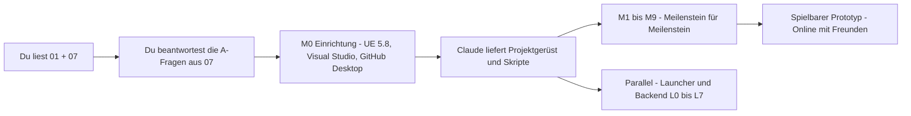

# How Could It Be You – Planungsdokumente

Stand: November 2026

Ein First-Person-Multiplayer-Horrorspiel für 4–8 Spieler in **Unreal Engine 5.8**. Eine Forscher-Crew sitzt auf einer dunklen Raumstation fest, und einer von ihnen ist **der Wandler**, ein Monster, das jeden lebenden Mitspieler kopieren kann. Inspiriert von *Among Us*, aber realistisch, dunkel und mit Proximity-Voice.

Dieser Ordner enthält die komplette Planung bis zum spielbaren Prototyp. Code gibt es noch keinen. Er folgt, sobald du die Planung freigegeben und die wichtigsten offenen Fragen beantwortet hast.

---

## Deine Wünsche und wo sie stehen

| Dein Wunsch | Dokument |
|---|---|
| 1. Kompaktes Game Design Document (Kern-Loop, Rollen, Spielmodi, Siegbedingungen, Maps) | [01 – Game Design Document](01-game-design-document.md). Die einseitige Kurzfassung steht ganz oben unter „Auf einen Blick“ |
| 2. Technische Architektur für UE5 (Replication, Formwandel, Kill und Jumpscare, Meeting und Voting, Intro-Cutscene) | [02 – Technische Architektur (UE 5.8)](02-technische-architektur-ue5.md) |
| Multiplayer und ehrliche Cloudflare-Bewertung (Teil von 2) | [03 – Multiplayer, Voice & Backend](03-multiplayer-und-backend.md) |
| Qualität und Spielbarkeit: nichts blockiert, keine Hänger, saubere Kollision, Tests (Teil von 2) | [04 – Qualität, Spielfluss & Tests](04-qualitaet-und-tests.md) |
| 3. Launcher mit Update-System (Architektur und Umsetzungsplan) | [05 – Launcher & Update-System](05-launcher-und-updates.md) |
| 4. Roadmap bis zum spielbaren Prototyp, mit Prioritäten, für Einsteiger | [06 – Roadmap](06-roadmap.md) |
| 5. Offene Design-Fragen | [07 – Offene Design-Fragen](07-offene-fragen.md), mit Checkliste zum Ausfüllen am Ende |
| Quellen | [Quellen der Recherche](quellen.md) |

## Was schon entschieden ist

Diese Punkte hast du in den Rückfragen festgelegt. Alle Dokumente bauen darauf auf.

| Thema | Entscheidung | Folge |
|---|---|---|
| Arbeitsteilung | **Claude schreibt den gesamten Code**: C++, Configs, Launcher, Backend, Skripte, CI. **Du** baust im Editor Maps und Assets, legst kleine Blueprint-Kindklassen an (nur Assets zuweisen), erstellst die Cutscene, kompilierst und testest | Spiellogik in C++ und Text-Configs, damit Claude sie lesen und ändern kann. Blueprints sind nur dünne „Asset-Hüllen“. Jeder Schritt kommt mit einer Anleitung für dich |
| Engine | **UE 5.8** (seit Juni 2026, laut Epic die letzte große UE5-Version) | MegaLights ist produktionsreif, Lumen und Nanite sind stabil. Das Projekt entsteht aus der Vorlage *First Person → Survival Horror* |
| Server | **Listen-Server**, 0 € Hosting | Ein Spieler hostet. **Epic Online Services (EOS)** verbindet die PCs kostenlos, inklusive NAT-Traversal und Relay |
| Voice | **Proximity-Voice** in der Runde, alle hören sich im Meeting | Eigenes Voice-System, das der Host über die Spielverbindung weiterleitet. Kostet 0 €, Geister sprechen nur mit Geistern, und keine Sprecheranzeige verrät das Monster |
| Cloudflare | Für Updates und Backend, **nicht** für den Spielverkehr | R2 hostet die Patches, ein Worker übernimmt Versions-Check, News und Crash-Reports. Später kommen Lobby und Matchmaking als Durable Object dazu. Begründung in [03](03-multiplayer-und-backend.md) §2 |
| Launcher | Eigener Launcher, **Tauri 2**, Patches über einen Chunk-Store auf R2 | Es werden nur geänderte Daten geladen, signiert und mit Fortschrittsanzeige. GitHub Actions baut den Launcher, du musst ihn nie selbst kompilieren |

## Empfohlene Lesereihenfolge

1. **[01 – „Auf einen Blick“](01-game-design-document.md#auf-einen-blick)** (5 Minuten): Was für ein Spiel entsteht.
2. **[07 – Offene Fragen](07-offene-fragen.md)**: Die A-Fragen bestimmen, was zuerst gebaut wird. Am Ende steht eine Checkliste, die du ausfüllen und an Claude zurückschicken kannst. Fragen ohne Antwort setzt Claude mit dem genannten Default um.
3. **[06 – Roadmap](06-roadmap.md)**, vor allem §1 (Zusammenarbeit) und Meilenstein **M0 – Einrichtung**: Das ist dein erster konkreter Arbeitsschritt.
4. Der Rest bei Bedarf, als Nachschlagewerk: 02 und 03, wenn du verstehen willst, wie etwas funktioniert. 04 vor dem ersten Map-Bau (Maße!). 05, wenn der Launcher drankommt.

## Wie es weitergeht



Der Prototyp umfasst: Greybox-Map Kepler-7, Modus „Infiltration“, 4–8 Spieler online über EOS mit Join-Code, Rollen, Aufgaben, Kill mit Jumpscare, Geister, Meetings mit Abstimmung, Formwandel, Stromausfall-Sabotage und Proximity-Voice. Die genaue Definition steht in [06](06-roadmap.md) §2.

## Geplante Repo-Struktur

```text
/docs                 diese Planungsdokumente
/Game                 UE-5.8-Projekt (HowCouldItBeYou.uproject, Source/, Config/, Content/, Plugins/)
/Launcher             Tauri-Launcher + Rust-Workspace (crates/hcpatch, crates/hcpublish, src-tauri, ui)
/Backend              Cloudflare Worker (TypeScript), später Durable Objects
/Tools                Windows-Skripte für dich: Build.bat, RunTests.bat, Publish.bat, CollectLogs.bat, SetupEOS.bat
/.github/workflows    CI: Launcher bauen und veröffentlichen, Worker deployen, Rust- und TS-Tests
```

## Ehrliche Grenzen dieser Planung

- **Recherche-Stand:** Fakten zu UE 5.8, EOS, Cloudflare, Tauri und GitHub wurden im November 2026 recherchiert. Einige Seiten (u. a. dev.epicgames.com und das Unreal-Forum) waren aus Claudes Umgebung nicht direkt abrufbar und wurden über Suchergebnisse und Spiegel geprüft. Solche Stellen sind in den Dokumenten mit „(beim Umsetzen gegen UE 5.8 prüfen)“ markiert.
- **Kompilieren:** Claude kann Unreal in seiner Cloud-Umgebung nicht starten. Den C++-Code kompilierst du auf deinem PC. Deshalb arbeiten wir in kleinen Schritten, mit Testanleitung zu jedem Push und automatischen Tests (`Tools/RunTests.bat`), deren Ergebnis du an Claude zurückgibst.
- **Zahlen sind Startwerte.** Abklingzeiten, Reichweiten und Timer stehen später in einer Text-Config und werden nach den ersten Playtests angepasst.
- **Kein Rechtsrat:** Datenschutz, Impressum, Altersfreigabe und Lizenzen sind in [07](07-offene-fragen.md) als Fragen aufgeführt und sollten vor einer Veröffentlichung fachkundig geprüft werden.

## Wichtigste Quellen

- Unreal Engine 5.8: [Release-Ankündigung](https://www.unrealengine.com/news/unreal-engine-5-8-is-now-available) · [Release Notes](https://dev.epicgames.com/documentation/unreal-engine/unreal-engine-5-8-release-notes) · [Hardware- und Software-Anforderungen](https://dev.epicgames.com/documentation/unreal-engine/hardware-and-software-specifications-for-unreal-engine)
- Epic Online Services: [Online Subsystem EOS](https://dev.epicgames.com/documentation/en-us/unreal-engine/online-subsystem-eos-plugin-in-unreal-engine) · [Lyra mit EOS](https://dev.epicgames.com/documentation/en-us/unreal-engine/using-lyra-with-epic-online-services-in-unreal-engine) · [Iris (bewusst nicht genutzt)](https://dev.epicgames.com/documentation/en-us/unreal-engine/introduction-to-iris-in-unreal-engine)
- Cloudflare: [Workers-Limits](https://developers.cloudflare.com/workers/platform/limits/) · [Durable-Objects-Preise](https://developers.cloudflare.com/durable-objects/platform/pricing/) · [DO und WebSockets](https://developers.cloudflare.com/durable-objects/best-practices/websockets/) · [R2-Preise](https://developers.cloudflare.com/r2/pricing/) · [R2 Public Buckets](https://developers.cloudflare.com/r2/buckets/public-buckets/) · [Spectrum-Protokolle je Tarif](https://developers.cloudflare.com/spectrum/protocols-per-plan/) · [Containers-Preise](https://developers.cloudflare.com/containers/platform/pricing/)
- Launcher: [Tauri-Updater](https://v2.tauri.app/plugin/updater/) · [Tauri-Windows-Installer](https://v2.tauri.app/distribute/windows-installer/) · [Tauri mit GitHub Actions](https://v2.tauri.app/distribute/pipelines/github/) · [SmartScreen-Reputation](https://learn.microsoft.com/windows/apps/package-and-deploy/smartscreen-reputation)
- GitHub: [Git-LFS-Abrechnung](https://docs.github.com/en/billing/concepts/product-billing/git-lfs) · [GitHub-hosted Runner](https://docs.github.com/en/actions/reference/runners/github-hosted-runners)

Alle rund 340 geprüften Quellen, nach Thema sortiert: [Quellen der Recherche](quellen.md).
